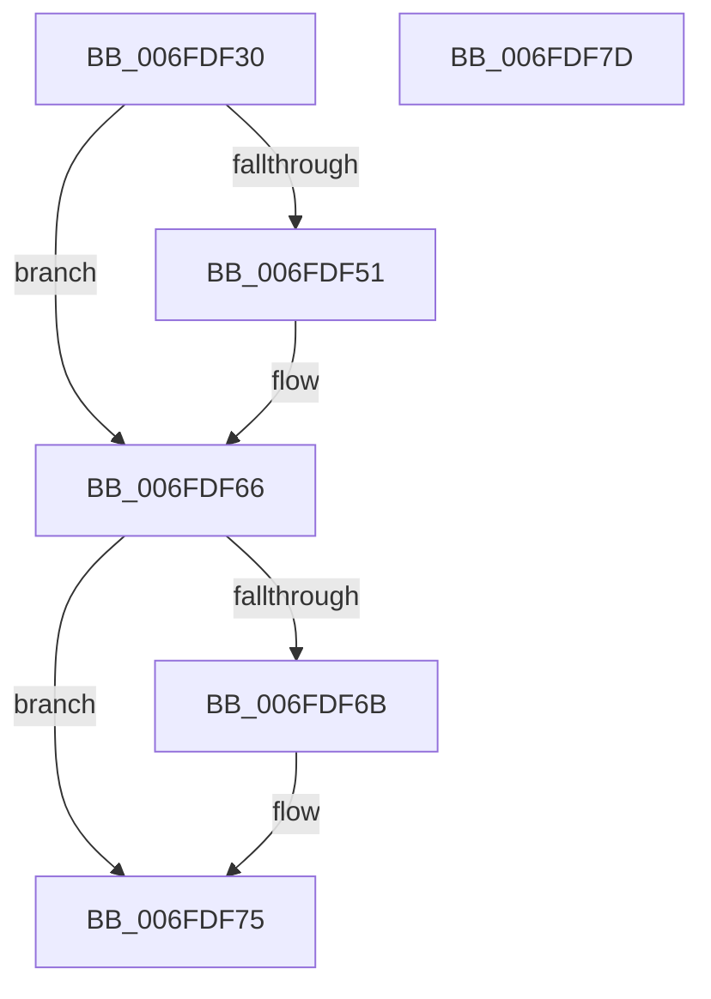

# PiUEventIsProcessFrozen

- RVA: `0x006FDF30`–`0x006FDF7E` (길이 `78` bytes)
- VA: `0x00000001406FDF30`
- 실행 섹션: `PAGE`
- PDB 이름 있음: `예`; PDB Function 태그: `아니요`
- unwind 정보 RVA: `0x0005CF00`
- 디코드: `23`개 명령, `78/78` bytes 표시
- 미해석 바이트: `0` (있으면 어셈블리에 `.byte`로 보존)

> 이 문서는 커널 이미지의 기계어와 PDB 기호를 분석해 생성했습니다. 4번과 5번은 함수 원형과 자료형을 바이너리 사용 방식에서 추정한 C 해석이며 원본 소스 복구 결과는 아닙니다.

## 1. Dependencies

- 직접 호출 지점: **2**; 고유 호출 대상: **2**
- 직접 호출자로 확인된 함수: **1**
- RIP 상대 이미지 참조: **0**

### Outgoing calls
- `0x006FDF43` → [PsLookupProcessByProcessId](../8A/PsLookupProcessByProcessId_function_008A2AA0.md) (function, `0x008A2AA0`)
- `0x006FDF70` → [ObfDereferenceObjectWithTag](../../text/2F/ObfDereferenceObjectWithTag_function_002F78E0.md) (function, `0x002F78E0`)

### Direct callers
- [PiUEventIsClientStuck](../AB/PiUEventIsClientStuck_function_00AB4E6C.md) at `0x00AB4ECC`

### Static image references
- 디코드된 RIP-relative 메모리 참조가 없습니다.

## 2. Other-region calls and transfers

- 다른 실행 섹션으로 향하는 call: **1**
  - `0x006FDF70` → [ObfDereferenceObjectWithTag](../../text/2F/ObfDereferenceObjectWithTag_function_002F78E0.md) (`PAGE` → `.text`)
- 별도 외부 분기/꼬리 이동을 확인하지 못했습니다.

## 3. Assembly (complete function range)

```asm
006FDF30  40 53                           push rbx
006FDF32  48 83 EC 20                     sub rsp, 0x20
006FDF36  48 83 64 24 38 00               and qword ptr [rsp + 0x38], 0
006FDF3C  48 8D 54 24 38                  lea rdx, [rsp + 0x38]
006FDF41  32 DB                           xor bl, bl
006FDF43  E8 58 4B 1A 00                  call 0x1408a2aa0
006FDF48  48 8B 4C 24 38                  mov rcx, qword ptr [rsp + 0x38]
006FDF4D  85 C0                           test eax, eax
006FDF4F  78 15                           js 0x1406fdf66
006FDF51  8B 81 88 00 00 00               mov eax, dword ptr [rcx + 0x88]
006FDF57  C1 E8 03                        shr eax, 3
006FDF5A  83 E0 01                        and eax, 1
006FDF5D  03 81 50 01 00 00               add eax, dword ptr [rcx + 0x150]
006FDF63  0F 95 C3                        setne bl
006FDF66  48 85 C9                        test rcx, rcx
006FDF69  74 0A                           je 0x1406fdf75
006FDF6B  BA 44 66 6C 74                  mov edx, 0x746c6644
006FDF70  E8 6B 99 BF FF                  call 0x1402f78e0
006FDF75  8A C3                           mov al, bl
006FDF77  48 83 C4 20                     add rsp, 0x20
006FDF7B  5B                              pop rbx
006FDF7C  C3                              ret
006FDF7D  CC                              int3
```

## 4. C-style interpretation (structured pseudocode)

```c
__int64 __fastcall PiUEventIsProcessFrozen(void)
{
    __int64 result;
    __int64 v_rbx;
    __int64 v_rsp;
    unsigned __int64 v_stack_p10;

    v_rsp = (v_rsp) - (32);
    v_rbx = 0;
    result = PsLookupProcessByProcessId(a1, v_stack_p10, a3, a4);
    if (!(sign_flag)) {
        result = *(unsigned int *)(v_stack_p10 + 136);
        result = (unsigned int)((result) >> (3));
        result = (unsigned int)((result) & (1));
        result = (unsigned int)((result) + (*(unsigned int *)(v_stack_p10 + 336)));
        v_rbx = (condition_is_not_equal) ? 1 : 0;
    }
    if (v_stack_p10 != 0) {
        a2 = 0x746C6644ULL;
        result = ObfDereferenceObjectWithTag(v_stack_p10, a2, a3, a4);
    }
    v_rsp = (v_rsp) + (32);
    return (unsigned __int8)(v_rbx);
}
```

## 5. (Beta) C Style

```c
void PiUEventIsProcessFrozen(void)
{
    int64_t result;
    int64_t local_rbx;
    int64_t local_rsp;
    uint64_t v_stack_p10;

    local_rsp = (local_rsp) - (32);
    local_rbx = 0;
    result = PsLookupProcessByProcessId(a1, v_stack_p10, a3, a4);
    if (!(sign_flag)) {
        result = *(uint32_t *)(v_stack_p10 + 0x88);
        result = (uint32_t)((result) >> (3));
        result = (uint32_t)((result) & (1));
        result = (uint32_t)((result) + (*(uint32_t *)(v_stack_p10 + 0x150)));
        local_rbx = (condition_is_not_equal) ? 1 : 0;
    }
    if (v_stack_p10 != 0) {
        a2 = 0x746C6644ULL;
        result = ObfDereferenceObjectWithTag(v_stack_p10, a2, a3, a4);
    }
    local_rsp = (local_rsp) + (32);
    return (uint8_t)(local_rbx);
}
```

## 6. Execution-region graph

[열기: 2D/3D 그래프와 함수 탐색 컨트롤 패널](../../../control-panel.html?section=page&rva=0x006FDF30&view=graph)

- 2D 그래프는 위에서 아래로 흐르고, 3D 그래프는 빈 공간을 드래그해 회전합니다. Shift+드래그는 이동, 휠은 확대·축소, 함수 노드 선택은 대상 보고서 이동입니다.

### Static fallback


