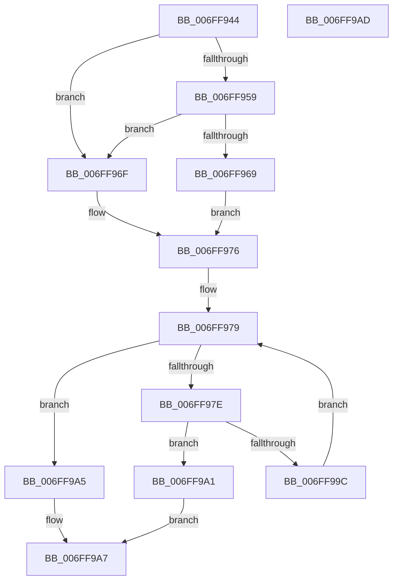

# PipCheckIfAllProvidersHaveDevnodes

- RVA: `0x006FF944`–`0x006FF9AE` (길이 `106` bytes)
- VA: `0x00000001406FF944`
- 실행 섹션: `PAGE`
- PDB 이름 있음: `예`; PDB Function 태그: `아니요`
- unwind 정보 RVA: `0x0005CF00`
- 디코드: `33`개 명령, `106/106` bytes 표시
- 미해석 바이트: `0` (있으면 어셈블리에 `.byte`로 보존)

> 이 문서는 커널 이미지의 기계어와 PDB 기호를 분석해 생성했습니다. 4번과 5번은 함수 원형과 자료형을 바이너리 사용 방식에서 추정한 C 해석이며 원본 소스 복구 결과는 아닙니다.

## 1. Dependencies

- 직접 호출 지점: **2**; 고유 호출 대상: **2**
- 직접 호출자로 확인된 함수: **1**
- RIP 상대 이미지 참조: **1**

### Outgoing calls
- `0x006FF989` → [PiEnumerateProviderListEntry](../72/PiEnumerateProviderListEntry_function_007277E4.md) (function, `0x007277E4`)
- `0x006FF993` → [PipIsDeviceReadyForPowerRelations](../A0/PipIsDeviceReadyForPowerRelations_function_00A071EC.md) (function, `0x00A071EC`)

### Direct callers
- [PipProcessRebuildPowerRelationsQueue](../A0/PipProcessRebuildPowerRelationsQueue_function_00A06844.md) at `0x00A068B9`

### Static image references
- `0x006FF96F` → RVA `0x00F8CE70` (`.data`; read)

## 2. Other-region calls and transfers

- 다른 실행 섹션으로 향하는 call: **0**
- 별도 외부 분기/꼬리 이동을 확인하지 못했습니다.

## 3. Assembly (complete function range)

```asm
006FF944  40 53                           push rbx
006FF946  48 83 EC 20                     sub rsp, 0x20
006FF94A  48 83 64 24 30 00               and qword ptr [rsp + 0x30], 0
006FF950  48 8B 41 30                     mov rax, qword ptr [rcx + 0x30]
006FF954  48 85 C0                        test rax, rax
006FF957  74 16                           je 0x1406ff96f
006FF959  48 8B 80 38 01 00 00            mov rax, qword ptr [rax + 0x138]
006FF960  48 8B 58 50                     mov rbx, qword ptr [rax + 0x50]
006FF964  48 85 DB                        test rbx, rbx
006FF967  74 06                           je 0x1406ff96f
006FF969  48 83 C3 10                     add rbx, 0x10
006FF96D  EB 07                           jmp 0x1406ff976
006FF96F  48 8D 1D FA D4 88 00            lea rbx, [rip + 0x88d4fa]
006FF976  4C 8B 1B                        mov r11, qword ptr [rbx]
006FF979  4C 3B DB                        cmp r11, rbx
006FF97C  74 27                           je 0x1406ff9a5
006FF97E  45 33 C0                        xor r8d, r8d
006FF981  48 8D 54 24 30                  lea rdx, [rsp + 0x30]
006FF986  49 8B CB                        mov rcx, r11
006FF989  E8 56 7E 02 00                  call 0x1407277e4
006FF98E  48 8B 4C 24 30                  mov rcx, qword ptr [rsp + 0x30]
006FF993  E8 54 78 30 00                  call 0x140a071ec
006FF998  84 C0                           test al, al
006FF99A  74 05                           je 0x1406ff9a1
006FF99C  4D 8B 1B                        mov r11, qword ptr [r11]
006FF99F  EB D8                           jmp 0x1406ff979
006FF9A1  32 C0                           xor al, al
006FF9A3  EB 02                           jmp 0x1406ff9a7
006FF9A5  B0 01                           mov al, 1
006FF9A7  48 83 C4 20                     add rsp, 0x20
006FF9AB  5B                              pop rbx
006FF9AC  C3                              ret
006FF9AD  CC                              int3
```

## 4. C-style interpretation (structured pseudocode)

```c
__int64 __fastcall PipCheckIfAllProvidersHaveDevnodes(__int64 a1, __int64 a2, int a3)
{
    __int64 result;
    __int64 v_rbx;
    __int64 v_rsp;
    unsigned __int64 v_stack_p8;

    v_rsp = (v_rsp) - (32);
    if (*(unsigned __int64 *)(a1 + 48) == 0) goto loc_006FF96F;
    if (*(unsigned __int64 *)(*(unsigned __int64 *)(*(unsigned __int64 *)(a1 + 48) + 312) + 80) == 0) goto loc_006FF96F;
    v_rbx = (*(unsigned __int64 *)(*(unsigned __int64 *)(*(unsigned __int64 *)(a1 + 48) + 312) + 80)) + (16);
    goto loc_006FF976;
loc_006FF96F:
loc_006FF976:
loc_006FF979:
    if ((*(unsigned __int64 *)(v_rip + 8967418)) == (v_rip + 8967418)) goto loc_006FF9A5;
    a3 = 0;
    result = PiEnumerateProviderListEntry(*(unsigned __int64 *)(v_rip + 8967418), v_stack_p8, a3, a4);
    result = PipIsDeviceReadyForPowerRelations(v_stack_p8, v_stack_p8, a3, a4);
    if ((unsigned __int8)(result) == 0) goto loc_006FF9A1;
    goto loc_006FF979;
loc_006FF9A1:
    result = 0;
    goto loc_006FF9A7;
loc_006FF9A5:
loc_006FF9A7:
    v_rsp = (v_rsp) + (32);
    return 1;
}
```

## 5. (Beta) C Style

```c
int64_t PipCheckIfAllProvidersHaveDevnodes(void *Arg1, int64_t Arg2, int32_t Arg3)
{
    uint8_t *arg1 = (uint8_t *)Arg1;

    int64_t result;
    int64_t local_rbx;
    int64_t local_rsp;
    uint64_t v_stack_p8;

    local_rsp = (local_rsp) - (32);
    if (*(uint64_t *)(arg1 + 0x30) == 0) goto loc_006FF96F;
    if (*(uint64_t *)(*(uint64_t *)(*(uint64_t *)(arg1 + 0x30) + 0x138) + 0x50) == 0) goto loc_006FF96F;
    local_rbx = (*(uint64_t *)(*(uint64_t *)(*(uint64_t *)(arg1 + 0x30) + 0x138) + 0x50)) + (16);
    goto loc_006FF976;
loc_006FF96F:
loc_006FF976:
loc_006FF979:
    if ((*(uint64_t *)(v_rip + 0x88D4FA)) == (v_rip + 8967418)) goto loc_006FF9A5;
    Arg3 = 0;
    result = PiEnumerateProviderListEntry(*(uint64_t *)(v_rip + 0x88D4FA), v_stack_p8, Arg3, a4);
    result = PipIsDeviceReadyForPowerRelations(v_stack_p8, v_stack_p8, Arg3, a4);
    if ((uint8_t)(result) == 0) goto loc_006FF9A1;
    goto loc_006FF979;
loc_006FF9A1:
    result = 0;
    goto loc_006FF9A7;
loc_006FF9A5:
loc_006FF9A7:
    local_rsp = (local_rsp) + (32);
    return 1;
}
```

### 관측된 메모리 오프셋

구조체 형식이 확인되지 않은 접근은 인자 기준의 오프셋으로만 기록했습니다.

| 기준 인자 | 오프셋 표현 | 폭 (bit) | 접근 |
|---|---:|---:|---|
| `Arg1` | `+ 0x30` | `64` | `R` |

## 6. Execution-region graph

[열기: 2D/3D 그래프와 함수 탐색 컨트롤 패널](../../../control-panel.html?section=page&rva=0x006FF944&view=graph)

- 2D 그래프는 위에서 아래로 흐르고, 3D 그래프는 빈 공간을 드래그해 회전합니다. Shift+드래그는 이동, 휠은 확대·축소, 함수 노드 선택은 대상 보고서 이동입니다.

### Static fallback


