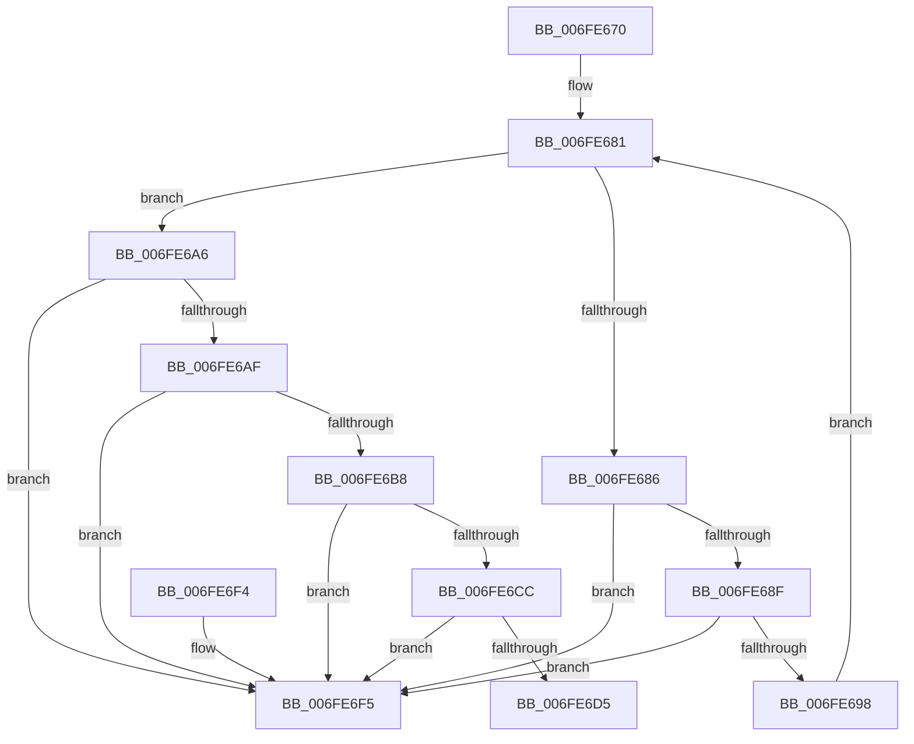

# PipDeleteDependencyNode

- RVA: `0x006FE670`–`0x006FE6FC` (길이 `140` bytes)
- VA: `0x00000001406FE670`
- 실행 섹션: `PAGE`
- PDB 이름 있음: `예`; PDB Function 태그: `아니요`
- unwind 정보 RVA: `0x0006CF28`
- 디코드: `44`개 명령, `140/140` bytes 표시
- 미해석 바이트: `0` (있으면 어셈블리에 `.byte`로 보존)

> 이 문서는 커널 이미지의 기계어와 PDB 기호를 분석해 생성했습니다. 4번과 5번은 함수 원형과 자료형을 바이너리 사용 방식에서 추정한 C 해석이며 원본 소스 복구 결과는 아닙니다.

## 1. Dependencies

- 직접 호출 지점: **2**; 고유 호출 대상: **2**
- 직접 호출자로 확인된 함수: **2**
- RIP 상대 이미지 참조: **0**

### Outgoing calls
- `0x006FE69F` → [PipFreeBindingId](../AB/PipFreeBindingId_function_00AB657C.md) (function, `0x00AB657C`)
- `0x006FE6E4` → [ExFreePoolWithTag](../../poolcode/B8/ExFreePoolWithTag_function_00B82870.md) (function, `0x00B82870`)

### Direct callers
- [PipCreateDependencyNode](../72/PipCreateDependencyNode_function_00727B0C.md) at `0x00727BDB`
- [PipDereferenceDependencyNode](../AC/PipDereferenceDependencyNode_function_00ACD5A0.md) at `0x00ACD5AA`

### Static image references
- 디코드된 RIP-relative 메모리 참조가 없습니다.

## 2. Other-region calls and transfers

- 다른 실행 섹션으로 향하는 call: **1**
  - `0x006FE6E4` → [ExFreePoolWithTag](../../poolcode/B8/ExFreePoolWithTag_function_00B82870.md) (`PAGE` → `POOLCODE`)
- 별도 외부 분기/꼬리 이동을 확인하지 못했습니다.

## 3. Assembly (complete function range)

```asm
006FE670  48 89 5C 24 08                  mov qword ptr [rsp + 8], rbx
006FE675  57                              push rdi
006FE676  48 83 EC 20                     sub rsp, 0x20
006FE67A  48 8B D9                        mov rbx, rcx
006FE67D  48 8D 79 38                     lea rdi, [rcx + 0x38]
006FE681  48 39 3F                        cmp qword ptr [rdi], rdi
006FE684  74 20                           je 0x1406fe6a6
006FE686  48 8B 4F 08                     mov rcx, qword ptr [rdi + 8]
006FE68A  48 39 39                        cmp qword ptr [rcx], rdi
006FE68D  75 66                           jne 0x1406fe6f5
006FE68F  48 8B 41 08                     mov rax, qword ptr [rcx + 8]
006FE693  48 39 08                        cmp qword ptr [rax], rcx
006FE696  75 5D                           jne 0x1406fe6f5
006FE698  48 89 47 08                     mov qword ptr [rdi + 8], rax
006FE69C  48 89 38                        mov qword ptr [rax], rdi
006FE69F  E8 D8 7E 3B 00                  call 0x140ab657c
006FE6A4  EB DB                           jmp 0x1406fe681
006FE6A6  48 8B 0B                        mov rcx, qword ptr [rbx]
006FE6A9  48 39 59 08                     cmp qword ptr [rcx + 8], rbx
006FE6AD  75 46                           jne 0x1406fe6f5
006FE6AF  48 8B 43 08                     mov rax, qword ptr [rbx + 8]
006FE6B3  48 39 18                        cmp qword ptr [rax], rbx
006FE6B6  75 3D                           jne 0x1406fe6f5
006FE6B8  48 89 08                        mov qword ptr [rax], rcx
006FE6BB  48 89 41 08                     mov qword ptr [rcx + 8], rax
006FE6BF  48 8D 43 48                     lea rax, [rbx + 0x48]
006FE6C3  48 8B 10                        mov rdx, qword ptr [rax]
006FE6C6  48 39 42 08                     cmp qword ptr [rdx + 8], rax
006FE6CA  75 29                           jne 0x1406fe6f5
006FE6CC  48 8B 48 08                     mov rcx, qword ptr [rax + 8]
006FE6D0  48 39 01                        cmp qword ptr [rcx], rax
006FE6D3  75 20                           jne 0x1406fe6f5
006FE6D5  48 89 11                        mov qword ptr [rcx], rdx
006FE6D8  48 89 4A 08                     mov qword ptr [rdx + 8], rcx
006FE6DC  BA 50 6E 70 53                  mov edx, 0x53706e50
006FE6E1  48 8B CB                        mov rcx, rbx
006FE6E4  E8 87 41 48 00                  call 0x140b82870
006FE6E9  48 8B 5C 24 30                  mov rbx, qword ptr [rsp + 0x30]
006FE6EE  48 83 C4 20                     add rsp, 0x20
006FE6F2  5F                              pop rdi
006FE6F3  C3                              ret
006FE6F4  CC                              int3
006FE6F5  B9 03 00 00 00                  mov ecx, 3
006FE6FA  CD 29                           int 0x29
```

## 4. C-style interpretation (structured pseudocode)

```c
__int64 __fastcall PipDeleteDependencyNode(__int64 a1)
{
    __int64 result;
    __int64 v_rsp;
    unsigned __int64 v_stack_p8;

    v_stack_p8 = v_rbx;
    v_rsp = (v_rsp) - (32);
loc_006FE681:
    if ((*(unsigned __int64 *)(a1 + 56)) == (a1 + 56)) goto loc_006FE6A6;
    if ((*(unsigned __int64 *)(*(unsigned __int64 *)(a1 + 56 + 8))) != (a1 + 56)) goto loc_006FE6F5;
    if ((*(unsigned __int64 *)(*(unsigned __int64 *)(*(unsigned __int64 *)(a1 + 56 + 8) + 8))) != (*(unsigned __int64 *)(a1 + 56 + 8))) goto loc_006FE6F5;
    *(unsigned __int64 *)(a1 + 56 + 8) = *(unsigned __int64 *)(*(unsigned __int64 *)(a1 + 56 + 8) + 8);
    *(unsigned __int64 *)(*(unsigned __int64 *)(*(unsigned __int64 *)(a1 + 56 + 8) + 8)) = a1 + 56;
    result = PipFreeBindingId(*(unsigned __int64 *)(a1 + 56 + 8), a2, a3, a4);
    goto loc_006FE681;
loc_006FE6A6:
    if ((*(unsigned __int64 *)(*(unsigned __int64 *)(a1) + 8)) != a1) goto loc_006FE6F5;
    if ((*(unsigned __int64 *)(*(unsigned __int64 *)(a1 + 8))) != a1) goto loc_006FE6F5;
    *(unsigned __int64 *)(*(unsigned __int64 *)(a1 + 8)) = *(unsigned __int64 *)(a1);
    *(unsigned __int64 *)(*(unsigned __int64 *)(a1) + 8) = *(unsigned __int64 *)(a1 + 8);
    if ((*(unsigned __int64 *)(*(unsigned __int64 *)(a1 + 72) + 8)) != (a1 + 72)) goto loc_006FE6F5;
    if ((*(unsigned __int64 *)(*(unsigned __int64 *)(a1 + 72 + 8))) != (a1 + 72)) goto loc_006FE6F5;
    *(unsigned __int64 *)(*(unsigned __int64 *)(a1 + 72 + 8)) = *(unsigned __int64 *)(a1 + 72);
    *(unsigned __int64 *)(*(unsigned __int64 *)(a1 + 72) + 8) = *(unsigned __int64 *)(a1 + 72 + 8);
    result = ExFreePoolWithTag(a1, (unsigned int)(0x53706E50ULL), a3, a4);
    v_rsp = (v_rsp) + (32);
    return result;
loc_006FE6F5:
    return result;
}
```

## 5. (Beta) C Style

```c
int64_t PipDeleteDependencyNode(void *Arg1)
{
    uint8_t *arg1 = (uint8_t *)Arg1;

    int64_t result;
    int64_t local_rsp;
    uint64_t v_stack_p8;

    v_stack_p8 = local_rbx;
    local_rsp = (local_rsp) - (32);
loc_006FE681:
    if ((*(uint64_t *)(arg1 + 0x38)) == (Arg1 + 56)) goto loc_006FE6A6;
    if ((*(uint64_t *)(*(uint64_t *)(arg1 + 0x38 + 0x8))) != (Arg1 + 56)) goto loc_006FE6F5;
    if ((*(uint64_t *)(*(uint64_t *)(*(uint64_t *)(arg1 + 0x38 + 0x8) + 0x8))) != (*(uint64_t *)(arg1 + 0x38 + 0x8))) goto loc_006FE6F5;
    *(uint64_t *)(arg1 + 0x38 + 0x8) = *(uint64_t *)(*(uint64_t *)(arg1 + 0x38 + 0x8) + 0x8);
    *(void **)(*(uint64_t *)(*(uint64_t *)(arg1 + 0x38 + 0x8) + 0x8)) = Arg1 + 56;
    result = PipFreeBindingId(*(uint64_t *)(arg1 + 0x38 + 0x8), a2, a3, a4);
    goto loc_006FE681;
loc_006FE6A6:
    if ((*(uint64_t *)(*(uint64_t *)(arg1) + 0x8)) != Arg1) goto loc_006FE6F5;
    if ((*(uint64_t *)(*(uint64_t *)(arg1 + 0x8))) != Arg1) goto loc_006FE6F5;
    *(uint64_t *)(*(uint64_t *)(arg1 + 0x8)) = *(uint64_t *)(arg1);
    *(uint64_t *)(*(uint64_t *)(arg1) + 0x8) = *(uint64_t *)(arg1 + 0x8);
    if ((*(uint64_t *)(*(uint64_t *)(arg1 + 0x48) + 0x8)) != (Arg1 + 72)) goto loc_006FE6F5;
    if ((*(uint64_t *)(*(uint64_t *)(arg1 + 0x48 + 0x8))) != (Arg1 + 72)) goto loc_006FE6F5;
    *(uint64_t *)(*(uint64_t *)(arg1 + 0x48 + 0x8)) = *(uint64_t *)(arg1 + 0x48);
    *(uint64_t *)(*(uint64_t *)(arg1 + 0x48) + 0x8) = *(uint64_t *)(arg1 + 0x48 + 0x8);
    result = ExFreePoolWithTag(Arg1, (uint32_t)(0x53706E50ULL), a3, a4);
    local_rsp = (local_rsp) + (32);
    return result;
loc_006FE6F5:
    return result;
}
```

### 관측된 메모리 오프셋

구조체 형식이 확인되지 않은 접근은 인자 기준의 오프셋으로만 기록했습니다.

| 기준 인자 | 오프셋 표현 | 폭 (bit) | 접근 |
|---|---:|---:|---|
| `Arg1` | `+ 0x0` | `64` | `R` |
| `Arg1` | `+ 0x8` | `64` | `R` |
| `Arg1` | `+ 0x8` | `64` | `W` |
| `Arg1` | `+ 0x38` | `64` | `R` |
| `Arg1` | `+ 0x48` | `64` | `R` |

## 6. Execution-region graph

[열기: 2D/3D 그래프와 함수 탐색 컨트롤 패널](../../../control-panel.html?section=page&rva=0x006FE670&view=graph)

- 2D 그래프는 위에서 아래로 흐르고, 3D 그래프는 빈 공간을 드래그해 회전합니다. Shift+드래그는 이동, 휠은 확대·축소, 함수 노드 선택은 대상 보고서 이동입니다.

### Static fallback


