# PopAdaptiveStandbyHandleBatteryUpdate

- RVA: `0x006FD39C`–`0x006FD80D` (길이 `1,137` bytes)
- VA: `0x00000001406FD39C`
- 실행 섹션: `PAGE`
- PDB 이름 있음: `예`; PDB Function 태그: `아니요`
- unwind 정보 RVA: `0x000BC354`
- 디코드: `268`개 명령, `1,137/1,137` bytes 표시
- 미해석 바이트: `0` (있으면 어셈블리에 `.byte`로 보존)

> 이 문서는 커널 이미지의 기계어와 PDB 기호를 분석해 생성했습니다. 4번과 5번은 함수 원형과 자료형을 바이너리 사용 방식에서 추정한 C 해석이며 원본 소스 복구 결과는 아닙니다.

## 1. Dependencies

- 직접 호출 지점: **23**; 고유 호출 대상: **12**
- 직접 호출자로 확인된 함수: **3**
- RIP 상대 이미지 참조: **6**

### Outgoing calls
- `0x006FD3F4` → [Feature_AdaptiveHibernateEnhancements__private_IsEnabledDeviceUsageNoInline](../../text/4F/Feature_AdaptiveHibernateEnhancements__private_IsEnabledDeviceUsageNoInline_function_004F78F0.md) (function, `0x004F78F0`)
- `0x006FD49B` → [IoGetActivityIdThread](../../text/44/IoGetActivityIdThread_function_00445030.md) (function, `0x00445030`)
- `0x006FD4C6` → [tlgWriteTransfer_EtwWriteTransfer](../../text/42/tlgWriteTransfer_EtwWriteTransfer_function_004260E0.md) (function, `0x004260E0`)
- `0x006FD506` → [PopAdaptiveStandbySessionStop](../76/PopAdaptiveStandbySessionStop_function_0076EC94.md) (function, `0x0076EC94`)
- `0x006FD512` → [PopAdaptiveStandbySessionStart](../76/PopAdaptiveStandbySessionStart_function_0076E8C8.md) (function, `0x0076E8C8`)
- `0x006FD52B` → [PopAdaptiveStandbySessionStop](../76/PopAdaptiveStandbySessionStop_function_0076EC94.md) (function, `0x0076EC94`)
- `0x006FD536` → [PopAdaptiveStandbySessionStart](../76/PopAdaptiveStandbySessionStart_function_0076E8C8.md) (function, `0x0076E8C8`)
- `0x006FD5B5` → [Feature_AdaptiveHibernateEnhancements__private_IsEnabledDeviceUsageNoInline](../../text/4F/Feature_AdaptiveHibernateEnhancements__private_IsEnabledDeviceUsageNoInline_function_004F78F0.md) (function, `0x004F78F0`)
- `0x006FD5D4` → [PopAdaptiveStandbyCheckRestrictedStandbyBudgetAction](../76/PopAdaptiveStandbyCheckRestrictedStandbyBudgetAction_function_0076D5C4.md) (function, `0x0076D5C4`)
- `0x006FD625` → [PopAdaptiveStandbyCheckHibernateBudgetAction](../76/PopAdaptiveStandbyCheckHibernateBudgetAction_function_0076CB54.md) (function, `0x0076CB54`)
- `0x006FD644` → [PopAdaptiveStandbyCalculateBatteryRegion](../76/PopAdaptiveStandbyCalculateBatteryRegion_function_0076CB28.md) (function, `0x0076CB28`)
- `0x006FD684` → [PopAdaptiveStandbyCheckRestrictedStandbyBudgetAction](../76/PopAdaptiveStandbyCheckRestrictedStandbyBudgetAction_function_0076D5C4.md) (function, `0x0076D5C4`)
- `0x006FD6A6` → [PopAdaptiveStandbyCheckHibernateReserveAction](../76/PopAdaptiveStandbyCheckHibernateReserveAction_function_0076D180.md) (function, `0x0076D180`)
- `0x006FD6C4` → [PopAdaptiveStandbyCheckHibernateBudgetAction](../76/PopAdaptiveStandbyCheckHibernateBudgetAction_function_0076CB54.md) (function, `0x0076CB54`)
- `0x006FD6FA` → [Feature_AdaptiveHibernateEnhancements__private_IsEnabledDeviceUsageNoInline](../../text/4F/Feature_AdaptiveHibernateEnhancements__private_IsEnabledDeviceUsageNoInline_function_004F78F0.md) (function, `0x004F78F0`)
- `0x006FD724` → [IoGetActivityIdThread](../../text/44/IoGetActivityIdThread_function_00445030.md) (function, `0x00445030`)
- `0x006FD74E` → [tlgWriteTransfer_EtwWriteTransfer](../../text/42/tlgWriteTransfer_EtwWriteTransfer_function_004260E0.md) (function, `0x004260E0`)
- `0x006FD764` → [ExQueueWorkItem](../../text/2F/ExQueueWorkItem_function_002F9520.md) (function, `0x002F9520`)
- `0x006FD784` → [PopAdaptiveStandbyTraceBatteryUpdate](../76/PopAdaptiveStandbyTraceBatteryUpdate_function_0076EF7C.md) (function, `0x0076EF7C`)
- `0x006FD7A7` → [IoGetActivityIdThread](../../text/44/IoGetActivityIdThread_function_00445030.md) (function, `0x00445030`)
- `0x006FD7CE` → [tlgWriteTransfer_EtwWriteTransfer](../../text/42/tlgWriteTransfer_EtwWriteTransfer_function_004260E0.md) (function, `0x004260E0`)
- `0x006FD7DA` → [_security_check_cookie](../../text/6A/_security_check_cookie_function_006AC640.md) (function, `0x006AC640`)
- `0x006FD7FB` → [Feature_AdaptiveHibernateEnhancements__private_IsEnabledDeviceUsageNoInline](../../text/4F/Feature_AdaptiveHibernateEnhancements__private_IsEnabledDeviceUsageNoInline_function_004F78F0.md) (function, `0x004F78F0`)

### Direct callers
- [PopAdaptiveStandbyPolicyTimerWorker](../76/PopAdaptiveStandbyPolicyTimerWorker_function_0076E410.md) at `0x0076E4B5`
- [PopAdaptiveStandbySessionStart](../76/PopAdaptiveStandbySessionStart_function_0076E8C8.md) at `0x0076E997`
- [PopAdaptiveStandbyWnfCallback](../76/PopAdaptiveStandbyWnfCallback_function_0076F910.md) at `0x0076FC49`

### Static image references
- `0x006FD3B8` → RVA `0x00E0A740` (`.data`; read)
- `0x006FD413` → RVA `0x00E082E8` (`.data`; read)
- `0x006FD4A3` → RVA `0x0004F577` (`.rdata`; read)
- `0x006FD652` → RVA `0x00E0C3F0` (`.data`; read)
- `0x006FD72C` → RVA `0x0004F071` (`.rdata`; read)
- `0x006FD7AF` → RVA `0x0004F0A3` (`.rdata`; read)

## 2. Other-region calls and transfers

- 다른 실행 섹션으로 향하는 call: **12**
  - `0x006FD3F4` → [Feature_AdaptiveHibernateEnhancements__private_IsEnabledDeviceUsageNoInline](../../text/4F/Feature_AdaptiveHibernateEnhancements__private_IsEnabledDeviceUsageNoInline_function_004F78F0.md) (`PAGE` → `.text`)
  - `0x006FD49B` → [IoGetActivityIdThread](../../text/44/IoGetActivityIdThread_function_00445030.md) (`PAGE` → `.text`)
  - `0x006FD4C6` → [tlgWriteTransfer_EtwWriteTransfer](../../text/42/tlgWriteTransfer_EtwWriteTransfer_function_004260E0.md) (`PAGE` → `.text`)
  - `0x006FD5B5` → [Feature_AdaptiveHibernateEnhancements__private_IsEnabledDeviceUsageNoInline](../../text/4F/Feature_AdaptiveHibernateEnhancements__private_IsEnabledDeviceUsageNoInline_function_004F78F0.md) (`PAGE` → `.text`)
  - `0x006FD6FA` → [Feature_AdaptiveHibernateEnhancements__private_IsEnabledDeviceUsageNoInline](../../text/4F/Feature_AdaptiveHibernateEnhancements__private_IsEnabledDeviceUsageNoInline_function_004F78F0.md) (`PAGE` → `.text`)
  - `0x006FD724` → [IoGetActivityIdThread](../../text/44/IoGetActivityIdThread_function_00445030.md) (`PAGE` → `.text`)
  - `0x006FD74E` → [tlgWriteTransfer_EtwWriteTransfer](../../text/42/tlgWriteTransfer_EtwWriteTransfer_function_004260E0.md) (`PAGE` → `.text`)
  - `0x006FD764` → [ExQueueWorkItem](../../text/2F/ExQueueWorkItem_function_002F9520.md) (`PAGE` → `.text`)
  - `0x006FD7A7` → [IoGetActivityIdThread](../../text/44/IoGetActivityIdThread_function_00445030.md) (`PAGE` → `.text`)
  - `0x006FD7CE` → [tlgWriteTransfer_EtwWriteTransfer](../../text/42/tlgWriteTransfer_EtwWriteTransfer_function_004260E0.md) (`PAGE` → `.text`)
  - `0x006FD7DA` → [_security_check_cookie](../../text/6A/_security_check_cookie_function_006AC640.md) (`PAGE` → `.text`)
  - `0x006FD7FB` → [Feature_AdaptiveHibernateEnhancements__private_IsEnabledDeviceUsageNoInline](../../text/4F/Feature_AdaptiveHibernateEnhancements__private_IsEnabledDeviceUsageNoInline_function_004F78F0.md) (`PAGE` → `.text`)
- 별도 외부 분기/꼬리 이동을 확인하지 못했습니다.

## 3. Assembly (complete function range)

```asm
006FD39C  48 89 5C 24 18                  mov qword ptr [rsp + 0x18], rbx
006FD3A1  55                              push rbp
006FD3A2  56                              push rsi
006FD3A3  57                              push rdi
006FD3A4  41 54                           push r12
006FD3A6  41 55                           push r13
006FD3A8  41 56                           push r14
006FD3AA  41 57                           push r15
006FD3AC  48 8D 6C 24 E0                  lea rbp, [rsp - 0x20]
006FD3B1  48 81 EC 20 01 00 00            sub rsp, 0x120
006FD3B8  48 8B 05 81 D3 70 00            mov rax, qword ptr [rip + 0x70d381]
006FD3BF  48 33 C4                        xor rax, rsp
006FD3C2  48 89 45 10                     mov qword ptr [rbp + 0x10], rax
006FD3C6  45 33 FF                        xor r15d, r15d
006FD3C9  0F 57 C0                        xorps xmm0, xmm0
006FD3CC  33 C0                           xor eax, eax
006FD3CE  44 89 7C 24 3C                  mov dword ptr [rsp + 0x3c], r15d
006FD3D3  48 89 44 24 68                  mov qword ptr [rsp + 0x68], rax
006FD3D8  4C 8B F2                        mov r14, rdx
006FD3DB  48 8B D9                        mov rbx, rcx
006FD3DE  44 89 7C 24 38                  mov dword ptr [rsp + 0x38], r15d
006FD3E3  44 89 7C 24 48                  mov dword ptr [rsp + 0x48], r15d
006FD3E8  0F 11 44 24 58                  movups xmmword ptr [rsp + 0x58], xmm0
006FD3ED  48 8D B1 88 00 00 00            lea rsi, [rcx + 0x88]
006FD3F4  E8 F7 A4 DF FF                  call 0x1404f78f0
006FD3F9  45 8D 67 01                     lea r12d, [r15 + 1]
006FD3FD  85 C0                           test eax, eax
006FD3FF  0F 85 C8 00 00 00               jne 0x1406fd4cd
006FD405  41 0F 10 06                     movups xmm0, xmmword ptr [r14]
006FD409  0F 11 06                        movups xmmword ptr [rsi], xmm0
006FD40C  41 8B 46 10                     mov eax, dword ptr [r14 + 0x10]
006FD410  89 46 10                        mov dword ptr [rsi + 0x10], eax
006FD413  83 3D CE AE 70 00 05            cmp dword ptr [rip + 0x70aece], 5
006FD41A  0F 86 B0 00 00 00               jbe 0x1406fd4d0
006FD420  41 8A 06                        mov al, byte ptr [r14]
006FD423  41 22 C4                        and al, r12b
006FD426  4C 89 65 98                     mov qword ptr [rbp - 0x68], r12
006FD42A  88 44 24 30                     mov byte ptr [rsp + 0x30], al
006FD42E  48 8D 44 24 30                  lea rax, [rsp + 0x30]
006FD433  48 89 45 90                     mov qword ptr [rbp - 0x70], rax
006FD437  41 8B 46 04                     mov eax, dword ptr [r14 + 4]
006FD43B  89 44 24 34                     mov dword ptr [rsp + 0x34], eax
006FD43F  48 8D 44 24 34                  lea rax, [rsp + 0x34]
006FD444  48 89 45 A0                     mov qword ptr [rbp - 0x60], rax
006FD448  41 8B 46 08                     mov eax, dword ptr [r14 + 8]
006FD44C  89 44 24 4C                     mov dword ptr [rsp + 0x4c], eax
006FD450  48 8D 44 24 4C                  lea rax, [rsp + 0x4c]
006FD455  48 89 45 B0                     mov qword ptr [rbp - 0x50], rax
006FD459  41 8B 46 0C                     mov eax, dword ptr [r14 + 0xc]
006FD45D  89 44 24 50                     mov dword ptr [rsp + 0x50], eax
006FD461  48 8D 44 24 50                  lea rax, [rsp + 0x50]
006FD466  48 89 45 C0                     mov qword ptr [rbp - 0x40], rax
006FD46A  41 8B 46 10                     mov eax, dword ptr [r14 + 0x10]
006FD46E  89 44 24 40                     mov dword ptr [rsp + 0x40], eax
006FD472  48 8D 44 24 40                  lea rax, [rsp + 0x40]
006FD477  48 89 45 D0                     mov qword ptr [rbp - 0x30], rax
006FD47B  48 C7 45 A8 04 00 00 00         mov qword ptr [rbp - 0x58], 4
006FD483  48 C7 45 B8 04 00 00 00         mov qword ptr [rbp - 0x48], 4
006FD48B  48 C7 45 C8 04 00 00 00         mov qword ptr [rbp - 0x38], 4
006FD493  48 C7 45 D8 04 00 00 00         mov qword ptr [rbp - 0x28], 4
006FD49B  E8 90 7B D4 FF                  call 0x140445030
006FD4A0  4C 8B C0                        mov r8, rax
006FD4A3  48 8D 15 CD 20 95 FF            lea rdx, [rip - 0x6adf33]
006FD4AA  48 8D 44 24 70                  lea rax, [rsp + 0x70]
006FD4AF  45 33 C9                        xor r9d, r9d
006FD4B2  48 89 44 24 28                  mov qword ptr [rsp + 0x28], rax
006FD4B7  48 8D 0D 2A AE 70 00            lea rcx, [rip + 0x70ae2a]
006FD4BE  C7 44 24 20 07 00 00 00         mov dword ptr [rsp + 0x20], 7
006FD4C6  E8 15 8C D2 FF                  call 0x1404260e0
006FD4CB  EB 03                           jmp 0x1406fd4d0
006FD4CD  4C 8B F6                        mov r14, rsi
006FD4D0  41 8B FF                        mov edi, r15d
006FD4D3  44 89 7C 24 34                  mov dword ptr [rsp + 0x34], r15d
006FD4D8  41 BD 03 00 00 00               mov r13d, 3
006FD4DE  44 89 7C 24 44                  mov dword ptr [rsp + 0x44], r15d
006FD4E3  4C 39 BB C8 00 00 00            cmp qword ptr [rbx + 0xc8], r15
006FD4EA  0F 84 99 02 00 00               je 0x1406fd789
006FD4F0  8B 8B B0 00 00 00               mov ecx, dword ptr [rbx + 0xb0]
006FD4F6  41 8D 45 FF                     lea eax, [r13 - 1]
006FD4FA  33 0E                           xor ecx, dword ptr [rsi]
006FD4FC  41 84 CC                        test r12b, cl
006FD4FF  74 16                           je 0x1406fd517
006FD501  8B D0                           mov edx, eax
006FD503  48 8B CB                        mov rcx, rbx
006FD506  E8 89 17 07 00                  call 0x14076ec94
006FD50B  41 8D 55 FF                     lea edx, [r13 - 1]
006FD50F  48 8B CB                        mov rcx, rbx
006FD512  E8 B1 13 07 00                  call 0x14076e8c8
006FD517  8B 83 B4 00 00 00               mov eax, dword ptr [rbx + 0xb4]
006FD51D  39 83 8C 00 00 00               cmp dword ptr [rbx + 0x8c], eax
006FD523  74 16                           je 0x1406fd53b
006FD525  41 8B D5                        mov edx, r13d
006FD528  48 8B CB                        mov rcx, rbx
006FD52B  E8 64 17 07 00                  call 0x14076ec94
006FD530  41 8B D5                        mov edx, r13d
006FD533  48 8B CB                        mov rcx, rbx
006FD536  E8 8D 13 07 00                  call 0x14076e8c8
006FD53B  8B 06                           mov eax, dword ptr [rsi]
006FD53D  41 84 C4                        test r12b, al
006FD540  0F 85 43 02 00 00               jne 0x1406fd789
006FD546  48 B9 08 00 00 00 80 F7 FF FF   movabs rcx, 0xfffff78000000008
006FD550  44 89 7C 24 5C                  mov dword ptr [rsp + 0x5c], r15d
006FD555  44 89 7C 24 6C                  mov dword ptr [rsp + 0x6c], r15d
006FD55A  48 B8 BD 42 7A E5 D5 94 BF D6   movabs rax, 0xd6bf94d5e57a42bd
006FD564  41 BD FF FF FF FF               mov r13d, 0xffffffff
006FD56A  48 8B 09                        mov rcx, qword ptr [rcx]
006FD56D  48 F7 E1                        mul rcx
006FD570  48 8B F2                        mov rsi, rdx
006FD573  48 C1 EE 17                     shr rsi, 0x17
006FD577  48 8B C6                        mov rax, rsi
006FD57A  8B FE                           mov edi, esi
006FD57C  48 2B 83 C8 00 00 00            sub rax, qword ptr [rbx + 0xc8]
006FD583  49 3B C5                        cmp rax, r13
006FD586  76 07                           jbe 0x1406fd58f
006FD588  44 89 6C 24 58                  mov dword ptr [rsp + 0x58], r13d
006FD58D  EB 0C                           jmp 0x1406fd59b
006FD58F  8B C6                           mov eax, esi
006FD591  2B 83 C8 00 00 00               sub eax, dword ptr [rbx + 0xc8]
006FD597  89 44 24 58                     mov dword ptr [rsp + 0x58], eax
006FD59B  8B 8B C0 00 00 00               mov ecx, dword ptr [rbx + 0xc0]
006FD5A1  8B 83 98 00 00 00               mov eax, dword ptr [rbx + 0x98]
006FD5A7  89 4C 24 60                     mov dword ptr [rsp + 0x60], ecx
006FD5AB  2B C8                           sub ecx, eax
006FD5AD  89 4C 24 68                     mov dword ptr [rsp + 0x68], ecx
006FD5B1  89 44 24 64                     mov dword ptr [rsp + 0x64], eax
006FD5B5  E8 36 A3 DF FF                  call 0x1404f78f0
006FD5BA  4C 8D 44 24 3C                  lea r8, [rsp + 0x3c]
006FD5BF  48 8B CB                        mov rcx, rbx
006FD5C2  48 8D 54 24 58                  lea rdx, [rsp + 0x58]
006FD5C7  85 C0                           test eax, eax
006FD5C9  0F 84 B2 00 00 00               je 0x1406fd681
006FD5CF  4C 8D 4C 24 34                  lea r9, [rsp + 0x34]
006FD5D4  E8 EB FF 06 00                  call 0x14076d5c4
006FD5D9  8B 83 E8 00 00 00               mov eax, dword ptr [rbx + 0xe8]
006FD5DF  2B 44 24 64                     sub eax, dword ptr [rsp + 0x64]
006FD5E3  89 44 24 6C                     mov dword ptr [rsp + 0x6c], eax
006FD5E7  48 8B C6                        mov rax, rsi
006FD5EA  48 2B 83 E0 00 00 00            sub rax, qword ptr [rbx + 0xe0]
006FD5F1  49 3B C5                        cmp rax, r13
006FD5F4  76 07                           jbe 0x1406fd5fd
006FD5F6  44 89 6C 24 5C                  mov dword ptr [rsp + 0x5c], r13d
006FD5FB  EB 0A                           jmp 0x1406fd607
006FD5FD  2B BB E0 00 00 00               sub edi, dword ptr [rbx + 0xe0]
006FD603  89 7C 24 5C                     mov dword ptr [rsp + 0x5c], edi
006FD607  8B 83 DC 00 00 00               mov eax, dword ptr [rbx + 0xdc]
006FD60D  4C 8D 4C 24 44                  lea r9, [rsp + 0x44]
006FD612  4C 8D 44 24 38                  lea r8, [rsp + 0x38]
006FD617  89 83 D8 00 00 00               mov dword ptr [rbx + 0xd8], eax
006FD61D  48 8D 54 24 58                  lea rdx, [rsp + 0x58]
006FD622  48 8B CB                        mov rcx, rbx
006FD625  E8 2A F5 06 00                  call 0x14076cb54
006FD62A  8B 7C 24 34                     mov edi, dword ptr [rsp + 0x34]
006FD62E  84 C0                           test al, al
006FD630  44 8B 44 24 64                  mov r8d, dword ptr [rsp + 0x64]
006FD635  41 8B C8                        mov ecx, r8d
006FD638  0F 45 7C 24 44                  cmovne edi, dword ptr [rsp + 0x44]
006FD63D  4C 63 8B D8 00 00 00            movsxd r9, dword ptr [rbx + 0xd8]
006FD644  E8 DF F4 06 00                  call 0x14076cb28
006FD649  41 3B C1                        cmp eax, r9d
006FD64C  74 28                           je 0x1406fd676
006FD64E  4B 8D 0C 89                     lea rcx, [r9 + r9*4]
006FD652  48 8D 15 97 ED 70 00            lea rdx, [rip + 0x70ed97]
006FD659  8B 0C 8A                        mov ecx, dword ptr [rdx + rcx*4]
006FD65C  39 4C 24 6C                     cmp dword ptr [rsp + 0x6c], ecx
006FD660  7C 14                           jl 0x1406fd676
006FD662  44 89 83 E8 00 00 00            mov dword ptr [rbx + 0xe8], r8d
006FD669  89 83 DC 00 00 00               mov dword ptr [rbx + 0xdc], eax
006FD66F  48 89 B3 E0 00 00 00            mov qword ptr [rbx + 0xe0], rsi
006FD676  BE 05 00 00 00                  mov esi, 5
006FD67B  44 8D 6E FE                     lea r13d, [rsi - 2]
006FD67F  EB 52                           jmp 0x1406fd6d3
006FD681  45 33 C9                        xor r9d, r9d
006FD684  E8 3B FF 06 00                  call 0x14076d5c4
006FD689  8B 7C 24 34                     mov edi, dword ptr [rsp + 0x34]
006FD68D  4C 8D 44 24 48                  lea r8, [rsp + 0x48]
006FD692  84 C0                           test al, al
006FD694  48 8D 54 24 58                  lea rdx, [rsp + 0x58]
006FD699  41 BD 03 00 00 00               mov r13d, 3
006FD69F  48 8B CB                        mov rcx, rbx
006FD6A2  41 0F 45 FD                     cmovne edi, r13d
006FD6A6  E8 D5 FA 06 00                  call 0x14076d180
006FD6AB  84 C0                           test al, al
006FD6AD  4C 8D 44 24 38                  lea r8, [rsp + 0x38]
006FD6B2  41 8D 45 FF                     lea eax, [r13 - 1]
006FD6B6  48 8B CB                        mov rcx, rbx
006FD6B9  0F 45 F8                        cmovne edi, eax
006FD6BC  48 8D 54 24 58                  lea rdx, [rsp + 0x58]
006FD6C1  45 33 C9                        xor r9d, r9d
006FD6C4  E8 8B F4 06 00                  call 0x14076cb54
006FD6C9  8B 74 24 48                     mov esi, dword ptr [rsp + 0x48]
006FD6CD  84 C0                           test al, al
006FD6CF  41 0F 45 FC                     cmovne edi, r12d
006FD6D3  85 FF                           test edi, edi
006FD6D5  0F 84 8E 00 00 00               je 0x1406fd769
006FD6DB  8B CF                           mov ecx, edi
006FD6DD  41 2B CC                        sub ecx, r12d
006FD6E0  74 2A                           je 0x1406fd70c
006FD6E2  41 2B CC                        sub ecx, r12d
006FD6E5  74 25                           je 0x1406fd70c
006FD6E7  41 2B CC                        sub ecx, r12d
006FD6EA  74 17                           je 0x1406fd703
006FD6EC  41 2B CC                        sub ecx, r12d
006FD6EF  0F 84 06 01 00 00               je 0x1406fd7fb
006FD6F5  41 3B CC                        cmp ecx, r12d
006FD6F8  75 18                           jne 0x1406fd712
006FD6FA  E8 F1 A1 DF FF                  call 0x1404f78f0
006FD6FF  85 C0                           test eax, eax
006FD701  74 0F                           je 0x1406fd712
006FD703  44 39 BB 2C 02 00 00            cmp dword ptr [rbx + 0x22c], r15d
006FD70A  75 06                           jne 0x1406fd712
006FD70C  89 BB 2C 02 00 00               mov dword ptr [rbx + 0x22c], edi
006FD712  44 38 BB 28 02 00 00            cmp byte ptr [rbx + 0x228], r15b
006FD719  75 4E                           jne 0x1406fd769
006FD71B  83 3D C6 AB 70 00 05            cmp dword ptr [rip + 0x70abc6], 5
006FD722  76 2F                           jbe 0x1406fd753
006FD724  E8 07 79 D4 FF                  call 0x140445030
006FD729  4C 8B C0                        mov r8, rax
006FD72C  48 8D 15 3E 19 95 FF            lea rdx, [rip - 0x6ae6c2]
006FD733  48 8D 45 E0                     lea rax, [rbp - 0x20]
006FD737  45 33 C9                        xor r9d, r9d
006FD73A  48 89 44 24 28                  mov qword ptr [rsp + 0x28], rax
006FD73F  48 8D 0D A2 AB 70 00            lea rcx, [rip + 0x70aba2]
006FD746  C7 44 24 20 02 00 00 00         mov dword ptr [rsp + 0x20], 2
006FD74E  E8 8D 89 D2 FF                  call 0x1404260e0
006FD753  48 8D 8B 08 02 00 00            lea rcx, [rbx + 0x208]
006FD75A  44 88 A3 28 02 00 00            mov byte ptr [rbx + 0x228], r12b
006FD761  41 8B D4                        mov edx, r12d
006FD764  E8 B7 BD BF FF                  call 0x1402f9520
006FD769  44 01 A3 EC 00 00 00            add dword ptr [rbx + 0xec], r12d
006FD770  49 8B D6                        mov rdx, r14
006FD773  44 8B 4C 24 38                  mov r9d, dword ptr [rsp + 0x38]
006FD778  48 8B CB                        mov rcx, rbx
006FD77B  44 8B 44 24 3C                  mov r8d, dword ptr [rsp + 0x3c]
006FD780  89 74 24 20                     mov dword ptr [rsp + 0x20], esi
006FD784  E8 F3 17 07 00                  call 0x14076ef7c
006FD789  83 3D 58 AB 70 00 05            cmp dword ptr [rip + 0x70ab58], 5
006FD790  76 41                           jbe 0x1406fd7d3
006FD792  48 8D 44 24 40                  lea rax, [rsp + 0x40]
006FD797  89 7C 24 40                     mov dword ptr [rsp + 0x40], edi
006FD79B  48 89 45 00                     mov qword ptr [rbp], rax
006FD79F  48 C7 45 08 04 00 00 00         mov qword ptr [rbp + 8], 4
006FD7A7  E8 84 78 D4 FF                  call 0x140445030
006FD7AC  4C 8B C0                        mov r8, rax
006FD7AF  48 8D 15 ED 18 95 FF            lea rdx, [rip - 0x6ae713]
006FD7B6  48 8D 45 E0                     lea rax, [rbp - 0x20]
006FD7BA  45 33 C9                        xor r9d, r9d
006FD7BD  48 89 44 24 28                  mov qword ptr [rsp + 0x28], rax
006FD7C2  48 8D 0D 1F AB 70 00            lea rcx, [rip + 0x70ab1f]
006FD7C9  44 89 6C 24 20                  mov dword ptr [rsp + 0x20], r13d
006FD7CE  E8 0D 89 D2 FF                  call 0x1404260e0
006FD7D3  48 8B 4D 10                     mov rcx, qword ptr [rbp + 0x10]
006FD7D7  48 33 CC                        xor rcx, rsp
006FD7DA  E8 61 EE FA FF                  call 0x1406ac640
006FD7DF  48 8B 9C 24 70 01 00 00         mov rbx, qword ptr [rsp + 0x170]
006FD7E7  48 81 C4 20 01 00 00            add rsp, 0x120
006FD7EE  41 5F                           pop r15
006FD7F0  41 5E                           pop r14
006FD7F2  41 5D                           pop r13
006FD7F4  41 5C                           pop r12
006FD7F6  5F                              pop rdi
006FD7F7  5E                              pop rsi
006FD7F8  5D                              pop rbp
006FD7F9  C3                              ret
006FD7FA  CC                              int3
006FD7FB  E8 F0 A0 DF FF                  call 0x1404f78f0
006FD800  85 C0                           test eax, eax
006FD802  0F 84 0A FF FF FF               je 0x1406fd712
006FD808  E9 FF FE FF FF                  jmp 0x1406fd70c
```

## 4. C-style interpretation (structured pseudocode)

```c
__int64 __fastcall PopAdaptiveStandbyHandleBatteryUpdate(__int64 a1, __int64 a2, __int64 a3, int a4)
{
    __int64 result;
    __int64 v_r15;
    __int64 v_rdi;
    __int64 v_rsi;
    __int64 v_rsp;
    unsigned __int64 v_stack_m100;
    unsigned int v_stack_m108;
    unsigned int v_stack_m10C;
    unsigned int v_stack_m110;
    unsigned int v_stack_m114;
    unsigned int v_stack_m118;
    unsigned int v_stack_m11C;
    unsigned int v_stack_m120;
    unsigned int v_stack_m124;
    unsigned __int8 v_stack_m128;
    unsigned __int64 v_stack_m130;
    unsigned int v_stack_m138;
    unsigned __int64 v_stack_m48;
    unsigned __int64 v_stack_m50;
    unsigned __int64 v_stack_m58;
    unsigned __int64 v_stack_m78;
    unsigned __int64 v_stack_m80;
    unsigned __int64 v_stack_m88;
    unsigned __int64 v_stack_m90;
    unsigned __int64 v_stack_m98;
    unsigned __int64 v_stack_mA0;
    unsigned __int64 v_stack_mA8;
    unsigned __int64 v_stack_mB0;
    unsigned __int64 v_stack_mB8;
    unsigned __int64 v_stack_mC0;
    unsigned __int64 v_stack_mC8;
    unsigned __int64 v_stack_mE8;
    unsigned int v_stack_mEC;
    unsigned __int64 v_stack_mF0;
    unsigned int v_stack_mF4;
    unsigned int v_stack_mF8;
    unsigned int v_stack_mFC;
    unsigned __int64 v_stack_p18;

    v_stack_p18 = v_rbx;
    v_rsp = (v_rsp) - (288);
    result = (*(unsigned __int64 *)(v_rip + 7394177)) ^ (v_rsp);
    v_stack_m48 = result;
    v_r15 = 0;
    result = 0;
    v_stack_m11C = 0;
    v_stack_mF0 = 0;
    v_stack_m120 = 0;
    v_stack_m110 = 0;
    v_stack_m100 = v_xmm0;
    result = Feature_AdaptiveHibernateEnhancements__private_IsEnabledDeviceUsageNoInline(a1, a2, a3, a4);
    if ((unsigned int)(result) != 0) goto loc_006FD4CD;
    *(unsigned __int64 *)(a1 + 136) = v_xmm0;
    *(unsigned int *)(a1 + 136 + 16) = (unsigned int)((unsigned int)(*(unsigned int *)(a2 + 16)));
    if ((*(unsigned int *)(v_rip + 7384782)) <= 5) goto loc_006FD4D0;
    result = (unsigned __int8)((*(unsigned __int8 *)(a2)) & ((unsigned __int8)(v_r15 + 1)));
    v_stack_mC0 = v_r15 + 1;
    v_stack_m128 = (unsigned __int8)(result);
    v_stack_mC8 = v_stack_m128;
    v_stack_m124 = (unsigned int)((unsigned int)(*(unsigned int *)(a2 + 4)));
    v_stack_mB8 = v_stack_m124;
    v_stack_m10C = (unsigned int)((unsigned int)(*(unsigned int *)(a2 + 8)));
    v_stack_mA8 = v_stack_m10C;
    v_stack_m108 = (unsigned int)((unsigned int)(*(unsigned int *)(a2 + 12)));
    v_stack_m98 = v_stack_m108;
    v_stack_m118 = (unsigned int)((unsigned int)(*(unsigned int *)(a2 + 16)));
    v_stack_m88 = v_stack_m118;
    v_stack_mB0 = 4;
    v_stack_mA0 = 4;
    v_stack_m90 = 4;
    v_stack_m80 = 4;
    result = IoGetActivityIdThread(a1, a2, a3, a4);
    a4 = 0;
    v_stack_m130 = v_stack_mE8;
    v_stack_m138 = 7;
    result = tlgWriteTransfer_EtwWriteTransfer(v_rip + 7384618, v_rip - 7003955, result, a4);
    goto loc_006FD4D0;
loc_006FD4CD:
loc_006FD4D0:
    v_stack_m124 = 0;
    v_stack_m114 = 0;
    if ((*(unsigned __int64 *)(a1 + 200)) == 0) goto loc_006FD789;
    a1 = (unsigned int)(((unsigned int)(*(unsigned int *)(a1 + 176))) ^ (*(unsigned int *)(a1 + 136)));
    result = 3 - 1;
    if ((((unsigned __int8)(v_r15 + 1)) & ((unsigned __int8)(a1))) != 0) {
        a2 = (unsigned int)(3 - 1);
        a1 = a1;
        result = PopAdaptiveStandbySessionStop(a1, a2, result, a4);
        a2 = 3 - 1;
        a1 = a1;
        result = PopAdaptiveStandbySessionStart(a1, a2, result, a4);
    }
    result = (unsigned int)(*(unsigned int *)(a1 + 180));
    if ((*(unsigned int *)(a1 + 140)) != ((unsigned int)((unsigned int)(*(unsigned int *)(a1 + 180))))) {
        a2 = 3;
        a1 = a1;
        result = PopAdaptiveStandbySessionStop(a1, a2, result, a4);
        a2 = 3;
        a1 = a1;
        result = PopAdaptiveStandbySessionStart(a1, a2, result, a4);
    }
    if ((((unsigned __int8)(v_r15 + 1)) & ((unsigned __int8)((unsigned int)(*(unsigned int *)(a1 + 136))))) != 0) goto loc_006FD789;
    v_stack_mFC = 0;
    v_stack_mEC = 0;
    v_rsi = (a2) >> (23);
    result = (v_rsi) - (*(unsigned __int64 *)(a1 + 200));
    if (result <= ((unsigned int)(0xFFFFFFFFULL))) goto loc_006FD58F;
    v_stack_m100 = (unsigned int)((unsigned int)(0xFFFFFFFFULL));
    goto loc_006FD59B;
loc_006FD58F:
    result = (unsigned int)(((unsigned int)((unsigned int)(v_rsi))) - (*(unsigned int *)(a1 + 200)));
    v_stack_m100 = (unsigned int)(result);
loc_006FD59B:
    v_stack_mF8 = (unsigned int)((unsigned int)(*(unsigned int *)(a1 + 192)));
    a1 = (unsigned int)(((unsigned int)(*(unsigned int *)(a1 + 192))) - ((unsigned int)((unsigned int)(*(unsigned int *)(a1 + 152)))));
    v_stack_mF0 = (unsigned int)(a1);
    v_stack_mF4 = (unsigned int)((unsigned int)(*(unsigned int *)(a1 + 152)));
    result = Feature_AdaptiveHibernateEnhancements__private_IsEnabledDeviceUsageNoInline(a1, a2, result, a4);
    if ((unsigned int)(result) == 0) goto loc_006FD681;
    result = PopAdaptiveStandbyCheckRestrictedStandbyBudgetAction(a1, v_stack_m100, v_stack_m11C, v_stack_m124);
    result = (unsigned int)(((unsigned int)(*(unsigned int *)(a1 + 232))) - (v_stack_mF4));
    v_stack_mEC = (unsigned int)(result);
    result = (v_rsi) - (*(unsigned __int64 *)(a1 + 224));
    if (result <= ((unsigned int)(0xFFFFFFFFULL))) goto loc_006FD5FD;
    v_stack_mFC = (unsigned int)((unsigned int)(0xFFFFFFFFULL));
    goto loc_006FD607;
loc_006FD5FD:
    v_rdi = (unsigned int)(((unsigned int)((unsigned int)(v_rsi))) - (*(unsigned int *)(a1 + 224)));
    v_stack_mFC = (unsigned int)(v_rdi);
loc_006FD607:
    *(unsigned int *)(a1 + 216) = (unsigned int)((unsigned int)(*(unsigned int *)(a1 + 220)));
    result = PopAdaptiveStandbyCheckHibernateBudgetAction(a1, v_stack_m100, v_stack_m120, v_stack_m114);
    v_rdi = (unsigned int)(v_stack_m124);
    if ((unsigned __int8)(result) != 0) { v_rdi = v_stack_m114; }
    result = PopAdaptiveStandbyCalculateBatteryRegion((unsigned int)((unsigned int)((unsigned int)(v_stack_mF4))), v_stack_m100, (unsigned int)(v_stack_mF4), (int)(*(unsigned int *)(a1 + 216)));
    if (((unsigned int)(result)) == ((unsigned int)((int)(*(unsigned int *)(a1 + 216))))) goto loc_006FD676;
    if (v_stack_mEC >= ((unsigned int)((unsigned int)(*(unsigned int *)(v_rip + 7400855 + (int)(*(unsigned int *)(a1 + 216)) + (int)(*(unsigned int *)(a1 + 216)) * 4 * 4))))) {
        *(unsigned int *)(a1 + 232) = (unsigned int)((unsigned int)(v_stack_mF4));
        *(unsigned int *)(a1 + 220) = (unsigned int)(result);
        *(unsigned __int64 *)(a1 + 224) = v_rsi;
    }
    goto loc_006FD6D3;
loc_006FD681:
    a4 = 0;
    result = PopAdaptiveStandbyCheckRestrictedStandbyBudgetAction((unsigned int)(*(unsigned int *)(v_rip + 7400855 + (int)(*(unsigned int *)(a1 + 216)) + (int)(*(unsigned int *)(a1 + 216)) * 4 * 4)), v_rip + 7400855, (unsigned int)(v_stack_mF4), a4);
    v_rdi = (unsigned int)(v_stack_m124);
    if ((unsigned __int8)(result) != 0) { v_rdi = 3; }
    result = PopAdaptiveStandbyCheckHibernateReserveAction(a1, v_stack_m100, v_stack_m110, a4);
    if ((unsigned __int8)(result) != 0) { v_rdi = (unsigned int)(3 - 1); }
    a4 = 0;
    result = PopAdaptiveStandbyCheckHibernateBudgetAction(a1, v_stack_m100, v_stack_m120, a4);
    if ((unsigned __int8)(result) != 0) { v_rdi = (unsigned int)(v_r15 + 1); }
loc_006FD6D3:
    if ((unsigned int)(v_rdi) == 0) goto loc_006FD769;
    a1 = (unsigned int)(((unsigned int)((unsigned int)(v_rdi))) - ((unsigned int)(v_r15 + 1)));
    if (condition_is_equal) goto loc_006FD70C;
    a1 = (unsigned int)((a1) - ((unsigned int)(v_r15 + 1)));
    if (condition_is_equal) goto loc_006FD70C;
    a1 = (unsigned int)((a1) - ((unsigned int)(v_r15 + 1)));
    if (condition_is_equal) goto loc_006FD703;
    a1 = (unsigned int)((a1) - ((unsigned int)(v_r15 + 1)));
    if (condition_is_equal) goto loc_006FD7FB;
    if (((unsigned int)(a1)) != ((unsigned int)(v_r15 + 1))) goto loc_006FD712;
    result = Feature_AdaptiveHibernateEnhancements__private_IsEnabledDeviceUsageNoInline(a1, v_stack_m100, v_stack_m120, a4);
    if ((unsigned int)(result) == 0) goto loc_006FD712;
loc_006FD703:
    if ((*(unsigned int *)(a1 + 556)) == 0) {
        *(unsigned int *)(a1 + 556) = (unsigned int)(v_rdi);
    }
    if ((*(unsigned __int8 *)(a1 + 552)) != 0) goto loc_006FD769;
    if ((*(unsigned int *)(v_rip + 7384006)) >= = 5) {
        result = IoGetActivityIdThread(a1, v_stack_m100, v_stack_m120, a4);
        a3 = result;
        a2 = v_rip - 7005890;
        result = v_stack_m78;
        a4 = 0;
        v_stack_m130 = result;
        a1 = v_rip + 7383970;
        v_stack_m138 = 2;
        result = tlgWriteTransfer_EtwWriteTransfer(a1, a2, a3, a4);
    }
    *(unsigned __int8 *)(a1 + 552) = (unsigned __int8)(v_r15 + 1);
    result = ExQueueWorkItem(a1 + 520, (unsigned int)((unsigned int)(v_r15 + 1)), a3, a4);
loc_006FD769:
    v_stack_m138 = (unsigned int)((unsigned int)(v_stack_m110));
    result = PopAdaptiveStandbyTraceBatteryUpdate(a1, a1 + 136, (unsigned int)(v_stack_m11C), (unsigned int)(v_stack_m120));
loc_006FD789:
    if ((*(unsigned int *)(v_rip + 7383896)) >= = 5) {
        result = v_stack_m118;
        v_stack_m118 = (unsigned int)(v_rdi);
        v_stack_m58 = result;
        v_stack_m50 = 4;
        result = IoGetActivityIdThread(a1, a1 + 136, (unsigned int)(v_stack_m11C), (unsigned int)(v_stack_m120));
        a3 = result;
        a2 = v_rip - 7005971;
        result = v_stack_m78;
        a4 = 0;
        v_stack_m130 = result;
        a1 = v_rip + 7383839;
        v_stack_m138 = 3;
        result = tlgWriteTransfer_EtwWriteTransfer(a1, a2, a3, a4);
    }
    a1 = (v_stack_m48) ^ (v_rsp);
    result = _security_check_cookie(a1, a2, a3, a4);
    v_rsp = (v_rsp) + (288);
    return result;
loc_006FD7FB:
    result = Feature_AdaptiveHibernateEnhancements__private_IsEnabledDeviceUsageNoInline(a1, a2, a3, a4);
    if ((unsigned int)(result) == 0) goto loc_006FD712;
    goto loc_006FD70C;
}
```

## 5. (Beta) C Style

```c
int64_t PopAdaptiveStandbyHandleBatteryUpdate(void *Arg1, void *Arg2, int64_t Arg3, int32_t Arg4)
{
    uint8_t *arg1 = (uint8_t *)Arg1;
    uint8_t *arg2 = (uint8_t *)Arg2;

    int64_t result;
    int64_t local_r15;
    int64_t local_rdi;
    int64_t local_rsi;
    int64_t local_rsp;
    uint64_t v_stack_m100;
    uint32_t v_stack_m108;
    uint32_t v_stack_m10C;
    uint32_t v_stack_m110;
    uint32_t v_stack_m114;
    uint32_t v_stack_m118;
    uint32_t v_stack_m11C;
    uint32_t v_stack_m120;
    uint32_t v_stack_m124;
    uint8_t v_stack_m128;
    uint64_t v_stack_m130;
    uint32_t v_stack_m138;
    uint64_t v_stack_m48;
    uint64_t v_stack_m50;
    uint64_t v_stack_m58;
    uint64_t v_stack_m78;
    uint64_t v_stack_m80;
    uint64_t v_stack_m88;
    uint64_t v_stack_m90;
    uint64_t v_stack_m98;
    uint64_t v_stack_mA0;
    uint64_t v_stack_mA8;
    uint64_t v_stack_mB0;
    uint64_t v_stack_mB8;
    uint64_t v_stack_mC0;
    uint64_t v_stack_mC8;
    uint64_t v_stack_mE8;
    uint32_t v_stack_mEC;
    uint64_t v_stack_mF0;
    uint32_t v_stack_mF4;
    uint32_t v_stack_mF8;
    uint32_t v_stack_mFC;
    uint64_t v_stack_p18;

    v_stack_p18 = local_rbx;
    local_rsp = (local_rsp) - (288);
    result = (*(uint64_t *)(v_rip + 0x70D381)) ^ (local_rsp);
    v_stack_m48 = result;
    local_r15 = 0;
    result = 0;
    v_stack_m11C = 0;
    v_stack_mF0 = 0;
    v_stack_m120 = 0;
    v_stack_m110 = 0;
    v_stack_m100 = v_xmm0;
    result = Feature_AdaptiveHibernateEnhancements__private_IsEnabledDeviceUsageNoInline(Arg1, Arg2, Arg3, Arg4);
    if ((uint32_t)(result) != 0) goto loc_006FD4CD;
    *(uint64_t *)(arg1 + 0x88) = v_xmm0;
    *(uint32_t *)(arg1 + 0x88 + 0x10) = (uint32_t)((uint32_t)(*(uint32_t *)(arg2 + 0x10)));
    if ((*(uint32_t *)(v_rip + 0x70AECE)) <= 5) goto loc_006FD4D0;
    result = (uint8_t)((*(uint8_t *)(arg2)) & ((uint8_t)(local_r15 + 1)));
    v_stack_mC0 = local_r15 + 1;
    v_stack_m128 = (uint8_t)(result);
    v_stack_mC8 = v_stack_m128;
    v_stack_m124 = (uint32_t)((uint32_t)(*(uint32_t *)(arg2 + 0x4)));
    v_stack_mB8 = v_stack_m124;
    v_stack_m10C = (uint32_t)((uint32_t)(*(uint32_t *)(arg2 + 0x8)));
    v_stack_mA8 = v_stack_m10C;
    v_stack_m108 = (uint32_t)((uint32_t)(*(uint32_t *)(arg2 + 0xC)));
    v_stack_m98 = v_stack_m108;
    v_stack_m118 = (uint32_t)((uint32_t)(*(uint32_t *)(arg2 + 0x10)));
    v_stack_m88 = v_stack_m118;
    v_stack_mB0 = 4;
    v_stack_mA0 = 4;
    v_stack_m90 = 4;
    v_stack_m80 = 4;
    result = IoGetActivityIdThread(Arg1, Arg2, Arg3, Arg4);
    Arg4 = 0;
    v_stack_m130 = v_stack_mE8;
    v_stack_m138 = 7;
    result = tlgWriteTransfer_EtwWriteTransfer(v_rip + 7384618, v_rip - 7003955, result, Arg4);
    goto loc_006FD4D0;
loc_006FD4CD:
loc_006FD4D0:
    v_stack_m124 = 0;
    v_stack_m114 = 0;
    if ((*(uint64_t *)(arg1 + 0xC8)) == 0) goto loc_006FD789;
    Arg1 = (uint32_t)(((uint32_t)(*(uint32_t *)(arg1 + 0xB0))) ^ (*(uint32_t *)(arg1 + 0x88)));
    result = 3 - 1;
    if ((((uint8_t)(local_r15 + 1)) & ((uint8_t)(Arg1))) != 0) {
        Arg2 = (uint32_t)(3 - 1);
        Arg1 = Arg1;
        result = PopAdaptiveStandbySessionStop(Arg1, Arg2, result, Arg4);
        Arg2 = 3 - 1;
        Arg1 = Arg1;
        result = PopAdaptiveStandbySessionStart(Arg1, Arg2, result, Arg4);
    }
    result = (uint32_t)(*(uint32_t *)(arg1 + 0xB4));
    if ((*(uint32_t *)(arg1 + 0x8C)) != ((uint32_t)((uint32_t)(*(uint32_t *)(arg1 + 0xB4))))) {
        Arg2 = 3;
        Arg1 = Arg1;
        result = PopAdaptiveStandbySessionStop(Arg1, Arg2, result, Arg4);
        Arg2 = 3;
        Arg1 = Arg1;
        result = PopAdaptiveStandbySessionStart(Arg1, Arg2, result, Arg4);
    }
    if ((((uint8_t)(local_r15 + 1)) & ((uint8_t)((uint32_t)(*(uint32_t *)(arg1 + 0x88))))) != 0) goto loc_006FD789;
    v_stack_mFC = 0;
    v_stack_mEC = 0;
    local_rsi = (Arg2) >> (23);
    result = (local_rsi) - (*(uint64_t *)(arg1 + 0xC8));
    if (result <= ((uint32_t)(0xFFFFFFFFULL))) goto loc_006FD58F;
    v_stack_m100 = (uint32_t)((uint32_t)(0xFFFFFFFFULL));
    goto loc_006FD59B;
loc_006FD58F:
    result = (uint32_t)(((uint32_t)((uint32_t)(local_rsi))) - (*(uint32_t *)(arg1 + 0xC8)));
    v_stack_m100 = (uint32_t)(result);
loc_006FD59B:
    v_stack_mF8 = (uint32_t)((uint32_t)(*(uint32_t *)(arg1 + 0xC0)));
    Arg1 = (uint32_t)(((uint32_t)(*(uint32_t *)(arg1 + 0xC0))) - ((uint32_t)((uint32_t)(*(uint32_t *)(arg1 + 0x98)))));
    v_stack_mF0 = (uint32_t)(Arg1);
    v_stack_mF4 = (uint32_t)((uint32_t)(*(uint32_t *)(arg1 + 0x98)));
    result = Feature_AdaptiveHibernateEnhancements__private_IsEnabledDeviceUsageNoInline(Arg1, Arg2, result, Arg4);
    if ((uint32_t)(result) == 0) goto loc_006FD681;
    result = PopAdaptiveStandbyCheckRestrictedStandbyBudgetAction(Arg1, v_stack_m100, v_stack_m11C, v_stack_m124);
    result = (uint32_t)(((uint32_t)(*(uint32_t *)(arg1 + 0xE8))) - (v_stack_mF4));
    v_stack_mEC = (uint32_t)(result);
    result = (local_rsi) - (*(uint64_t *)(arg1 + 0xE0));
    if (result <= ((uint32_t)(0xFFFFFFFFULL))) goto loc_006FD5FD;
    v_stack_mFC = (uint32_t)((uint32_t)(0xFFFFFFFFULL));
    goto loc_006FD607;
loc_006FD5FD:
    local_rdi = (uint32_t)(((uint32_t)((uint32_t)(local_rsi))) - (*(uint32_t *)(arg1 + 0xE0)));
    v_stack_mFC = (uint32_t)(local_rdi);
loc_006FD607:
    *(uint32_t *)(arg1 + 0xD8) = (uint32_t)((uint32_t)(*(uint32_t *)(arg1 + 0xDC)));
    result = PopAdaptiveStandbyCheckHibernateBudgetAction(Arg1, v_stack_m100, v_stack_m120, v_stack_m114);
    local_rdi = (uint32_t)(v_stack_m124);
    if ((uint8_t)(result) != 0) { local_rdi = v_stack_m114; }
    result = PopAdaptiveStandbyCalculateBatteryRegion((uint32_t)((uint32_t)((uint32_t)(v_stack_mF4))), v_stack_m100, (uint32_t)(v_stack_mF4), (int32_t)(*(uint32_t *)(arg1 + 0xD8)));
    if (((uint32_t)(result)) == ((uint32_t)((int32_t)(*(uint32_t *)(arg1 + 0xD8))))) goto loc_006FD676;
    if (v_stack_mEC >= ((uint32_t)((uint32_t)(*(uint32_t *)(v_rip + 0x70ED97 + (int32_t)(*(uint32_t *)(arg1 + 0xD8)) + (int32_t)(*(uint32_t *)(arg1 + 0xD8)) * 4 * 4))))) {
        *(uint32_t *)(arg1 + 0xE8) = (uint32_t)((uint32_t)(v_stack_mF4));
        *(uint32_t *)(arg1 + 0xDC) = (uint32_t)(result);
        *(uint64_t *)(arg1 + 0xE0) = local_rsi;
    }
    goto loc_006FD6D3;
loc_006FD681:
    Arg4 = 0;
    result = PopAdaptiveStandbyCheckRestrictedStandbyBudgetAction((uint32_t)(*(uint32_t *)(v_rip + 0x70ED97 + (int32_t)(*(uint32_t *)(arg1 + 0xD8)) + (int32_t)(*(uint32_t *)(arg1 + 0xD8)) * 4 * 4)), v_rip + 7400855, (uint32_t)(v_stack_mF4), Arg4);
    local_rdi = (uint32_t)(v_stack_m124);
    if ((uint8_t)(result) != 0) { local_rdi = 3; }
    result = PopAdaptiveStandbyCheckHibernateReserveAction(Arg1, v_stack_m100, v_stack_m110, Arg4);
    if ((uint8_t)(result) != 0) { local_rdi = (uint32_t)(3 - 1); }
    Arg4 = 0;
    result = PopAdaptiveStandbyCheckHibernateBudgetAction(Arg1, v_stack_m100, v_stack_m120, Arg4);
    if ((uint8_t)(result) != 0) { local_rdi = (uint32_t)(local_r15 + 1); }
loc_006FD6D3:
    if ((uint32_t)(local_rdi) == 0) goto loc_006FD769;
    Arg1 = (uint32_t)(((uint32_t)((uint32_t)(local_rdi))) - ((uint32_t)(local_r15 + 1)));
    if (condition_is_equal) goto loc_006FD70C;
    Arg1 = (uint32_t)((Arg1) - ((uint32_t)(local_r15 + 1)));
    if (condition_is_equal) goto loc_006FD70C;
    Arg1 = (uint32_t)((Arg1) - ((uint32_t)(local_r15 + 1)));
    if (condition_is_equal) goto loc_006FD703;
    Arg1 = (uint32_t)((Arg1) - ((uint32_t)(local_r15 + 1)));
    if (condition_is_equal) goto loc_006FD7FB;
    if (((uint32_t)(Arg1)) != ((uint32_t)(local_r15 + 1))) goto loc_006FD712;
    result = Feature_AdaptiveHibernateEnhancements__private_IsEnabledDeviceUsageNoInline(Arg1, v_stack_m100, v_stack_m120, Arg4);
    if ((uint32_t)(result) == 0) goto loc_006FD712;
loc_006FD703:
    if ((*(uint32_t *)(arg1 + 0x22C)) == 0) {
        *(uint32_t *)(arg1 + 0x22C) = (uint32_t)(local_rdi);
    }
    if ((*(uint8_t *)(arg1 + 0x228)) != 0) goto loc_006FD769;
    if ((*(uint32_t *)(v_rip + 0x70ABC6)) >= = 5) {
        result = IoGetActivityIdThread(Arg1, v_stack_m100, v_stack_m120, Arg4);
        Arg3 = result;
        Arg2 = v_rip - 7005890;
        result = v_stack_m78;
        Arg4 = 0;
        v_stack_m130 = result;
        Arg1 = v_rip + 7383970;
        v_stack_m138 = 2;
        result = tlgWriteTransfer_EtwWriteTransfer(Arg1, Arg2, Arg3, Arg4);
    }
    *(uint8_t *)(arg1 + 0x228) = (uint8_t)(local_r15 + 1);
    result = ExQueueWorkItem(Arg1 + 520, (uint32_t)((uint32_t)(local_r15 + 1)), Arg3, Arg4);
loc_006FD769:
    v_stack_m138 = (uint32_t)((uint32_t)(v_stack_m110));
    result = PopAdaptiveStandbyTraceBatteryUpdate(Arg1, Arg1 + 136, (uint32_t)(v_stack_m11C), (uint32_t)(v_stack_m120));
loc_006FD789:
    if ((*(uint32_t *)(v_rip + 0x70AB58)) >= = 5) {
        result = v_stack_m118;
        v_stack_m118 = (uint32_t)(local_rdi);
        v_stack_m58 = result;
        v_stack_m50 = 4;
        result = IoGetActivityIdThread(Arg1, Arg1 + 136, (uint32_t)(v_stack_m11C), (uint32_t)(v_stack_m120));
        Arg3 = result;
        Arg2 = v_rip - 7005971;
        result = v_stack_m78;
        Arg4 = 0;
        v_stack_m130 = result;
        Arg1 = v_rip + 7383839;
        v_stack_m138 = 3;
        result = tlgWriteTransfer_EtwWriteTransfer(Arg1, Arg2, Arg3, Arg4);
    }
    Arg1 = (v_stack_m48) ^ (local_rsp);
    result = _security_check_cookie(Arg1, Arg2, Arg3, Arg4);
    local_rsp = (local_rsp) + (288);
    return result;
loc_006FD7FB:
    result = Feature_AdaptiveHibernateEnhancements__private_IsEnabledDeviceUsageNoInline(Arg1, Arg2, Arg3, Arg4);
    if ((uint32_t)(result) == 0) goto loc_006FD712;
    goto loc_006FD70C;
}
```

### 관측된 메모리 오프셋

구조체 형식이 확인되지 않은 접근은 인자 기준의 오프셋으로만 기록했습니다.

| 기준 인자 | 오프셋 표현 | 폭 (bit) | 접근 |
|---|---:|---:|---|
| `Arg1` | `+ 0x0` | `32` | `R` |
| `Arg1` | `+ 0x0` | `128` | `R` |
| `Arg1` | `+ 0x10` | `32` | `W` |
| `Arg1` | `+ 0x88` | `64` | `R` |
| `Arg1` | `+ 0x8C` | `32` | `R` |
| `Arg1` | `+ 0x98` | `32` | `R` |
| `Arg1` | `+ 0xB0` | `32` | `R` |
| `Arg1` | `+ 0xB4` | `32` | `R` |
| `Arg1` | `+ 0xC0` | `32` | `R` |
| `Arg1` | `+ 0xC8` | `32` | `R` |
| `Arg1` | `+ 0xC8` | `64` | `R` |
| `Arg1` | `+ 0xD8` | `32` | `R` |
| `Arg1` | `+ 0xD8` | `32` | `W` |
| `Arg1` | `+ 0xDC` | `32` | `R` |
| `Arg1` | `+ 0xDC` | `32` | `W` |
| `Arg1` | `+ 0xE0` | `32` | `R` |
| `Arg1` | `+ 0xE0` | `64` | `R` |
| `Arg1` | `+ 0xE0` | `64` | `W` |
| `Arg1` | `+ 0xE8` | `32` | `R` |
| `Arg1` | `+ 0xE8` | `32` | `W` |
| `Arg1` | `+ 0xEC` | `32` | `R/W` |
| `Arg1` | `+ 0x208` | `64` | `R` |
| `Arg1` | `+ 0x228` | `8` | `R` |
| `Arg1` | `+ 0x228` | `8` | `W` |
| `Arg1` | `+ 0x22C` | `32` | `R` |
| `Arg1` | `+ 0x22C` | `32` | `W` |
| `Arg2` | `+ 0x0` | `8` | `R` |
| `Arg2` | `+ 0x0` | `128` | `R` |
| `Arg2` | `+ 0x4` | `32` | `R` |
| `Arg2` | `+ 0x8` | `32` | `R` |
| `Arg2` | `+ 0xC` | `32` | `R` |
| `Arg2` | `+ 0x10` | `32` | `R` |

## 6. Execution-region graph

[열기: 2D/3D 그래프와 함수 탐색 컨트롤 패널](../../../control-panel.html?section=page&rva=0x006FD39C&view=graph)

- 2D 그래프는 위에서 아래로 흐르고, 3D 그래프는 빈 공간을 드래그해 회전합니다. Shift+드래그는 이동, 휠은 확대·축소, 함수 노드 선택은 대상 보고서 이동입니다.

### Static fallback

```mermaid
flowchart TD
  bb_006FD39C[BB_006FD39C]
  bb_006FD405[BB_006FD405]
  bb_006FD420[BB_006FD420]
  bb_006FD4CD[BB_006FD4CD]
  bb_006FD4D0[BB_006FD4D0]
  bb_006FD4F0[BB_006FD4F0]
  bb_006FD501[BB_006FD501]
  bb_006FD517[BB_006FD517]
  bb_006FD525[BB_006FD525]
  bb_006FD53B[BB_006FD53B]
  bb_006FD546[BB_006FD546]
  bb_006FD588[BB_006FD588]
  bb_006FD58F[BB_006FD58F]
  bb_006FD59B[BB_006FD59B]
  bb_006FD5CF[BB_006FD5CF]
  bb_006FD5F6[BB_006FD5F6]
  bb_006FD5FD[BB_006FD5FD]
  bb_006FD607[BB_006FD607]
  bb_006FD64E[BB_006FD64E]
  bb_006FD662[BB_006FD662]
  bb_006FD676[BB_006FD676]
  bb_006FD681[BB_006FD681]
  bb_006FD6D3[BB_006FD6D3]
  bb_006FD6DB[BB_006FD6DB]
  bb_006FD6E2[BB_006FD6E2]
  bb_006FD6E7[BB_006FD6E7]
  bb_006FD6EC[BB_006FD6EC]
  bb_006FD6F5[BB_006FD6F5]
  bb_006FD6FA[BB_006FD6FA]
  bb_006FD703[BB_006FD703]
  bb_006FD70C[BB_006FD70C]
  bb_006FD712[BB_006FD712]
  bb_006FD71B[BB_006FD71B]
  bb_006FD724[BB_006FD724]
  bb_006FD753[BB_006FD753]
  bb_006FD769[BB_006FD769]
  bb_006FD789[BB_006FD789]
  bb_006FD792[BB_006FD792]
  bb_006FD7D3[BB_006FD7D3]
  bb_006FD7FA[BB_006FD7FA]
  bb_006FD7FB[BB_006FD7FB]
  bb_006FD808[BB_006FD808]
  bb_006FD39C -->|branch| bb_006FD4CD
  bb_006FD39C -->|fallthrough| bb_006FD405
  bb_006FD405 -->|branch| bb_006FD4D0
  bb_006FD405 -->|fallthrough| bb_006FD420
  bb_006FD420 -->|branch| bb_006FD4D0
  bb_006FD4CD -->|flow| bb_006FD4D0
  bb_006FD4D0 -->|branch| bb_006FD789
  bb_006FD4D0 -->|fallthrough| bb_006FD4F0
  bb_006FD4F0 -->|branch| bb_006FD517
  bb_006FD4F0 -->|fallthrough| bb_006FD501
  bb_006FD501 -->|flow| bb_006FD517
  bb_006FD517 -->|branch| bb_006FD53B
  bb_006FD517 -->|fallthrough| bb_006FD525
  bb_006FD525 -->|flow| bb_006FD53B
  bb_006FD53B -->|branch| bb_006FD789
  bb_006FD53B -->|fallthrough| bb_006FD546
  bb_006FD546 -->|branch| bb_006FD58F
  bb_006FD546 -->|fallthrough| bb_006FD588
  bb_006FD588 -->|branch| bb_006FD59B
  bb_006FD58F -->|flow| bb_006FD59B
  bb_006FD59B -->|branch| bb_006FD681
  bb_006FD59B -->|fallthrough| bb_006FD5CF
  bb_006FD5CF -->|branch| bb_006FD5FD
  bb_006FD5CF -->|fallthrough| bb_006FD5F6
  bb_006FD5F6 -->|branch| bb_006FD607
  bb_006FD5FD -->|flow| bb_006FD607
  bb_006FD607 -->|branch| bb_006FD676
  bb_006FD607 -->|fallthrough| bb_006FD64E
  bb_006FD64E -->|branch| bb_006FD676
  bb_006FD64E -->|fallthrough| bb_006FD662
  bb_006FD662 -->|flow| bb_006FD676
  bb_006FD676 -->|branch| bb_006FD6D3
  bb_006FD681 -->|flow| bb_006FD6D3
  bb_006FD6D3 -->|branch| bb_006FD769
  bb_006FD6D3 -->|fallthrough| bb_006FD6DB
  bb_006FD6DB -->|branch| bb_006FD70C
  bb_006FD6DB -->|fallthrough| bb_006FD6E2
  bb_006FD6E2 -->|branch| bb_006FD70C
  bb_006FD6E2 -->|fallthrough| bb_006FD6E7
  bb_006FD6E7 -->|branch| bb_006FD703
  bb_006FD6E7 -->|fallthrough| bb_006FD6EC
  bb_006FD6EC -->|branch| bb_006FD7FB
  bb_006FD6EC -->|fallthrough| bb_006FD6F5
  bb_006FD6F5 -->|branch| bb_006FD712
  bb_006FD6F5 -->|fallthrough| bb_006FD6FA
  bb_006FD6FA -->|branch| bb_006FD712
  bb_006FD6FA -->|fallthrough| bb_006FD703
  bb_006FD703 -->|branch| bb_006FD712
  bb_006FD703 -->|fallthrough| bb_006FD70C
  bb_006FD70C -->|flow| bb_006FD712
  bb_006FD712 -->|branch| bb_006FD769
  bb_006FD712 -->|fallthrough| bb_006FD71B
  bb_006FD71B -->|branch| bb_006FD753
  bb_006FD71B -->|fallthrough| bb_006FD724
  bb_006FD724 -->|flow| bb_006FD753
  bb_006FD753 -->|flow| bb_006FD769
  bb_006FD769 -->|flow| bb_006FD789
  bb_006FD789 -->|branch| bb_006FD7D3
  bb_006FD789 -->|fallthrough| bb_006FD792
  bb_006FD792 -->|flow| bb_006FD7D3
  bb_006FD7FA -->|flow| bb_006FD7FB
  bb_006FD7FB -->|branch| bb_006FD712
  bb_006FD7FB -->|fallthrough| bb_006FD808
  bb_006FD808 -->|branch| bb_006FD70C
```


