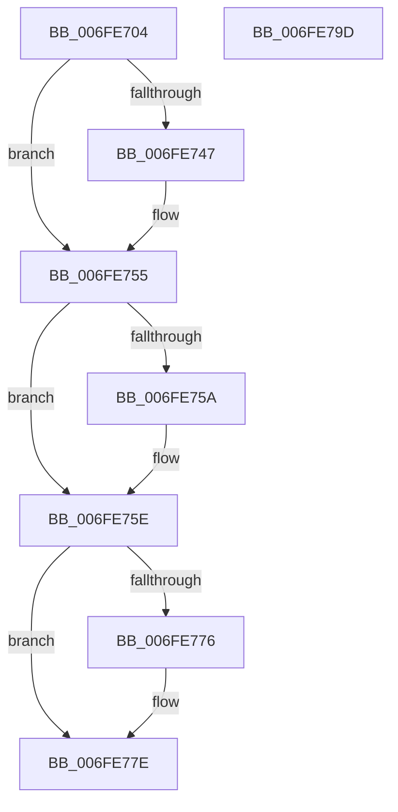

# PopBootStatUnlock

- RVA: `0x006FE704`–`0x006FE79E` (길이 `154` bytes)
- VA: `0x00000001406FE704`
- 실행 섹션: `PAGE`
- PDB 이름 있음: `예`; PDB Function 태그: `아니요`
- unwind 정보 RVA: `0x00060BC4`
- 디코드: `41`개 명령, `154/154` bytes 표시
- 미해석 바이트: `0` (있으면 어셈블리에 `.byte`로 보존)

> 이 문서는 커널 이미지의 기계어와 PDB 기호를 분석해 생성했습니다. 4번과 5번은 함수 원형과 자료형을 바이너리 사용 방식에서 추정한 C 해석이며 원본 소스 복구 결과는 아닙니다.

## 1. Dependencies

- 직접 호출 지점: **6**; 고유 호출 대상: **6**
- 직접 호출자로 확인된 함수: **1**
- RIP 상대 이미지 참조: **2**

### Outgoing calls
- `0x006FE737` → [KeAbPreAcquire](../../text/21/KeAbPreAcquire_function_00210230.md) (function, `0x00210230`)
- `0x006FE750` → [ExfAcquirePushLockExclusiveEx](../../text/20/ExfAcquirePushLockExclusiveEx_function_0020FC90.md) (function, `0x0020FC90`)
- `0x006FE760` → [RtlUnlockBootStatusData](../A4/RtlUnlockBootStatusData_function_00A4CAF0.md) (function, `0x00A4CAF0`)
- `0x006FE779` → [ExfTryToWakePushLock](../../text/26/ExfTryToWakePushLock_function_00265DD0.md) (function, `0x00265DD0`)
- `0x006FE781` → [KeAbPostRelease](../../text/2E/KeAbPostRelease_function_002E1600.md) (function, `0x002E1600`)
- `0x006FE786` → [KeLeaveCriticalRegion](../../text/25/KeLeaveCriticalRegion_function_0025D8B0.md) (function, `0x0025D8B0`)

### Direct callers
- [PopPowerInformationInternal](../A8/PopPowerInformationInternal_function_00A8B7C0.md) at `0x00A8C4B6`

### Static image references
- `0x006FE71C` → RVA `0x00F084F0` (`.data`; read)
- `0x006FE765` → RVA `0x00F084F0` (`.data`; read/write)

## 2. Other-region calls and transfers

- 다른 실행 섹션으로 향하는 call: **5**
  - `0x006FE737` → [KeAbPreAcquire](../../text/21/KeAbPreAcquire_function_00210230.md) (`PAGE` → `.text`)
  - `0x006FE750` → [ExfAcquirePushLockExclusiveEx](../../text/20/ExfAcquirePushLockExclusiveEx_function_0020FC90.md) (`PAGE` → `.text`)
  - `0x006FE779` → [ExfTryToWakePushLock](../../text/26/ExfTryToWakePushLock_function_00265DD0.md) (`PAGE` → `.text`)
  - `0x006FE781` → [KeAbPostRelease](../../text/2E/KeAbPostRelease_function_002E1600.md) (`PAGE` → `.text`)
  - `0x006FE786` → [KeLeaveCriticalRegion](../../text/25/KeLeaveCriticalRegion_function_0025D8B0.md) (`PAGE` → `.text`)
- 별도 외부 분기/꼬리 이동을 확인하지 못했습니다.

## 3. Assembly (complete function range)

```asm
006FE704  48 89 5C 24 08                  mov qword ptr [rsp + 8], rbx
006FE709  48 89 74 24 10                  mov qword ptr [rsp + 0x10], rsi
006FE70E  57                              push rdi
006FE70F  48 83 EC 20                     sub rsp, 0x20
006FE713  65 48 8B 04 25 88 01 00 00      mov rax, qword ptr gs:[0x188]
006FE71C  48 8D 35 CD 9D 80 00            lea rsi, [rip + 0x809dcd]
006FE723  48 83 CB FF                     or rbx, 0xffffffffffffffff
006FE727  45 33 C0                        xor r8d, r8d
006FE72A  33 D2                           xor edx, edx
006FE72C  48 8B CE                        mov rcx, rsi
006FE72F  66 01 98 E4 01 00 00            add word ptr [rax + 0x1e4], bx
006FE736  90                              nop
006FE737  E8 F4 1A B1 FF                  call 0x140210230
006FE73C  F0 48 0F BA 2E 00               lock bts qword ptr [rsi], 0
006FE742  48 8B F8                        mov rdi, rax
006FE745  73 0E                           jae 0x1406fe755
006FE747  4C 8B C6                        mov r8, rsi
006FE74A  48 8B D0                        mov rdx, rax
006FE74D  48 8B CE                        mov rcx, rsi
006FE750  E8 3B 15 B1 FF                  call 0x14020fc90
006FE755  48 85 FF                        test rdi, rdi
006FE758  74 04                           je 0x1406fe75e
006FE75A  C6 47 0A 01                     mov byte ptr [rdi + 0xa], 1
006FE75E  33 C9                           xor ecx, ecx
006FE760  E8 8B E3 34 00                  call 0x140a4caf0
006FE765  F0 48 0F C1 1D 82 9D 80 00      lock xadd qword ptr [rip + 0x809d82], rbx
006FE76E  80 E3 06                        and bl, 6
006FE771  80 FB 02                        cmp bl, 2
006FE774  75 08                           jne 0x1406fe77e
006FE776  48 8B CE                        mov rcx, rsi
006FE779  E8 52 76 B6 FF                  call 0x140265dd0
006FE77E  48 8B CE                        mov rcx, rsi
006FE781  E8 7A 2E BE FF                  call 0x1402e1600
006FE786  E8 25 F1 B5 FF                  call 0x14025d8b0
006FE78B  48 8B 5C 24 30                  mov rbx, qword ptr [rsp + 0x30]
006FE790  33 C0                           xor eax, eax
006FE792  48 8B 74 24 38                  mov rsi, qword ptr [rsp + 0x38]
006FE797  48 83 C4 20                     add rsp, 0x20
006FE79B  5F                              pop rdi
006FE79C  C3                              ret
006FE79D  CC                              int3
```

## 4. C-style interpretation (structured pseudocode)

```c
__int64 __fastcall PopBootStatUnlock(__int64 a1, int a2, int a3)
{
    __int64 result;
    __int64 v_rbx;
    __int64 v_rsp;
    unsigned __int64 v_stack_p10;
    unsigned __int64 v_stack_p8;

    v_stack_p8 = v_rbx;
    v_stack_p10 = v_rsi;
    v_rsp = (v_rsp) - (32);
    v_rbx = (v_rbx) | (-1);
    a3 = 0;
    a2 = 0;
    result = KeAbPreAcquire(v_rip + 8429005, a2, a3, a4);
    if (!(condition_is_above_or_equal)) {
        a3 = v_rip + 8429005;
        a2 = result;
        a1 = v_rip + 8429005;
        result = ExfAcquirePushLockExclusiveEx(a1, a2, a3, a4);
    }
    if (result != 0) {
        *(unsigned __int8 *)(result + 10) = 1;
    }
    a1 = 0;
    result = RtlUnlockBootStatusData(a1, a2, a3, a4);
    v_rbx = (unsigned __int8)((v_rbx) & (6));
    if (((unsigned __int8)(v_rbx)) == 2) {
        a1 = v_rip + 8429005;
        result = ExfTryToWakePushLock(a1, a2, a3, a4);
    }
    result = KeAbPostRelease(v_rip + 8429005, a2, a3, a4);
    result = KeLeaveCriticalRegion(v_rip + 8429005, a2, a3, a4);
    result = 0;
    v_rsp = (v_rsp) + (32);
    return result;
}
```

## 5. (Beta) C Style

```c
int64_t PopBootStatUnlock(int64_t Arg1, int32_t Arg2, int32_t Arg3)
{
    int64_t result;
    int64_t local_rbx;
    int64_t local_rsp;
    uint64_t v_stack_p10;
    uint64_t v_stack_p8;

    v_stack_p8 = local_rbx;
    v_stack_p10 = local_rsi;
    local_rsp = (local_rsp) - (32);
    local_rbx = (local_rbx) | (-1);
    Arg3 = 0;
    Arg2 = 0;
    result = KeAbPreAcquire(v_rip + 8429005, Arg2, Arg3, a4);
    if (!(condition_is_above_or_equal)) {
        Arg3 = v_rip + 8429005;
        Arg2 = result;
        Arg1 = v_rip + 8429005;
        result = ExfAcquirePushLockExclusiveEx(Arg1, Arg2, Arg3, a4);
    }
    if (result != 0) {
        *(uint8_t *)(result + 0xA) = 1;
    }
    Arg1 = 0;
    result = RtlUnlockBootStatusData(Arg1, Arg2, Arg3, a4);
    local_rbx = (uint8_t)((local_rbx) & (6));
    if (((uint8_t)(local_rbx)) == 2) {
        Arg1 = v_rip + 8429005;
        result = ExfTryToWakePushLock(Arg1, Arg2, Arg3, a4);
    }
    result = KeAbPostRelease(v_rip + 8429005, Arg2, Arg3, a4);
    result = KeLeaveCriticalRegion(v_rip + 8429005, Arg2, Arg3, a4);
    result = 0;
    local_rsp = (local_rsp) + (32);
    return result;
}
```

## 6. Execution-region graph

[열기: 2D/3D 그래프와 함수 탐색 컨트롤 패널](../../../control-panel.html?section=page&rva=0x006FE704&view=graph)

- 2D 그래프는 위에서 아래로 흐르고, 3D 그래프는 빈 공간을 드래그해 회전합니다. Shift+드래그는 이동, 휠은 확대·축소, 함수 노드 선택은 대상 보고서 이동입니다.

### Static fallback


