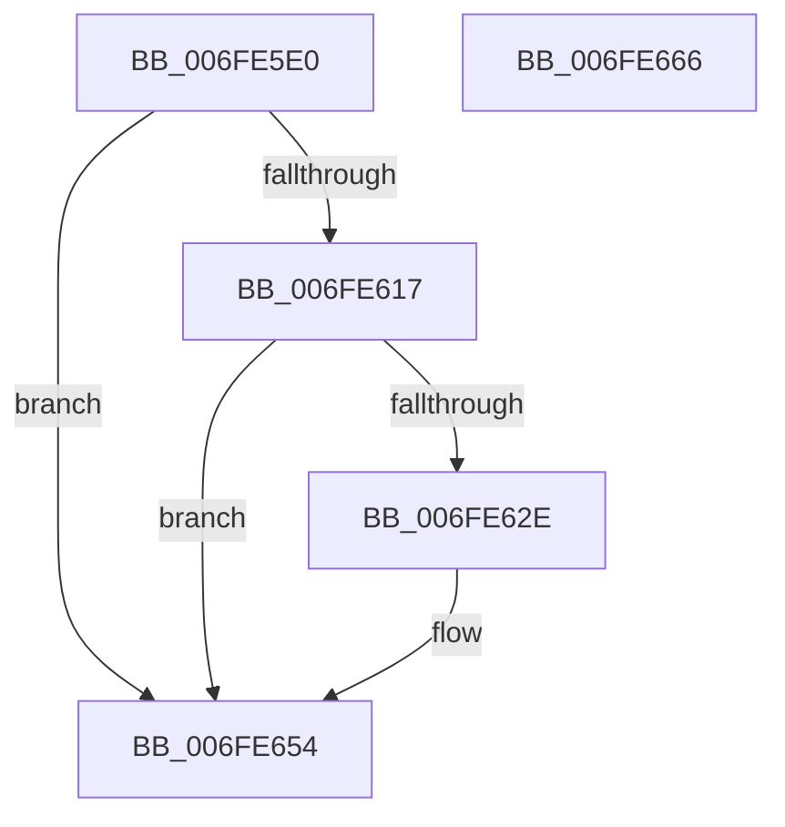

# PopPowerAggregatorDiagTraceDozeTimerDisarmed

- RVA: `0x006FE5E0`–`0x006FE667` (길이 `135` bytes)
- VA: `0x00000001406FE5E0`
- 실행 섹션: `PAGE`
- PDB 이름 있음: `예`; PDB Function 태그: `아니요`
- unwind 정보 RVA: `0x000AD25C`
- 디코드: `29`개 명령, `135/135` bytes 표시
- 미해석 바이트: `0` (있으면 어셈블리에 `.byte`로 보존)

> 이 문서는 커널 이미지의 기계어와 PDB 기호를 분석해 생성했습니다. 4번과 5번은 함수 원형과 자료형을 바이너리 사용 방식에서 추정한 C 해석이며 원본 소스 복구 결과는 아닙니다.

## 1. Dependencies

- 직접 호출 지점: **3**; 고유 호출 대상: **3**
- 직접 호출자로 확인된 함수: **1**
- RIP 상대 이미지 참조: **4**

### Outgoing calls
- `0x006FE625` → [EtwEventEnabled](../../text/39/EtwEventEnabled_function_00392450.md) (function, `0x00392450`)
- `0x006FE64F` → [EtwWrite](../../text/41/EtwWrite_function_0041C720.md) (function, `0x0041C720`)
- `0x006FE65C` → [_security_check_cookie](../../text/6A/_security_check_cookie_function_006AC640.md) (function, `0x006AC640`)

### Direct callers
- [PopPowerAggregatorDozeTimerDisarm](PopPowerAggregatorDozeTimerDisarm_function_006FE548.md) at `0x006FE5C9`

### Static image references
- `0x006FE5E8` → RVA `0x00E0A740` (`.data`; read)
- `0x006FE601` → RVA `0x00E67858` (`.data`; read)
- `0x006FE617` → RVA `0x00F0B408` (`.data`; read)
- `0x006FE61E` → RVA `0x0001ECF8` (`.rdata`; read)

## 2. Other-region calls and transfers

- 다른 실행 섹션으로 향하는 call: **3**
  - `0x006FE625` → [EtwEventEnabled](../../text/39/EtwEventEnabled_function_00392450.md) (`PAGE` → `.text`)
  - `0x006FE64F` → [EtwWrite](../../text/41/EtwWrite_function_0041C720.md) (`PAGE` → `.text`)
  - `0x006FE65C` → [_security_check_cookie](../../text/6A/_security_check_cookie_function_006AC640.md) (`PAGE` → `.text`)
- 별도 외부 분기/꼬리 이동을 확인하지 못했습니다.

## 3. Assembly (complete function range)

```asm
006FE5E0  89 4C 24 08                     mov dword ptr [rsp + 8], ecx
006FE5E4  48 83 EC 58                     sub rsp, 0x58
006FE5E8  48 8B 05 51 C1 70 00            mov rax, qword ptr [rip + 0x70c151]
006FE5EF  48 33 C4                        xor rax, rsp
006FE5F2  48 89 44 24 40                  mov qword ptr [rsp + 0x40], rax
006FE5F7  83 64 24 3C 00                  and dword ptr [rsp + 0x3c], 0
006FE5FC  48 8D 44 24 60                  lea rax, [rsp + 0x60]
006FE601  80 3D 50 92 76 00 00            cmp byte ptr [rip + 0x769250], 0
006FE608  48 89 44 24 30                  mov qword ptr [rsp + 0x30], rax
006FE60D  C7 44 24 38 04 00 00 00         mov dword ptr [rsp + 0x38], 4
006FE615  74 3D                           je 0x1406fe654
006FE617  48 8B 0D EA CD 80 00            mov rcx, qword ptr [rip + 0x80cdea]
006FE61E  48 8D 15 D3 06 92 FF            lea rdx, [rip - 0x6df92d]
006FE625  E8 26 3E C9 FF                  call 0x140392450
006FE62A  84 C0                           test al, al
006FE62C  74 26                           je 0x1406fe654
006FE62E  48 8B 0D D3 CD 80 00            mov rcx, qword ptr [rip + 0x80cdd3]
006FE635  48 8D 44 24 30                  lea rax, [rsp + 0x30]
006FE63A  41 B9 01 00 00 00               mov r9d, 1
006FE640  48 89 44 24 20                  mov qword ptr [rsp + 0x20], rax
006FE645  45 33 C0                        xor r8d, r8d
006FE648  48 8D 15 A9 06 92 FF            lea rdx, [rip - 0x6df957]
006FE64F  E8 CC E0 D1 FF                  call 0x14041c720
006FE654  48 8B 4C 24 40                  mov rcx, qword ptr [rsp + 0x40]
006FE659  48 33 CC                        xor rcx, rsp
006FE65C  E8 DF DF FA FF                  call 0x1406ac640
006FE661  48 83 C4 58                     add rsp, 0x58
006FE665  C3                              ret
006FE666  CC                              int3
```

## 4. C-style interpretation (structured pseudocode)

```c
__int64 __fastcall PopPowerAggregatorDiagTraceDozeTimerDisarmed(int a1, __int64 a2, int a3)
{
    __int64 result;
    __int64 v_rsp;
    unsigned __int64 v_stack_m18;
    unsigned int v_stack_m1C;
    unsigned int v_stack_m20;
    unsigned __int64 v_stack_m28;
    unsigned __int64 v_stack_m38;
    unsigned int v_stack_p8;

    v_stack_p8 = a1;
    v_rsp = (v_rsp) - (88);
    result = (*(unsigned __int64 *)(v_rip + 7389521)) ^ (v_rsp);
    v_stack_m18 = result;
    v_stack_m28 = v_stack_p8;
    v_stack_m20 = 4;
    if ((*(unsigned __int8 *)(v_rip + 7770704)) == 0) goto loc_006FE654;
    result = EtwEventEnabled(*(unsigned __int64 *)(v_rip + 8441322), v_rip - 7207213, a3, a4);
    if ((unsigned __int8)(result) != 0) {
        a1 = *(unsigned __int64 *)(v_rip + 8441299);
        result = v_stack_m28;
        a4 = 1;
        v_stack_m38 = result;
        a3 = 0;
        a2 = v_rip - 7207255;
        result = EtwWrite(a1, a2, a3, a4);
    }
    a1 = (v_stack_m18) ^ (v_rsp);
    result = _security_check_cookie(a1, a2, a3, a4);
    v_rsp = (v_rsp) + (88);
    return result;
}
```

## 5. (Beta) C Style

```c
int64_t PopPowerAggregatorDiagTraceDozeTimerDisarmed(int32_t Arg1, int64_t Arg2, int32_t Arg3)
{
    int64_t result;
    int64_t local_rsp;
    uint64_t v_stack_m18;
    uint32_t v_stack_m1C;
    uint32_t v_stack_m20;
    uint64_t v_stack_m28;
    uint64_t v_stack_m38;
    uint32_t v_stack_p8;

    v_stack_p8 = Arg1;
    local_rsp = (local_rsp) - (88);
    result = (*(uint64_t *)(v_rip + 0x70C151)) ^ (local_rsp);
    v_stack_m18 = result;
    v_stack_m28 = v_stack_p8;
    v_stack_m20 = 4;
    if ((*(uint8_t *)(v_rip + 0x769250)) == 0) goto loc_006FE654;
    result = EtwEventEnabled(*(uint64_t *)(v_rip + 0x80CDEA), v_rip - 7207213, Arg3, a4);
    if ((uint8_t)(result) != 0) {
        Arg1 = *(uint64_t *)(v_rip + 0x80CDD3);
        result = v_stack_m28;
        a4 = 1;
        v_stack_m38 = result;
        Arg3 = 0;
        Arg2 = v_rip - 7207255;
        result = EtwWrite(Arg1, Arg2, Arg3, a4);
    }
    Arg1 = (v_stack_m18) ^ (local_rsp);
    result = _security_check_cookie(Arg1, Arg2, Arg3, a4);
    local_rsp = (local_rsp) + (88);
    return result;
}
```

## 6. Execution-region graph

[열기: 2D/3D 그래프와 함수 탐색 컨트롤 패널](../../../control-panel.html?section=page&rva=0x006FE5E0&view=graph)

- 2D 그래프는 위에서 아래로 흐르고, 3D 그래프는 빈 공간을 드래그해 회전합니다. Shift+드래그는 이동, 휠은 확대·축소, 함수 노드 선택은 대상 보고서 이동입니다.

### Static fallback


