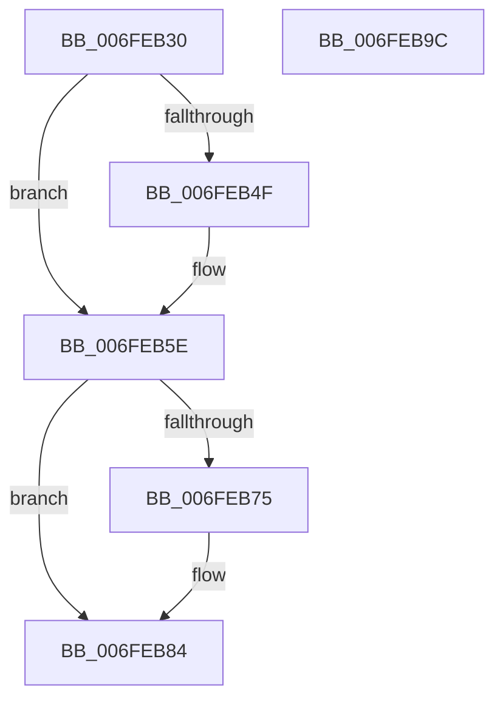

# PopPowerAggregatorDisengageAggressiveStandbyActions

- RVA: `0x006FEB30`–`0x006FEB9D` (길이 `109` bytes)
- VA: `0x00000001406FEB30`
- 실행 섹션: `PAGE`
- PDB 이름 있음: `예`; PDB Function 태그: `아니요`
- unwind 정보 RVA: `0x0005C788`
- 디코드: `24`개 명령, `109/109` bytes 표시
- 미해석 바이트: `0` (있으면 어셈블리에 `.byte`로 보존)

> 이 문서는 커널 이미지의 기계어와 PDB 기호를 분석해 생성했습니다. 4번과 5번은 함수 원형과 자료형을 바이너리 사용 방식에서 추정한 C 해석이며 원본 소스 복구 결과는 아닙니다.

## 1. Dependencies

- 직접 호출 지점: **4**; 고유 호출 대상: **3**
- 직접 호출자로 확인된 함수: **1**
- RIP 상대 이미지 참조: **5**

### Outgoing calls
- `0x006FEB34` → [PopAcquirePolicyLock](../../pagelk/B7/PopAcquirePolicyLock_function_00B783C0.md) (function, `0x00B783C0`)
- `0x006FEB59` → [PopQueueWorkItem](../../text/4A/PopQueueWorkItem_function_004A20F8.md) (function, `0x004A20F8`)
- `0x006FEB7F` → [PopQueueWorkItem](../../text/4A/PopQueueWorkItem_function_004A20F8.md) (function, `0x004A20F8`)
- `0x006FEB92` → [PopReleasePolicyLock](../../pagelk/B7/PopReleasePolicyLock_function_00B78410.md) (function, `0x00B78410`)

### Direct callers
- [PopPowerAggregatorDisengageModernStandby](../98/PopPowerAggregatorDisengageModernStandby_function_00989DD8.md) at `0x00989E06`

### Static image references
- `0x006FEB39` → RVA `0x00F08878` (`.data`; read/write)
- `0x006FEB42` → RVA `0x00E678E8` (`.data`; read/write)
- `0x006FEB52` → RVA `0x00F08848` (`.data`; read)
- `0x006FEB84` → RVA `0x00F0C9D8` (`.data`; read/write)
- `0x006FEB8B` → RVA `0x00FC6AFA` (`ALMOSTRO`; write)

## 2. Other-region calls and transfers

- 다른 실행 섹션으로 향하는 call: **4**
  - `0x006FEB34` → [PopAcquirePolicyLock](../../pagelk/B7/PopAcquirePolicyLock_function_00B783C0.md) (`PAGE` → `PAGELK`)
  - `0x006FEB59` → [PopQueueWorkItem](../../text/4A/PopQueueWorkItem_function_004A20F8.md) (`PAGE` → `.text`)
  - `0x006FEB7F` → [PopQueueWorkItem](../../text/4A/PopQueueWorkItem_function_004A20F8.md) (`PAGE` → `.text`)
  - `0x006FEB92` → [PopReleasePolicyLock](../../pagelk/B7/PopReleasePolicyLock_function_00B78410.md) (`PAGE` → `PAGELK`)
- 별도 외부 분기/꼬리 이동을 확인하지 못했습니다.

## 3. Assembly (complete function range)

```asm
006FEB30  48 83 EC 28                     sub rsp, 0x28
006FEB34  E8 87 98 47 00                  call 0x140b783c0
006FEB39  83 25 38 9D 80 00 FD            and dword ptr [rip + 0x809d38], 0xfffffffd
006FEB40  33 C0                           xor eax, eax
006FEB42  F0 0F C1 05 9E 8D 76 00         lock xadd dword ptr [rip + 0x768d9e], eax
006FEB4A  83 F8 02                        cmp eax, 2
006FEB4D  75 0F                           jne 0x1406feb5e
006FEB4F  8D 50 FF                        lea edx, [rax - 1]
006FEB52  48 8D 0D EF 9C 80 00            lea rcx, [rip + 0x809cef]
006FEB59  E8 9A 35 DA FF                  call 0x1404a20f8
006FEB5E  0F BA 35 12 9D 80 00 07         btr dword ptr [rip + 0x809d12], 7
006FEB66  33 C0                           xor eax, eax
006FEB68  F0 0F C1 05 78 8D 76 00         lock xadd dword ptr [rip + 0x768d78], eax
006FEB70  83 F8 02                        cmp eax, 2
006FEB73  75 0F                           jne 0x1406feb84
006FEB75  8D 50 FF                        lea edx, [rax - 1]
006FEB78  48 8D 0D C9 9C 80 00            lea rcx, [rip + 0x809cc9]
006FEB7F  E8 74 35 DA FF                  call 0x1404a20f8
006FEB84  83 25 4D DE 80 00 00            and dword ptr [rip + 0x80de4d], 0
006FEB8B  C6 05 68 7F 8C 00 00            mov byte ptr [rip + 0x8c7f68], 0
006FEB92  E8 79 98 47 00                  call 0x140b78410
006FEB97  48 83 C4 28                     add rsp, 0x28
006FEB9B  C3                              ret
006FEB9C  CC                              int3
```

## 4. C-style interpretation (structured pseudocode)

```c
__int64 __fastcall PopPowerAggregatorDisengageAggressiveStandbyActions(void)
{
    __int64 result;
    __int64 v_rsp;

    v_rsp = (v_rsp) - (40);
    result = PopAcquirePolicyLock(a1, a2, a3, a4);
    result = 0;
    if (0 == 2) {
        a2 = result - 1;
        a1 = v_rip + 8428783;
        result = PopQueueWorkItem(a1, a2, a3, a4);
    }
    result = 0;
    if (0 == 2) {
        a2 = result - 1;
        a1 = v_rip + 8428745;
        result = PopQueueWorkItem(a1, a2, a3, a4);
    }
    *(unsigned __int8 *)(v_rip + 9207656) = 0;
    result = PopReleasePolicyLock(a1, a2, a3, a4);
    v_rsp = (v_rsp) + (40);
    return result;
}
```

## 5. (Beta) C Style

```c
void PopPowerAggregatorDisengageAggressiveStandbyActions(void)
{
    int64_t result;
    int64_t local_rsp;

    local_rsp = (local_rsp) - (40);
    result = PopAcquirePolicyLock(a1, a2, a3, a4);
    result = 0;
    if (0 == 2) {
        a2 = result - 1;
        a1 = v_rip + 8428783;
        result = PopQueueWorkItem(a1, a2, a3, a4);
    }
    result = 0;
    if (0 == 2) {
        a2 = result - 1;
        a1 = v_rip + 8428745;
        result = PopQueueWorkItem(a1, a2, a3, a4);
    }
    *(uint8_t *)(v_rip + 0x8C7F68) = 0;
    result = PopReleasePolicyLock(a1, a2, a3, a4);
    local_rsp = (local_rsp) + (40);
    return result;
}
```

## 6. Execution-region graph

[열기: 2D/3D 그래프와 함수 탐색 컨트롤 패널](../../../control-panel.html?section=page&rva=0x006FEB30&view=graph)

- 2D 그래프는 위에서 아래로 흐르고, 3D 그래프는 빈 공간을 드래그해 회전합니다. Shift+드래그는 이동, 휠은 확대·축소, 함수 노드 선택은 대상 보고서 이동입니다.

### Static fallback


