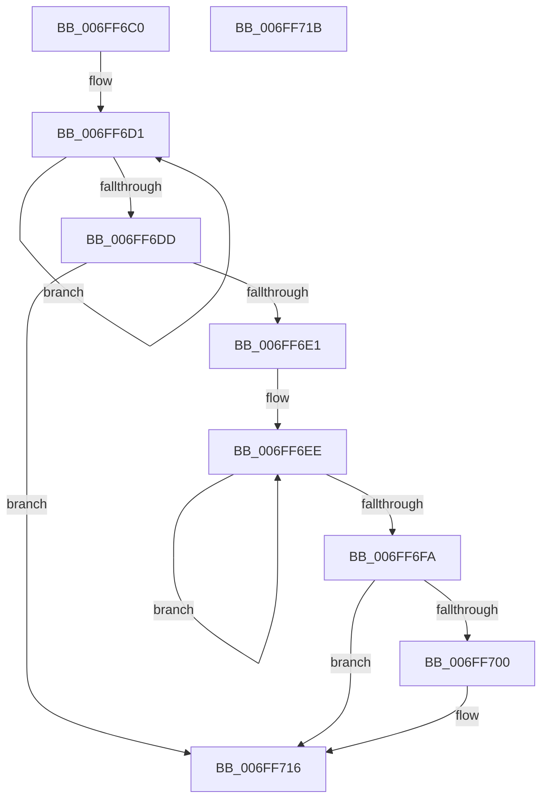

# PopPowerAggregatorDisengageDirectedDrips

- RVA: `0x006FF6C0`–`0x006FF71C` (길이 `92` bytes)
- VA: `0x00000001406FF6C0`
- 실행 섹션: `PAGE`
- PDB 이름 있음: `예`; PDB Function 태그: `아니요`
- unwind 정보 RVA: `0x0005C788`
- 디코드: `22`개 명령, `92/92` bytes 표시
- 미해석 바이트: `0` (있으면 어셈블리에 `.byte`로 보존)

> 이 문서는 커널 이미지의 기계어와 PDB 기호를 분석해 생성했습니다. 4번과 5번은 함수 원형과 자료형을 바이너리 사용 방식에서 추정한 C 해석이며 원본 소스 복구 결과는 아닙니다.

## 1. Dependencies

- 직접 호출 지점: **1**; 고유 호출 대상: **1**
- 직접 호출자로 확인된 함수: **1**
- RIP 상대 이미지 참조: **2**

### Outgoing calls
- `0x006FF711` → [PopDirectedDripsNotifyAppsAndServices](../75/PopDirectedDripsNotifyAppsAndServices_function_0075792C.md) (function, `0x0075792C`)

### Direct callers
- [PopPowerAggregatorDisengageModernStandby](../98/PopPowerAggregatorDisengageModernStandby_function_00989DD8.md) at `0x00989E01`

### Static image references
- `0x006FF6C4` → RVA `0x00F0EAC0` (`.data`; read)
- `0x006FF703` → RVA `0x00F0EAF8` (`.data`; read)

## 2. Other-region calls and transfers

- 다른 실행 섹션으로 향하는 call: **0**
- 별도 외부 분기/꼬리 이동을 확인하지 못했습니다.

## 3. Assembly (complete function range)

```asm
006FF6C0  48 83 EC 28                     sub rsp, 0x28
006FF6C4  0F 0D 0D F5 F3 80 00            prefetchw byte ptr [rip + 0x80f3f5]
006FF6CB  8B 05 EF F3 80 00               mov eax, dword ptr [rip + 0x80f3ef]
006FF6D1  8B C8                           mov ecx, eax
006FF6D3  F0 0F B1 0D E5 F3 80 00         lock cmpxchg dword ptr [rip + 0x80f3e5], ecx
006FF6DB  75 F4                           jne 0x1406ff6d1
006FF6DD  A8 01                           test al, 1
006FF6DF  74 35                           je 0x1406ff716
006FF6E1  0F 0D 0D D8 F3 80 00            prefetchw byte ptr [rip + 0x80f3d8]
006FF6E8  8B 05 D2 F3 80 00               mov eax, dword ptr [rip + 0x80f3d2]
006FF6EE  8B C8                           mov ecx, eax
006FF6F0  F0 0F B1 0D C8 F3 80 00         lock cmpxchg dword ptr [rip + 0x80f3c8], ecx
006FF6F8  75 F4                           jne 0x1406ff6ee
006FF6FA  0F BA E0 0B                     bt eax, 0xb
006FF6FE  73 16                           jae 0x1406ff716
006FF700  45 33 C0                        xor r8d, r8d
006FF703  48 8D 15 EE F3 80 00            lea rdx, [rip + 0x80f3ee]
006FF70A  48 8D 0D AF F3 80 00            lea rcx, [rip + 0x80f3af]
006FF711  E8 16 82 05 00                  call 0x14075792c
006FF716  48 83 C4 28                     add rsp, 0x28
006FF71A  C3                              ret
006FF71B  CC                              int3
```

## 4. C-style interpretation (structured pseudocode)

```c
__int64 __fastcall PopPowerAggregatorDisengageDirectedDrips(__int64 a1, __int64 a2, int a3)
{
    __int64 result;
    __int64 v_rsp;

    v_rsp = (v_rsp) - (40);
loc_006FF6D1:
    if (condition_is_not_equal) goto loc_006FF6D1;
    if ((((unsigned __int8)((unsigned int)(*(unsigned int *)(v_rip + 8451055)))) & (1)) == 0) goto loc_006FF716;
loc_006FF6EE:
    if ((((unsigned __int8)((unsigned int)(*(unsigned int *)(v_rip + 8451055)))) & (1)) != 0) goto loc_006FF6EE;
    result = (unsigned int)(*(unsigned int *)(v_rip + 8451026));
    if (!(condition_is_above_or_equal)) {
        a3 = 0;
        a2 = v_rip + 8451054;
        a1 = v_rip + 8450991;
        result = PopDirectedDripsNotifyAppsAndServices(a1, a2, a3, a4);
    }
    v_rsp = (v_rsp) + (40);
    return result;
}
```

## 5. (Beta) C Style

```c
int64_t PopPowerAggregatorDisengageDirectedDrips(int64_t Arg1, int64_t Arg2, int32_t Arg3)
{
    int64_t result;
    int64_t local_rsp;

    local_rsp = (local_rsp) - (40);
loc_006FF6D1:
    if (condition_is_not_equal) goto loc_006FF6D1;
    if ((((uint8_t)((uint32_t)(*(uint32_t *)(v_rip + 0x80F3EF)))) & (1)) == 0) goto loc_006FF716;
loc_006FF6EE:
    if ((((uint8_t)((uint32_t)(*(uint32_t *)(v_rip + 0x80F3EF)))) & (1)) != 0) goto loc_006FF6EE;
    result = (uint32_t)(*(uint32_t *)(v_rip + 0x80F3D2));
    if (!(condition_is_above_or_equal)) {
        Arg3 = 0;
        Arg2 = v_rip + 8451054;
        Arg1 = v_rip + 8450991;
        result = PopDirectedDripsNotifyAppsAndServices(Arg1, Arg2, Arg3, a4);
    }
    local_rsp = (local_rsp) + (40);
    return result;
}
```

## 6. Execution-region graph

[열기: 2D/3D 그래프와 함수 탐색 컨트롤 패널](../../../control-panel.html?section=page&rva=0x006FF6C0&view=graph)

- 2D 그래프는 위에서 아래로 흐르고, 3D 그래프는 빈 공간을 드래그해 회전합니다. Shift+드래그는 이동, 휠은 확대·축소, 함수 노드 선택은 대상 보고서 이동입니다.

### Static fallback


