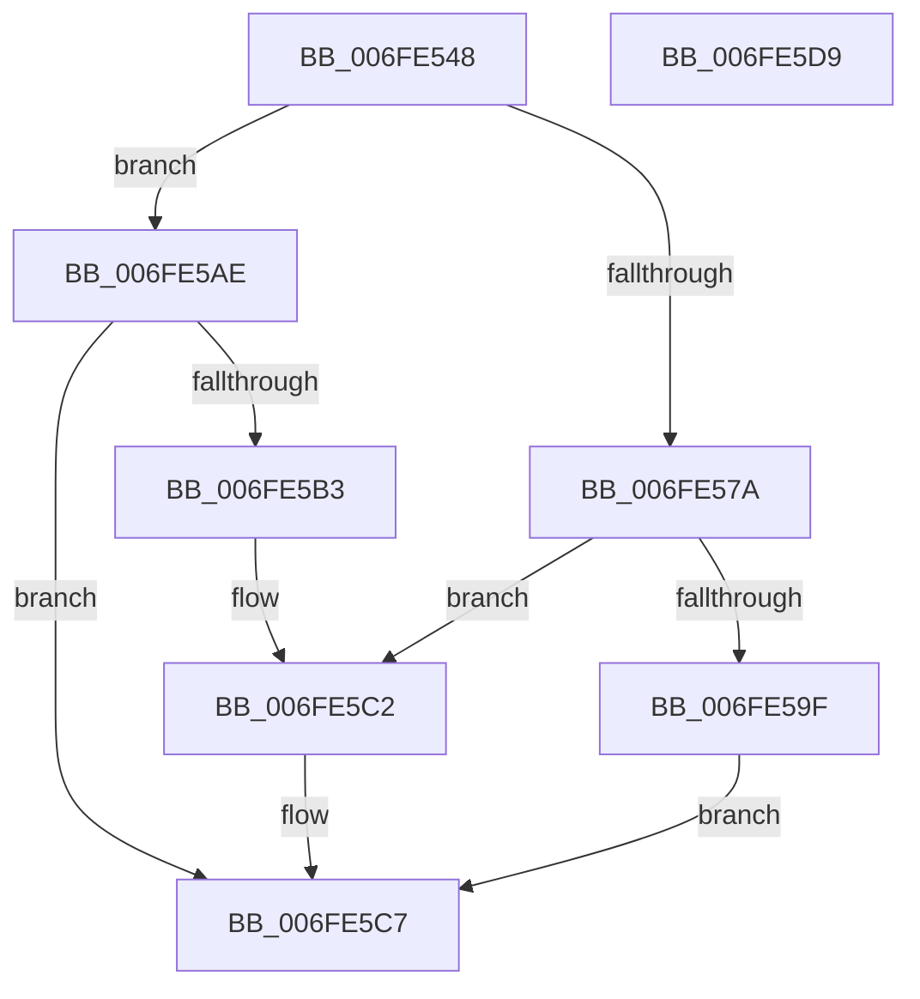

# PopPowerAggregatorDozeTimerDisarm

- RVA: `0x006FE548`–`0x006FE5DA` (길이 `146` bytes)
- VA: `0x00000001406FE548`
- 실행 섹션: `PAGE`
- PDB 이름 있음: `예`; PDB Function 태그: `아니요`
- unwind 정보 RVA: `0x0006E5F8`
- 디코드: `40`개 명령, `146/146` bytes 표시
- 미해석 바이트: `0` (있으면 어셈블리에 `.byte`로 보존)

> 이 문서는 커널 이미지의 기계어와 PDB 기호를 분석해 생성했습니다. 4번과 5번은 함수 원형과 자료형을 바이너리 사용 방식에서 추정한 C 해석이며 원본 소스 복구 결과는 아닙니다.

## 1. Dependencies

- 직접 호출 지점: **4**; 고유 호출 대상: **4**
- 직접 호출자로 확인된 함수: **2**
- RIP 상대 이미지 참조: **0**

### Outgoing calls
- `0x006FE58A` → [KeCancelTimer2](../../text/3A/KeCancelTimer2_function_003A01E0.md) (function, `0x003A01E0`)
- `0x006FE5A7` → [KeWaitForSingleObject](../../text/20/KeWaitForSingleObject_function_0020E6B0.md) (function, `0x0020E6B0`)
- `0x006FE5C2` → [KeSetEvent](../../text/33/KeSetEvent_function_0033F310.md) (function, `0x0033F310`)
- `0x006FE5C9` → [PopPowerAggregatorDiagTraceDozeTimerDisarmed](PopPowerAggregatorDiagTraceDozeTimerDisarmed_function_006FE5E0.md) (function, `0x006FE5E0`)

### Direct callers
- [PopPowerAggregatorEvaluateDozeTimers](PopPowerAggregatorEvaluateDozeTimers_function_006FE460.md) at `0x006FE46F`
- [PopPowerAggregatorEvaluateDozeTimers](PopPowerAggregatorEvaluateDozeTimers_function_006FE460.md) at `0x006FE480`
- [PopPowerAggregatorDozeTimerArm](../76/PopPowerAggregatorDozeTimerArm_function_007643BC.md) at `0x007643E9`

### Static image references
- 디코드된 RIP-relative 메모리 참조가 없습니다.

## 2. Other-region calls and transfers

- 다른 실행 섹션으로 향하는 call: **3**
  - `0x006FE58A` → [KeCancelTimer2](../../text/3A/KeCancelTimer2_function_003A01E0.md) (`PAGE` → `.text`)
  - `0x006FE5A7` → [KeWaitForSingleObject](../../text/20/KeWaitForSingleObject_function_0020E6B0.md) (`PAGE` → `.text`)
  - `0x006FE5C2` → [KeSetEvent](../../text/33/KeSetEvent_function_0033F310.md) (`PAGE` → `.text`)
- 별도 외부 분기/꼬리 이동을 확인하지 못했습니다.

## 3. Assembly (complete function range)

```asm
006FE548  48 89 5C 24 08                  mov qword ptr [rsp + 8], rbx
006FE54D  57                              push rdi
006FE54E  48 83 EC 30                     sub rsp, 0x30
006FE552  48 63 FA                        movsxd rdi, edx
006FE555  4C 69 C7 C8 00 00 00            imul r8, rdi, 0xc8
006FE55C  41 8B 84 08 E0 01 00 00         mov eax, dword ptr [r8 + rcx + 0x1e0]
006FE564  83 E0 FC                        and eax, 0xfffffffc
006FE567  83 C0 04                        add eax, 4
006FE56A  41 87 84 08 E0 01 00 00         xchg dword ptr [r8 + rcx + 0x1e0], eax
006FE572  83 E0 03                        and eax, 3
006FE575  83 F8 01                        cmp eax, 1
006FE578  75 34                           jne 0x1406fe5ae
006FE57A  49 8D 1C 08                     lea rbx, [r8 + rcx]
006FE57E  33 D2                           xor edx, edx
006FE580  48 81 C1 58 01 00 00            add rcx, 0x158
006FE587  49 03 C8                        add rcx, r8
006FE58A  E8 51 1C CA FF                  call 0x1403a01e0
006FE58F  45 33 C0                        xor r8d, r8d
006FE592  48 8D 8B E8 01 00 00            lea rcx, [rbx + 0x1e8]
006FE599  33 D2                           xor edx, edx
006FE59B  84 C0                           test al, al
006FE59D  75 23                           jne 0x1406fe5c2
006FE59F  48 21 54 24 20                  and qword ptr [rsp + 0x20], rdx
006FE5A4  45 33 C9                        xor r9d, r9d
006FE5A7  E8 04 01 B1 FF                  call 0x14020e6b0
006FE5AC  EB 19                           jmp 0x1406fe5c7
006FE5AE  83 F8 02                        cmp eax, 2
006FE5B1  75 14                           jne 0x1406fe5c7
006FE5B3  48 81 C1 E8 01 00 00            add rcx, 0x1e8
006FE5BA  49 03 C8                        add rcx, r8
006FE5BD  45 33 C0                        xor r8d, r8d
006FE5C0  33 D2                           xor edx, edx
006FE5C2  E8 49 0D C4 FF                  call 0x14033f310
006FE5C7  8B CF                           mov ecx, edi
006FE5C9  E8 12 00 00 00                  call 0x1406fe5e0
006FE5CE  48 8B 5C 24 40                  mov rbx, qword ptr [rsp + 0x40]
006FE5D3  48 83 C4 30                     add rsp, 0x30
006FE5D7  5F                              pop rdi
006FE5D8  C3                              ret
006FE5D9  CC                              int3
```

## 4. C-style interpretation (structured pseudocode)

```c
__int64 __fastcall PopPowerAggregatorDozeTimerDisarm(__int64 a1, int a2, __int64 a3, int a4)
{
    __int64 result;
    __int64 v_rsp;
    unsigned __int64 v_stack_m18;
    unsigned __int64 v_stack_p8;

    v_stack_p8 = v_rbx;
    v_rsp = (v_rsp) - (48);
    a3 = (a3) * ((int)(a2));
    result = (unsigned int)(((unsigned int)(*(unsigned int *)(a3 + a1 * 1 + 480))) & (0xFFFFFFFCULL));
    result = (unsigned int)((result) + (4));
    result = (unsigned int)((result) & (3));
    if (((unsigned int)(result)) != 1) goto loc_006FE5AE;
    a2 = 0;
    a1 = (a1) + (344);
    a1 = (a1) + (a3);
    result = KeCancelTimer2(a1, a2, a3, a4);
    a3 = 0;
    a2 = 0;
    if ((unsigned __int8)(result) != 0) goto loc_006FE5C2;
    a4 = 0;
    result = KeWaitForSingleObject(a3 + a1 * 1 + 488, a2, a3, a4);
    goto loc_006FE5C7;
loc_006FE5AE:
    if (((unsigned int)(result)) != 2) goto loc_006FE5C7;
    a1 = (a3 + a1 * 1 + 488) + (488);
    a1 = (a1) + (0);
    a3 = 0;
    a2 = 0;
loc_006FE5C2:
    result = KeSetEvent(a1, a2, a3, a4);
loc_006FE5C7:
    result = PopPowerAggregatorDiagTraceDozeTimerDisarmed((unsigned int)((unsigned int)((int)(a2))), a2, a3, a4);
    v_rsp = (v_rsp) + (48);
    return result;
}
```

## 5. (Beta) C Style

```c
int64_t PopPowerAggregatorDozeTimerDisarm(int64_t Arg1, int32_t Arg2, void *Arg3, int32_t Arg4)
{
    uint8_t *arg3 = (uint8_t *)Arg3;

    int64_t result;
    int64_t local_rsp;
    uint64_t v_stack_m18;
    uint64_t v_stack_p8;

    v_stack_p8 = local_rbx;
    local_rsp = (local_rsp) - (48);
    Arg3 = (Arg3) * ((int32_t)(Arg2));
    result = (uint32_t)(((uint32_t)(*(uint32_t *)(arg3 + Arg1 * 1 + 0x1E0))) & (0xFFFFFFFCULL));
    result = (uint32_t)((result) + (4));
    result = (uint32_t)((result) & (3));
    if (((uint32_t)(result)) != 1) goto loc_006FE5AE;
    Arg2 = 0;
    Arg1 = (Arg1) + (344);
    Arg1 = (Arg1) + (Arg3);
    result = KeCancelTimer2(Arg1, Arg2, Arg3, Arg4);
    Arg3 = 0;
    Arg2 = 0;
    if ((uint8_t)(result) != 0) goto loc_006FE5C2;
    Arg4 = 0;
    result = KeWaitForSingleObject(Arg3 + Arg1 * 1 + 488, Arg2, Arg3, Arg4);
    goto loc_006FE5C7;
loc_006FE5AE:
    if (((uint32_t)(result)) != 2) goto loc_006FE5C7;
    Arg1 = (Arg3 + Arg1 * 1 + 488) + (488);
    Arg1 = (Arg1) + (0);
    Arg3 = 0;
    Arg2 = 0;
loc_006FE5C2:
    result = KeSetEvent(Arg1, Arg2, Arg3, Arg4);
loc_006FE5C7:
    result = PopPowerAggregatorDiagTraceDozeTimerDisarmed((uint32_t)((uint32_t)((int32_t)(Arg2))), Arg2, Arg3, Arg4);
    local_rsp = (local_rsp) + (48);
    return result;
}
```

### 관측된 메모리 오프셋

구조체 형식이 확인되지 않은 접근은 인자 기준의 오프셋으로만 기록했습니다.

| 기준 인자 | 오프셋 표현 | 폭 (bit) | 접근 |
|---|---:|---:|---|
| `Arg3` | `+ 0x0 + rcx*1` | `64` | `R` |
| `Arg3` | `+ 0x1E0 + rcx*1` | `32` | `R` |
| `Arg3` | `+ 0x1E0 + rcx*1` | `32` | `R/W` |
| `Arg3` | `+ 0x1E8` | `64` | `R` |

## 6. Execution-region graph

[열기: 2D/3D 그래프와 함수 탐색 컨트롤 패널](../../../control-panel.html?section=page&rva=0x006FE548&view=graph)

- 2D 그래프는 위에서 아래로 흐르고, 3D 그래프는 빈 공간을 드래그해 회전합니다. Shift+드래그는 이동, 휠은 확대·축소, 함수 노드 선택은 대상 보고서 이동입니다.

### Static fallback


