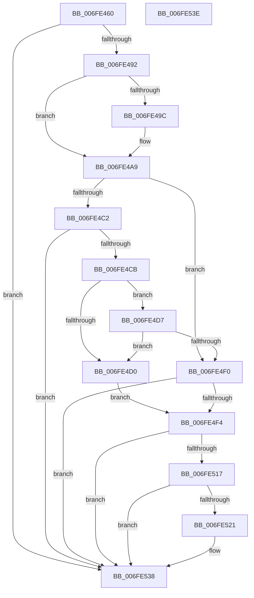

# PopPowerAggregatorEvaluateDozeTimers

- RVA: `0x006FE460`–`0x006FE53F` (길이 `223` bytes)
- VA: `0x00000001406FE460`
- 실행 섹션: `PAGE`
- PDB 이름 있음: `예`; PDB Function 태그: `아니요`
- unwind 정보 RVA: `0x0005CF00`
- 디코드: `56`개 명령, `223/223` bytes 표시
- 미해석 바이트: `0` (있으면 어셈블리에 `.byte`로 보존)

> 이 문서는 커널 이미지의 기계어와 PDB 기호를 분석해 생성했습니다. 4번과 5번은 함수 원형과 자료형을 바이너리 사용 방식에서 추정한 C 해석이며 원본 소스 복구 결과는 아닙니다.

## 1. Dependencies

- 직접 호출 지점: **5**; 고유 호출 대상: **3**
- 직접 호출자로 확인된 함수: **3**
- RIP 상대 이미지 참조: **5**

### Outgoing calls
- `0x006FE46F` → [PopPowerAggregatorDozeTimerDisarm](PopPowerAggregatorDozeTimerDisarm_function_006FE548.md) (function, `0x006FE548`)
- `0x006FE480` → [PopPowerAggregatorDozeTimerDisarm](PopPowerAggregatorDozeTimerDisarm_function_006FE548.md) (function, `0x006FE548`)
- `0x006FE49C` → [PopQueryRestrictedStandbyTimeoutSeconds](../75/PopQueryRestrictedStandbyTimeoutSeconds_function_00754374.md) (function, `0x00754374`)
- `0x006FE506` → [PopPowerAggregatorDozeTimerArm](../76/PopPowerAggregatorDozeTimerArm_function_007643BC.md) (function, `0x007643BC`)
- `0x006FE533` → [PopPowerAggregatorDozeTimerArm](../76/PopPowerAggregatorDozeTimerArm_function_007643BC.md) (function, `0x007643BC`)

### Direct callers
- [PopPowerAggregatorNotifyAcDcStateChange](PopPowerAggregatorNotifyAcDcStateChange_function_006FE41C.md) at `0x006FE43B`
- [PopPowerAggregatorDozeTimerWorker](../76/PopPowerAggregatorDozeTimerWorker_function_00764490.md) at `0x007645B0`
- [PopPowerAggregatorNotifyPdcPhaseState](../76/PopPowerAggregatorNotifyPdcPhaseState_function_00764C54.md) at `0x00764D10`

### Static image references
- `0x006FE468` → RVA `0x00F09740` (`.data`; read)
- `0x006FE485` → RVA `0x00F0986C` (`.data`; read)
- `0x006FE494` → RVA `0x00F09724` (`.data`; read)
- `0x006FE4A3` → RVA `0x00F09724` (`.data`; write)
- `0x006FE4B6` → RVA `0x00F08F68` (`.data`; read)

## 2. Other-region calls and transfers

- 다른 실행 섹션으로 향하는 call: **0**
- 별도 외부 분기/꼬리 이동을 확인하지 못했습니다.

## 3. Assembly (complete function range)

```asm
006FE460  40 53                           push rbx
006FE462  48 83 EC 20                     sub rsp, 0x20
006FE466  33 D2                           xor edx, edx
006FE468  48 8D 0D D1 B2 80 00            lea rcx, [rip + 0x80b2d1]
006FE46F  E8 D4 00 00 00                  call 0x1406fe548
006FE474  BA 01 00 00 00                  mov edx, 1
006FE479  48 8D 0D C0 B2 80 00            lea rcx, [rip + 0x80b2c0]
006FE480  E8 C3 00 00 00                  call 0x1406fe548
006FE485  80 3D E0 B3 80 00 00            cmp byte ptr [rip + 0x80b3e0], 0
006FE48C  0F 84 A6 00 00 00               je 0x1406fe538
006FE492  33 D2                           xor edx, edx
006FE494  39 15 8A B2 80 00               cmp dword ptr [rip + 0x80b28a], edx
006FE49A  74 0D                           je 0x1406fe4a9
006FE49C  E8 D3 5E 05 00                  call 0x140754374
006FE4A1  8B D0                           mov edx, eax
006FE4A3  89 05 7B B2 80 00               mov dword ptr [rip + 0x80b27b], eax
006FE4A9  48 BB 14 00 00 00 80 F7 FF FF   movabs rbx, 0xfffff78000000014
006FE4B3  48 8B 1B                        mov rbx, qword ptr [rbx]
006FE4B6  48 8B 0D AB AA 80 00            mov rcx, qword ptr [rip + 0x80aaab]
006FE4BD  80 39 00                        cmp byte ptr [rcx], 0
006FE4C0  74 2E                           je 0x1406fe4f0
006FE4C2  48 8B 49 20                     mov rcx, qword ptr [rcx + 0x20]
006FE4C6  48 85 C9                        test rcx, rcx
006FE4C9  74 6D                           je 0x1406fe538
006FE4CB  48 3B CB                        cmp rcx, rbx
006FE4CE  73 07                           jae 0x1406fe4d7
006FE4D0  BA 0A 00 00 00                  mov edx, 0xa
006FE4D5  EB 1D                           jmp 0x1406fe4f4
006FE4D7  48 2B CB                        sub rcx, rbx
006FE4DA  48 B8 BD 42 7A E5 D5 94 BF D6   movabs rax, 0xd6bf94d5e57a42bd
006FE4E4  48 F7 E1                        mul rcx
006FE4E7  48 C1 EA 17                     shr rdx, 0x17
006FE4EB  83 FA 0A                        cmp edx, 0xa
006FE4EE  72 E0                           jb 0x1406fe4d0
006FE4F0  85 D2                           test edx, edx
006FE4F2  74 44                           je 0x1406fe538
006FE4F4  8B C2                           mov eax, edx
006FE4F6  48 8D 0D 43 B2 80 00            lea rcx, [rip + 0x80b243]
006FE4FD  4C 69 C0 80 69 67 FF            imul r8, rax, -0x989680
006FE504  33 D2                           xor edx, edx
006FE506  E8 B1 5E 06 00                  call 0x1407643bc
006FE50B  48 8B 05 56 AA 80 00            mov rax, qword ptr [rip + 0x80aa56]
006FE512  80 38 00                        cmp byte ptr [rax], 0
006FE515  74 21                           je 0x1406fe538
006FE517  48 8B 40 28                     mov rax, qword ptr [rax + 0x28]
006FE51B  48 83 F8 FF                     cmp rax, -1
006FE51F  74 17                           je 0x1406fe538
006FE521  48 2B D8                        sub rbx, rax
006FE524  48 8D 0D 15 B2 80 00            lea rcx, [rip + 0x80b215]
006FE52B  4C 8B C3                        mov r8, rbx
006FE52E  BA 01 00 00 00                  mov edx, 1
006FE533  E8 84 5E 06 00                  call 0x1407643bc
006FE538  48 83 C4 20                     add rsp, 0x20
006FE53C  5B                              pop rbx
006FE53D  C3                              ret
006FE53E  CC                              int3
```

## 4. C-style interpretation (structured pseudocode)

```c
__int64 __fastcall PopPowerAggregatorEvaluateDozeTimers(__int64 a1, int a2)
{
    __int64 result;
    __int64 v_rbx;
    __int64 v_rsp;

    v_rsp = (v_rsp) - (32);
    a2 = 0;
    result = PopPowerAggregatorDozeTimerDisarm(v_rip + 8434385, a2, a3, a4);
    result = PopPowerAggregatorDozeTimerDisarm(v_rip + 8434368, 1, a3, a4);
    if ((*(unsigned __int8 *)(v_rip + 8434656)) == 0) goto loc_006FE538;
    a2 = 0;
    if ((*(unsigned int *)(v_rip + 8434314)) != 0) {
        result = PopQueryRestrictedStandbyTimeoutSeconds(v_rip + 8434368, a2, a3, a4);
        a2 = (unsigned int)(result);
        *(unsigned int *)(v_rip + 8434299) = (unsigned int)(result);
    }
    if ((*(unsigned __int8 *)(*(unsigned __int64 *)(v_rip + 8432299))) == 0) goto loc_006FE4F0;
    if (*(unsigned __int64 *)(*(unsigned __int64 *)(v_rip + 8432299) + 32) == 0) goto loc_006FE538;
    if ((*(unsigned __int64 *)(*(unsigned __int64 *)(v_rip + 8432299) + 32)) >= (*(unsigned __int64 *)(v_rbx))) goto loc_006FE4D7;
loc_006FE4D0:
    goto loc_006FE4F4;
loc_006FE4D7:
    a1 = (*(unsigned __int64 *)(*(unsigned __int64 *)(v_rip + 8432299) + 32)) - (*(unsigned __int64 *)(v_rbx));
    a2 = (10) >> (23);
    if (a2 < 10) goto loc_006FE4D0;
loc_006FE4F0:
    if (a2 == 0) goto loc_006FE538;
loc_006FE4F4:
    a3 = (a3) * ((unsigned int)(a2));
    a2 = 0;
    result = PopPowerAggregatorDozeTimerArm(v_rip + 8434243, a2, a3, a4);
    if ((*(unsigned __int8 *)(*(unsigned __int64 *)(v_rip + 8432214))) == 0) goto loc_006FE538;
    result = *(unsigned __int64 *)(*(unsigned __int64 *)(v_rip + 8432214) + 40);
    v_rbx = *(unsigned __int64 *)(v_rbx);
    if ((*(unsigned __int64 *)(*(unsigned __int64 *)(v_rip + 8432214) + 40)) != -1) {
        v_rbx = (*(unsigned __int64 *)(v_rbx)) - (*(unsigned __int64 *)(*(unsigned __int64 *)(v_rip + 8432214) + 40));
        a1 = v_rip + 8434197;
        a3 = v_rbx;
        a2 = 1;
        result = PopPowerAggregatorDozeTimerArm(a1, a2, a3, a4);
    }
    v_rsp = (v_rsp) + (32);
    return result;
}
```

## 5. (Beta) C Style

```c
int64_t PopPowerAggregatorEvaluateDozeTimers(int64_t Arg1, int32_t Arg2)
{
    int64_t result;
    int64_t local_rbx;
    int64_t local_rsp;

    local_rsp = (local_rsp) - (32);
    Arg2 = 0;
    result = PopPowerAggregatorDozeTimerDisarm(v_rip + 8434385, Arg2, a3, a4);
    result = PopPowerAggregatorDozeTimerDisarm(v_rip + 8434368, 1, a3, a4);
    if ((*(uint8_t *)(v_rip + 0x80B3E0)) == 0) goto loc_006FE538;
    Arg2 = 0;
    if ((*(uint32_t *)(v_rip + 0x80B28A)) != 0) {
        result = PopQueryRestrictedStandbyTimeoutSeconds(v_rip + 8434368, Arg2, a3, a4);
        Arg2 = (uint32_t)(result);
        *(uint32_t *)(v_rip + 0x80B27B) = (uint32_t)(result);
    }
    if ((*(uint8_t *)(*(uint64_t *)(v_rip + 0x80AAAB))) == 0) goto loc_006FE4F0;
    if (*(uint64_t *)(*(uint64_t *)(v_rip + 0x80AAAB) + 0x20) == 0) goto loc_006FE538;
    if ((*(uint64_t *)(*(uint64_t *)(v_rip + 0x80AAAB) + 0x20)) >= (*(uint64_t *)(local_rbx))) goto loc_006FE4D7;
loc_006FE4D0:
    goto loc_006FE4F4;
loc_006FE4D7:
    Arg1 = (*(uint64_t *)(*(uint64_t *)(v_rip + 0x80AAAB) + 0x20)) - (*(uint64_t *)(local_rbx));
    Arg2 = (10) >> (23);
    if (Arg2 < 10) goto loc_006FE4D0;
loc_006FE4F0:
    if (Arg2 == 0) goto loc_006FE538;
loc_006FE4F4:
    a3 = (a3) * ((uint32_t)(Arg2));
    Arg2 = 0;
    result = PopPowerAggregatorDozeTimerArm(v_rip + 8434243, Arg2, a3, a4);
    if ((*(uint8_t *)(*(uint64_t *)(v_rip + 0x80AA56))) == 0) goto loc_006FE538;
    result = *(uint64_t *)(*(uint64_t *)(v_rip + 0x80AA56) + 0x28);
    local_rbx = *(uint64_t *)(local_rbx);
    if ((*(uint64_t *)(*(uint64_t *)(v_rip + 0x80AA56) + 0x28)) != -1) {
        local_rbx = (*(uint64_t *)(local_rbx)) - (*(uint64_t *)(*(uint64_t *)(v_rip + 0x80AA56) + 0x28));
        Arg1 = v_rip + 8434197;
        a3 = local_rbx;
        Arg2 = 1;
        result = PopPowerAggregatorDozeTimerArm(Arg1, Arg2, a3, a4);
    }
    local_rsp = (local_rsp) + (32);
    return result;
}
```

## 6. Execution-region graph

[열기: 2D/3D 그래프와 함수 탐색 컨트롤 패널](../../../control-panel.html?section=page&rva=0x006FE460&view=graph)

- 2D 그래프는 위에서 아래로 흐르고, 3D 그래프는 빈 공간을 드래그해 회전합니다. Shift+드래그는 이동, 휠은 확대·축소, 함수 노드 선택은 대상 보고서 이동입니다.

### Static fallback


