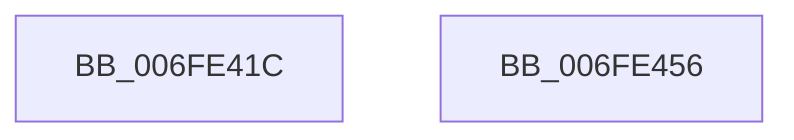

# PopPowerAggregatorNotifyAcDcStateChange

- RVA: `0x006FE41C`–`0x006FE457` (길이 `59` bytes)
- VA: `0x00000001406FE41C`
- 실행 섹션: `PAGE`
- PDB 이름 있음: `예`; PDB Function 태그: `아니요`
- unwind 정보 RVA: `0x0005C788`
- 디코드: `13`개 명령, `59/59` bytes 표시
- 미해석 바이트: `0` (있으면 어셈블리에 `.byte`로 보존)

> 이 문서는 커널 이미지의 기계어와 PDB 기호를 분석해 생성했습니다. 4번과 5번은 함수 원형과 자료형을 바이너리 사용 방식에서 추정한 C 해석이며 원본 소스 복구 결과는 아닙니다.

## 1. Dependencies

- 직접 호출 지점: **6**; 고유 호출 대상: **6**
- 직접 호출자로 확인된 함수: **1**
- RIP 상대 이미지 참조: **1**

### Outgoing calls
- `0x006FE420` → [PopAcquirePolicyLock](../../pagelk/B7/PopAcquirePolicyLock_function_00B783C0.md) (function, `0x00B783C0`)
- `0x006FE42A` → [PopSmartSuspendMakePredictions](../AD/PopSmartSuspendMakePredictions_function_00AD9168.md) (function, `0x00AD9168`)
- `0x006FE436` → [PopAcquireRwLockExclusive](../../text/43/PopAcquireRwLockExclusive_function_00430B44.md) (function, `0x00430B44`)
- `0x006FE43B` → [PopPowerAggregatorEvaluateDozeTimers](PopPowerAggregatorEvaluateDozeTimers_function_006FE460.md) (function, `0x006FE460`)
- `0x006FE447` → [PopReleaseRwLock](../../text/2D/PopReleaseRwLock_function_002DFBBC.md) (function, `0x002DFBBC`)
- `0x006FE44C` → [PopReleasePolicyLock](../../pagelk/B7/PopReleasePolicyLock_function_00B78410.md) (function, `0x00B78410`)

### Direct callers
- [PopPowerSourceChangeCallback](../../text/4C/PopPowerSourceChangeCallback_function_004C3A60.md) at `0x004C3C6C`

### Static image references
- `0x006FE42F` → RVA `0x00F09710` (`.data`; read)

## 2. Other-region calls and transfers

- 다른 실행 섹션으로 향하는 call: **4**
  - `0x006FE420` → [PopAcquirePolicyLock](../../pagelk/B7/PopAcquirePolicyLock_function_00B783C0.md) (`PAGE` → `PAGELK`)
  - `0x006FE436` → [PopAcquireRwLockExclusive](../../text/43/PopAcquireRwLockExclusive_function_00430B44.md) (`PAGE` → `.text`)
  - `0x006FE447` → [PopReleaseRwLock](../../text/2D/PopReleaseRwLock_function_002DFBBC.md) (`PAGE` → `.text`)
  - `0x006FE44C` → [PopReleasePolicyLock](../../pagelk/B7/PopReleasePolicyLock_function_00B78410.md) (`PAGE` → `PAGELK`)
- 별도 외부 분기/꼬리 이동을 확인하지 못했습니다.

## 3. Assembly (complete function range)

```asm
006FE41C  48 83 EC 28                     sub rsp, 0x28
006FE420  E8 9B 9F 47 00                  call 0x140b783c0
006FE425  B9 03 00 00 00                  mov ecx, 3
006FE42A  E8 39 AD 3D 00                  call 0x140ad9168
006FE42F  48 8D 0D DA B2 80 00            lea rcx, [rip + 0x80b2da]
006FE436  E8 09 27 D3 FF                  call 0x140430b44
006FE43B  E8 20 00 00 00                  call 0x1406fe460
006FE440  48 8D 0D C9 B2 80 00            lea rcx, [rip + 0x80b2c9]
006FE447  E8 70 17 BE FF                  call 0x1402dfbbc
006FE44C  E8 BF 9F 47 00                  call 0x140b78410
006FE451  48 83 C4 28                     add rsp, 0x28
006FE455  C3                              ret
006FE456  CC                              int3
```

## 4. C-style interpretation (structured pseudocode)

```c
__int64 __fastcall PopPowerAggregatorNotifyAcDcStateChange(void)
{
    __int64 result;
    __int64 v_rsp;

    v_rsp = (v_rsp) - (40);
    result = PopAcquirePolicyLock(a1, a2, a3, a4);
    result = PopSmartSuspendMakePredictions(3, a2, a3, a4);
    result = PopAcquireRwLockExclusive(v_rip + 8434394, a2, a3, a4);
    result = PopPowerAggregatorEvaluateDozeTimers(v_rip + 8434394, a2, a3, a4);
    result = PopReleaseRwLock(v_rip + 8434377, a2, a3, a4);
    result = PopReleasePolicyLock(v_rip + 8434377, a2, a3, a4);
    v_rsp = (v_rsp) + (40);
    return result;
}
```

## 5. (Beta) C Style

```c
void PopPowerAggregatorNotifyAcDcStateChange(void)
{
    int64_t result;
    int64_t local_rsp;

    local_rsp = (local_rsp) - (40);
    result = PopAcquirePolicyLock(a1, a2, a3, a4);
    result = PopSmartSuspendMakePredictions(3, a2, a3, a4);
    result = PopAcquireRwLockExclusive(v_rip + 8434394, a2, a3, a4);
    result = PopPowerAggregatorEvaluateDozeTimers(v_rip + 8434394, a2, a3, a4);
    result = PopReleaseRwLock(v_rip + 8434377, a2, a3, a4);
    result = PopReleasePolicyLock(v_rip + 8434377, a2, a3, a4);
    local_rsp = (local_rsp) + (40);
    return result;
}
```

## 6. Execution-region graph

[열기: 2D/3D 그래프와 함수 탐색 컨트롤 패널](../../../control-panel.html?section=page&rva=0x006FE41C&view=graph)

- 2D 그래프는 위에서 아래로 흐르고, 3D 그래프는 빈 공간을 드래그해 회전합니다. Shift+드래그는 이동, 휠은 확대·축소, 함수 노드 선택은 대상 보고서 이동입니다.

### Static fallback


