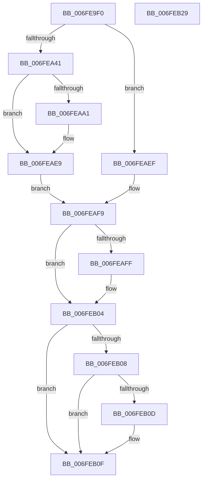

# PopSetHiberPersistedRegValue

- RVA: `0x006FE9F0`–`0x006FEB2A` (길이 `314` bytes)
- VA: `0x00000001406FE9F0`
- 실행 섹션: `PAGE`
- PDB 이름 있음: `예`; PDB Function 태그: `아니요`
- unwind 정보 RVA: `0x000BECC0`
- 디코드: `86`개 명령, `314/314` bytes 표시
- 미해석 바이트: `0` (있으면 어셈블리에 `.byte`로 보존)

> 이 문서는 커널 이미지의 기계어와 PDB 기호를 분석해 생성했습니다. 4번과 5번은 함수 원형과 자료형을 바이너리 사용 방식에서 추정한 C 해석이며 원본 소스 복구 결과는 아닙니다.

## 1. Dependencies

- 직접 호출 지점: **5**; 고유 호출 대상: **4**
- 직접 호출자로 확인된 함수: **3**
- RIP 상대 이미지 참조: **2**

### Outgoing calls
- `0x006FEA45` → [RtlInitUnicodeString](../../text/42/RtlInitUnicodeString_function_0042A780.md) (function, `0x0042A780`)
- `0x006FEA8E` → [ZwCreateKey](../../text/6A/ZwCreateKey_function_006AD470.md) (function, `0x006AD470`)
- `0x006FEAB4` → [RtlInitUnicodeString](../../text/42/RtlInitUnicodeString_function_0042A780.md) (function, `0x0042A780`)
- `0x006FEAD8` → [ZwSetValueKey](../../text/6A/ZwSetValueKey_function_006ADCD0.md) (function, `0x006ADCD0`)
- `0x006FEAFF` → [ZwClose](../../text/6A/ZwClose_function_006AD2B0.md) (function, `0x006AD2B0`)

### Direct callers
- [PopSetHiberFileType](../70/PopSetHiberFileType_function_00703268.md) at `0x007032F5`
- [PopSetHiberFileSize](../70/PopSetHiberFileSize_function_00703974.md) at `0x00703A0D`
- [NtPowerInformation](../95/NtPowerInformation_function_00955D80.md) at `0x0095660D`

### Static image references
- `0x006FEA0D` → RVA `0x00F0DE50` (`.data`; read)
- `0x006FEAA1` → RVA `0x00E07520` (`.data`; read)

## 2. Other-region calls and transfers

- 다른 실행 섹션으로 향하는 call: **5**
  - `0x006FEA45` → [RtlInitUnicodeString](../../text/42/RtlInitUnicodeString_function_0042A780.md) (`PAGE` → `.text`)
  - `0x006FEA8E` → [ZwCreateKey](../../text/6A/ZwCreateKey_function_006AD470.md) (`PAGE` → `.text`)
  - `0x006FEAB4` → [RtlInitUnicodeString](../../text/42/RtlInitUnicodeString_function_0042A780.md) (`PAGE` → `.text`)
  - `0x006FEAD8` → [ZwSetValueKey](../../text/6A/ZwSetValueKey_function_006ADCD0.md) (`PAGE` → `.text`)
  - `0x006FEAFF` → [ZwClose](../../text/6A/ZwClose_function_006AD2B0.md) (`PAGE` → `.text`)
- 별도 외부 분기/꼬리 이동을 확인하지 못했습니다.

## 3. Assembly (complete function range)

```asm
006FE9F0  48 8B C4                        mov rax, rsp
006FE9F3  48 89 58 08                     mov qword ptr [rax + 8], rbx
006FE9F7  48 89 70 18                     mov qword ptr [rax + 0x18], rsi
006FE9FB  89 50 10                        mov dword ptr [rax + 0x10], edx
006FE9FE  55                              push rbp
006FE9FF  57                              push rdi
006FEA00  41 56                           push r14
006FEA02  48 8D 68 A1                     lea rbp, [rax - 0x5f]
006FEA06  48 81 EC 90 00 00 00            sub rsp, 0x90
006FEA0D  48 8B 15 3C F4 80 00            mov rdx, qword ptr [rip + 0x80f43c]
006FEA14  33 C0                           xor eax, eax
006FEA16  21 45 33                        and dword ptr [rbp + 0x33], eax
006FEA19  0F 57 C0                        xorps xmm0, xmm0
006FEA1C  89 45 1B                        mov dword ptr [rbp + 0x1b], eax
006FEA1F  49 8B F0                        mov rsi, r8
006FEA22  21 45 1B                        and dword ptr [rbp + 0x1b], eax
006FEA25  4C 63 F1                        movsxd r14, ecx
006FEA28  48 83 C9 FF                     or rcx, 0xffffffffffffffff
006FEA2C  48 89 4D 7F                     mov qword ptr [rbp + 0x7f], rcx
006FEA30  0F 11 45 07                     movups xmmword ptr [rbp + 7], xmm0
006FEA34  0F 11 45 F7                     movups xmmword ptr [rbp - 9], xmm0
006FEA38  48 85 D2                        test rdx, rdx
006FEA3B  0F 84 AE 00 00 00               je 0x1406feaef
006FEA41  48 8D 4D F7                     lea rcx, [rbp - 9]
006FEA45  E8 36 BD D2 FF                  call 0x14042a780
006FEA4A  48 83 64 24 30 00               and qword ptr [rsp + 0x30], 0
006FEA50  48 8D 45 F7                     lea rax, [rbp - 9]
006FEA54  83 64 24 28 00                  and dword ptr [rsp + 0x28], 0
006FEA59  4C 8D 45 17                     lea r8, [rbp + 0x17]
006FEA5D  48 83 65 1F 00                  and qword ptr [rbp + 0x1f], 0
006FEA62  48 8D 4D 7F                     lea rcx, [rbp + 0x7f]
006FEA66  48 83 64 24 20 00               and qword ptr [rsp + 0x20], 0
006FEA6C  0F 57 C0                        xorps xmm0, xmm0
006FEA6F  45 33 C9                        xor r9d, r9d
006FEA72  48 89 45 27                     mov qword ptr [rbp + 0x27], rax
006FEA76  BA 1F 00 02 00                  mov edx, 0x2001f
006FEA7B  C7 45 17 30 00 00 00            mov dword ptr [rbp + 0x17], 0x30
006FEA82  F3 0F 7F 45 37                  movdqu xmmword ptr [rbp + 0x37], xmm0
006FEA87  C7 45 2F 40 02 00 00            mov dword ptr [rbp + 0x2f], 0x240
006FEA8E  E8 DD E9 FA FF                  call 0x1406ad470
006FEA93  8B F8                           mov edi, eax
006FEA95  8B D8                           mov ebx, eax
006FEA97  C1 FF 1F                        sar edi, 0x1f
006FEA9A  83 E7 08                        and edi, 8
006FEA9D  85 C0                           test eax, eax
006FEA9F  78 48                           js 0x1406feae9
006FEAA1  48 8D 05 78 8A 70 00            lea rax, [rip + 0x708a78]
006FEAA8  4B 8D 14 76                     lea rdx, [r14 + r14*2]
006FEAAC  48 8B 14 D0                     mov rdx, qword ptr [rax + rdx*8]
006FEAB0  48 8D 4D 07                     lea rcx, [rbp + 7]
006FEAB4  E8 C7 BC D2 FF                  call 0x14042a780
006FEAB9  48 8B 4D 7F                     mov rcx, qword ptr [rbp + 0x7f]
006FEABD  48 8D 45 6F                     lea rax, [rbp + 0x6f]
006FEAC1  41 B9 04 00 00 00               mov r9d, 4
006FEAC7  48 8D 55 07                     lea rdx, [rbp + 7]
006FEACB  44 89 4C 24 28                  mov dword ptr [rsp + 0x28], r9d
006FEAD0  45 33 C0                        xor r8d, r8d
006FEAD3  48 89 44 24 20                  mov qword ptr [rsp + 0x20], rax
006FEAD8  E8 F3 F1 FA FF                  call 0x1406adcd0
006FEADD  33 FF                           xor edi, edi
006FEADF  8B D8                           mov ebx, eax
006FEAE1  85 DB                           test ebx, ebx
006FEAE3  8D 47 0A                        lea eax, [rdi + 0xa]
006FEAE6  0F 48 F8                        cmovs edi, eax
006FEAE9  48 8B 4D 7F                     mov rcx, qword ptr [rbp + 0x7f]
006FEAED  EB 0A                           jmp 0x1406feaf9
006FEAEF  BF 07 00 00 00                  mov edi, 7
006FEAF4  BB 0D 00 00 C0                  mov ebx, 0xc000000d
006FEAF9  48 83 F9 FF                     cmp rcx, -1
006FEAFD  74 05                           je 0x1406feb04
006FEAFF  E8 AC E7 FA FF                  call 0x1406ad2b0
006FEB04  85 DB                           test ebx, ebx
006FEB06  79 07                           jns 0x1406feb0f
006FEB08  48 85 F6                        test rsi, rsi
006FEB0B  74 02                           je 0x1406feb0f
006FEB0D  89 3E                           mov dword ptr [rsi], edi
006FEB0F  4C 8D 9C 24 90 00 00 00         lea r11, [rsp + 0x90]
006FEB17  8B C3                           mov eax, ebx
006FEB19  49 8B 5B 20                     mov rbx, qword ptr [r11 + 0x20]
006FEB1D  49 8B 73 30                     mov rsi, qword ptr [r11 + 0x30]
006FEB21  49 8B E3                        mov rsp, r11
006FEB24  41 5E                           pop r14
006FEB26  5F                              pop rdi
006FEB27  5D                              pop rbp
006FEB28  C3                              ret
006FEB29  CC                              int3
```

## 4. C-style interpretation (structured pseudocode)

```c
__int64 __fastcall PopSetHiberPersistedRegValue(__int64 a1, int a2, __int64 a3, int a4)
{
    __int64 result;
    __int64 v_rbx;
    __int64 v_rdi;
    __int64 v_rsp;
    unsigned __int64 v_stack_m18;
    unsigned __int64 v_stack_m78;
    unsigned int v_stack_m80;
    unsigned __int64 v_stack_m88;

    *(unsigned __int64 *)(v_rsp + 8) = v_rbx;
    *(unsigned __int64 *)(v_rsp + 24) = v_rsi;
    *(unsigned int *)(v_rsp + 16) = a2;
    v_rsp = (v_rsp) - (144);
    result = 0;
    *(unsigned int *)(v_rsp - 95 + 27) = 0;
    a1 = (a1) | (-1);
    *(unsigned __int64 *)(v_rsp - 95 + 127) = a1;
    *(unsigned __int64 *)(v_rsp - 95 + 7) = v_xmm0;
    *(unsigned __int64 *)(v_rsp - 95 - 9) = v_xmm0;
    if (*(unsigned __int64 *)(v_rip + 8451132) == 0) goto loc_006FEAEF;
    result = RtlInitUnicodeString(v_rsp - 95 - 9, *(unsigned __int64 *)(v_rip + 8451132), a3, a4);
    a4 = 0;
    *(unsigned __int64 *)(v_rsp - 95 + 39) = v_rsp - 95 - 9;
    *(unsigned int *)(v_rsp - 95 + 23) = 48;
    *(unsigned __int64 *)(v_rsp - 95 + 55) = v_xmm0;
    *(unsigned int *)(v_rsp - 95 + 47) = 576;
    result = ZwCreateKey(v_rsp - 95 + 127, (unsigned int)(0x2001FULL), v_rsp - 95 + 23, a4);
    v_rdi = (unsigned int)(((unsigned int)((unsigned int)(result))) >> (31));
    v_rdi = (unsigned int)((v_rdi) & (8));
    v_rbx = (unsigned int)((unsigned int)(result));
    if (!(sign_flag)) {
        result = v_rip + 7375480;
        a2 = (int)((unsigned int)(a1)) + (int)((unsigned int)(a1)) * 2;
        a2 = *(unsigned __int64 *)(result + a2 * 8);
        a1 = v_rsp - 95 + 7;
        result = RtlInitUnicodeString(a1, a2, v_rsp - 95 + 23, a4);
        a1 = *(unsigned __int64 *)(v_rsp - 95 + 127);
        result = v_rsp - 95 + 111;
        a4 = 4;
        a2 = v_rsp - 95 + 7;
        v_stack_m80 = a4;
        a3 = 0;
        v_stack_m88 = result;
        result = ZwSetValueKey(a1, a2, a3, a4);
        v_rdi = 0;
        v_rbx = (unsigned int)(result);
        result = v_rdi + 10;
        if (sign_flag) { v_rdi = (unsigned int)(result); }
    }
    goto loc_006FEAF9;
loc_006FEAEF:
loc_006FEAF9:
    if ((*(unsigned __int64 *)(v_rsp - 95 + 127)) != -1) {
        result = ZwClose(*(unsigned __int64 *)(v_rsp - 95 + 127), a2, a3, a4);
    }
    if (!sign_flag) goto loc_006FEB0F;
    if (0 != 0) {
        *(unsigned int *)(a3) = 7;
    }
    return (unsigned int)((unsigned int)((unsigned int)(0xC000000DULL)));
}
```

## 5. (Beta) C Style

```c
int64_t PopSetHiberPersistedRegValue(void *Arg1, int32_t Arg2, int64_t Arg3, int32_t Arg4)
{
    uint8_t *arg1 = (uint8_t *)Arg1;

    int64_t result;
    int64_t local_rbx;
    int64_t local_rdi;
    int64_t local_rsp;
    uint64_t v_stack_m18;
    uint64_t v_stack_m78;
    uint32_t v_stack_m80;
    uint64_t v_stack_m88;

    *(uint64_t *)(local_rsp + 0x8) = local_rbx;
    *(uint64_t *)(local_rsp + 0x18) = local_rsi;
    *(uint32_t *)(local_rsp + 0x10) = Arg2;
    local_rsp = (local_rsp) - (144);
    result = 0;
    *(uint32_t *)(local_rsp - 0x5F + 0x1B) = 0;
    Arg1 = (Arg1) | (-1);
    *(void **)(local_rsp - 0x5F + 0x7F) = Arg1;
    *(uint64_t *)(local_rsp - 0x5F + 0x7) = v_xmm0;
    *(uint64_t *)(local_rsp - 0x5F - 0x9) = v_xmm0;
    if (*(uint64_t *)(v_rip + 0x80F43C) == 0) goto loc_006FEAEF;
    result = RtlInitUnicodeString(local_rsp - 95 - 9, *(uint64_t *)(v_rip + 0x80F43C), Arg3, Arg4);
    Arg4 = 0;
    *(uint64_t *)(local_rsp - 0x5F + 0x27) = local_rsp - 95 - 9;
    *(uint32_t *)(local_rsp - 0x5F + 0x17) = 48;
    *(uint64_t *)(local_rsp - 0x5F + 0x37) = v_xmm0;
    *(uint32_t *)(local_rsp - 0x5F + 0x2F) = 576;
    result = ZwCreateKey(local_rsp - 95 + 127, (uint32_t)(0x2001FULL), local_rsp - 95 + 23, Arg4);
    local_rdi = (uint32_t)(((uint32_t)((uint32_t)(result))) >> (31));
    local_rdi = (uint32_t)((local_rdi) & (8));
    local_rbx = (uint32_t)((uint32_t)(result));
    if (!(sign_flag)) {
        result = v_rip + 7375480;
        Arg2 = (int32_t)((uint32_t)(Arg1)) + (int32_t)((uint32_t)(Arg1)) * 2;
        Arg2 = *(uint64_t *)(result + Arg2 * 8);
        Arg1 = local_rsp - 95 + 7;
        result = RtlInitUnicodeString(Arg1, Arg2, local_rsp - 95 + 23, Arg4);
        Arg1 = *(uint64_t *)(local_rsp - 0x5F + 0x7F);
        result = local_rsp - 95 + 111;
        Arg4 = 4;
        Arg2 = local_rsp - 95 + 7;
        v_stack_m80 = Arg4;
        Arg3 = 0;
        v_stack_m88 = result;
        result = ZwSetValueKey(Arg1, Arg2, Arg3, Arg4);
        local_rdi = 0;
        local_rbx = (uint32_t)(result);
        result = local_rdi + 10;
        if (sign_flag) { local_rdi = (uint32_t)(result); }
    }
    goto loc_006FEAF9;
loc_006FEAEF:
loc_006FEAF9:
    if ((*(uint64_t *)(local_rsp - 0x5F + 0x7F)) != -1) {
        result = ZwClose(*(uint64_t *)(local_rsp - 0x5F + 0x7F), Arg2, Arg3, Arg4);
    }
    if (!sign_flag) goto loc_006FEB0F;
    if (0 != 0) {
        *(uint32_t *)(Arg3) = 7;
    }
    return (uint32_t)((uint32_t)((uint32_t)(0xC000000DULL)));
}
```

### 관측된 메모리 오프셋

구조체 형식이 확인되지 않은 접근은 인자 기준의 오프셋으로만 기록했습니다.

| 기준 인자 | 오프셋 표현 | 폭 (bit) | 접근 |
|---|---:|---:|---|
| `Arg1` | `+ 0x0 + r14*2` | `64` | `R` |

## 6. Execution-region graph

[열기: 2D/3D 그래프와 함수 탐색 컨트롤 패널](../../../control-panel.html?section=page&rva=0x006FE9F0&view=graph)

- 2D 그래프는 위에서 아래로 흐르고, 3D 그래프는 빈 공간을 드래그해 회전합니다. Shift+드래그는 이동, 휠은 확대·축소, 함수 노드 선택은 대상 보고서 이동입니다.

### Static fallback


