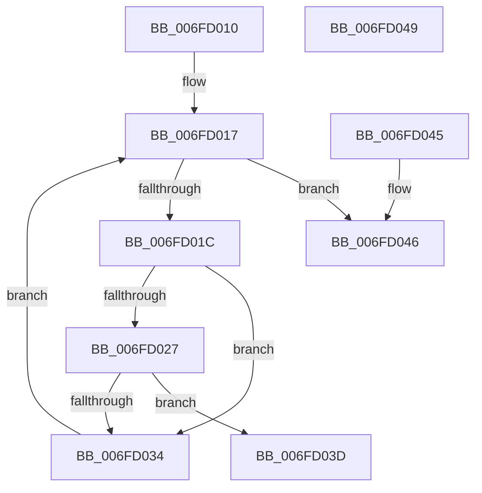

# PsGetUILimitJobProvider

- RVA: `0x006FD010`–`0x006FD04A` (길이 `58` bytes)
- VA: `0x00000001406FD010`
- 실행 섹션: `PAGE`
- PDB 이름 있음: `예`; PDB Function 태그: `아니요`
- unwind 정보 RVA: `0x000DB714`
- 디코드: `18`개 명령, `58/58` bytes 표시
- 미해석 바이트: `0` (있으면 어셈블리에 `.byte`로 보존)

> 이 문서는 커널 이미지의 기계어와 PDB 기호를 분석해 생성했습니다. 4번과 5번은 함수 원형과 자료형을 바이너리 사용 방식에서 추정한 C 해석이며 원본 소스 복구 결과는 아닙니다.

## 1. Dependencies

- 직접 호출 지점: **0**; 고유 호출 대상: **0**
- 직접 호출자로 확인된 함수: **0**
- RIP 상대 이미지 참조: **0**

### Outgoing calls
- 직접 디코드된 call 명령이 없습니다.

### Direct callers
- 이 함수 시작 RVA로 연결되는 직접 call은 확인되지 않았습니다. 간접 호출은 완전히 역산할 수 없습니다.

### Static image references
- 디코드된 RIP-relative 메모리 참조가 없습니다.

## 2. Other-region calls and transfers

- 다른 실행 섹션으로 향하는 call: **0**
- 별도 외부 분기/꼬리 이동을 확인하지 못했습니다.

## 3. Assembly (complete function range)

```asm
006FD010  4C 8B 81 A0 02 00 00            mov r8, qword ptr [rcx + 0x2a0]
006FD017  4D 85 C0                        test r8, r8
006FD01A  74 2A                           je 0x1406fd046
006FD01C  41 8B 80 10 06 00 00            mov eax, dword ptr [r8 + 0x610]
006FD023  A8 10                           test al, 0x10
006FD025  74 0D                           je 0x1406fd034
006FD027  41 8B 80 20 02 00 00            mov eax, dword ptr [r8 + 0x220]
006FD02E  23 C2                           and eax, edx
006FD030  3B C2                           cmp eax, edx
006FD032  74 09                           je 0x1406fd03d
006FD034  4D 8B 80 18 05 00 00            mov r8, qword ptr [r8 + 0x518]
006FD03B  EB DA                           jmp 0x1406fd017
006FD03D  41 8B 80 BC 05 00 00            mov eax, dword ptr [r8 + 0x5bc]
006FD044  C3                              ret
006FD045  CC                              int3
006FD046  33 C0                           xor eax, eax
006FD048  C3                              ret
006FD049  CC                              int3
```

## 4. C-style interpretation (structured pseudocode)

```c
__int64 __fastcall PsGetUILimitJobProvider(__int64 a1, int a2)
{
    __int64 result;

loc_006FD017:
    if (*(unsigned __int64 *)(a1 + 672) == 0) goto loc_006FD046;
    if ((((unsigned __int8)((unsigned int)(*(unsigned int *)(*(unsigned __int64 *)(a1 + 672) + 1552)))) & (16)) == 0) goto loc_006FD034;
    result = (unsigned int)(((unsigned int)(*(unsigned int *)(*(unsigned __int64 *)(a1 + 672) + 544))) & (a2));
    if (((unsigned int)(result)) == a2) goto loc_006FD03D;
loc_006FD034:
    goto loc_006FD017;
loc_006FD03D:
    return (unsigned int)(*(unsigned int *)(*(unsigned __int64 *)(*(unsigned __int64 *)(a1 + 672) + 1304) + 1468));
loc_006FD046:
    result = 0;
    return result;
}
```

## 5. (Beta) C Style

```c
int64_t PsGetUILimitJobProvider(void *Arg1, int32_t Arg2)
{
    uint8_t *arg1 = (uint8_t *)Arg1;

    int64_t result;

loc_006FD017:
    if (*(uint64_t *)(arg1 + 0x2A0) == 0) goto loc_006FD046;
    if ((((uint8_t)((uint32_t)(*(uint32_t *)(*(uint64_t *)(arg1 + 0x2A0) + 0x610)))) & (16)) == 0) goto loc_006FD034;
    result = (uint32_t)(((uint32_t)(*(uint32_t *)(*(uint64_t *)(arg1 + 0x2A0) + 0x220))) & (Arg2));
    if (((uint32_t)(result)) == Arg2) goto loc_006FD03D;
loc_006FD034:
    goto loc_006FD017;
loc_006FD03D:
    return (uint32_t)(*(uint32_t *)(*(uint64_t *)(*(uint64_t *)(arg1 + 0x2A0) + 0x518) + 0x5BC));
loc_006FD046:
    result = 0;
    return result;
}
```

### 관측된 메모리 오프셋

구조체 형식이 확인되지 않은 접근은 인자 기준의 오프셋으로만 기록했습니다.

| 기준 인자 | 오프셋 표현 | 폭 (bit) | 접근 |
|---|---:|---:|---|
| `Arg1` | `+ 0x2A0` | `64` | `R` |

## 6. Execution-region graph

[열기: 2D/3D 그래프와 함수 탐색 컨트롤 패널](../../../control-panel.html?section=page&rva=0x006FD010&view=graph)

- 2D 그래프는 위에서 아래로 흐르고, 3D 그래프는 빈 공간을 드래그해 회전합니다. Shift+드래그는 이동, 휠은 확대·축소, 함수 노드 선택은 대상 보고서 이동입니다.

### Static fallback


