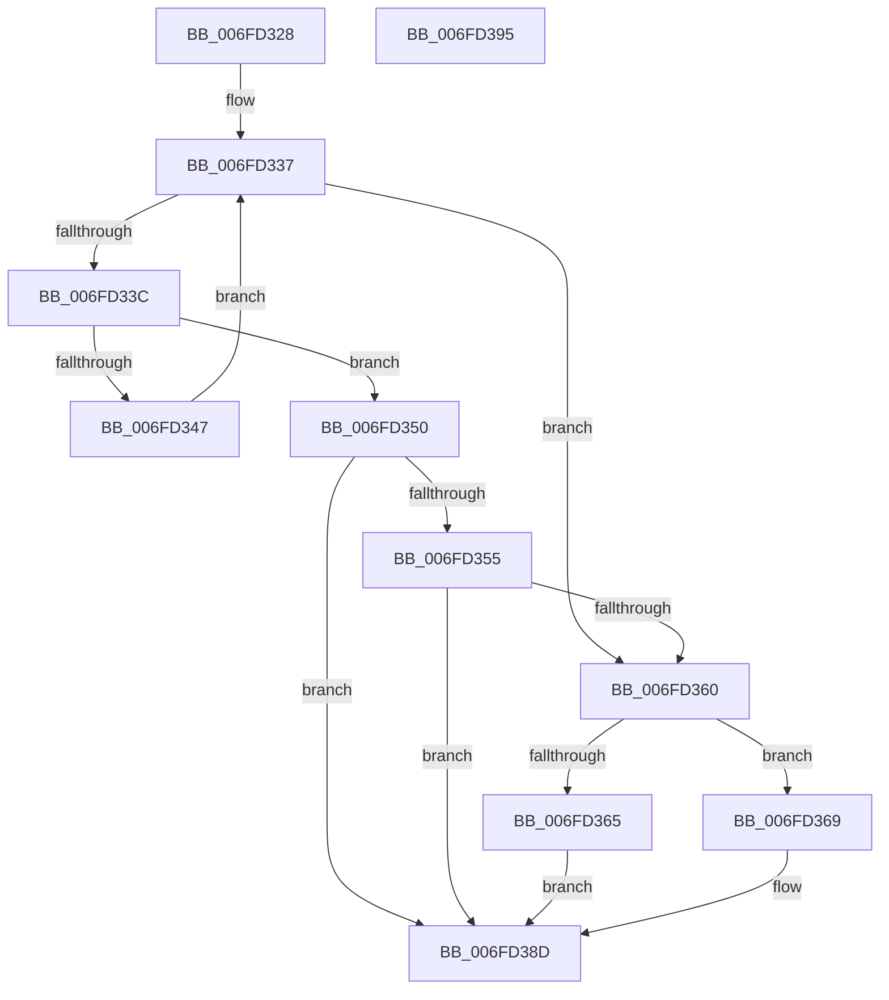

# PspDoesJobHierarchyPermitUILimits

- RVA: `0x006FD328`–`0x006FD396` (길이 `110` bytes)
- VA: `0x00000001406FD328`
- 실행 섹션: `PAGE`
- PDB 이름 있음: `예`; PDB Function 태그: `아니요`
- unwind 정보 RVA: `0x00064C80`
- 디코드: `33`개 명령, `110/110` bytes 표시
- 미해석 바이트: `0` (있으면 어셈블리에 `.byte`로 보존)

> 이 문서는 커널 이미지의 기계어와 PDB 기호를 분석해 생성했습니다. 4번과 5번은 함수 원형과 자료형을 바이너리 사용 방식에서 추정한 C 해석이며 원본 소스 복구 결과는 아닙니다.

## 1. Dependencies

- 직접 호출 지점: **1**; 고유 호출 대상: **1**
- 직접 호출자로 확인된 함수: **2**
- RIP 상대 이미지 참조: **1**

### Outgoing calls
- `0x006FD383` → [PspEnumJobsAndProcessesInJobHierarchy](../91/PspEnumJobsAndProcessesInJobHierarchy_function_0091A1EC.md) (function, `0x0091A1EC`)

### Direct callers
- [PspSetUILimitJobObject](PspSetUILimitJobObject_function_006FD218.md) at `0x006FD264`
- [PspValidateJobAssignmentUILimits](../AB/PspValidateJobAssignmentUILimits_function_00AB913C.md) at `0x00AB9188`

### Static image references
- `0x006FD371` → RVA `0x00A95350` (`PspDoesJobHierarchyPermitUILimitsCallback`; read)

## 2. Other-region calls and transfers

- 다른 실행 섹션으로 향하는 call: **0**
- 별도 외부 분기/꼬리 이동을 확인하지 못했습니다.

## 3. Assembly (complete function range)

```asm
006FD328  40 53                           push rbx
006FD32A  48 83 EC 30                     sub rsp, 0x30
006FD32E  4C 8B 81 18 05 00 00            mov r8, qword ptr [rcx + 0x518]
006FD335  33 DB                           xor ebx, ebx
006FD337  4D 85 C0                        test r8, r8
006FD33A  74 24                           je 0x1406fd360
006FD33C  41 8B 80 10 06 00 00            mov eax, dword ptr [r8 + 0x610]
006FD343  A8 10                           test al, 0x10
006FD345  75 09                           jne 0x1406fd350
006FD347  4D 8B 80 18 05 00 00            mov r8, qword ptr [r8 + 0x518]
006FD34E  EB E7                           jmp 0x1406fd337
006FD350  F6 C2 02                        test dl, 2
006FD353  74 38                           je 0x1406fd38d
006FD355  41 8B 80 14 06 00 00            mov eax, dword ptr [r8 + 0x614]
006FD35C  A8 10                           test al, 0x10
006FD35E  74 2D                           je 0x1406fd38d
006FD360  F6 C2 01                        test dl, 1
006FD363  74 04                           je 0x1406fd369
006FD365  B3 01                           mov bl, 1
006FD367  EB 24                           jmp 0x1406fd38d
006FD369  C7 44 24 28 01 00 00 00         mov dword ptr [rsp + 0x28], 1
006FD371  48 8D 15 D8 7F 39 00            lea rdx, [rip + 0x397fd8]
006FD378  45 33 C9                        xor r9d, r9d
006FD37B  48 89 4C 24 20                  mov qword ptr [rsp + 0x20], rcx
006FD380  45 33 C0                        xor r8d, r8d
006FD383  E8 64 CE 21 00                  call 0x14091a1ec
006FD388  85 C0                           test eax, eax
006FD38A  0F 99 C3                        setns bl
006FD38D  8A C3                           mov al, bl
006FD38F  48 83 C4 30                     add rsp, 0x30
006FD393  5B                              pop rbx
006FD394  C3                              ret
006FD395  CC                              int3
```

## 4. C-style interpretation (structured pseudocode)

```c
__int64 __fastcall PspDoesJobHierarchyPermitUILimits(__int64 a1, unsigned __int8 a2, __int64 a3, int a4)
{
    __int64 result;
    __int64 v_rbx;
    __int64 v_rsp;
    unsigned int v_stack_m10;
    unsigned __int64 v_stack_m18;

    v_rsp = (v_rsp) - (48);
    v_rbx = 0;
loc_006FD337:
    if (*(unsigned __int64 *)(a1 + 1304) == 0) goto loc_006FD360;
    if ((((unsigned __int8)((unsigned int)(*(unsigned int *)(*(unsigned __int64 *)(a1 + 1304) + 1552)))) & (16)) != 0) goto loc_006FD350;
    goto loc_006FD337;
loc_006FD350:
    if (((a2) & (2)) == 0) goto loc_006FD38D;
    if ((((unsigned __int8)((unsigned int)(*(unsigned int *)(*(unsigned __int64 *)(*(unsigned __int64 *)(a1 + 1304) + 1304) + 1556)))) & (16)) == 0) goto loc_006FD38D;
loc_006FD360:
    if (((a2) & (1)) == 0) goto loc_006FD369;
    goto loc_006FD38D;
loc_006FD369:
    v_stack_m10 = 1;
    a4 = 0;
    v_stack_m18 = a1;
    a3 = 0;
    result = PspEnumJobsAndProcessesInJobHierarchy(a1, v_rip + 3768280, a3, a4);
    v_rbx = (!sign_flag) ? 1 : 0;
loc_006FD38D:
    v_rsp = (v_rsp) + (48);
    return (unsigned __int8)(v_rbx);
}
```

## 5. (Beta) C Style

```c
int64_t PspDoesJobHierarchyPermitUILimits(void *Arg1, uint8_t Arg2, int64_t Arg3, int32_t Arg4)
{
    uint8_t *arg1 = (uint8_t *)Arg1;

    int64_t result;
    int64_t local_rbx;
    int64_t local_rsp;
    uint32_t v_stack_m10;
    uint64_t v_stack_m18;

    local_rsp = (local_rsp) - (48);
    local_rbx = 0;
loc_006FD337:
    if (*(uint64_t *)(arg1 + 0x518) == 0) goto loc_006FD360;
    if ((((uint8_t)((uint32_t)(*(uint32_t *)(*(uint64_t *)(arg1 + 0x518) + 0x610)))) & (16)) != 0) goto loc_006FD350;
    goto loc_006FD337;
loc_006FD350:
    if (((Arg2) & (2)) == 0) goto loc_006FD38D;
    if ((((uint8_t)((uint32_t)(*(uint32_t *)(*(uint64_t *)(*(uint64_t *)(arg1 + 0x518) + 0x518) + 0x614)))) & (16)) == 0) goto loc_006FD38D;
loc_006FD360:
    if (((Arg2) & (1)) == 0) goto loc_006FD369;
    goto loc_006FD38D;
loc_006FD369:
    v_stack_m10 = 1;
    Arg4 = 0;
    v_stack_m18 = Arg1;
    Arg3 = 0;
    result = PspEnumJobsAndProcessesInJobHierarchy(Arg1, v_rip + 3768280, Arg3, Arg4);
    local_rbx = (!sign_flag) ? 1 : 0;
loc_006FD38D:
    local_rsp = (local_rsp) + (48);
    return (uint8_t)(local_rbx);
}
```

### 관측된 메모리 오프셋

구조체 형식이 확인되지 않은 접근은 인자 기준의 오프셋으로만 기록했습니다.

| 기준 인자 | 오프셋 표현 | 폭 (bit) | 접근 |
|---|---:|---:|---|
| `Arg1` | `+ 0x518` | `64` | `R` |

## 6. Execution-region graph

[열기: 2D/3D 그래프와 함수 탐색 컨트롤 패널](../../../control-panel.html?section=page&rva=0x006FD328&view=graph)

- 2D 그래프는 위에서 아래로 흐르고, 3D 그래프는 빈 공간을 드래그해 회전합니다. Shift+드래그는 이동, 휠은 확대·축소, 함수 노드 선택은 대상 보고서 이동입니다.

### Static fallback


