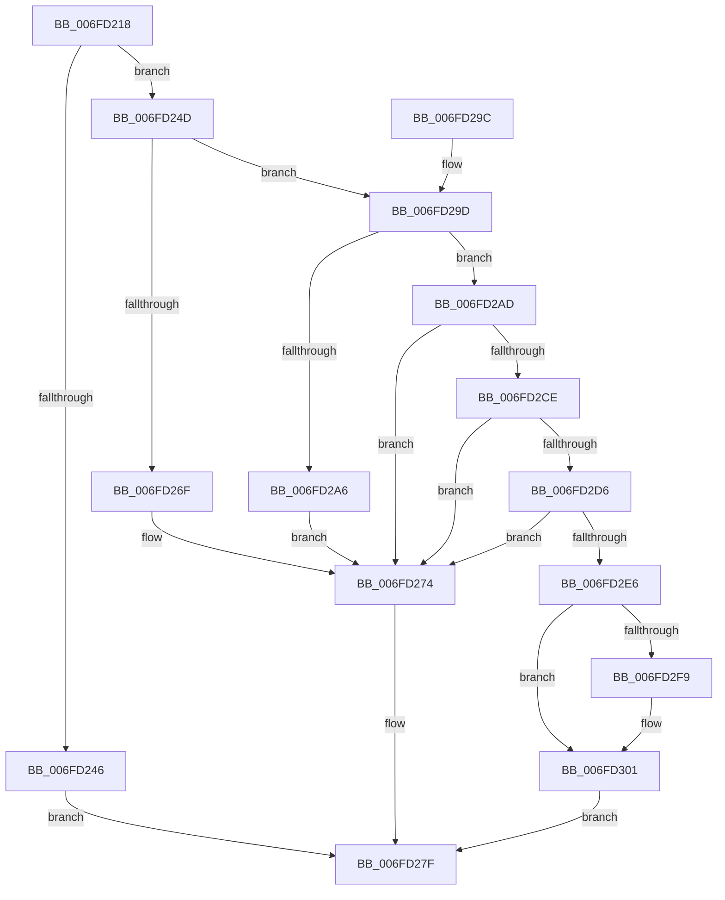

# PspSetUILimitJobObject

- RVA: `0x006FD218`–`0x006FD320` (길이 `264` bytes)
- VA: `0x00000001406FD218`
- 실행 섹션: `PAGE`
- PDB 이름 있음: `예`; PDB Function 태그: `아니요`
- unwind 정보 RVA: `0x000BC290`
- 디코드: `67`개 명령, `264/264` bytes 표시
- 미해석 바이트: `0` (있으면 어셈블리에 `.byte`로 보존)

> 이 문서는 커널 이미지의 기계어와 PDB 기호를 분석해 생성했습니다. 4번과 5번은 함수 원형과 자료형을 바이너리 사용 방식에서 추정한 C 해석이며 원본 소스 복구 결과는 아닙니다.

## 1. Dependencies

- 직접 호출 지점: **7**; 고유 호출 대상: **6**
- 직접 호출자로 확인된 함수: **2**
- RIP 상대 이미지 참조: **2**

### Outgoing calls
- `0x006FD250` → [PspLockJobChain](../87/PspLockJobChain_function_0087DAD0.md) (function, `0x0087DAD0`)
- `0x006FD264` → [PspDoesJobHierarchyPermitUILimits](PspDoesJobHierarchyPermitUILimits_function_006FD328.md) (function, `0x006FD328`)
- `0x006FD27A` → [PspUnlockJobChain](../87/PspUnlockJobChain_function_0087DC78.md) (function, `0x0087DC78`)
- `0x006FD2C0` → [PspBindProcessSessionToJob](../87/PspBindProcessSessionToJob_function_0087E660.md) (function, `0x0087E660`)
- `0x006FD2D6` → `ext-ms-win-ntos-win32k-l1-1-0.dll!IsWin32kJobNotifyCallOutPresent` (import, 간접 대상; import `ext-ms-win-ntos-win32k-l1-1-0.dll!IsWin32kJobNotifyCallOutPresent`)
- `0x006FD307` → [PspUnlockJobChain](../87/PspUnlockJobChain_function_0087DC78.md) (function, `0x0087DC78`)
- `0x006FD30F` → `ext-ms-win-ntos-win32k-l1-1-0.dll!Win32kJobUpdateUIRestrictionsNotify` (import, 간접 대상; import `ext-ms-win-ntos-win32k-l1-1-0.dll!Win32kJobUpdateUIRestrictionsNotify`)

### Direct callers
- [PsSystemSetUILimitJobObject](../78/PsSystemSetUILimitJobObject_function_00784B10.md) at `0x00784B26`
- [NtSetInformationJobObject](../9F/NtSetInformationJobObject_function_009F84C0.md) at `0x009F8B45`

### Static image references
- `0x006FD2D6` → RVA `0x00151690` (`ext-ms-win-ntos-win32k-l1-1-0.dll!IsWin32kJobNotifyCallOutPresent (IAT)`; read)
- `0x006FD30F` → RVA `0x00151698` (`ext-ms-win-ntos-win32k-l1-1-0.dll!Win32kJobUpdateUIRestrictionsNotify (IAT)`; read)

## 2. Other-region calls and transfers

- 다른 실행 섹션으로 향하는 call: **0**
- 별도 외부 분기/꼬리 이동을 확인하지 못했습니다.

## 3. Assembly (complete function range)

```asm
006FD218  48 8B C4                        mov rax, rsp
006FD21B  48 89 58 08                     mov qword ptr [rax + 8], rbx
006FD21F  48 89 68 10                     mov qword ptr [rax + 0x10], rbp
006FD223  48 89 70 18                     mov qword ptr [rax + 0x18], rsi
006FD227  48 89 78 20                     mov qword ptr [rax + 0x20], rdi
006FD22B  41 56                           push r14
006FD22D  48 83 EC 20                     sub rsp, 0x20
006FD231  45 8B F1                        mov r14d, r9d
006FD234  41 8B F0                        mov esi, r8d
006FD237  48 8B EA                        mov rbp, rdx
006FD23A  48 8B D9                        mov rbx, rcx
006FD23D  41 F7 C0 00 FC FF FF            test r8d, 0xfffffc00
006FD244  74 07                           je 0x1406fd24d
006FD246  BF 0D 00 00 C0                  mov edi, 0xc000000d
006FD24B  EB 32                           jmp 0x1406fd27f
006FD24D  45 33 C0                        xor r8d, r8d
006FD250  E8 7B 08 18 00                  call 0x14087dad0
006FD255  41 83 E6 01                     and r14d, 1
006FD259  48 8B CB                        mov rcx, rbx
006FD25C  41 8B D6                        mov edx, r14d
006FD25F  83 F2 01                        xor edx, 1
006FD262  03 D2                           add edx, edx
006FD264  E8 BF 00 00 00                  call 0x1406fd328
006FD269  33 FF                           xor edi, edi
006FD26B  84 C0                           test al, al
006FD26D  75 2E                           jne 0x1406fd29d
006FD26F  BF BB 00 00 C0                  mov edi, 0xc00000bb
006FD274  48 8B D5                        mov rdx, rbp
006FD277  48 8B CB                        mov rcx, rbx
006FD27A  E8 F9 09 18 00                  call 0x14087dc78
006FD27F  48 8B 5C 24 30                  mov rbx, qword ptr [rsp + 0x30]
006FD284  8B C7                           mov eax, edi
006FD286  48 8B 7C 24 48                  mov rdi, qword ptr [rsp + 0x48]
006FD28B  48 8B 6C 24 38                  mov rbp, qword ptr [rsp + 0x38]
006FD290  48 8B 74 24 40                  mov rsi, qword ptr [rsp + 0x40]
006FD295  48 83 C4 20                     add rsp, 0x20
006FD299  41 5E                           pop r14
006FD29B  C3                              ret
006FD29C  CC                              int3
006FD29D  83 BB 40 02 00 00 FE            cmp dword ptr [rbx + 0x240], -2
006FD2A4  75 07                           jne 0x1406fd2ad
006FD2A6  BF 22 00 00 C0                  mov edi, 0xc0000022
006FD2AB  EB C7                           jmp 0x1406fd274
006FD2AD  65 48 8B 14 25 88 01 00 00      mov rdx, qword ptr gs:[0x188]
006FD2B6  48 8B CB                        mov rcx, rbx
006FD2B9  48 8B 92 B8 00 00 00            mov rdx, qword ptr [rdx + 0xb8]
006FD2C0  E8 9B 13 18 00                  call 0x14087e660
006FD2C5  83 BB 40 02 00 00 FD            cmp dword ptr [rbx + 0x240], -3
006FD2CC  77 A6                           ja 0x1406fd274
006FD2CE  39 B3 20 02 00 00               cmp dword ptr [rbx + 0x220], esi
006FD2D4  74 9E                           je 0x1406fd274
006FD2D6  48 FF 15 B3 43 A5 FF            call qword ptr [rip - 0x5abc4d]
006FD2DD  0F 1F 44 00 00                  nop dword ptr [rax + rax]
006FD2E2  84 C0                           test al, al
006FD2E4  74 8E                           je 0x1406fd274
006FD2E6  89 B3 20 02 00 00               mov dword ptr [rbx + 0x220], esi
006FD2EC  F0 83 8B 10 06 00 00 10         lock or dword ptr [rbx + 0x610], 0x10
006FD2F4  45 85 F6                        test r14d, r14d
006FD2F7  74 08                           je 0x1406fd301
006FD2F9  F0 83 8B 14 06 00 00 10         lock or dword ptr [rbx + 0x614], 0x10
006FD301  48 8B D5                        mov rdx, rbp
006FD304  48 8B CB                        mov rcx, rbx
006FD307  E8 6C 09 18 00                  call 0x14087dc78
006FD30C  48 8B CB                        mov rcx, rbx
006FD30F  48 FF 15 82 43 A5 FF            call qword ptr [rip - 0x5abc7e]
006FD316  0F 1F 44 00 00                  nop dword ptr [rax + rax]
006FD31B  E9 5F FF FF FF                  jmp 0x1406fd27f
```

## 4. C-style interpretation (structured pseudocode)

```c
__int64 __fastcall PspSetUILimitJobObject(__int64 a1, __int64 a2, int a3, int a4)
{
    __int64 result;
    __int64 v_r14;
    __int64 v_rdi;
    __int64 v_rsp;
    unsigned __int64 v_stack_p10;
    unsigned __int64 v_stack_p18;
    unsigned __int64 v_stack_p20;
    unsigned __int64 v_stack_p8;

    *(unsigned __int64 *)(v_rsp + 8) = v_rbx;
    *(unsigned __int64 *)(v_rsp + 16) = v_rbp;
    *(unsigned __int64 *)(v_rsp + 24) = v_rsi;
    *(unsigned __int64 *)(v_rsp + 32) = v_rdi;
    v_rsp = (v_rsp) - (32);
    if (((a3) & (0xFFFFFC00ULL)) == 0) goto loc_006FD24D;
    goto loc_006FD27F;
loc_006FD24D:
    a3 = 0;
    result = PspLockJobChain(a1, a2, a3, a4);
    v_r14 = (unsigned int)(((unsigned int)(a4)) & (1));
    a2 = (unsigned int)(((unsigned int)((unsigned int)(v_r14))) ^ (1));
    a2 = (unsigned int)((a2) + ((unsigned int)(a2)));
    result = PspDoesJobHierarchyPermitUILimits(a1, a2, a3, a4);
    v_rdi = 0;
    if ((unsigned __int8)(result) != 0) goto loc_006FD29D;
loc_006FD274:
    result = PspUnlockJobChain(a1, a2, a3, a4);
loc_006FD27F:
    v_rsp = (v_rsp) + (32);
    return (unsigned int)((unsigned int)((unsigned int)(0xC00000BBULL)));
loc_006FD29D:
    if ((*(unsigned int *)(v_stack_p8 + 576)) != -2) goto loc_006FD2AD;
    goto loc_006FD274;
loc_006FD2AD:
    result = PspBindProcessSessionToJob(v_stack_p8, *(unsigned __int64 *)(*(unsigned __int64 *)(gs_base + (0 + 392)) + 184), a3, a4);
    if ((*(unsigned int *)(v_stack_p8 + 576)) > -3) goto loc_006FD274;
    if ((*(unsigned int *)(v_stack_p8 + 544)) == ((unsigned int)(v_stack_p18))) goto loc_006FD274;
    result = ext_ms_win_ntos_win32k_l1_1_0_dll_IsWin32kJobNotifyCallOutPresent(v_stack_p8, *(unsigned __int64 *)(*(unsigned __int64 *)(gs_base + (0 + 392)) + 184), a3, a4);
    if ((unsigned __int8)(result) == 0) goto loc_006FD274;
    *(unsigned int *)(v_stack_p8 + 544) = (unsigned int)(v_stack_p18);
    if ((unsigned int)(v_r14) != 0) {
    }
    result = PspUnlockJobChain(v_stack_p8, v_stack_p10, a3, a4);
    result = ext_ms_win_ntos_win32k_l1_1_0_dll_Win32kJobUpdateUIRestrictionsNotify(v_stack_p8, v_stack_p10, a3, a4);
    goto loc_006FD27F;
}
```

## 5. (Beta) C Style

```c
int64_t PspSetUILimitJobObject(void *Arg1, int64_t Arg2, int32_t Arg3, int32_t Arg4)
{
    uint8_t *arg1 = (uint8_t *)Arg1;

    int64_t result;
    int64_t local_r14;
    int64_t local_rdi;
    int64_t local_rsp;
    uint64_t v_stack_p10;
    uint64_t v_stack_p18;
    uint64_t v_stack_p20;
    uint64_t v_stack_p8;

    *(uint64_t *)(local_rsp + 0x8) = local_rbx;
    *(uint64_t *)(local_rsp + 0x10) = local_rbp;
    *(uint64_t *)(local_rsp + 0x18) = local_rsi;
    *(uint64_t *)(local_rsp + 0x20) = local_rdi;
    local_rsp = (local_rsp) - (32);
    if (((Arg3) & (0xFFFFFC00ULL)) == 0) goto loc_006FD24D;
    goto loc_006FD27F;
loc_006FD24D:
    Arg3 = 0;
    result = PspLockJobChain(Arg1, Arg2, Arg3, Arg4);
    local_r14 = (uint32_t)(((uint32_t)(Arg4)) & (1));
    Arg2 = (uint32_t)(((uint32_t)((uint32_t)(local_r14))) ^ (1));
    Arg2 = (uint32_t)((Arg2) + ((uint32_t)(Arg2)));
    result = PspDoesJobHierarchyPermitUILimits(Arg1, Arg2, Arg3, Arg4);
    local_rdi = 0;
    if ((uint8_t)(result) != 0) goto loc_006FD29D;
loc_006FD274:
    result = PspUnlockJobChain(Arg1, Arg2, Arg3, Arg4);
loc_006FD27F:
    local_rsp = (local_rsp) + (32);
    return (uint32_t)((uint32_t)((uint32_t)(0xC00000BBULL)));
loc_006FD29D:
    if ((*(uint32_t *)(v_stack_p8 + 0x240)) != -2) goto loc_006FD2AD;
    goto loc_006FD274;
loc_006FD2AD:
    result = PspBindProcessSessionToJob(v_stack_p8, *(uint64_t *)(*(uint64_t *)(gs_base + (0 + 0x188)) + 0xB8), Arg3, Arg4);
    if ((*(uint32_t *)(v_stack_p8 + 0x240)) > -3) goto loc_006FD274;
    if ((*(uint32_t *)(v_stack_p8 + 0x220)) == ((uint32_t)(v_stack_p18))) goto loc_006FD274;
    result = kernel_indirect_call(v_stack_p8, *(uint64_t *)(*(uint64_t *)(gs_base + (0 + 0x188)) + 0xB8), Arg3, Arg4);
    if ((uint8_t)(result) == 0) goto loc_006FD274;
    *(uint32_t *)(v_stack_p8 + 0x220) = (uint32_t)(v_stack_p18);
    if ((uint32_t)(local_r14) != 0) {
    }
    result = PspUnlockJobChain(v_stack_p8, v_stack_p10, Arg3, Arg4);
    result = kernel_indirect_call(v_stack_p8, v_stack_p10, Arg3, Arg4);
    goto loc_006FD27F;
}
```

### 관측된 메모리 오프셋

구조체 형식이 확인되지 않은 접근은 인자 기준의 오프셋으로만 기록했습니다.

| 기준 인자 | 오프셋 표현 | 폭 (bit) | 접근 |
|---|---:|---:|---|
| `Arg1` | `+ 0x220` | `32` | `R` |
| `Arg1` | `+ 0x220` | `32` | `W` |
| `Arg1` | `+ 0x240` | `32` | `R` |
| `Arg1` | `+ 0x610` | `32` | `R/W` |
| `Arg1` | `+ 0x614` | `32` | `R/W` |

## 6. Execution-region graph

[열기: 2D/3D 그래프와 함수 탐색 컨트롤 패널](../../../control-panel.html?section=page&rva=0x006FD218&view=graph)

- 2D 그래프는 위에서 아래로 흐르고, 3D 그래프는 빈 공간을 드래그해 회전합니다. Shift+드래그는 이동, 휠은 확대·축소, 함수 노드 선택은 대상 보고서 이동입니다.

### Static fallback


