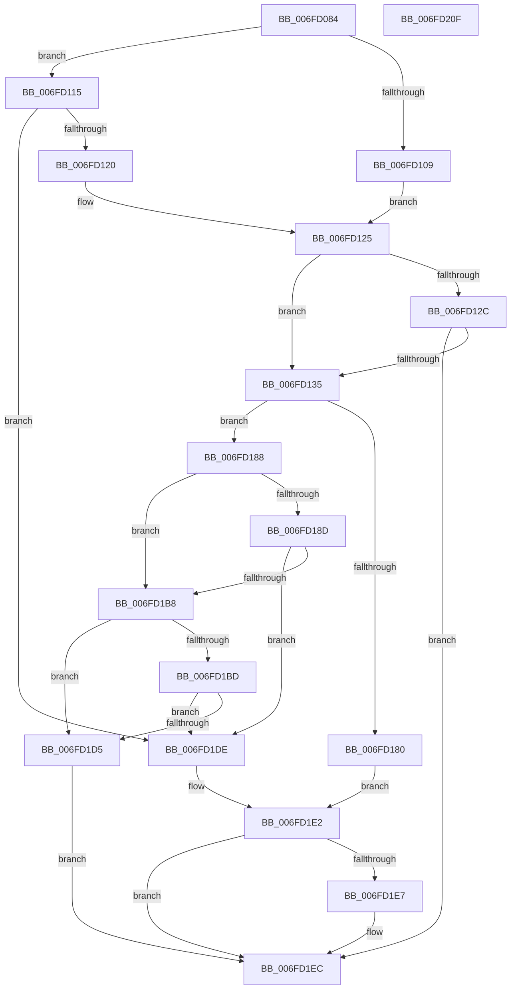

# SeDuplicateTokenWithPredictedClaims

- RVA: `0x006FD084`–`0x006FD210` (길이 `396` bytes)
- VA: `0x00000001406FD084`
- 실행 섹션: `PAGE`
- PDB 이름 있음: `예`; PDB Function 태그: `아니요`
- unwind 정보 RVA: `0x000BC240`
- 디코드: `118`개 명령, `396/396` bytes 표시
- 미해석 바이트: `0` (있으면 어셈블리에 `.byte`로 보존)

> 이 문서는 커널 이미지의 기계어와 PDB 기호를 분석해 생성했습니다. 4번과 5번은 함수 원형과 자료형을 바이너리 사용 방식에서 추정한 C 해석이며 원본 소스 복구 결과는 아닙니다.

## 1. Dependencies

- 직접 호출 지점: **5**; 고유 호출 대상: **5**
- 직접 호출자로 확인된 함수: **1**
- RIP 상대 이미지 참조: **0**

### Outgoing calls
- `0x006FD0FE` → [RtlQueryPackageClaims](../../text/45/RtlQueryPackageClaims_function_0045C3F0.md) (function, `0x0045C3F0`)
- `0x006FD175` → [SepDuplicateToken](../8B/SepDuplicateToken_function_008B87EC.md) (function, `0x008B87EC`)
- `0x006FD1AD` → [SepDesktopAppxSubProcessToken](../../text/45/SepDesktopAppxSubProcessToken_function_0045BD90.md) (function, `0x0045BD90`)
- `0x006FD1CA` → [SepAddTokenOriginClaim](../AF/SepAddTokenOriginClaim_function_00AF2130.md) (function, `0x00AF2130`)
- `0x006FD1E7` → [ObfDereferenceObject](../../text/2F/ObfDereferenceObject_function_002F9350.md) (function, `0x002F9350`)

### Direct callers
- [NtCreateUserProcess](../AE/NtCreateUserProcess_function_00AEA680.md) at `0x00AEADE0`

### Static image references
- 디코드된 RIP-relative 메모리 참조가 없습니다.

## 2. Other-region calls and transfers

- 다른 실행 섹션으로 향하는 call: **3**
  - `0x006FD0FE` → [RtlQueryPackageClaims](../../text/45/RtlQueryPackageClaims_function_0045C3F0.md) (`PAGE` → `.text`)
  - `0x006FD1AD` → [SepDesktopAppxSubProcessToken](../../text/45/SepDesktopAppxSubProcessToken_function_0045BD90.md) (`PAGE` → `.text`)
  - `0x006FD1E7` → [ObfDereferenceObject](../../text/2F/ObfDereferenceObject_function_002F9350.md) (`PAGE` → `.text`)
- 별도 외부 분기/꼬리 이동을 확인하지 못했습니다.

## 3. Assembly (complete function range)

```asm
006FD084  4C 8B DC                        mov r11, rsp
006FD087  49 89 5B 08                     mov qword ptr [r11 + 8], rbx
006FD08B  49 89 73 10                     mov qword ptr [r11 + 0x10], rsi
006FD08F  49 89 7B 18                     mov qword ptr [r11 + 0x18], rdi
006FD093  55                              push rbp
006FD094  41 54                           push r12
006FD096  41 55                           push r13
006FD098  41 56                           push r14
006FD09A  41 57                           push r15
006FD09C  49 8D 6B B1                     lea rbp, [r11 - 0x4f]
006FD0A0  48 81 EC 90 00 00 00            sub rsp, 0x90
006FD0A7  4C 8B 75 7F                     mov r14, qword ptr [rbp + 0x7f]
006FD0AB  33 C0                           xor eax, eax
006FD0AD  49 21 43 80                     and qword ptr [r11 - 0x80], rax
006FD0B1  0F 57 C0                        xorps xmm0, xmm0
006FD0B4  48 21 45 E7                     and qword ptr [rbp - 0x19], rax
006FD0B8  49 8B F1                        mov rsi, r9
006FD0BB  48 83 65 DF 00                  and qword ptr [rbp - 0x21], 0
006FD0C0  45 8B E0                        mov r12d, r8d
006FD0C3  49 21 06                        and qword ptr [r14], rax
006FD0C6  4C 8B EA                        mov r13, rdx
006FD0C9  48 89 45 0F                     mov qword ptr [rbp + 0xf], rax
006FD0CD  45 33 C9                        xor r9d, r9d
006FD0D0  89 45 17                        mov dword ptr [rbp + 0x17], eax
006FD0D3  45 33 C0                        xor r8d, r8d
006FD0D6  88 45 D8                        mov byte ptr [rbp - 0x28], al
006FD0D9  33 D2                           xor edx, edx
006FD0DB  88 45 D7                        mov byte ptr [rbp - 0x29], al
006FD0DE  4C 8B F9                        mov r15, rcx
006FD0E1  48 8D 45 E7                     lea rax, [rbp - 0x19]
006FD0E5  48 89 44 24 30                  mov qword ptr [rsp + 0x30], rax
006FD0EA  48 83 64 24 28 00               and qword ptr [rsp + 0x28], 0
006FD0F0  48 83 64 24 20 00               and qword ptr [rsp + 0x20], 0
006FD0F6  0F 11 45 EF                     movups xmmword ptr [rbp - 0x11], xmm0
006FD0FA  0F 11 45 FF                     movups xmmword ptr [rbp - 1], xmm0
006FD0FE  E8 ED F2 D5 FF                  call 0x14045c3f0
006FD103  8B D8                           mov ebx, eax
006FD105  85 C0                           test eax, eax
006FD107  78 0C                           js 0x1406fd115
006FD109  8B 7D E7                        mov edi, dword ptr [rbp - 0x19]
006FD10C  C1 EF 15                        shr edi, 0x15
006FD10F  40 80 E7 01                     and dil, 1
006FD113  EB 10                           jmp 0x1406fd125
006FD115  3D 25 02 00 C0                  cmp eax, 0xc0000225
006FD11A  0F 85 BE 00 00 00               jne 0x1406fd1de
006FD120  33 DB                           xor ebx, ebx
006FD122  40 32 FF                        xor dil, dil
006FD125  33 C9                           xor ecx, ecx
006FD127  48 85 F6                        test rsi, rsi
006FD12A  75 09                           jne 0x1406fd135
006FD12C  40 84 FF                        test dil, dil
006FD12F  0F 84 B7 00 00 00               je 0x1406fd1ec
006FD135  48 8D 45 DF                     lea rax, [rbp - 0x21]
006FD139  48 89 4D F7                     mov qword ptr [rbp - 9], rcx
006FD13D  48 89 44 24 38                  mov qword ptr [rsp + 0x38], rax
006FD142  48 8D 55 EF                     lea rdx, [rbp - 0x11]
006FD146  C6 44 24 30 01                  mov byte ptr [rsp + 0x30], 1
006FD14B  0F 57 C0                        xorps xmm0, xmm0
006FD14E  88 4C 24 28                     mov byte ptr [rsp + 0x28], cl
006FD152  41 B9 01 00 00 00               mov r9d, 1
006FD158  89 4C 24 20                     mov dword ptr [rsp + 0x20], ecx
006FD15C  45 33 C0                        xor r8d, r8d
006FD15F  89 4D 07                        mov dword ptr [rbp + 7], ecx
006FD162  48 89 4D FF                     mov qword ptr [rbp - 1], rcx
006FD166  49 8B CF                        mov rcx, r15
006FD169  C7 45 EF 30 00 00 00            mov dword ptr [rbp - 0x11], 0x30
006FD170  F3 0F 7F 45 0F                  movdqu xmmword ptr [rbp + 0xf], xmm0
006FD175  E8 72 B6 1B 00                  call 0x1408b87ec
006FD17A  8B D8                           mov ebx, eax
006FD17C  85 C0                           test eax, eax
006FD17E  79 08                           jns 0x1406fd188
006FD180  33 C9                           xor ecx, ecx
006FD182  48 89 4D DF                     mov qword ptr [rbp - 0x21], rcx
006FD186  EB 5A                           jmp 0x1406fd1e2
006FD188  40 84 FF                        test dil, dil
006FD18B  74 2B                           je 0x1406fd1b8
006FD18D  48 8B 4D DF                     mov rcx, qword ptr [rbp - 0x21]
006FD191  48 8D 45 D7                     lea rax, [rbp - 0x29]
006FD195  48 89 44 24 30                  mov qword ptr [rsp + 0x30], rax
006FD19A  4D 8B C5                        mov r8, r13
006FD19D  48 8D 45 D8                     lea rax, [rbp - 0x28]
006FD1A1  33 D2                           xor edx, edx
006FD1A3  48 89 44 24 28                  mov qword ptr [rsp + 0x28], rax
006FD1A8  44 89 64 24 20                  mov dword ptr [rsp + 0x20], r12d
006FD1AD  E8 DE EB D5 FF                  call 0x14045bd90
006FD1B2  8B D8                           mov ebx, eax
006FD1B4  85 C0                           test eax, eax
006FD1B6  78 26                           js 0x1406fd1de
006FD1B8  48 85 F6                        test rsi, rsi
006FD1BB  74 18                           je 0x1406fd1d5
006FD1BD  4C 8B 45 DF                     mov r8, qword ptr [rbp - 0x21]
006FD1C1  41 B1 01                        mov r9b, 1
006FD1C4  8B 55 77                        mov edx, dword ptr [rbp + 0x77]
006FD1C7  48 8B CE                        mov rcx, rsi
006FD1CA  E8 61 4F 3F 00                  call 0x140af2130
006FD1CF  8B D8                           mov ebx, eax
006FD1D1  85 C0                           test eax, eax
006FD1D3  78 09                           js 0x1406fd1de
006FD1D5  48 8B 45 DF                     mov rax, qword ptr [rbp - 0x21]
006FD1D9  49 89 06                        mov qword ptr [r14], rax
006FD1DC  EB 0E                           jmp 0x1406fd1ec
006FD1DE  48 8B 4D DF                     mov rcx, qword ptr [rbp - 0x21]
006FD1E2  48 85 C9                        test rcx, rcx
006FD1E5  74 05                           je 0x1406fd1ec
006FD1E7  E8 64 C1 BF FF                  call 0x1402f9350
006FD1EC  4C 8D 9C 24 90 00 00 00         lea r11, [rsp + 0x90]
006FD1F4  8B C3                           mov eax, ebx
006FD1F6  49 8B 5B 30                     mov rbx, qword ptr [r11 + 0x30]
006FD1FA  49 8B 73 38                     mov rsi, qword ptr [r11 + 0x38]
006FD1FE  49 8B 7B 40                     mov rdi, qword ptr [r11 + 0x40]
006FD202  49 8B E3                        mov rsp, r11
006FD205  41 5F                           pop r15
006FD207  41 5E                           pop r14
006FD209  41 5D                           pop r13
006FD20B  41 5C                           pop r12
006FD20D  5D                              pop rbp
006FD20E  C3                              ret
006FD20F  CC                              int3
```

## 4. C-style interpretation (structured pseudocode)

```c
__int64 __fastcall SeDuplicateTokenWithPredictedClaims(__int64 a1, __int64 a2, int a3, __int64 a4)
{
    __int64 result;
    __int64 v_rbx;
    __int64 v_rdi;
    __int64 v_rsp;
    unsigned __int64 v_stack_m28;
    unsigned __int64 v_stack_m80;
    unsigned __int64 v_stack_m88;
    unsigned __int64 v_stack_m90;
    unsigned __int64 v_stack_m98;

    *(unsigned __int64 *)(v_rsp + 8) = v_rbx;
    *(unsigned __int64 *)(v_rsp + 16) = v_rsi;
    *(unsigned __int64 *)(v_rsp + 24) = v_rdi;
    v_rsp = (v_rsp) - (144);
    result = 0;
    *(unsigned __int64 *)(v_rsp - 79 + 15) = 0;
    a4 = 0;
    *(unsigned int *)(v_rsp - 79 + 23) = 0;
    a3 = 0;
    *(unsigned __int8 *)(v_rsp - 79 - 40) = 0;
    a2 = 0;
    *(unsigned __int8 *)(v_rsp - 79 - 41) = 0;
    v_stack_m88 = v_rsp - 79 - 25;
    *(unsigned __int64 *)(v_rsp - 79 - 17) = v_xmm0;
    *(unsigned __int64 *)(v_rsp - 79 - 1) = v_xmm0;
    result = RtlQueryPackageClaims(a1, a2, a3, a4);
    if (sign_flag) goto loc_006FD115;
    v_rdi = (unsigned int)(((unsigned int)(*(unsigned int *)(v_rsp - 79 - 25))) >> (21));
    v_rdi = (unsigned __int8)((v_rdi) & (1));
    goto loc_006FD125;
loc_006FD115:
    if (((unsigned int)(result)) != 0xC0000225ULL) goto loc_006FD1DE;
    v_rbx = 0;
    v_rdi = 0;
loc_006FD125:
    a1 = 0;
    if (0 != 0) goto loc_006FD135;
    if (0 == 0) goto loc_006FD1EC;
loc_006FD135:
    *(unsigned __int64 *)(v_rsp - 79 - 9) = 0;
    v_stack_m80 = v_rsp - 79 - 33;
    v_stack_m88 = 1;
    v_stack_m90 = 0;
    v_stack_m98 = 0;
    a3 = 0;
    *(unsigned int *)(v_rsp - 79 + 7) = 0;
    *(unsigned __int64 *)(v_rsp - 79 - 1) = 0;
    *(unsigned int *)(v_rsp - 79 - 17) = 48;
    *(unsigned __int64 *)(v_rsp - 79 + 15) = v_xmm0;
    result = SepDuplicateToken(0, v_rsp - 79 - 17, a3, 1);
    if (!sign_flag) goto loc_006FD188;
    a1 = 0;
    *(unsigned __int64 *)(v_rsp - 79 - 33) = 0;
    goto loc_006FD1E2;
loc_006FD188:
    if (0 == 0) goto loc_006FD1B8;
    v_stack_m88 = v_rsp - 79 - 41;
    a2 = 0;
    v_stack_m90 = v_rsp - 79 - 40;
    v_stack_m98 = (unsigned int)((unsigned int)(a3));
    result = SepDesktopAppxSubProcessToken(*(unsigned __int64 *)(v_rsp - 79 - 33), a2, 0, 1);
    if (sign_flag) goto loc_006FD1DE;
loc_006FD1B8:
    if (0 == 0) goto loc_006FD1D5;
    result = SepAddTokenOriginClaim(0, (unsigned int)(*(unsigned int *)(v_rsp - 79 + 119)), *(unsigned __int64 *)(v_rsp - 79 - 33), 1);
    if (sign_flag) goto loc_006FD1DE;
loc_006FD1D5:
    *(unsigned __int64 *)(*(unsigned __int64 *)(v_rsp - 79 + 127)) = *(unsigned __int64 *)(v_rsp - 79 - 33);
    goto loc_006FD1EC;
loc_006FD1DE:
loc_006FD1E2:
    result = *(unsigned __int64 *)(v_rsp - 79 - 33);
    if (*(unsigned __int64 *)(v_rsp - 79 - 33) != 0) {
        result = ObfDereferenceObject(*(unsigned __int64 *)(v_rsp - 79 - 33), (unsigned int)(*(unsigned int *)(v_rsp - 79 + 119)), *(unsigned __int64 *)(v_rsp - 79 - 33), 1);
    }
    return (unsigned int)((unsigned int)((unsigned int)((unsigned int)(result))));
}
```

## 5. (Beta) C Style

```c
int64_t SeDuplicateTokenWithPredictedClaims(int64_t Arg1, int64_t Arg2, int32_t Arg3, int64_t Arg4)
{
    int64_t result;
    int64_t local_rbx;
    int64_t local_rdi;
    int64_t local_rsp;
    uint64_t v_stack_m28;
    uint64_t v_stack_m80;
    uint64_t v_stack_m88;
    uint64_t v_stack_m90;
    uint64_t v_stack_m98;

    *(uint64_t *)(local_rsp + 0x8) = local_rbx;
    *(uint64_t *)(local_rsp + 0x10) = local_rsi;
    *(uint64_t *)(local_rsp + 0x18) = local_rdi;
    local_rsp = (local_rsp) - (144);
    result = 0;
    *(uint64_t *)(local_rsp - 0x4F + 0xF) = 0;
    Arg4 = 0;
    *(uint32_t *)(local_rsp - 0x4F + 0x17) = 0;
    Arg3 = 0;
    *(uint8_t *)(local_rsp - 0x4F - 0x28) = 0;
    Arg2 = 0;
    *(uint8_t *)(local_rsp - 0x4F - 0x29) = 0;
    v_stack_m88 = local_rsp - 79 - 25;
    *(uint64_t *)(local_rsp - 0x4F - 0x11) = v_xmm0;
    *(uint64_t *)(local_rsp - 0x4F - 0x1) = v_xmm0;
    result = RtlQueryPackageClaims(Arg1, Arg2, Arg3, Arg4);
    if (sign_flag) goto loc_006FD115;
    local_rdi = (uint32_t)(((uint32_t)(*(uint32_t *)(local_rsp - 0x4F - 0x19))) >> (21));
    local_rdi = (uint8_t)((local_rdi) & (1));
    goto loc_006FD125;
loc_006FD115:
    if (((uint32_t)(result)) != 0xC0000225ULL) goto loc_006FD1DE;
    local_rbx = 0;
    local_rdi = 0;
loc_006FD125:
    Arg1 = 0;
    if (0 != 0) goto loc_006FD135;
    if (0 == 0) goto loc_006FD1EC;
loc_006FD135:
    *(uint64_t *)(local_rsp - 0x4F - 0x9) = 0;
    v_stack_m80 = local_rsp - 79 - 33;
    v_stack_m88 = 1;
    v_stack_m90 = 0;
    v_stack_m98 = 0;
    Arg3 = 0;
    *(uint32_t *)(local_rsp - 0x4F + 0x7) = 0;
    *(uint64_t *)(local_rsp - 0x4F - 0x1) = 0;
    *(uint32_t *)(local_rsp - 0x4F - 0x11) = 48;
    *(uint64_t *)(local_rsp - 0x4F + 0xF) = v_xmm0;
    result = SepDuplicateToken(0, local_rsp - 79 - 17, Arg3, 1);
    if (!sign_flag) goto loc_006FD188;
    Arg1 = 0;
    *(uint64_t *)(local_rsp - 0x4F - 0x21) = 0;
    goto loc_006FD1E2;
loc_006FD188:
    if (0 == 0) goto loc_006FD1B8;
    v_stack_m88 = local_rsp - 79 - 41;
    Arg2 = 0;
    v_stack_m90 = local_rsp - 79 - 40;
    v_stack_m98 = (uint32_t)((uint32_t)(Arg3));
    result = SepDesktopAppxSubProcessToken(*(uint64_t *)(local_rsp - 0x4F - 0x21), Arg2, 0, 1);
    if (sign_flag) goto loc_006FD1DE;
loc_006FD1B8:
    if (0 == 0) goto loc_006FD1D5;
    result = SepAddTokenOriginClaim(0, (uint32_t)(*(uint32_t *)(local_rsp - 0x4F + 0x77)), *(uint64_t *)(local_rsp - 0x4F - 0x21), 1);
    if (sign_flag) goto loc_006FD1DE;
loc_006FD1D5:
    *(uint64_t *)(*(uint64_t *)(local_rsp - 0x4F + 0x7F)) = *(uint64_t *)(local_rsp - 0x4F - 0x21);
    goto loc_006FD1EC;
loc_006FD1DE:
loc_006FD1E2:
    result = *(uint64_t *)(local_rsp - 0x4F - 0x21);
    if (*(uint64_t *)(local_rsp - 0x4F - 0x21) != 0) {
        result = ObfDereferenceObject(*(uint64_t *)(local_rsp - 0x4F - 0x21), (uint32_t)(*(uint32_t *)(local_rsp - 0x4F + 0x77)), *(uint64_t *)(local_rsp - 0x4F - 0x21), 1);
    }
    return (uint32_t)((uint32_t)((uint32_t)((uint32_t)(result))));
}
```

## 6. Execution-region graph

[열기: 2D/3D 그래프와 함수 탐색 컨트롤 패널](../../../control-panel.html?section=page&rva=0x006FD084&view=graph)

- 2D 그래프는 위에서 아래로 흐르고, 3D 그래프는 빈 공간을 드래그해 회전합니다. Shift+드래그는 이동, 휠은 확대·축소, 함수 노드 선택은 대상 보고서 이동입니다.

### Static fallback


