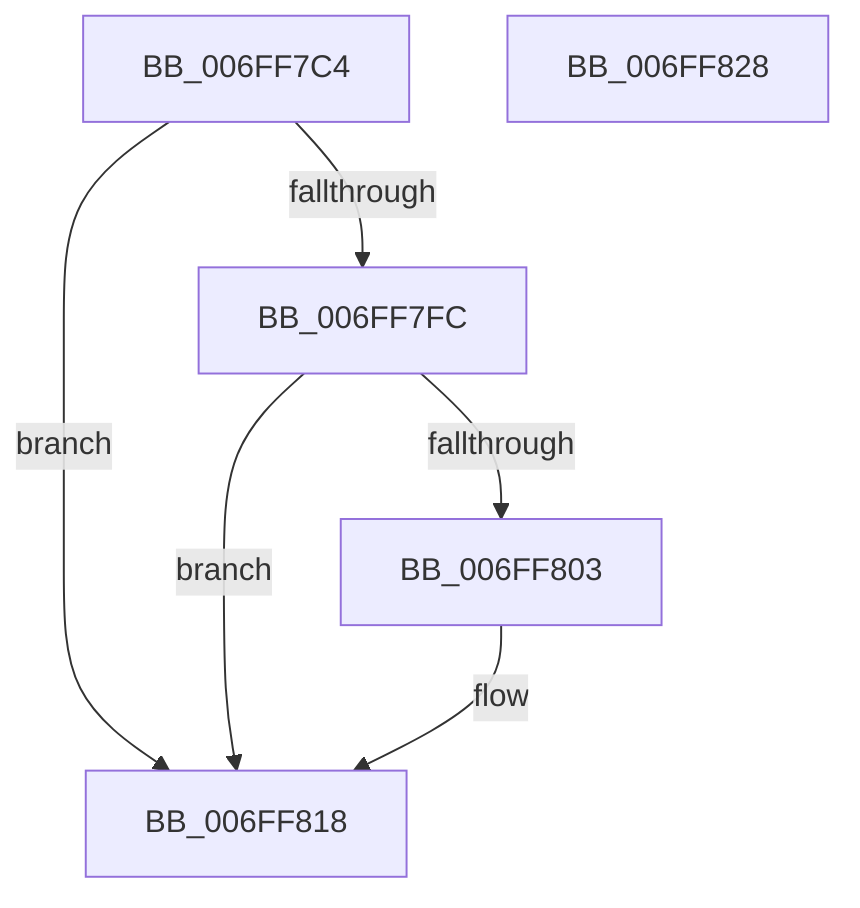

# SyspartGetFirmwarePartition

- RVA: `0x006FF7C4`–`0x006FF829` (길이 `101` bytes)
- VA: `0x00000001406FF7C4`
- 실행 섹션: `PAGE`
- PDB 이름 있음: `예`; PDB Function 태그: `아니요`
- unwind 정보 RVA: `0x00060BC4`
- 디코드: `29`개 명령, `101/101` bytes 표시
- 미해석 바이트: `0` (있으면 어셈블리에 `.byte`로 보존)

> 이 문서는 커널 이미지의 기계어와 PDB 기호를 분석해 생성했습니다. 4번과 5번은 함수 원형과 자료형을 바이너리 사용 방식에서 추정한 C 해석이며 원본 소스 복구 결과는 아닙니다.

## 1. Dependencies

- 직접 호출 지점: **2**; 고유 호출 대상: **2**
- 직접 호출자로 확인된 함수: **1**
- RIP 상대 이미지 참조: **1**

### Outgoing calls
- `0x006FF7E9` → [SiQuerySystemInformationString](../A9/SiQuerySystemInformationString_function_00A97438.md) (function, `0x00A97438`)
- `0x006FF813` → [SiGetSystemDeviceName](../A5/SiGetSystemDeviceName_function_00A558B8.md) (function, `0x00A558B8`)

### Direct callers
- [BiGetSystemPartition](BiGetSystemPartition_function_006FF724.md) at `0x006FF743`
- [BiGetSystemPartition](BiGetSystemPartition_function_006FF724.md) at `0x006FF78B`

### Static image references
- `0x006FF806` → RVA `0x00A377A0` (`SiGetFirmwareSystemPartition`; read)

## 2. Other-region calls and transfers

- 다른 실행 섹션으로 향하는 call: **0**
- 별도 외부 분기/꼬리 이동을 확인하지 못했습니다.

## 3. Assembly (complete function range)

```asm
006FF7C4  48 89 5C 24 08                  mov qword ptr [rsp + 8], rbx
006FF7C9  48 89 74 24 10                  mov qword ptr [rsp + 0x10], rsi
006FF7CE  57                              push rdi
006FF7CF  48 83 EC 20                     sub rsp, 0x20
006FF7D3  49 8B D8                        mov rbx, r8
006FF7D6  4D 8B C8                        mov r9, r8
006FF7D9  44 8B C2                        mov r8d, edx
006FF7DC  8B FA                           mov edi, edx
006FF7DE  48 8B D1                        mov rdx, rcx
006FF7E1  48 8B F1                        mov rsi, rcx
006FF7E4  B9 C8 00 00 00                  mov ecx, 0xc8
006FF7E9  E8 4A 7C 39 00                  call 0x140a97438
006FF7EE  B9 00 00 00 80                  mov ecx, 0x80000000
006FF7F3  44 8D 0C 08                     lea r9d, [rax + rcx]
006FF7F7  44 85 C9                        test ecx, r9d
006FF7FA  75 1C                           jne 0x1406ff818
006FF7FC  3D 23 00 00 C0                  cmp eax, 0xc0000023
006FF801  74 15                           je 0x1406ff818
006FF803  4C 8B CB                        mov r9, rbx
006FF806  48 8D 0D 93 7F 33 00            lea rcx, [rip + 0x337f93]
006FF80D  44 8B C7                        mov r8d, edi
006FF810  48 8B D6                        mov rdx, rsi
006FF813  E8 A0 60 35 00                  call 0x140a558b8
006FF818  48 8B 5C 24 30                  mov rbx, qword ptr [rsp + 0x30]
006FF81D  48 8B 74 24 38                  mov rsi, qword ptr [rsp + 0x38]
006FF822  48 83 C4 20                     add rsp, 0x20
006FF826  5F                              pop rdi
006FF827  C3                              ret
006FF828  CC                              int3
```

## 4. C-style interpretation (structured pseudocode)

```c
__int64 __fastcall SyspartGetFirmwarePartition(__int64 a1, int a2, __int64 a3)
{
    __int64 result;
    __int64 v_rsp;
    unsigned __int64 v_stack_p10;
    unsigned __int64 v_stack_p8;

    v_stack_p8 = v_rbx;
    v_stack_p10 = v_rsi;
    v_rsp = (v_rsp) - (32);
    result = SiQuerySystemInformationString(200, a1, (unsigned int)(a2), a3);
    if ((((unsigned int)((unsigned int)(0x80000000ULL))) & ((unsigned int)(result + (unsigned int)(0x80000000ULL) * 1))) != 0) goto loc_006FF818;
    if (((unsigned int)(result)) != 0xC0000023ULL) {
        a4 = a3;
        a1 = v_rip + 3374995;
        a3 = (unsigned int)((unsigned int)(a2));
        a2 = a1;
        result = SiGetSystemDeviceName(a1, a2, a3, a4);
    }
    v_rsp = (v_rsp) + (32);
    return result;
}
```

## 5. (Beta) C Style

```c
int64_t SyspartGetFirmwarePartition(int64_t Arg1, int32_t Arg2, int64_t Arg3)
{
    int64_t result;
    int64_t local_rsp;
    uint64_t v_stack_p10;
    uint64_t v_stack_p8;

    v_stack_p8 = local_rbx;
    v_stack_p10 = local_rsi;
    local_rsp = (local_rsp) - (32);
    result = SiQuerySystemInformationString(200, Arg1, (uint32_t)(Arg2), Arg3);
    if ((((uint32_t)((uint32_t)(0x80000000ULL))) & ((uint32_t)(result + (uint32_t)(0x80000000ULL) * 1))) != 0) goto loc_006FF818;
    if (((uint32_t)(result)) != 0xC0000023ULL) {
        a4 = Arg3;
        Arg1 = v_rip + 3374995;
        Arg3 = (uint32_t)((uint32_t)(Arg2));
        Arg2 = Arg1;
        result = SiGetSystemDeviceName(Arg1, Arg2, Arg3, a4);
    }
    local_rsp = (local_rsp) + (32);
    return result;
}
```

## 6. Execution-region graph

[열기: 2D/3D 그래프와 함수 탐색 컨트롤 패널](../../../control-panel.html?section=page&rva=0x006FF7C4&view=graph)

- 2D 그래프는 위에서 아래로 흐르고, 3D 그래프는 빈 공간을 드래그해 회전합니다. Shift+드래그는 이동, 휠은 확대·축소, 함수 노드 선택은 대상 보고서 이동입니다.

### Static fallback


