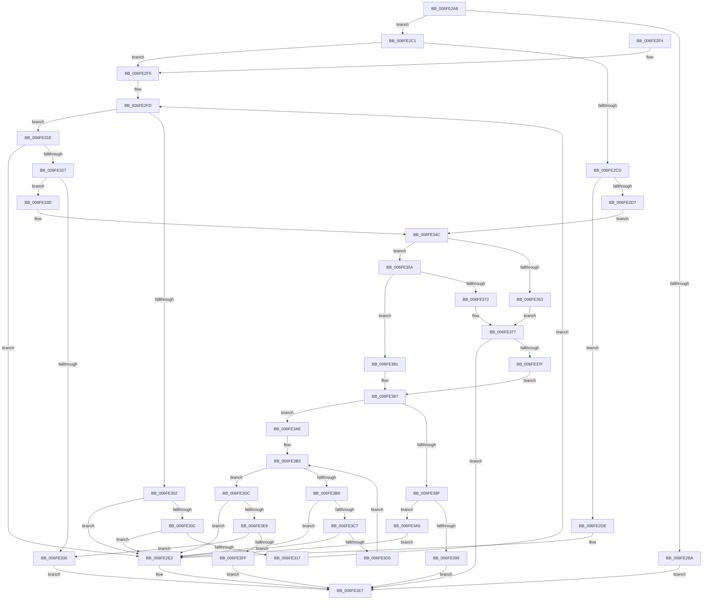

# sub_006FE2A8

- RVA: `0x006FE2A8`–`0x006FE414` (길이 `364` bytes)
- VA: `0x00000001406FE2A8`
- 실행 섹션: `PAGE`
- PDB 이름 있음: `아니요`; PDB Function 태그: `아니요`
- unwind 정보 RVA: `0x000BE6E4`
- 디코드: `114`개 명령, `364/364` bytes 표시
- 미해석 바이트: `0` (있으면 어셈블리에 `.byte`로 보존)

> 이 문서는 커널 이미지의 기계어와 PDB 기호를 분석해 생성했습니다. 4번과 5번은 함수 원형과 자료형을 바이너리 사용 방식에서 추정한 C 해석이며 원본 소스 복구 결과는 아닙니다.

## 1. Dependencies

- 직접 호출 지점: **1**; 고유 호출 대상: **1**
- 직접 호출자로 확인된 함수: **1**
- RIP 상대 이미지 참조: **0**

### Outgoing calls
- `0x006FE368` → [ExAllocatePool2](../../poolcode/B8/ExAllocatePool2_function_00B820F0.md) (function, `0x00B820F0`)

### Direct callers
- [sub_00968AF6](../96/Unknown_function_00968AF6.md) at `0x00969860`

### Static image references
- 디코드된 RIP-relative 메모리 참조가 없습니다.

## 2. Other-region calls and transfers

- 다른 실행 섹션으로 향하는 call: **1**
  - `0x006FE368` → [ExAllocatePool2](../../poolcode/B8/ExAllocatePool2_function_00B820F0.md) (`PAGE` → `POOLCODE`)
- 별도 외부 분기/꼬리 이동을 확인하지 못했습니다.

## 3. Assembly (complete function range)

```asm
006FE2A8  48 89 5C 24 08                  mov qword ptr [rsp + 8], rbx
006FE2AD  57                              push rdi
006FE2AE  48 83 EC 20                     sub rsp, 0x20
006FE2B2  48 8B DA                        mov rbx, rdx
006FE2B5  48 85 D2                        test rdx, rdx
006FE2B8  75 07                           jne 0x1406fe2c1
006FE2BA  BA 0D 00 00 C0                  mov edx, 0xc000000d
006FE2BF  EB 26                           jmp 0x1406fe2e7
006FE2C1  48 8D 7A 08                     lea rdi, [rdx + 8]
006FE2C5  4C 8B 07                        mov r8, qword ptr [rdi]
006FE2C8  4D 85 C0                        test r8, r8
006FE2CB  75 28                           jne 0x1406fe2f5
006FE2CD  8B 42 04                        mov eax, dword ptr [rdx + 4]
006FE2D0  8D 48 08                        lea ecx, [rax + 8]
006FE2D3  3B C8                           cmp ecx, eax
006FE2D5  72 07                           jb 0x1406fe2de
006FE2D7  89 4A 04                        mov dword ptr [rdx + 4], ecx
006FE2DA  FF 02                           inc dword ptr [rdx]
006FE2DC  EB 6E                           jmp 0x1406fe34c
006FE2DE  83 4A 04 FF                     or dword ptr [rdx + 4], 0xffffffff
006FE2E2  BA 95 00 00 C0                  mov edx, 0xc0000095
006FE2E7  48 8B 5C 24 30                  mov rbx, qword ptr [rsp + 0x30]
006FE2EC  8B C2                           mov eax, edx
006FE2EE  48 83 C4 20                     add rsp, 0x20
006FE2F2  5F                              pop rdi
006FE2F3  C3                              ret
006FE2F4  CC                              int3
006FE2F5  44 8B 13                        mov r10d, dword ptr [rbx]
006FE2F8  49 8B D0                        mov rdx, r8
006FE2FB  33 C9                           xor ecx, ecx
006FE2FD  41 3B CA                        cmp ecx, r10d
006FE300  73 1C                           jae 0x1406fe31e
006FE302  8B 02                           mov eax, dword ptr [rdx]
006FE304  83 C0 04                        add eax, 4
006FE307  83 F8 04                        cmp eax, 4
006FE30A  72 D6                           jb 0x1406fe2e2
006FE30C  44 8B C8                        mov r9d, eax
006FE30F  4C 03 CA                        add r9, rdx
006FE312  4C 3B CA                        cmp r9, rdx
006FE315  72 CB                           jb 0x1406fe2e2
006FE317  49 8B D1                        mov rdx, r9
006FE31A  FF C1                           inc ecx
006FE31C  EB DF                           jmp 0x1406fe2fd
006FE31E  4C 8D 4A 04                     lea r9, [rdx + 4]
006FE322  4C 3B CA                        cmp r9, rdx
006FE325  72 BB                           jb 0x1406fe2e2
006FE327  8B 4B 04                        mov ecx, dword ptr [rbx + 4]
006FE32A  48 8D 42 08                     lea rax, [rdx + 8]
006FE32E  49 03 C8                        add rcx, r8
006FE331  48 3B C1                        cmp rax, rcx
006FE334  76 07                           jbe 0x1406fe33d
006FE336  BA 23 00 00 C0                  mov edx, 0xc0000023
006FE33B  EB AA                           jmp 0x1406fe2e7
006FE33D  C7 02 04 00 00 00               mov dword ptr [rdx], 4
006FE343  41 C7 01 01 40 00 80            mov dword ptr [r9], 0x80004001
006FE34A  FF 03                           inc dword ptr [rbx]
006FE34C  8B 43 04                        mov eax, dword ptr [rbx + 4]
006FE34F  85 C0                           test eax, eax
006FE351  75 07                           jne 0x1406fe35a
006FE353  BA 3E 00 00 C0                  mov edx, 0xc000003e
006FE358  EB 1D                           jmp 0x1406fe377
006FE35A  48 8B D0                        mov rdx, rax
006FE35D  B9 00 01 00 00                  mov ecx, 0x100
006FE362  41 B8 53 4C 53 20               mov r8d, 0x20534c53
006FE368  E8 83 3D 48 00                  call 0x140b820f0
006FE36D  48 85 C0                        test rax, rax
006FE370  75 0F                           jne 0x1406fe381
006FE372  BA 17 00 00 C0                  mov edx, 0xc0000017
006FE377  85 D2                           test edx, edx
006FE379  0F 88 68 FF FF FF               js 0x1406fe2e7
006FE37F  EB 06                           jmp 0x1406fe387
006FE381  48 89 07                        mov qword ptr [rdi], rax
006FE384  83 23 00                        and dword ptr [rbx], 0
006FE387  4C 8B 07                        mov r8, qword ptr [rdi]
006FE38A  4D 85 C0                        test r8, r8
006FE38D  75 1F                           jne 0x1406fe3ae
006FE38F  8B 43 04                        mov eax, dword ptr [rbx + 4]
006FE392  8D 48 08                        lea ecx, [rax + 8]
006FE395  3B C8                           cmp ecx, eax
006FE397  72 0C                           jb 0x1406fe3a5
006FE399  89 4B 04                        mov dword ptr [rbx + 4], ecx
006FE39C  FF 03                           inc dword ptr [rbx]
006FE39E  33 D2                           xor edx, edx
006FE3A0  E9 42 FF FF FF                  jmp 0x1406fe2e7
006FE3A5  83 4B 04 FF                     or dword ptr [rbx + 4], 0xffffffff
006FE3A9  E9 34 FF FF FF                  jmp 0x1406fe2e2
006FE3AE  44 8B 0B                        mov r9d, dword ptr [rbx]
006FE3B1  33 C9                           xor ecx, ecx
006FE3B3  41 3B C9                        cmp ecx, r9d
006FE3B6  73 24                           jae 0x1406fe3dc
006FE3B8  41 8B 00                        mov eax, dword ptr [r8]
006FE3BB  83 C0 04                        add eax, 4
006FE3BE  83 F8 04                        cmp eax, 4
006FE3C1  0F 82 1B FF FF FF               jb 0x1406fe2e2
006FE3C7  8B D0                           mov edx, eax
006FE3C9  49 03 D0                        add rdx, r8
006FE3CC  49 3B D0                        cmp rdx, r8
006FE3CF  0F 82 0D FF FF FF               jb 0x1406fe2e2
006FE3D5  4C 8B C2                        mov r8, rdx
006FE3D8  FF C1                           inc ecx
006FE3DA  EB D7                           jmp 0x1406fe3b3
006FE3DC  4D 8D 48 04                     lea r9, [r8 + 4]
006FE3E0  4D 3B C8                        cmp r9, r8
006FE3E3  0F 82 F9 FE FF FF               jb 0x1406fe2e2
006FE3E9  8B 4B 04                        mov ecx, dword ptr [rbx + 4]
006FE3EC  49 8D 40 08                     lea rax, [r8 + 8]
006FE3F0  48 03 4B 08                     add rcx, qword ptr [rbx + 8]
006FE3F4  33 D2                           xor edx, edx
006FE3F6  48 3B C1                        cmp rax, rcx
006FE3F9  0F 87 37 FF FF FF               ja 0x1406fe336
006FE3FF  41 C7 00 04 00 00 00            mov dword ptr [r8], 4
006FE406  41 C7 01 01 40 00 80            mov dword ptr [r9], 0x80004001
006FE40D  FF 03                           inc dword ptr [rbx]
006FE40F  E9 D3 FE FF FF                  jmp 0x1406fe2e7
```

## 4. C-style interpretation (structured pseudocode)

```c
__int64 __fastcall sub_006FE2A8(__int64 a1, __int64 a2)
{
    __int64 result;
    __int64 v_rsp;
    unsigned __int64 v_stack_p8;

    v_stack_p8 = v_rbx;
    v_rsp = (v_rsp) - (32);
    if (a2 != 0) goto loc_006FE2C1;
    goto loc_006FE2E7;
loc_006FE2C1:
    if (*(unsigned __int64 *)((unsigned int)(0xC000000DULL) + 8) != 0) goto loc_006FE2F5;
    if (((unsigned int)((unsigned int)(*(unsigned int *)((unsigned int)(0xC000000DULL) + 4)) + 8)) < ((unsigned int)((unsigned int)(*(unsigned int *)((unsigned int)(0xC000000DULL) + 4))))) goto loc_006FE2DE;
    *(unsigned int *)((unsigned int)(0xC000000DULL) + 4) = (unsigned int)((unsigned int)(*(unsigned int *)((unsigned int)(0xC000000DULL) + 4)) + 8);
    goto loc_006FE34C;
loc_006FE2DE:
loc_006FE2E2:
loc_006FE2E7:
    v_rsp = (v_rsp) + (32);
    return (unsigned int)((unsigned int)((unsigned int)(0xC0000095ULL)));
loc_006FE2F5:
    a1 = 0;
loc_006FE2FD:
    if (0 >= ((unsigned int)((unsigned int)(*(unsigned int *)(v_stack_p8))))) goto loc_006FE31E;
    result = (unsigned int)(((unsigned int)(*(unsigned int *)(*(unsigned __int64 *)((unsigned int)(0xC000000DULL) + 8)))) + (4));
    if (((unsigned int)(result)) < 4) goto loc_006FE2E2;
    a4 = ((unsigned int)((unsigned int)(result))) + (*(unsigned __int64 *)((unsigned int)(0xC000000DULL) + 8));
    if (a4 < (*(unsigned __int64 *)((unsigned int)(0xC000000DULL) + 8))) goto loc_006FE2E2;
    a1 = (unsigned int)((a1) + 1);
    goto loc_006FE2FD;
loc_006FE31E:
    if ((a4 + 4) < a4) goto loc_006FE2E2;
    a1 = ((unsigned int)(*(unsigned int *)(v_stack_p8 + 4))) + (*(unsigned __int64 *)((unsigned int)(0xC000000DULL) + 8));
    if ((a4 + 8) <= a1) goto loc_006FE33D;
loc_006FE336:
    goto loc_006FE2E7;
loc_006FE33D:
    *(unsigned int *)((unsigned int)(0xC0000023ULL)) = 4;
    *(unsigned int *)(a4 + 4) = 0x80004001ULL;
loc_006FE34C:
    if ((unsigned int)((unsigned int)(*(unsigned int *)(v_stack_p8 + 4))) != 0) goto loc_006FE35A;
    goto loc_006FE377;
loc_006FE35A:
    result = ExAllocatePool2(256, (unsigned int)(*(unsigned int *)(v_stack_p8 + 4)), (unsigned int)(0x20534C53ULL), a4 + 4);
    if (result != 0) goto loc_006FE381;
loc_006FE377:
    if (sign_flag) goto loc_006FE2E7;
    goto loc_006FE387;
loc_006FE381:
    *(unsigned __int64 *)((unsigned int)(0xC000000DULL) + 8) = result;
loc_006FE387:
    if (*(unsigned __int64 *)((unsigned int)(0xC000000DULL) + 8) != 0) goto loc_006FE3AE;
    if (((unsigned int)((unsigned int)(*(unsigned int *)(v_stack_p8 + 4)) + 8)) < ((unsigned int)((unsigned int)(*(unsigned int *)(v_stack_p8 + 4))))) goto loc_006FE3A5;
    *(unsigned int *)(v_stack_p8 + 4) = (unsigned int)((unsigned int)(*(unsigned int *)(v_stack_p8 + 4)) + 8);
    a2 = 0;
    goto loc_006FE2E7;
loc_006FE3A5:
    goto loc_006FE2E2;
loc_006FE3AE:
    a1 = 0;
loc_006FE3B3:
    if (0 >= ((unsigned int)((unsigned int)(*(unsigned int *)(v_stack_p8))))) goto loc_006FE3DC;
    result = (unsigned int)(((unsigned int)(*(unsigned int *)(*(unsigned __int64 *)((unsigned int)(0xC000000DULL) + 8)))) + (4));
    if (((unsigned int)(result)) < 4) goto loc_006FE2E2;
    a2 = ((unsigned int)((unsigned int)(result))) + (*(unsigned __int64 *)((unsigned int)(0xC000000DULL) + 8));
    if (a2 < (*(unsigned __int64 *)((unsigned int)(0xC000000DULL) + 8))) goto loc_006FE2E2;
    a1 = (unsigned int)((a1) + 1);
    goto loc_006FE3B3;
loc_006FE3DC:
    if ((a2 + 4) < a2) goto loc_006FE2E2;
    a1 = ((unsigned int)(*(unsigned int *)(v_stack_p8 + 4))) + (*(unsigned __int64 *)(v_stack_p8 + 8));
    a2 = 0;
    if ((a2 + 8) > a1) goto loc_006FE336;
    *(unsigned int *)(a2) = 4;
    *(unsigned int *)(a2 + 4) = 0x80004001ULL;
    goto loc_006FE2E7;
}
```

## 5. (Beta) C Style

```c
int64_t sub_006FE2A8(int64_t Arg1, void *Arg2)
{
    uint8_t *arg2 = (uint8_t *)Arg2;

    int64_t result;
    int64_t local_rsp;
    uint64_t v_stack_p8;

    v_stack_p8 = local_rbx;
    local_rsp = (local_rsp) - (32);
    if (Arg2 != NULL) goto loc_006FE2C1;
    goto loc_006FE2E7;
loc_006FE2C1:
    if (*(uint64_t *)((uint32_t)(0xC000000DULL) + 0x8) != 0) goto loc_006FE2F5;
    if (((uint32_t)((uint32_t)(*(uint32_t *)((uint32_t)(0xC000000DULL) + 0x4)) + 8)) < ((uint32_t)((uint32_t)(*(uint32_t *)((uint32_t)(0xC000000DULL) + 0x4))))) goto loc_006FE2DE;
    *(uint32_t *)((uint32_t)(0xC000000DULL) + 0x4) = (uint32_t)((uint32_t)(*(uint32_t *)((uint32_t)(0xC000000DULL) + 0x4)) + 8);
    goto loc_006FE34C;
loc_006FE2DE:
loc_006FE2E2:
loc_006FE2E7:
    local_rsp = (local_rsp) + (32);
    return (uint32_t)((uint32_t)((uint32_t)(0xC0000095ULL)));
loc_006FE2F5:
    Arg1 = 0;
loc_006FE2FD:
    if (0 >= ((uint32_t)((uint32_t)(*(uint32_t *)(v_stack_p8))))) goto loc_006FE31E;
    result = (uint32_t)(((uint32_t)(*(uint32_t *)(*(uint64_t *)((uint32_t)(0xC000000DULL) + 0x8)))) + (4));
    if (((uint32_t)(result)) < 4) goto loc_006FE2E2;
    a4 = ((uint32_t)((uint32_t)(result))) + (*(uint64_t *)((uint32_t)(0xC000000DULL) + 0x8));
    if (a4 < (*(uint64_t *)((uint32_t)(0xC000000DULL) + 0x8))) goto loc_006FE2E2;
    Arg1 = (uint32_t)((Arg1) + 1);
    goto loc_006FE2FD;
loc_006FE31E:
    if ((a4 + 4) < a4) goto loc_006FE2E2;
    Arg1 = ((uint32_t)(*(uint32_t *)(v_stack_p8 + 0x4))) + (*(uint64_t *)((uint32_t)(0xC000000DULL) + 0x8));
    if ((a4 + 8) <= Arg1) goto loc_006FE33D;
loc_006FE336:
    goto loc_006FE2E7;
loc_006FE33D:
    *(uint32_t *)((uint32_t)(0xC0000023ULL)) = 4;
    *(uint32_t *)(a4 + 0x4) = 0x80004001ULL;
loc_006FE34C:
    if ((uint32_t)((uint32_t)(*(uint32_t *)(v_stack_p8 + 0x4))) != 0) goto loc_006FE35A;
    goto loc_006FE377;
loc_006FE35A:
    result = ExAllocatePool2(256, (uint32_t)(*(uint32_t *)(v_stack_p8 + 0x4)), (uint32_t)(0x20534C53ULL), a4 + 4);
    if (result != 0) goto loc_006FE381;
loc_006FE377:
    if (sign_flag) goto loc_006FE2E7;
    goto loc_006FE387;
loc_006FE381:
    *(uint64_t *)((uint32_t)(0xC000000DULL) + 0x8) = result;
loc_006FE387:
    if (*(uint64_t *)((uint32_t)(0xC000000DULL) + 0x8) != 0) goto loc_006FE3AE;
    if (((uint32_t)((uint32_t)(*(uint32_t *)(v_stack_p8 + 0x4)) + 8)) < ((uint32_t)((uint32_t)(*(uint32_t *)(v_stack_p8 + 0x4))))) goto loc_006FE3A5;
    *(uint32_t *)(v_stack_p8 + 0x4) = (uint32_t)((uint32_t)(*(uint32_t *)(v_stack_p8 + 0x4)) + 8);
    Arg2 = 0;
    goto loc_006FE2E7;
loc_006FE3A5:
    goto loc_006FE2E2;
loc_006FE3AE:
    Arg1 = 0;
loc_006FE3B3:
    if (0 >= ((uint32_t)((uint32_t)(*(uint32_t *)(v_stack_p8))))) goto loc_006FE3DC;
    result = (uint32_t)(((uint32_t)(*(uint32_t *)(*(uint64_t *)((uint32_t)(0xC000000DULL) + 0x8)))) + (4));
    if (((uint32_t)(result)) < 4) goto loc_006FE2E2;
    Arg2 = ((uint32_t)((uint32_t)(result))) + (*(uint64_t *)((uint32_t)(0xC000000DULL) + 0x8));
    if (Arg2 < (*(uint64_t *)((uint32_t)(0xC000000DULL) + 0x8))) goto loc_006FE2E2;
    Arg1 = (uint32_t)((Arg1) + 1);
    goto loc_006FE3B3;
loc_006FE3DC:
    if ((Arg2 + 4) < Arg2) goto loc_006FE2E2;
    Arg1 = ((uint32_t)(*(uint32_t *)(v_stack_p8 + 0x4))) + (*(uint64_t *)(v_stack_p8 + 0x8));
    Arg2 = 0;
    if ((Arg2 + 8) > Arg1) goto loc_006FE336;
    *(uint32_t *)(arg2) = 4;
    *(uint32_t *)(arg2 + 0x4) = 0x80004001ULL;
    goto loc_006FE2E7;
}
```

### 관측된 메모리 오프셋

구조체 형식이 확인되지 않은 접근은 인자 기준의 오프셋으로만 기록했습니다.

| 기준 인자 | 오프셋 표현 | 폭 (bit) | 접근 |
|---|---:|---:|---|
| `Arg2` | `+ 0x0` | `32` | `R` |
| `Arg2` | `+ 0x0` | `32` | `R/W` |
| `Arg2` | `+ 0x4` | `32` | `R` |
| `Arg2` | `+ 0x4` | `32` | `R/W` |
| `Arg2` | `+ 0x4` | `32` | `W` |
| `Arg2` | `+ 0x8` | `64` | `R` |

## 6. Execution-region graph

[열기: 2D/3D 그래프와 함수 탐색 컨트롤 패널](../../../control-panel.html?section=page&rva=0x006FE2A8&view=graph)

- 2D 그래프는 위에서 아래로 흐르고, 3D 그래프는 빈 공간을 드래그해 회전합니다. Shift+드래그는 이동, 휠은 확대·축소, 함수 노드 선택은 대상 보고서 이동입니다.

### Static fallback


