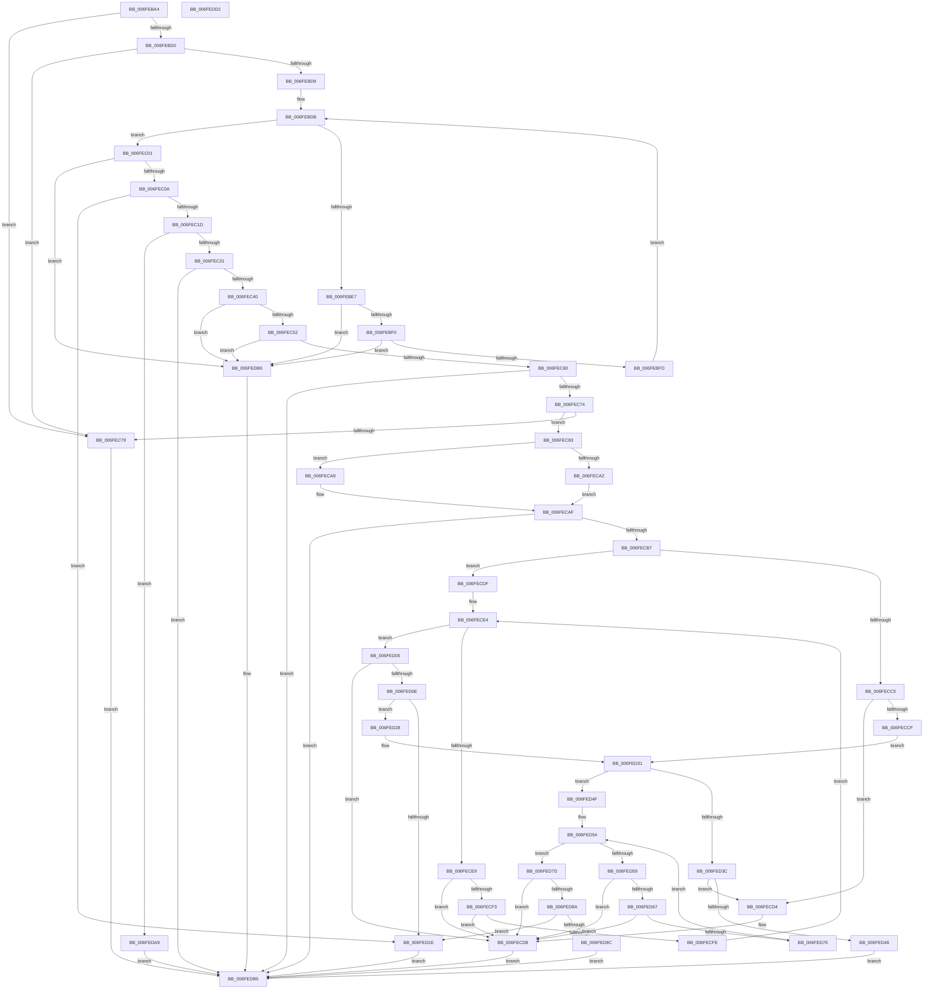

# sub_006FEBA4

- RVA: `0x006FEBA4`–`0x006FEDD3` (길이 `559` bytes)
- VA: `0x00000001406FEBA4`
- 실행 섹션: `PAGE`
- PDB 이름 있음: `아니요`; PDB Function 태그: `아니요`
- unwind 정보 RVA: `0x0005E6B4`
- 디코드: `166`개 명령, `559/559` bytes 표시
- 미해석 바이트: `0` (있으면 어셈블리에 `.byte`로 보존)

> 이 문서는 커널 이미지의 기계어와 PDB 기호를 분석해 생성했습니다. 4번과 5번은 함수 원형과 자료형을 바이너리 사용 방식에서 추정한 C 해석이며 원본 소스 복구 결과는 아닙니다.

## 1. Dependencies

- 직접 호출 지점: **2**; 고유 호출 대상: **2**
- 직접 호출자로 확인된 함수: **1**
- RIP 상대 이미지 참조: **1**

### Outgoing calls
- `0x006FEC31` → [guard_dispatch_icall](../../text/6B/guard_dispatch_icall_function_006BAAD0.md) (function, `0x006BAAD0`)
- `0x006FEC98` → [ExAllocatePool2](../../poolcode/B8/ExAllocatePool2_function_00B820F0.md) (function, `0x00B820F0`)

### Direct callers
- [sub_00968AF6](../96/Unknown_function_00968AF6.md) at `0x0096A7A5`

### Static image references
- `0x006FEC1D` → RVA `0x00FD8350` (`PAGEDATA`; read)

## 2. Other-region calls and transfers

- 다른 실행 섹션으로 향하는 call: **2**
  - `0x006FEC31` → [guard_dispatch_icall](../../text/6B/guard_dispatch_icall_function_006BAAD0.md) (`PAGE` → `.text`)
  - `0x006FEC98` → [ExAllocatePool2](../../poolcode/B8/ExAllocatePool2_function_00B820F0.md) (`PAGE` → `POOLCODE`)
- 별도 외부 분기/꼬리 이동을 확인하지 못했습니다.

## 3. Assembly (complete function range)

```asm
006FEBA4  48 8B C4                        mov rax, rsp
006FEBA7  48 89 58 08                     mov qword ptr [rax + 8], rbx
006FEBAB  48 89 68 10                     mov qword ptr [rax + 0x10], rbp
006FEBAF  48 89 70 18                     mov qword ptr [rax + 0x18], rsi
006FEBB3  48 89 78 20                     mov qword ptr [rax + 0x20], rdi
006FEBB7  41 56                           push r14
006FEBB9  48 83 EC 20                     sub rsp, 0x20
006FEBBD  48 8B 41 08                     mov rax, qword ptr [rcx + 8]
006FEBC1  49 8B F9                        mov rdi, r9
006FEBC4  48 8B F2                        mov rsi, rdx
006FEBC7  48 85 C0                        test rax, rax
006FEBCA  0F 84 A9 00 00 00               je 0x1406fec79
006FEBD0  83 39 03                        cmp dword ptr [rcx], 3
006FEBD3  0F 86 A0 00 00 00               jbe 0x1406fec79
006FEBD9  33 D2                           xor edx, edx
006FEBDB  44 8B 00                        mov r8d, dword ptr [rax]
006FEBDE  48 8D 48 04                     lea rcx, [rax + 4]
006FEBE2  83 FA 03                        cmp edx, 3
006FEBE5  73 1A                           jae 0x1406fec01
006FEBE7  48 3B C8                        cmp rcx, rax
006FEBEA  0F 82 C0 01 00 00               jb 0x1406fedb0
006FEBF0  4A 8D 04 01                     lea rax, [rcx + r8]
006FEBF4  48 3B C1                        cmp rax, rcx
006FEBF7  0F 82 B3 01 00 00               jb 0x1406fedb0
006FEBFD  FF C2                           inc edx
006FEBFF  EB DA                           jmp 0x1406febdb
006FEC01  48 3B C8                        cmp rcx, rax
006FEC04  0F 82 A6 01 00 00               jb 0x1406fedb0
006FEC0A  33 ED                           xor ebp, ebp
006FEC0C  45 85 C0                        test r8d, r8d
006FEC0F  48 0F 45 E9                     cmovne rbp, rcx
006FEC13  41 83 F8 08                     cmp r8d, 8
006FEC17  0F 85 01 01 00 00               jne 0x1406fed1e
006FEC1D  48 8B 05 2C 97 8D 00            mov rax, qword ptr [rip + 0x8d972c]
006FEC24  48 8B 6D 00                     mov rbp, qword ptr [rbp]
006FEC28  48 85 C0                        test rax, rax
006FEC2B  0F 84 78 01 00 00               je 0x1406feda9
006FEC31  E8 9A BE FB FF                  call 0x1406baad0
006FEC36  8B D8                           mov ebx, eax
006FEC38  85 C0                           test eax, eax
006FEC3A  0F 88 75 01 00 00               js 0x1406fedb5
006FEC40  8B 46 10                        mov eax, dword ptr [rsi + 0x10]
006FEC43  8B 56 20                        mov edx, dword ptr [rsi + 0x20]
006FEC46  83 C0 30                        add eax, 0x30
006FEC49  83 F8 30                        cmp eax, 0x30
006FEC4C  0F 82 5E 01 00 00               jb 0x1406fedb0
006FEC52  8D 48 04                        lea ecx, [rax + 4]
006FEC55  44 8B F3                        mov r14d, ebx
006FEC58  3B C8                           cmp ecx, eax
006FEC5A  0F 82 50 01 00 00               jb 0x1406fedb0
006FEC60  8D 04 11                        lea eax, [rcx + rdx]
006FEC63  BE 95 00 00 C0                  mov esi, 0xc0000095
006FEC68  3B C1                           cmp eax, ecx
006FEC6A  1B DB                           sbb ebx, ebx
006FEC6C  23 DE                           and ebx, esi
006FEC6E  0F 8C 41 01 00 00               jl 0x1406fedb5
006FEC74  48 85 FF                        test rdi, rdi
006FEC77  75 0A                           jne 0x1406fec83
006FEC79  BB 0D 00 00 C0                  mov ebx, 0xc000000d
006FEC7E  E9 32 01 00 00                  jmp 0x1406fedb5
006FEC83  BA 14 00 00 00                  mov edx, 0x14
006FEC88  B9 00 01 00 00                  mov ecx, 0x100
006FEC8D  41 B8 53 4C 53 20               mov r8d, 0x20534c53
006FEC93  89 57 04                        mov dword ptr [rdi + 4], edx
006FEC96  33 DB                           xor ebx, ebx
006FEC98  E8 53 34 48 00                  call 0x140b820f0
006FEC9D  48 85 C0                        test rax, rax
006FECA0  75 07                           jne 0x1406feca9
006FECA2  BB 17 00 00 C0                  mov ebx, 0xc0000017
006FECA7  EB 06                           jmp 0x1406fecaf
006FECA9  48 89 47 08                     mov qword ptr [rdi + 8], rax
006FECAD  21 1F                           and dword ptr [rdi], ebx
006FECAF  85 DB                           test ebx, ebx
006FECB1  0F 88 FE 00 00 00               js 0x1406fedb5
006FECB7  48 8B 57 08                     mov rdx, qword ptr [rdi + 8]
006FECBB  41 0F BA EE 1C                  bts r14d, 0x1c
006FECC0  48 85 D2                        test rdx, rdx
006FECC3  75 1A                           jne 0x1406fecdf
006FECC5  8B 47 04                        mov eax, dword ptr [rdi + 4]
006FECC8  8D 48 08                        lea ecx, [rax + 8]
006FECCB  3B C8                           cmp ecx, eax
006FECCD  72 05                           jb 0x1406fecd4
006FECCF  89 4F 04                        mov dword ptr [rdi + 4], ecx
006FECD2  EB 5D                           jmp 0x1406fed31
006FECD4  83 4F 04 FF                     or dword ptr [rdi + 4], 0xffffffff
006FECD8  8B DE                           mov ebx, esi
006FECDA  E9 D6 00 00 00                  jmp 0x1406fedb5
006FECDF  44 8B 0F                        mov r9d, dword ptr [rdi]
006FECE2  33 C9                           xor ecx, ecx
006FECE4  41 3B C9                        cmp ecx, r9d
006FECE7  73 1C                           jae 0x1406fed05
006FECE9  8B 02                           mov eax, dword ptr [rdx]
006FECEB  83 C0 04                        add eax, 4
006FECEE  83 F8 04                        cmp eax, 4
006FECF1  72 E5                           jb 0x1406fecd8
006FECF3  44 8B C0                        mov r8d, eax
006FECF6  4C 03 C2                        add r8, rdx
006FECF9  4C 3B C2                        cmp r8, rdx
006FECFC  72 DA                           jb 0x1406fecd8
006FECFE  49 8B D0                        mov rdx, r8
006FED01  FF C1                           inc ecx
006FED03  EB DF                           jmp 0x1406fece4
006FED05  4C 8D 42 04                     lea r8, [rdx + 4]
006FED09  4C 3B C2                        cmp r8, rdx
006FED0C  72 CA                           jb 0x1406fecd8
006FED0E  8B 4F 04                        mov ecx, dword ptr [rdi + 4]
006FED11  48 8D 42 08                     lea rax, [rdx + 8]
006FED15  48 03 4F 08                     add rcx, qword ptr [rdi + 8]
006FED19  48 3B C1                        cmp rax, rcx
006FED1C  76 0A                           jbe 0x1406fed28
006FED1E  BB 23 00 00 C0                  mov ebx, 0xc0000023
006FED23  E9 8D 00 00 00                  jmp 0x1406fedb5
006FED28  C7 02 04 00 00 00               mov dword ptr [rdx], 4
006FED2E  45 89 30                        mov dword ptr [r8], r14d
006FED31  FF 07                           inc dword ptr [rdi]
006FED33  48 8B 57 08                     mov rdx, qword ptr [rdi + 8]
006FED37  48 85 D2                        test rdx, rdx
006FED3A  75 13                           jne 0x1406fed4f
006FED3C  8B 47 04                        mov eax, dword ptr [rdi + 4]
006FED3F  8D 48 0C                        lea ecx, [rax + 0xc]
006FED42  3B C8                           cmp ecx, eax
006FED44  72 8E                           jb 0x1406fecd4
006FED46  FF 07                           inc dword ptr [rdi]
006FED48  33 DB                           xor ebx, ebx
006FED4A  89 4F 04                        mov dword ptr [rdi + 4], ecx
006FED4D  EB 66                           jmp 0x1406fedb5
006FED4F  44 8B 0F                        mov r9d, dword ptr [rdi]
006FED52  33 C9                           xor ecx, ecx
006FED54  41 3B C9                        cmp ecx, r9d
006FED57  73 24                           jae 0x1406fed7d
006FED59  8B 02                           mov eax, dword ptr [rdx]
006FED5B  83 C0 04                        add eax, 4
006FED5E  83 F8 04                        cmp eax, 4
006FED61  0F 82 71 FF FF FF               jb 0x1406fecd8
006FED67  44 8B C0                        mov r8d, eax
006FED6A  4C 03 C2                        add r8, rdx
006FED6D  4C 3B C2                        cmp r8, rdx
006FED70  0F 82 62 FF FF FF               jb 0x1406fecd8
006FED76  49 8B D0                        mov rdx, r8
006FED79  FF C1                           inc ecx
006FED7B  EB D7                           jmp 0x1406fed54
006FED7D  4C 8D 42 04                     lea r8, [rdx + 4]
006FED81  4C 3B C2                        cmp r8, rdx
006FED84  0F 82 4E FF FF FF               jb 0x1406fecd8
006FED8A  8B 4F 04                        mov ecx, dword ptr [rdi + 4]
006FED8D  48 8D 42 0C                     lea rax, [rdx + 0xc]
006FED91  48 03 4F 08                     add rcx, qword ptr [rdi + 8]
006FED95  33 DB                           xor ebx, ebx
006FED97  48 3B C1                        cmp rax, rcx
006FED9A  77 82                           ja 0x1406fed1e
006FED9C  C7 02 08 00 00 00               mov dword ptr [rdx], 8
006FEDA2  49 89 28                        mov qword ptr [r8], rbp
006FEDA5  FF 07                           inc dword ptr [rdi]
006FEDA7  EB 0C                           jmp 0x1406fedb5
006FEDA9  BB BB 00 00 C0                  mov ebx, 0xc00000bb
006FEDAE  EB 05                           jmp 0x1406fedb5
006FEDB0  BB 95 00 00 C0                  mov ebx, 0xc0000095
006FEDB5  48 8B 6C 24 38                  mov rbp, qword ptr [rsp + 0x38]
006FEDBA  8B C3                           mov eax, ebx
006FEDBC  48 8B 5C 24 30                  mov rbx, qword ptr [rsp + 0x30]
006FEDC1  48 8B 74 24 40                  mov rsi, qword ptr [rsp + 0x40]
006FEDC6  48 8B 7C 24 48                  mov rdi, qword ptr [rsp + 0x48]
006FEDCB  48 83 C4 20                     add rsp, 0x20
006FEDCF  41 5E                           pop r14
006FEDD1  C3                              ret
006FEDD2  CC                              int3
```

## 4. C-style interpretation (structured pseudocode)

```c
__int64 __fastcall sub_006FEBA4(__int64 a1, __int64 a2, __int64 a3, __int64 a4)
{
    __int64 result;
    __int64 v_rbp;
    __int64 v_rbx;
    __int64 v_rsp;
    unsigned __int64 v_stack_p10;
    unsigned __int64 v_stack_p18;
    unsigned __int64 v_stack_p20;
    unsigned __int64 v_stack_p8;

    *(unsigned __int64 *)(v_rsp + 8) = v_rbx;
    *(unsigned __int64 *)(v_rsp + 16) = v_rbp;
    *(unsigned __int64 *)(v_rsp + 24) = v_rsi;
    *(unsigned __int64 *)(v_rsp + 32) = v_rdi;
    v_rsp = (v_rsp) - (32);
    if (*(unsigned __int64 *)(a1 + 8) == 0) goto loc_006FEC79;
    if ((*(unsigned int *)(a1)) <= 3) goto loc_006FEC79;
    a2 = 0;
loc_006FEBDB:
    if (0 >= 3) goto loc_006FEC01;
    if ((*(unsigned __int64 *)(a1 + 8) + 4) < (*(unsigned __int64 *)(a1 + 8))) goto loc_006FEDB0;
    if ((*(unsigned __int64 *)(a1 + 8) + 4 + (unsigned int)(*(unsigned int *)(*(unsigned __int64 *)(a1 + 8))) * 1) < (*(unsigned __int64 *)(a1 + 8) + 4)) goto loc_006FEDB0;
    a2 = (unsigned int)((a2) + 1);
    goto loc_006FEBDB;
loc_006FEC01:
    if ((*(unsigned __int64 *)(a1 + 8) + 4) < (*(unsigned __int64 *)(a1 + 8) + 4 + (unsigned int)(*(unsigned int *)(*(unsigned __int64 *)(a1 + 8))) * 1)) goto loc_006FEDB0;
    v_rbp = 0;
    if ((unsigned int)((unsigned int)(*(unsigned int *)(*(unsigned __int64 *)(a1 + 8)))) != 0) { v_rbp = *(unsigned __int64 *)(a1 + 8) + 4; }
    if (((unsigned int)((unsigned int)(*(unsigned int *)(*(unsigned __int64 *)(a1 + 8))))) != 8) goto loc_006FED1E;
    if (*(unsigned __int64 *)(v_rip + 9279276) == 0) goto loc_006FEDA9;
    result = guard_dispatch_icall(*(unsigned __int64 *)(a1 + 8) + 4, a2, (unsigned int)(*(unsigned int *)(*(unsigned __int64 *)(a1 + 8))), a4);
    if (sign_flag) goto loc_006FEDB5;
    result = (unsigned int)(((unsigned int)(*(unsigned int *)(a2 + 16))) + (48));
    if (((unsigned int)(result)) < 48) goto loc_006FEDB0;
    if (((unsigned int)(result + 4)) < ((unsigned int)(result))) goto loc_006FEDB0;
    v_rbx = (unsigned int)(((unsigned int)((unsigned int)(result))) & ((unsigned int)((unsigned int)(0xC0000095ULL))));
    if (condition_is_less) goto loc_006FEDB5;
    if (a4 != 0) goto loc_006FEC83;
loc_006FEC79:
    goto loc_006FEDB5;
loc_006FEC83:
    *(unsigned int *)(a4 + 4) = 20;
    v_rbx = 0;
    result = ExAllocatePool2(256, 20, (unsigned int)(0x20534C53ULL), a4);
    if (result != 0) goto loc_006FECA9;
    goto loc_006FECAF;
loc_006FECA9:
    *(unsigned __int64 *)(a4 + 8) = result;
loc_006FECAF:
    if (sign_flag) goto loc_006FEDB5;
    if (*(unsigned __int64 *)(a4 + 8) != 0) goto loc_006FECDF;
    if (((unsigned int)((unsigned int)(*(unsigned int *)(a4 + 4)) + 8)) < ((unsigned int)((unsigned int)(*(unsigned int *)(a4 + 4))))) goto loc_006FECD4;
    *(unsigned int *)(a4 + 4) = (unsigned int)((unsigned int)(*(unsigned int *)(a4 + 4)) + 8);
    goto loc_006FED31;
loc_006FECD4:
loc_006FECD8:
    goto loc_006FEDB5;
loc_006FECDF:
    a1 = 0;
loc_006FECE4:
    if (0 >= ((unsigned int)((unsigned int)(*(unsigned int *)(a4))))) goto loc_006FED05;
    result = (unsigned int)(((unsigned int)(*(unsigned int *)(*(unsigned __int64 *)(a4 + 8)))) + (4));
    if (((unsigned int)(result)) < 4) goto loc_006FECD8;
    a3 = ((unsigned int)((unsigned int)(result))) + (*(unsigned __int64 *)(a4 + 8));
    if (a3 < (*(unsigned __int64 *)(a4 + 8))) goto loc_006FECD8;
    a1 = (unsigned int)((a1) + 1);
    goto loc_006FECE4;
loc_006FED05:
    if ((a3 + 4) < a3) goto loc_006FECD8;
    a1 = ((unsigned int)(*(unsigned int *)(a4 + 4))) + (*(unsigned __int64 *)(a4 + 8));
    if ((a3 + 8) <= a1) goto loc_006FED28;
loc_006FED1E:
    goto loc_006FEDB5;
loc_006FED28:
    *(unsigned int *)(a3) = 4;
    *(unsigned int *)(a3 + 4) = (unsigned int)((unsigned int)((unsigned int)((unsigned int)((unsigned int)(result)))));
loc_006FED31:
    if (*(unsigned __int64 *)(a4 + 8) != 0) goto loc_006FED4F;
    if (((unsigned int)((unsigned int)(*(unsigned int *)(a4 + 4)) + 12)) < ((unsigned int)((unsigned int)(*(unsigned int *)(a4 + 4))))) goto loc_006FECD4;
    v_rbx = 0;
    *(unsigned int *)(a4 + 4) = (unsigned int)((unsigned int)(*(unsigned int *)(a4 + 4)) + 12);
    goto loc_006FEDB5;
loc_006FED4F:
    a1 = 0;
loc_006FED54:
    if (0 >= ((unsigned int)((unsigned int)(*(unsigned int *)(a4))))) goto loc_006FED7D;
    result = (unsigned int)(((unsigned int)(*(unsigned int *)(*(unsigned __int64 *)(a4 + 8)))) + (4));
    if (((unsigned int)(result)) < 4) goto loc_006FECD8;
    a3 = ((unsigned int)((unsigned int)(result))) + (*(unsigned __int64 *)(a4 + 8));
    if (a3 < (*(unsigned __int64 *)(a4 + 8))) goto loc_006FECD8;
    a1 = (unsigned int)((a1) + 1);
    goto loc_006FED54;
loc_006FED7D:
    if ((a3 + 4) < a3) goto loc_006FECD8;
    a1 = ((unsigned int)(*(unsigned int *)(a4 + 4))) + (*(unsigned __int64 *)(a4 + 8));
    v_rbx = 0;
    if ((a3 + 12) > a1) goto loc_006FED1E;
    *(unsigned int *)(a3) = 8;
    *(unsigned __int64 *)(a3 + 4) = *(unsigned __int64 *)(v_rbp);
    goto loc_006FEDB5;
loc_006FEDA9:
    goto loc_006FEDB5;
loc_006FEDB0:
loc_006FEDB5:
    v_rsp = (v_rsp) + (32);
    return (unsigned int)((unsigned int)((unsigned int)(0xC0000095ULL)));
}
```

## 5. (Beta) C Style

```c
int64_t sub_006FEBA4(void *Arg1, void *Arg2, int64_t Arg3, int64_t Arg4)
{
    uint8_t *arg1 = (uint8_t *)Arg1;
    uint8_t *arg2 = (uint8_t *)Arg2;

    int64_t result;
    int64_t local_rbp;
    int64_t local_rbx;
    int64_t local_rsp;
    uint64_t v_stack_p10;
    uint64_t v_stack_p18;
    uint64_t v_stack_p20;
    uint64_t v_stack_p8;

    *(uint64_t *)(local_rsp + 0x8) = local_rbx;
    *(uint64_t *)(local_rsp + 0x10) = local_rbp;
    *(uint64_t *)(local_rsp + 0x18) = local_rsi;
    *(uint64_t *)(local_rsp + 0x20) = local_rdi;
    local_rsp = (local_rsp) - (32);
    if (*(uint64_t *)(arg1 + 0x8) == 0) goto loc_006FEC79;
    if ((*(uint32_t *)(arg1)) <= 3) goto loc_006FEC79;
    Arg2 = 0;
loc_006FEBDB:
    if (0 >= 3) goto loc_006FEC01;
    if ((*(uint64_t *)(arg1 + 0x8) + 4) < (*(uint64_t *)(arg1 + 0x8))) goto loc_006FEDB0;
    if ((*(uint64_t *)(arg1 + 0x8) + 4 + (uint32_t)(*(uint32_t *)(*(uint64_t *)(arg1 + 0x8))) * 1) < (*(uint64_t *)(arg1 + 0x8) + 4)) goto loc_006FEDB0;
    Arg2 = (uint32_t)((Arg2) + 1);
    goto loc_006FEBDB;
loc_006FEC01:
    if ((*(uint64_t *)(arg1 + 0x8) + 4) < (*(uint64_t *)(arg1 + 0x8) + 4 + (uint32_t)(*(uint32_t *)(*(uint64_t *)(arg1 + 0x8))) * 1)) goto loc_006FEDB0;
    local_rbp = 0;
    if ((uint32_t)((uint32_t)(*(uint32_t *)(*(uint64_t *)(arg1 + 0x8)))) != 0) { local_rbp = *(uint64_t *)(arg1 + 0x8) + 4; }
    if (((uint32_t)((uint32_t)(*(uint32_t *)(*(uint64_t *)(arg1 + 0x8))))) != 8) goto loc_006FED1E;
    if (*(uint64_t *)(v_rip + 0x8D972C) == 0) goto loc_006FEDA9;
    result = guard_dispatch_icall(*(uint64_t *)(arg1 + 0x8) + 4, Arg2, (uint32_t)(*(uint32_t *)(*(uint64_t *)(arg1 + 0x8))), Arg4);
    if (sign_flag) goto loc_006FEDB5;
    result = (uint32_t)(((uint32_t)(*(uint32_t *)(arg2 + 0x10))) + (48));
    if (((uint32_t)(result)) < 48) goto loc_006FEDB0;
    if (((uint32_t)(result + 4)) < ((uint32_t)(result))) goto loc_006FEDB0;
    local_rbx = (uint32_t)(((uint32_t)((uint32_t)(result))) & ((uint32_t)((uint32_t)(0xC0000095ULL))));
    if (condition_is_less) goto loc_006FEDB5;
    if (Arg4 != 0) goto loc_006FEC83;
loc_006FEC79:
    goto loc_006FEDB5;
loc_006FEC83:
    *(uint32_t *)(Arg4 + 0x4) = 20;
    local_rbx = 0;
    result = ExAllocatePool2(256, 20, (uint32_t)(0x20534C53ULL), Arg4);
    if (result != 0) goto loc_006FECA9;
    goto loc_006FECAF;
loc_006FECA9:
    *(uint64_t *)(Arg4 + 0x8) = result;
loc_006FECAF:
    if (sign_flag) goto loc_006FEDB5;
    if (*(uint64_t *)(Arg4 + 0x8) != 0) goto loc_006FECDF;
    if (((uint32_t)((uint32_t)(*(uint32_t *)(Arg4 + 0x4)) + 8)) < ((uint32_t)((uint32_t)(*(uint32_t *)(Arg4 + 0x4))))) goto loc_006FECD4;
    *(uint32_t *)(Arg4 + 0x4) = (uint32_t)((uint32_t)(*(uint32_t *)(Arg4 + 0x4)) + 8);
    goto loc_006FED31;
loc_006FECD4:
loc_006FECD8:
    goto loc_006FEDB5;
loc_006FECDF:
    Arg1 = 0;
loc_006FECE4:
    if (0 >= ((uint32_t)((uint32_t)(*(uint32_t *)(Arg4))))) goto loc_006FED05;
    result = (uint32_t)(((uint32_t)(*(uint32_t *)(*(uint64_t *)(Arg4 + 0x8)))) + (4));
    if (((uint32_t)(result)) < 4) goto loc_006FECD8;
    Arg3 = ((uint32_t)((uint32_t)(result))) + (*(uint64_t *)(Arg4 + 0x8));
    if (Arg3 < (*(uint64_t *)(Arg4 + 0x8))) goto loc_006FECD8;
    Arg1 = (uint32_t)((Arg1) + 1);
    goto loc_006FECE4;
loc_006FED05:
    if ((Arg3 + 4) < Arg3) goto loc_006FECD8;
    Arg1 = ((uint32_t)(*(uint32_t *)(Arg4 + 0x4))) + (*(uint64_t *)(Arg4 + 0x8));
    if ((Arg3 + 8) <= Arg1) goto loc_006FED28;
loc_006FED1E:
    goto loc_006FEDB5;
loc_006FED28:
    *(uint32_t *)(Arg3) = 4;
    *(uint32_t *)(Arg3 + 0x4) = (uint32_t)((uint32_t)((uint32_t)((uint32_t)((uint32_t)(result)))));
loc_006FED31:
    if (*(uint64_t *)(Arg4 + 0x8) != 0) goto loc_006FED4F;
    if (((uint32_t)((uint32_t)(*(uint32_t *)(Arg4 + 0x4)) + 12)) < ((uint32_t)((uint32_t)(*(uint32_t *)(Arg4 + 0x4))))) goto loc_006FECD4;
    local_rbx = 0;
    *(uint32_t *)(Arg4 + 0x4) = (uint32_t)((uint32_t)(*(uint32_t *)(Arg4 + 0x4)) + 12);
    goto loc_006FEDB5;
loc_006FED4F:
    Arg1 = 0;
loc_006FED54:
    if (0 >= ((uint32_t)((uint32_t)(*(uint32_t *)(Arg4))))) goto loc_006FED7D;
    result = (uint32_t)(((uint32_t)(*(uint32_t *)(*(uint64_t *)(Arg4 + 0x8)))) + (4));
    if (((uint32_t)(result)) < 4) goto loc_006FECD8;
    Arg3 = ((uint32_t)((uint32_t)(result))) + (*(uint64_t *)(Arg4 + 0x8));
    if (Arg3 < (*(uint64_t *)(Arg4 + 0x8))) goto loc_006FECD8;
    Arg1 = (uint32_t)((Arg1) + 1);
    goto loc_006FED54;
loc_006FED7D:
    if ((Arg3 + 4) < Arg3) goto loc_006FECD8;
    Arg1 = ((uint32_t)(*(uint32_t *)(Arg4 + 0x4))) + (*(uint64_t *)(Arg4 + 0x8));
    local_rbx = 0;
    if ((Arg3 + 12) > Arg1) goto loc_006FED1E;
    *(uint32_t *)(Arg3) = 8;
    *(uint64_t *)(Arg3 + 0x4) = *(uint64_t *)(local_rbp);
    goto loc_006FEDB5;
loc_006FEDA9:
    goto loc_006FEDB5;
loc_006FEDB0:
loc_006FEDB5:
    local_rsp = (local_rsp) + (32);
    return (uint32_t)((uint32_t)((uint32_t)(0xC0000095ULL)));
}
```

### 관측된 메모리 오프셋

구조체 형식이 확인되지 않은 접근은 인자 기준의 오프셋으로만 기록했습니다.

| 기준 인자 | 오프셋 표현 | 폭 (bit) | 접근 |
|---|---:|---:|---|
| `Arg1` | `+ 0x0` | `32` | `R` |
| `Arg1` | `+ 0x8` | `64` | `R` |
| `Arg2` | `+ 0x10` | `32` | `R` |
| `Arg2` | `+ 0x20` | `32` | `R` |

## 6. Execution-region graph

[열기: 2D/3D 그래프와 함수 탐색 컨트롤 패널](../../../control-panel.html?section=page&rva=0x006FEBA4&view=graph)

- 2D 그래프는 위에서 아래로 흐르고, 3D 그래프는 빈 공간을 드래그해 회전합니다. Shift+드래그는 이동, 휠은 확대·축소, 함수 노드 선택은 대상 보고서 이동입니다.

### Static fallback


