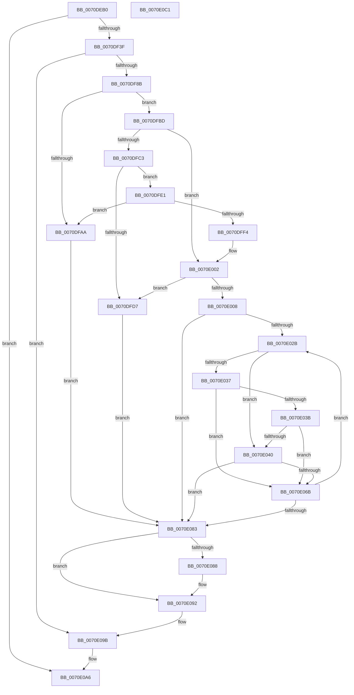

# ArbAddInaccessibleAllocationRange

- RVA: `0x0070DEB0`–`0x0070E0C2` (길이 `530` bytes)
- VA: `0x000000014070DEB0`
- 실행 섹션: `PAGE`
- PDB 이름 있음: `예`; PDB Function 태그: `아니요`
- unwind 정보 RVA: `0x000C565C`
- 디코드: `146`개 명령, `530/530` bytes 표시
- 미해석 바이트: `0` (있으면 어셈블리에 `.byte`로 보존)

> 이 문서는 커널 이미지의 기계어와 PDB 기호를 분석해 생성했습니다. 4번과 5번은 함수 원형과 자료형을 바이너리 사용 방식에서 추정한 C 해석이며 원본 소스 복구 결과는 아닙니다.

## 1. Dependencies

- 직접 호출 지점: **9**; 고유 호출 대상: **5**
- 직접 호출자로 확인된 함수: **1**
- RIP 상대 이미지 참조: **2**

### Outgoing calls
- `0x0070DF32` → [ZwOpenKey](../../text/6A/ZwOpenKey_function_006AD310.md) (function, `0x006AD310`)
- `0x0070DF7C` → [ZwOpenKey](../../text/6A/ZwOpenKey_function_006AD310.md) (function, `0x006AD310`)
- `0x0070DF9B` → [ArbpGetRegistryValue](../71/ArbpGetRegistryValue_function_00710124.md) (function, `0x00710124`)
- `0x0070DFE9` → [ArbpGetRegistryValue](../71/ArbpGetRegistryValue_function_00710124.md) (function, `0x00710124`)
- `0x0070DFF9` → [ExFreePoolWithTag](../../poolcode/B8/ExFreePoolWithTag_function_00B82870.md) (function, `0x00B82870`)
- `0x0070E060` → [RtlAddRange](../A8/RtlAddRange_function_00A8E860.md) (function, `0x00A8E860`)
- `0x0070E08D` → [ExFreePoolWithTag](../../poolcode/B8/ExFreePoolWithTag_function_00B82870.md) (function, `0x00B82870`)
- `0x0070E096` → [ZwClose](../../text/6A/ZwClose_function_006AD2B0.md) (function, `0x006AD2B0`)
- `0x0070E09F` → [ZwClose](../../text/6A/ZwClose_function_006AD2B0.md) (function, `0x006AD2B0`)

### Direct callers
- [IopMemInitialize](../72/IopMemInitialize_function_0072F078.md) at `0x0072F133`

### Static image references
- `0x0070DED7` → RVA `0x00AFAF60` (` ?? ::NNGAKEGL::`string'`; read)
- `0x0070DF3F` → RVA `0x00AFAF30` (` ?? ::NNGAKEGL::`string'`; read)

## 2. Other-region calls and transfers

- 다른 실행 섹션으로 향하는 call: **6**
  - `0x0070DF32` → [ZwOpenKey](../../text/6A/ZwOpenKey_function_006AD310.md) (`PAGE` → `.text`)
  - `0x0070DF7C` → [ZwOpenKey](../../text/6A/ZwOpenKey_function_006AD310.md) (`PAGE` → `.text`)
  - `0x0070DFF9` → [ExFreePoolWithTag](../../poolcode/B8/ExFreePoolWithTag_function_00B82870.md) (`PAGE` → `POOLCODE`)
  - `0x0070E08D` → [ExFreePoolWithTag](../../poolcode/B8/ExFreePoolWithTag_function_00B82870.md) (`PAGE` → `POOLCODE`)
  - `0x0070E096` → [ZwClose](../../text/6A/ZwClose_function_006AD2B0.md) (`PAGE` → `.text`)
  - `0x0070E09F` → [ZwClose](../../text/6A/ZwClose_function_006AD2B0.md) (`PAGE` → `.text`)
- 별도 외부 분기/꼬리 이동을 확인하지 못했습니다.

## 3. Assembly (complete function range)

```asm
0070DEB0  48 89 5C 24 08                  mov qword ptr [rsp + 8], rbx
0070DEB5  55                              push rbp
0070DEB6  56                              push rsi
0070DEB7  57                              push rdi
0070DEB8  41 54                           push r12
0070DEBA  41 55                           push r13
0070DEBC  41 56                           push r14
0070DEBE  41 57                           push r15
0070DEC0  48 8D 6C 24 D9                  lea rbp, [rsp - 0x27]
0070DEC5  48 81 EC A0 00 00 00            sub rsp, 0xa0
0070DECC  45 33 ED                        xor r13d, r13d
0070DECF  48 C7 45 F7 30 00 00 00         mov qword ptr [rbp - 9], 0x30
0070DED7  48 8D 05 82 D0 3E 00            lea rax, [rip + 0x3ed082]
0070DEDE  4C 89 6D 7F                     mov qword ptr [rbp + 0x7f], r13
0070DEE2  48 89 45 DF                     mov qword ptr [rbp - 0x21], rax
0070DEE6  4C 8D 45 F7                     lea r8, [rbp - 9]
0070DEEA  48 8D 45 D7                     lea rax, [rbp - 0x29]
0070DEEE  48 C7 45 0F 40 02 00 00         mov qword ptr [rbp + 0xf], 0x240
0070DEF6  4C 8B E2                        mov r12, rdx
0070DEF9  48 89 45 07                     mov qword ptr [rbp + 7], rax
0070DEFD  4C 8B F9                        mov r15, rcx
0070DF00  48 C7 45 D7 76 00 76 00         mov qword ptr [rbp - 0x29], 0x760076
0070DF08  0F 57 C0                        xorps xmm0, xmm0
0070DF0B  4C 89 6D 77                     mov qword ptr [rbp + 0x77], r13
0070DF0F  BA 19 00 02 00                  mov edx, 0x20019
0070DF14  44 89 6D EB                     mov dword ptr [rbp - 0x15], r13d
0070DF18  48 8D 4D 7F                     lea rcx, [rbp + 0x7f]
0070DF1C  4C 89 6D CF                     mov qword ptr [rbp - 0x31], r13
0070DF20  41 8D 5D 30                     lea ebx, [r13 + 0x30]
0070DF24  4C 89 6D FF                     mov qword ptr [rbp - 1], r13
0070DF28  BF 40 02 00 00                  mov edi, 0x240
0070DF2D  F3 0F 7F 45 17                  movdqu xmmword ptr [rbp + 0x17], xmm0
0070DF32  E8 D9 F3 F9 FF                  call 0x1406ad310
0070DF37  85 C0                           test eax, eax
0070DF39  0F 88 67 01 00 00               js 0x14070e0a6
0070DF3F  48 8D 05 EA CF 3E 00            lea rax, [rip + 0x3ecfea]
0070DF46  C7 45 E7 22 00 22 00            mov dword ptr [rbp - 0x19], 0x220022
0070DF4D  48 89 45 EF                     mov qword ptr [rbp - 0x11], rax
0070DF51  4C 8D 45 F7                     lea r8, [rbp - 9]
0070DF55  48 8B 45 7F                     mov rax, qword ptr [rbp + 0x7f]
0070DF59  48 8D 4D 77                     lea rcx, [rbp + 0x77]
0070DF5D  48 89 45 FF                     mov qword ptr [rbp - 1], rax
0070DF61  0F 57 C0                        xorps xmm0, xmm0
0070DF64  48 8D 45 E7                     lea rax, [rbp - 0x19]
0070DF68  89 5D F7                        mov dword ptr [rbp - 9], ebx
0070DF6B  BA 1F 00 02 00                  mov edx, 0x2001f
0070DF70  48 89 45 07                     mov qword ptr [rbp + 7], rax
0070DF74  89 7D 0F                        mov dword ptr [rbp + 0xf], edi
0070DF77  F3 0F 7F 45 17                  movdqu xmmword ptr [rbp + 0x17], xmm0
0070DF7C  E8 8F F3 F9 FF                  call 0x1406ad310
0070DF81  8B D8                           mov ebx, eax
0070DF83  85 C0                           test eax, eax
0070DF85  0F 88 10 01 00 00               js 0x14070e09b
0070DF8B  49 8B 57 18                     mov rdx, qword ptr [r15 + 0x18]
0070DF8F  4C 8D 45 C7                     lea r8, [rbp - 0x39]
0070DF93  48 8B 4D 77                     mov rcx, qword ptr [rbp + 0x77]
0070DF97  4C 89 6D C7                     mov qword ptr [rbp - 0x39], r13
0070DF9B  E8 84 21 00 00                  call 0x140710124
0070DFA0  48 8B 7D C7                     mov rdi, qword ptr [rbp - 0x39]
0070DFA4  8B D8                           mov ebx, eax
0070DFA6  85 C0                           test eax, eax
0070DFA8  79 13                           jns 0x14070dfbd
0070DFAA  81 FB 9A 00 00 C0               cmp ebx, 0xc000009a
0070DFB0  41 8B C5                        mov eax, r13d
0070DFB3  0F 44 C3                        cmove eax, ebx
0070DFB6  8B D8                           mov ebx, eax
0070DFB8  E9 C6 00 00 00                  jmp 0x14070e083
0070DFBD  83 7F 04 01                     cmp dword ptr [rdi + 4], 1
0070DFC1  75 3F                           jne 0x14070e002
0070DFC3  8B 57 08                        mov edx, dword ptr [rdi + 8]
0070DFC6  8B 47 0C                        mov eax, dword ptr [rdi + 0xc]
0070DFC9  48 03 D7                        add rdx, rdi
0070DFCC  48 D1 E8                        shr rax, 1
0070DFCF  66 44 39 6C 42 FE               cmp word ptr [rdx + rax*2 - 2], r13w
0070DFD5  74 0A                           je 0x14070dfe1
0070DFD7  BB 0D 00 00 C0                  mov ebx, 0xc000000d
0070DFDC  E9 A2 00 00 00                  jmp 0x14070e083
0070DFE1  48 8B 4D 77                     mov rcx, qword ptr [rbp + 0x77]
0070DFE5  4C 8D 45 CF                     lea r8, [rbp - 0x31]
0070DFE9  E8 36 21 00 00                  call 0x140710124
0070DFEE  8B D8                           mov ebx, eax
0070DFF0  85 C0                           test eax, eax
0070DFF2  78 B6                           js 0x14070dfaa
0070DFF4  33 D2                           xor edx, edx
0070DFF6  48 8B CF                        mov rcx, rdi
0070DFF9  E8 72 48 47 00                  call 0x140b82870
0070DFFE  48 8B 7D CF                     mov rdi, qword ptr [rbp - 0x31]
0070E002  83 7F 04 0A                     cmp dword ptr [rdi + 4], 0xa
0070E006  75 CF                           jne 0x14070dfd7
0070E008  44 8B 77 08                     mov r14d, dword ptr [rdi + 8]
0070E00C  49 83 C6 20                     add r14, 0x20
0070E010  4C 03 F7                        add r14, rdi
0070E013  41 8B 46 04                     mov eax, dword ptr [r14 + 4]
0070E017  49 8D 76 08                     lea rsi, [r14 + 8]
0070E01B  48 C1 E0 05                     shl rax, 5
0070E01F  48 83 C0 08                     add rax, 8
0070E023  49 03 C6                        add rax, r14
0070E026  48 3B F0                        cmp rsi, rax
0070E029  73 58                           jae 0x14070e083
0070E02B  0F B6 46 01                     movzx eax, byte ptr [rsi + 1]
0070E02F  41 8B 4F 20                     mov ecx, dword ptr [r15 + 0x20]
0070E033  3B C1                           cmp eax, ecx
0070E035  74 09                           je 0x14070e040
0070E037  3C 07                           cmp al, 7
0070E039  75 30                           jne 0x14070e06b
0070E03B  83 F9 03                        cmp ecx, 3
0070E03E  75 2B                           jne 0x14070e06b
0070E040  4C 8B 46 18                     mov r8, qword ptr [rsi + 0x18]
0070E044  41 B1 40                        mov r9b, 0x40
0070E047  48 8B 56 10                     mov rdx, qword ptr [rsi + 0x10]
0070E04B  49 8B CC                        mov rcx, r12
0070E04E  4C 89 6C 24 30                  mov qword ptr [rsp + 0x30], r13
0070E053  4C 89 6C 24 28                  mov qword ptr [rsp + 0x28], r13
0070E058  C7 44 24 20 01 00 00 00         mov dword ptr [rsp + 0x20], 1
0070E060  E8 FB 07 38 00                  call 0x140a8e860
0070E065  8B D8                           mov ebx, eax
0070E067  85 C0                           test eax, eax
0070E069  78 18                           js 0x14070e083
0070E06B  41 8B 4E 04                     mov ecx, dword ptr [r14 + 4]
0070E06F  48 83 C6 20                     add rsi, 0x20
0070E073  48 C1 E1 05                     shl rcx, 5
0070E077  48 83 C1 08                     add rcx, 8
0070E07B  49 03 CE                        add rcx, r14
0070E07E  48 3B F1                        cmp rsi, rcx
0070E081  72 A8                           jb 0x14070e02b
0070E083  48 85 FF                        test rdi, rdi
0070E086  74 0A                           je 0x14070e092
0070E088  33 D2                           xor edx, edx
0070E08A  48 8B CF                        mov rcx, rdi
0070E08D  E8 DE 47 47 00                  call 0x140b82870
0070E092  48 8B 4D 77                     mov rcx, qword ptr [rbp + 0x77]
0070E096  E8 15 F2 F9 FF                  call 0x1406ad2b0
0070E09B  48 8B 4D 7F                     mov rcx, qword ptr [rbp + 0x7f]
0070E09F  E8 0C F2 F9 FF                  call 0x1406ad2b0
0070E0A4  8B C3                           mov eax, ebx
0070E0A6  48 8B 9C 24 E0 00 00 00         mov rbx, qword ptr [rsp + 0xe0]
0070E0AE  48 81 C4 A0 00 00 00            add rsp, 0xa0
0070E0B5  41 5F                           pop r15
0070E0B7  41 5E                           pop r14
0070E0B9  41 5D                           pop r13
0070E0BB  41 5C                           pop r12
0070E0BD  5F                              pop rdi
0070E0BE  5E                              pop rsi
0070E0BF  5D                              pop rbp
0070E0C0  C3                              ret
0070E0C1  CC                              int3
```

## 4. C-style interpretation (structured pseudocode)

```c
__int64 __fastcall ArbAddInaccessibleAllocationRange(__int64 a1, __int64 a2)
{
    __int64 result;
    __int64 v_r13;
    __int64 v_r14;
    __int64 v_rsi;
    __int64 v_rsp;
    unsigned __int64 v_stack_m48;
    unsigned __int64 v_stack_m50;
    unsigned __int64 v_stack_m58;
    unsigned __int64 v_stack_m5F;
    unsigned __int64 v_stack_m60;
    unsigned __int64 v_stack_m68;
    unsigned __int64 v_stack_m70;
    unsigned int v_stack_m74;
    unsigned int v_stack_m78;
    unsigned __int64 v_stack_m80;
    unsigned __int64 v_stack_m88;
    unsigned __int64 v_stack_m90;
    unsigned __int64 v_stack_m98;
    unsigned __int64 v_stack_mA8;
    unsigned __int64 v_stack_mB0;
    unsigned int v_stack_mB8;
    unsigned __int64 v_stack_p18;
    unsigned __int64 v_stack_p20;
    unsigned __int64 v_stack_p8;

    v_stack_p8 = v_rbx;
    v_rsp = (v_rsp) - (160);
    v_r13 = 0;
    v_stack_m68 = 48;
    v_stack_p20 = 0;
    v_stack_m80 = v_rip + 4116610;
    v_stack_m50 = 576;
    v_stack_m58 = v_stack_m88;
    v_stack_m88 = 0x760076ULL;
    v_stack_p18 = 0;
    v_stack_m74 = 0;
    v_stack_m90 = 0;
    v_stack_m60 = 0;
    v_stack_m48 = v_xmm0;
    result = ZwOpenKey(v_stack_p20, (unsigned int)(0x20019ULL), v_stack_m68, a4);
    if (sign_flag) goto loc_0070E0A6;
    v_stack_m78 = 0x220022ULL;
    v_stack_m70 = v_rip + 4116458;
    v_stack_m60 = v_stack_p20;
    v_stack_m68 = (unsigned int)(v_r13 + 48);
    v_stack_m58 = v_stack_m78;
    v_stack_m50 = 576;
    v_stack_m48 = v_xmm0;
    result = ZwOpenKey(v_stack_p18, (unsigned int)(0x2001FULL), v_stack_m68, a4);
    if (sign_flag) goto loc_0070E09B;
    v_stack_m98 = 0;
    result = ArbpGetRegistryValue(v_stack_p18, *(unsigned __int64 *)(a1 + 24), v_stack_m98, a4);
    if (!sign_flag) goto loc_0070DFBD;
loc_0070DFAA:
    result = 0;
    if (((unsigned int)((unsigned int)((unsigned int)(result)))) == 0xC000009AULL) { result = (unsigned int)((unsigned int)((unsigned int)(result))); }
    goto loc_0070E083;
loc_0070DFBD:
    if ((*(unsigned int *)(v_stack_m98 + 4)) != 1) goto loc_0070E002;
    a2 = ((unsigned int)(*(unsigned int *)(v_stack_m98 + 8))) + (v_stack_m98);
    result = ((unsigned int)(*(unsigned int *)(v_stack_m98 + 12))) >> (1);
    if ((*(unsigned __int16 *)(a2 + result * 2 - 2)) == 0) goto loc_0070DFE1;
loc_0070DFD7:
    goto loc_0070E083;
loc_0070DFE1:
    result = ArbpGetRegistryValue(v_stack_p18, a2, v_stack_m90, a4);
    if (sign_flag) goto loc_0070DFAA;
    a2 = 0;
    result = ExFreePoolWithTag(v_stack_m98, a2, v_stack_m90, a4);
loc_0070E002:
    if ((*(unsigned int *)(v_stack_m90 + 4)) != 10) goto loc_0070DFD7;
    v_r14 = ((unsigned int)(*(unsigned int *)(v_stack_m90 + 8))) + (32);
    v_r14 = (v_r14) + (v_stack_m90);
    result = ((unsigned int)(*(unsigned int *)(v_r14 + 4))) << (5);
    result = (result) + (8);
    result = (result) + (v_r14);
    if ((v_r14 + 8) >= result) goto loc_0070E083;
loc_0070E02B:
    if (((unsigned int)(*(unsigned __int8 *)(v_r14 + 8 + 1))) == ((unsigned int)((unsigned int)(*(unsigned int *)(a1 + 32))))) goto loc_0070E040;
    if (((unsigned __int8)(*(unsigned __int8 *)(v_r14 + 8 + 1))) != 7) goto loc_0070E06B;
    if (((unsigned int)((unsigned int)(*(unsigned int *)(a1 + 32)))) != 3) goto loc_0070E06B;
loc_0070E040:
    v_stack_mA8 = 0;
    v_stack_mB0 = 0;
    v_stack_mB8 = 1;
    result = RtlAddRange(0, *(unsigned __int64 *)(v_r14 + 8 + 16), *(unsigned __int64 *)(v_r14 + 8 + 24), 64);
    if (sign_flag) goto loc_0070E083;
loc_0070E06B:
    v_rsi = (v_r14 + 8) + (32);
    a1 = ((unsigned int)(*(unsigned int *)(v_r14 + 4))) << (5);
    a1 = (a1) + (8);
    a1 = (a1) + (v_r14);
    if (v_rsi < a1) goto loc_0070E02B;
loc_0070E083:
    if (v_stack_m90 != 0) {
        a2 = 0;
        a1 = v_stack_m90;
        result = ExFreePoolWithTag(a1, a2, *(unsigned __int64 *)(v_r14 + 8 + 24), 64);
    }
    result = ZwClose(v_stack_p18, a2, *(unsigned __int64 *)(v_r14 + 8 + 24), 64);
loc_0070E09B:
    result = ZwClose(v_stack_p20, a2, *(unsigned __int64 *)(v_r14 + 8 + 24), 64);
loc_0070E0A6:
    v_rsp = (v_rsp) + (160);
    return (unsigned int)((unsigned int)((unsigned int)((unsigned int)(result))));
}
```

## 5. (Beta) C Style

```c
int64_t ArbAddInaccessibleAllocationRange(void *Arg1, int64_t Arg2)
{
    uint8_t *arg1 = (uint8_t *)Arg1;

    int64_t result;
    int64_t local_r13;
    int64_t local_r14;
    int64_t local_rsi;
    int64_t local_rsp;
    uint64_t v_stack_m48;
    uint64_t v_stack_m50;
    uint64_t v_stack_m58;
    uint64_t v_stack_m5F;
    uint64_t v_stack_m60;
    uint64_t v_stack_m68;
    uint64_t v_stack_m70;
    uint32_t v_stack_m74;
    uint32_t v_stack_m78;
    uint64_t v_stack_m80;
    uint64_t v_stack_m88;
    uint64_t v_stack_m90;
    uint64_t v_stack_m98;
    uint64_t v_stack_mA8;
    uint64_t v_stack_mB0;
    uint32_t v_stack_mB8;
    uint64_t v_stack_p18;
    uint64_t v_stack_p20;
    uint64_t v_stack_p8;

    v_stack_p8 = local_rbx;
    local_rsp = (local_rsp) - (160);
    local_r13 = 0;
    v_stack_m68 = 48;
    v_stack_p20 = 0;
    v_stack_m80 = v_rip + 4116610;
    v_stack_m50 = 576;
    v_stack_m58 = v_stack_m88;
    v_stack_m88 = 0x760076ULL;
    v_stack_p18 = 0;
    v_stack_m74 = 0;
    v_stack_m90 = 0;
    v_stack_m60 = 0;
    v_stack_m48 = v_xmm0;
    result = ZwOpenKey(v_stack_p20, (uint32_t)(0x20019ULL), v_stack_m68, a4);
    if (sign_flag) goto loc_0070E0A6;
    v_stack_m78 = 0x220022ULL;
    v_stack_m70 = v_rip + 4116458;
    v_stack_m60 = v_stack_p20;
    v_stack_m68 = (uint32_t)(local_r13 + 48);
    v_stack_m58 = v_stack_m78;
    v_stack_m50 = 576;
    v_stack_m48 = v_xmm0;
    result = ZwOpenKey(v_stack_p18, (uint32_t)(0x2001FULL), v_stack_m68, a4);
    if (sign_flag) goto loc_0070E09B;
    v_stack_m98 = 0;
    result = ArbpGetRegistryValue(v_stack_p18, *(uint64_t *)(arg1 + 0x18), v_stack_m98, a4);
    if (!sign_flag) goto loc_0070DFBD;
loc_0070DFAA:
    result = 0;
    if (((uint32_t)((uint32_t)((uint32_t)(result)))) == 0xC000009AULL) { result = (uint32_t)((uint32_t)((uint32_t)(result))); }
    goto loc_0070E083;
loc_0070DFBD:
    if ((*(uint32_t *)(v_stack_m98 + 0x4)) != 1) goto loc_0070E002;
    Arg2 = ((uint32_t)(*(uint32_t *)(v_stack_m98 + 0x8))) + (v_stack_m98);
    result = ((uint32_t)(*(uint32_t *)(v_stack_m98 + 0xC))) >> (1);
    if ((*(uint16_t *)(Arg2 + result * 2 - 0x2)) == 0) goto loc_0070DFE1;
loc_0070DFD7:
    goto loc_0070E083;
loc_0070DFE1:
    result = ArbpGetRegistryValue(v_stack_p18, Arg2, v_stack_m90, a4);
    if (sign_flag) goto loc_0070DFAA;
    Arg2 = 0;
    result = ExFreePoolWithTag(v_stack_m98, Arg2, v_stack_m90, a4);
loc_0070E002:
    if ((*(uint32_t *)(v_stack_m90 + 0x4)) != 10) goto loc_0070DFD7;
    local_r14 = ((uint32_t)(*(uint32_t *)(v_stack_m90 + 0x8))) + (32);
    local_r14 = (local_r14) + (v_stack_m90);
    result = ((uint32_t)(*(uint32_t *)(local_r14 + 0x4))) << (5);
    result = (result) + (8);
    result = (result) + (local_r14);
    if ((local_r14 + 8) >= result) goto loc_0070E083;
loc_0070E02B:
    if (((uint32_t)(*(uint8_t *)(local_r14 + 0x8 + 0x1))) == ((uint32_t)((uint32_t)(*(uint32_t *)(arg1 + 0x20))))) goto loc_0070E040;
    if (((uint8_t)(*(uint8_t *)(local_r14 + 0x8 + 0x1))) != 7) goto loc_0070E06B;
    if (((uint32_t)((uint32_t)(*(uint32_t *)(arg1 + 0x20)))) != 3) goto loc_0070E06B;
loc_0070E040:
    v_stack_mA8 = 0;
    v_stack_mB0 = 0;
    v_stack_mB8 = 1;
    result = RtlAddRange(0, *(uint64_t *)(local_r14 + 0x8 + 0x10), *(uint64_t *)(local_r14 + 0x8 + 0x18), 64);
    if (sign_flag) goto loc_0070E083;
loc_0070E06B:
    local_rsi = (local_r14 + 8) + (32);
    Arg1 = ((uint32_t)(*(uint32_t *)(local_r14 + 0x4))) << (5);
    Arg1 = (Arg1) + (8);
    Arg1 = (Arg1) + (local_r14);
    if (local_rsi < Arg1) goto loc_0070E02B;
loc_0070E083:
    if (v_stack_m90 != 0) {
        Arg2 = 0;
        Arg1 = v_stack_m90;
        result = ExFreePoolWithTag(Arg1, Arg2, *(uint64_t *)(local_r14 + 0x8 + 0x18), 64);
    }
    result = ZwClose(v_stack_p18, Arg2, *(uint64_t *)(local_r14 + 0x8 + 0x18), 64);
loc_0070E09B:
    result = ZwClose(v_stack_p20, Arg2, *(uint64_t *)(local_r14 + 0x8 + 0x18), 64);
loc_0070E0A6:
    local_rsp = (local_rsp) + (160);
    return (uint32_t)((uint32_t)((uint32_t)((uint32_t)(result))));
}
```

### 관측된 메모리 오프셋

구조체 형식이 확인되지 않은 접근은 인자 기준의 오프셋으로만 기록했습니다.

| 기준 인자 | 오프셋 표현 | 폭 (bit) | 접근 |
|---|---:|---:|---|
| `Arg1` | `+ 0x18` | `64` | `R` |
| `Arg1` | `+ 0x20` | `32` | `R` |

## 6. Execution-region graph

[열기: 2D/3D 그래프와 함수 탐색 컨트롤 패널](../../../control-panel.html?section=page&rva=0x0070DEB0&view=graph)

- 2D 그래프는 위에서 아래로 흐르고, 3D 그래프는 빈 공간을 드래그해 회전합니다. Shift+드래그는 이동, 휠은 확대·축소, 함수 노드 선택은 대상 보고서 이동입니다.

### Static fallback


