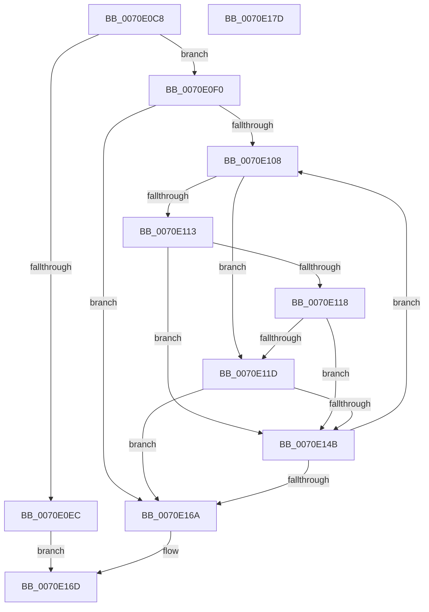

# ArbAddMmConfigRangeAsBootReserved

- RVA: `0x0070E0C8`–`0x0070E17E` (길이 `182` bytes)
- VA: `0x000000014070E0C8`
- 실행 섹션: `PAGE`
- PDB 이름 있음: `예`; PDB Function 태그: `아니요`
- unwind 정보 RVA: `0x00086C28`
- 디코드: `53`개 명령, `182/182` bytes 표시
- 미해석 바이트: `0` (있으면 어셈블리에 `.byte`로 보존)

> 이 문서는 커널 이미지의 기계어와 PDB 기호를 분석해 생성했습니다. 4번과 5번은 함수 원형과 자료형을 바이너리 사용 방식에서 추정한 C 해석이며 원본 소스 복구 결과는 아닙니다.

## 1. Dependencies

- 직접 호출 지점: **1**; 고유 호출 대상: **1**
- 직접 호출자로 확인된 함수: **1**
- RIP 상대 이미지 참조: **1**

### Outgoing calls
- `0x0070E13F` → [RtlAddRange](../A8/RtlAddRange_function_00A8E860.md) (function, `0x00A8E860`)

### Direct callers
- [IopMemInitialize](../72/IopMemInitialize_function_0072F078.md) at `0x0072F14A`

### Static image references
- `0x0070E0D7` → RVA `0x00E65AD8` (`.data`; read)

## 2. Other-region calls and transfers

- 다른 실행 섹션으로 향하는 call: **0**
- 별도 외부 분기/꼬리 이동을 확인하지 못했습니다.

## 3. Assembly (complete function range)

```asm
0070E0C8  48 89 5C 24 08                  mov qword ptr [rsp + 8], rbx
0070E0CD  48 89 74 24 10                  mov qword ptr [rsp + 0x10], rsi
0070E0D2  57                              push rdi
0070E0D3  48 83 EC 40                     sub rsp, 0x40
0070E0D7  4C 8B 05 FA 79 75 00            mov r8, qword ptr [rip + 0x7579fa]
0070E0DE  45 33 C9                        xor r9d, r9d
0070E0E1  48 8B F2                        mov rsi, rdx
0070E0E4  48 8B F9                        mov rdi, rcx
0070E0E7  4D 85 C0                        test r8, r8
0070E0EA  75 04                           jne 0x14070e0f0
0070E0EC  33 C0                           xor eax, eax
0070E0EE  EB 7D                           jmp 0x14070e16d
0070E0F0  41 8B 40 04                     mov eax, dword ptr [r8 + 4]
0070E0F4  49 8D 58 08                     lea rbx, [r8 + 8]
0070E0F8  48 C1 E0 05                     shl rax, 5
0070E0FC  48 83 C0 08                     add rax, 8
0070E100  49 03 C0                        add rax, r8
0070E103  48 3B D8                        cmp rbx, rax
0070E106  73 62                           jae 0x14070e16a
0070E108  0F B6 4B 01                     movzx ecx, byte ptr [rbx + 1]
0070E10C  8B 47 20                        mov eax, dword ptr [rdi + 0x20]
0070E10F  3B C8                           cmp ecx, eax
0070E111  74 0A                           je 0x14070e11d
0070E113  80 F9 07                        cmp cl, 7
0070E116  75 33                           jne 0x14070e14b
0070E118  83 F8 03                        cmp eax, 3
0070E11B  75 2E                           jne 0x14070e14b
0070E11D  48 83 64 24 30 00               and qword ptr [rsp + 0x30], 0
0070E123  41 B1 01                        mov r9b, 1
0070E126  48 83 64 24 28 00               and qword ptr [rsp + 0x28], 0
0070E12C  48 8B CE                        mov rcx, rsi
0070E12F  4C 8B 43 18                     mov r8, qword ptr [rbx + 0x18]
0070E133  48 8B 53 10                     mov rdx, qword ptr [rbx + 0x10]
0070E137  C7 44 24 20 01 00 00 00         mov dword ptr [rsp + 0x20], 1
0070E13F  E8 1C 07 38 00                  call 0x140a8e860
0070E144  44 8B C8                        mov r9d, eax
0070E147  85 C0                           test eax, eax
0070E149  78 1F                           js 0x14070e16a
0070E14B  4C 8B 05 86 79 75 00            mov r8, qword ptr [rip + 0x757986]
0070E152  48 83 C3 20                     add rbx, 0x20
0070E156  41 8B 48 04                     mov ecx, dword ptr [r8 + 4]
0070E15A  48 C1 E1 05                     shl rcx, 5
0070E15E  48 83 C1 08                     add rcx, 8
0070E162  49 03 C8                        add rcx, r8
0070E165  48 3B D9                        cmp rbx, rcx
0070E168  72 9E                           jb 0x14070e108
0070E16A  41 8B C1                        mov eax, r9d
0070E16D  48 8B 5C 24 50                  mov rbx, qword ptr [rsp + 0x50]
0070E172  48 8B 74 24 58                  mov rsi, qword ptr [rsp + 0x58]
0070E177  48 83 C4 40                     add rsp, 0x40
0070E17B  5F                              pop rdi
0070E17C  C3                              ret
0070E17D  CC                              int3
```

## 4. C-style interpretation (structured pseudocode)

```c
__int64 __fastcall ArbAddMmConfigRangeAsBootReserved(__int64 a1, __int64 a2, __int64 a3, int a4)
{
    __int64 result;
    __int64 v_rbx;
    __int64 v_rsp;
    unsigned __int64 v_stack_m18;
    unsigned __int64 v_stack_m20;
    unsigned int v_stack_m28;
    unsigned __int64 v_stack_p10;
    unsigned __int64 v_stack_p8;

    v_stack_p8 = v_rbx;
    v_stack_p10 = v_rsi;
    v_rsp = (v_rsp) - (64);
    a4 = 0;
    if (*(unsigned __int64 *)(v_rip + 7698938) != 0) goto loc_0070E0F0;
    result = 0;
    goto loc_0070E16D;
loc_0070E0F0:
    result = ((unsigned int)(*(unsigned int *)(*(unsigned __int64 *)(v_rip + 7698938) + 4))) << (5);
    result = (result) + (8);
    result = (result) + (*(unsigned __int64 *)(v_rip + 7698938));
    if ((*(unsigned __int64 *)(v_rip + 7698938) + 8) >= result) goto loc_0070E16A;
loc_0070E108:
    if (((unsigned int)(*(unsigned __int8 *)(*(unsigned __int64 *)(v_rip + 7698938) + 8 + 1))) == ((unsigned int)((unsigned int)(*(unsigned int *)(a1 + 32))))) goto loc_0070E11D;
    if (((unsigned __int8)(*(unsigned __int8 *)(*(unsigned __int64 *)(v_rip + 7698938) + 8 + 1))) != 7) goto loc_0070E14B;
    if (((unsigned int)((unsigned int)(*(unsigned int *)(a1 + 32)))) != 3) goto loc_0070E14B;
loc_0070E11D:
    v_stack_m28 = 1;
    result = RtlAddRange(a2, *(unsigned __int64 *)(*(unsigned __int64 *)(v_rip + 7698938) + 8 + 16), *(unsigned __int64 *)(*(unsigned __int64 *)(v_rip + 7698938) + 8 + 24), 1);
    if (sign_flag) goto loc_0070E16A;
loc_0070E14B:
    v_rbx = (*(unsigned __int64 *)(v_rip + 7698938) + 8) + (32);
    a1 = ((unsigned int)(*(unsigned int *)(*(unsigned __int64 *)(v_rip + 7698822) + 4))) << (5);
    a1 = (a1) + (8);
    a1 = (a1) + (*(unsigned __int64 *)(v_rip + 7698822));
    if (v_rbx < a1) goto loc_0070E108;
loc_0070E16A:
loc_0070E16D:
    v_rsp = (v_rsp) + (64);
    return (unsigned int)((unsigned int)((unsigned int)((unsigned int)(result))));
}
```

## 5. (Beta) C Style

```c
int64_t ArbAddMmConfigRangeAsBootReserved(void *Arg1, int64_t Arg2, int64_t Arg3, int32_t Arg4)
{
    uint8_t *arg1 = (uint8_t *)Arg1;

    int64_t result;
    int64_t local_rbx;
    int64_t local_rsp;
    uint64_t v_stack_m18;
    uint64_t v_stack_m20;
    uint32_t v_stack_m28;
    uint64_t v_stack_p10;
    uint64_t v_stack_p8;

    v_stack_p8 = local_rbx;
    v_stack_p10 = local_rsi;
    local_rsp = (local_rsp) - (64);
    Arg4 = 0;
    if (*(uint64_t *)(v_rip + 0x7579FA) != 0) goto loc_0070E0F0;
    result = 0;
    goto loc_0070E16D;
loc_0070E0F0:
    result = ((uint32_t)(*(uint32_t *)(*(uint64_t *)(v_rip + 0x7579FA) + 0x4))) << (5);
    result = (result) + (8);
    result = (result) + (*(uint64_t *)(v_rip + 0x7579FA));
    if ((*(uint64_t *)(v_rip + 0x7579FA) + 8) >= result) goto loc_0070E16A;
loc_0070E108:
    if (((uint32_t)(*(uint8_t *)(*(uint64_t *)(v_rip + 0x7579FA) + 0x8 + 0x1))) == ((uint32_t)((uint32_t)(*(uint32_t *)(arg1 + 0x20))))) goto loc_0070E11D;
    if (((uint8_t)(*(uint8_t *)(*(uint64_t *)(v_rip + 0x7579FA) + 0x8 + 0x1))) != 7) goto loc_0070E14B;
    if (((uint32_t)((uint32_t)(*(uint32_t *)(arg1 + 0x20)))) != 3) goto loc_0070E14B;
loc_0070E11D:
    v_stack_m28 = 1;
    result = RtlAddRange(Arg2, *(uint64_t *)(*(uint64_t *)(v_rip + 0x7579FA) + 0x8 + 0x10), *(uint64_t *)(*(uint64_t *)(v_rip + 0x7579FA) + 0x8 + 0x18), 1);
    if (sign_flag) goto loc_0070E16A;
loc_0070E14B:
    local_rbx = (*(uint64_t *)(v_rip + 0x7579FA) + 8) + (32);
    Arg1 = ((uint32_t)(*(uint32_t *)(*(uint64_t *)(v_rip + 0x757986) + 0x4))) << (5);
    Arg1 = (Arg1) + (8);
    Arg1 = (Arg1) + (*(uint64_t *)(v_rip + 0x757986));
    if (local_rbx < Arg1) goto loc_0070E108;
loc_0070E16A:
loc_0070E16D:
    local_rsp = (local_rsp) + (64);
    return (uint32_t)((uint32_t)((uint32_t)((uint32_t)(result))));
}
```

### 관측된 메모리 오프셋

구조체 형식이 확인되지 않은 접근은 인자 기준의 오프셋으로만 기록했습니다.

| 기준 인자 | 오프셋 표현 | 폭 (bit) | 접근 |
|---|---:|---:|---|
| `Arg1` | `+ 0x20` | `32` | `R` |

## 6. Execution-region graph

[열기: 2D/3D 그래프와 함수 탐색 컨트롤 패널](../../../control-panel.html?section=page&rva=0x0070E0C8&view=graph)

- 2D 그래프는 위에서 아래로 흐르고, 3D 그래프는 빈 공간을 드래그해 회전합니다. Shift+드래그는 이동, 휠은 확대·축소, 함수 노드 선택은 대상 보고서 이동입니다.

### Static fallback


