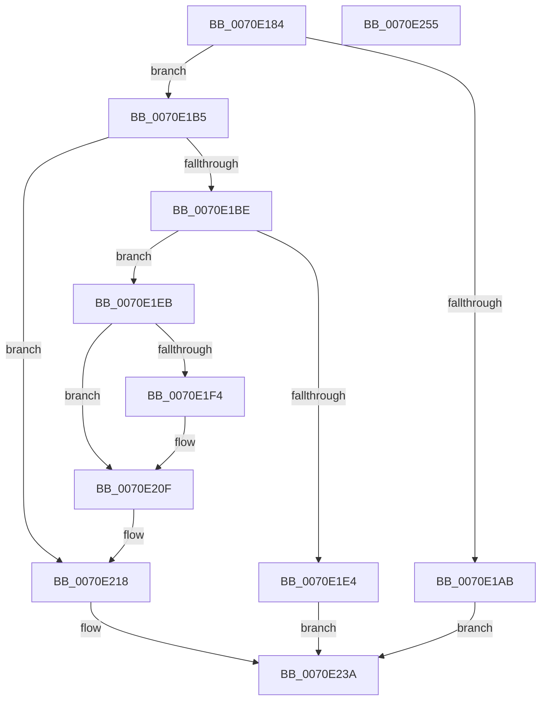

# ArbAddOrdering

- RVA: `0x0070E184`–`0x0070E256` (길이 `210` bytes)
- VA: `0x000000014070E184`
- 실행 섹션: `PAGE`
- PDB 이름 있음: `예`; PDB Function 태그: `아니요`
- unwind 정보 RVA: `0x0005E6B4`
- 디코드: `58`개 명령, `210/210` bytes 표시
- 미해석 바이트: `0` (있으면 어셈블리에 `.byte`로 보존)

> 이 문서는 커널 이미지의 기계어와 PDB 기호를 분석해 생성했습니다. 4번과 5번은 함수 원형과 자료형을 바이너리 사용 방식에서 추정한 C 해석이며 원본 소스 복구 결과는 아닙니다.

## 1. Dependencies

- 직접 호출 지점: **3**; 고유 호출 대상: **3**
- 직접 호출자로 확인된 함수: **1**
- RIP 상대 이미지 참조: **0**

### Outgoing calls
- `0x0070E1D7` → [ExAllocatePool2](../../poolcode/B8/ExAllocatePool2_function_00B820F0.md) (function, `0x00B820F0`)
- `0x0070E1FF` → [memcpy](../../text/6C/memcpy_function_006C6840.md) (function, `0x006C6840`)
- `0x0070E20A` → [ExFreePoolWithTag](../../poolcode/B8/ExFreePoolWithTag_function_00B82870.md) (function, `0x00B82870`)

### Direct callers
- [ArbBuildAssignmentOrdering](ArbBuildAssignmentOrdering_function_0070E43C.md) at `0x0070E6DD`
- [ArbBuildAssignmentOrdering](ArbBuildAssignmentOrdering_function_0070E43C.md) at `0x0070E888`

### Static image references
- 디코드된 RIP-relative 메모리 참조가 없습니다.

## 2. Other-region calls and transfers

- 다른 실행 섹션으로 향하는 call: **3**
  - `0x0070E1D7` → [ExAllocatePool2](../../poolcode/B8/ExAllocatePool2_function_00B820F0.md) (`PAGE` → `POOLCODE`)
  - `0x0070E1FF` → [memcpy](../../text/6C/memcpy_function_006C6840.md) (`PAGE` → `.text`)
  - `0x0070E20A` → [ExFreePoolWithTag](../../poolcode/B8/ExFreePoolWithTag_function_00B82870.md) (`PAGE` → `POOLCODE`)
- 별도 외부 분기/꼬리 이동을 확인하지 못했습니다.

## 3. Assembly (complete function range)

```asm
0070E184  48 8B C4                        mov rax, rsp
0070E187  48 89 58 08                     mov qword ptr [rax + 8], rbx
0070E18B  48 89 68 10                     mov qword ptr [rax + 0x10], rbp
0070E18F  48 89 70 18                     mov qword ptr [rax + 0x18], rsi
0070E193  48 89 78 20                     mov qword ptr [rax + 0x20], rdi
0070E197  41 56                           push r14
0070E199  48 83 EC 20                     sub rsp, 0x20
0070E19D  49 8B F8                        mov rdi, r8
0070E1A0  48 8B F2                        mov rsi, rdx
0070E1A3  48 8B D9                        mov rbx, rcx
0070E1A6  4C 3B C2                        cmp r8, rdx
0070E1A9  73 0A                           jae 0x14070e1b5
0070E1AB  B8 0D 00 00 C0                  mov eax, 0xc000000d
0070E1B0  E9 85 00 00 00                  jmp 0x14070e23a
0070E1B5  0F B7 01                        movzx eax, word ptr [rcx]
0070E1B8  66 3B 41 02                     cmp ax, word ptr [rcx + 2]
0070E1BC  75 5A                           jne 0x14070e218
0070E1BE  41 BE 08 00 00 00               mov r14d, 8
0070E1C4  B9 00 01 00 00                  mov ecx, 0x100
0070E1C9  41 B8 41 72 62 4C               mov r8d, 0x4c627241
0070E1CF  49 8D 14 06                     lea rdx, [r14 + rax]
0070E1D3  48 C1 E2 04                     shl rdx, 4
0070E1D7  E8 14 3F 47 00                  call 0x140b820f0
0070E1DC  48 8B E8                        mov rbp, rax
0070E1DF  48 85 C0                        test rax, rax
0070E1E2  75 07                           jne 0x14070e1eb
0070E1E4  B8 9A 00 00 C0                  mov eax, 0xc000009a
0070E1E9  EB 4F                           jmp 0x14070e23a
0070E1EB  48 8B 53 08                     mov rdx, qword ptr [rbx + 8]
0070E1EF  48 85 D2                        test rdx, rdx
0070E1F2  74 1B                           je 0x14070e20f
0070E1F4  44 0F B7 03                     movzx r8d, word ptr [rbx]
0070E1F8  48 8B CD                        mov rcx, rbp
0070E1FB  49 C1 E0 04                     shl r8, 4
0070E1FF  E8 3C 86 FB FF                  call 0x1406c6840
0070E204  48 8B 4B 08                     mov rcx, qword ptr [rbx + 8]
0070E208  33 D2                           xor edx, edx
0070E20A  E8 61 46 47 00                  call 0x140b82870
0070E20F  66 44 01 73 02                  add word ptr [rbx + 2], r14w
0070E214  48 89 6B 08                     mov qword ptr [rbx + 8], rbp
0070E218  0F B7 0B                        movzx ecx, word ptr [rbx]
0070E21B  48 8B 43 08                     mov rax, qword ptr [rbx + 8]
0070E21F  48 03 C9                        add rcx, rcx
0070E222  48 89 34 C8                     mov qword ptr [rax + rcx*8], rsi
0070E226  0F B7 0B                        movzx ecx, word ptr [rbx]
0070E229  48 8B 43 08                     mov rax, qword ptr [rbx + 8]
0070E22D  48 03 C9                        add rcx, rcx
0070E230  48 89 7C C8 08                  mov qword ptr [rax + rcx*8 + 8], rdi
0070E235  66 FF 03                        inc word ptr [rbx]
0070E238  33 C0                           xor eax, eax
0070E23A  48 8B 5C 24 30                  mov rbx, qword ptr [rsp + 0x30]
0070E23F  48 8B 6C 24 38                  mov rbp, qword ptr [rsp + 0x38]
0070E244  48 8B 74 24 40                  mov rsi, qword ptr [rsp + 0x40]
0070E249  48 8B 7C 24 48                  mov rdi, qword ptr [rsp + 0x48]
0070E24E  48 83 C4 20                     add rsp, 0x20
0070E252  41 5E                           pop r14
0070E254  C3                              ret
0070E255  CC                              int3
```

## 4. C-style interpretation (structured pseudocode)

```c
__int64 __fastcall ArbAddOrdering(__int64 a1, __int64 a2, __int64 a3)
{
    __int64 result;
    __int64 v_rsp;
    unsigned __int64 v_stack_p10;
    unsigned __int64 v_stack_p18;
    unsigned __int64 v_stack_p20;
    unsigned __int64 v_stack_p8;

    *(unsigned __int64 *)(v_rsp + 8) = v_rbx;
    *(unsigned __int64 *)(v_rsp + 16) = v_rbp;
    *(unsigned __int64 *)(v_rsp + 24) = v_rsi;
    *(unsigned __int64 *)(v_rsp + 32) = v_rdi;
    v_rsp = (v_rsp) - (32);
    if (a3 >= a2) goto loc_0070E1B5;
    goto loc_0070E23A;
loc_0070E1B5:
    if (((unsigned __int16)(*(unsigned __int16 *)(a1))) != (*(unsigned __int16 *)(a1 + 2))) goto loc_0070E218;
    a2 = (8 + *(unsigned __int16 *)(a1) * 1) << (4);
    result = ExAllocatePool2(256, a2, (unsigned int)(0x4C627241ULL), a4);
    if (result != 0) goto loc_0070E1EB;
    goto loc_0070E23A;
loc_0070E1EB:
    result = (unsigned int)(0xC000009AULL);
    if (*(unsigned __int64 *)(a1 + 8) != 0) {
        a3 = *(unsigned __int16 *)(a1);
        a1 = result;
        a3 = (a3) << (4);
        result = memcpy(a1, *(unsigned __int64 *)(a1 + 8), a3, a4);
        a1 = *(unsigned __int64 *)(a1 + 8);
        a2 = 0;
        result = ExFreePoolWithTag(a1, a2, a3, a4);
    }
    *(unsigned __int64 *)(a1 + 8) = result;
loc_0070E218:
    a1 = (*(unsigned __int16 *)(a1)) + (*(unsigned __int16 *)(a1));
    *(unsigned __int64 *)(*(unsigned __int64 *)(a1 + 8) + a1 * 8) = 0;
    a1 = (*(unsigned __int16 *)(a1)) + (*(unsigned __int16 *)(a1));
    *(unsigned __int64 *)(*(unsigned __int64 *)(a1 + 8) + a1 * 8 + 8) = a3;
    result = 0;
loc_0070E23A:
    v_rsp = (v_rsp) + (32);
    return result;
}
```

## 5. (Beta) C Style

```c
int64_t ArbAddOrdering(void *Arg1, int64_t Arg2, int64_t Arg3)
{
    uint8_t *arg1 = (uint8_t *)Arg1;

    int64_t result;
    int64_t local_rsp;
    uint64_t v_stack_p10;
    uint64_t v_stack_p18;
    uint64_t v_stack_p20;
    uint64_t v_stack_p8;

    *(uint64_t *)(local_rsp + 0x8) = local_rbx;
    *(uint64_t *)(local_rsp + 0x10) = local_rbp;
    *(uint64_t *)(local_rsp + 0x18) = local_rsi;
    *(uint64_t *)(local_rsp + 0x20) = local_rdi;
    local_rsp = (local_rsp) - (32);
    if (Arg3 >= Arg2) goto loc_0070E1B5;
    goto loc_0070E23A;
loc_0070E1B5:
    if (((uint16_t)(*(uint16_t *)(arg1))) != (*(uint16_t *)(arg1 + 0x2))) goto loc_0070E218;
    Arg2 = (8 + *(uint16_t *)(arg1) * 1) << (4);
    result = ExAllocatePool2(256, Arg2, (uint32_t)(0x4C627241ULL), a4);
    if (result != 0) goto loc_0070E1EB;
    goto loc_0070E23A;
loc_0070E1EB:
    result = (uint32_t)(0xC000009AULL);
    if (*(uint64_t *)(arg1 + 0x8) != 0) {
        Arg3 = *(uint16_t *)(arg1);
        Arg1 = result;
        Arg3 = (Arg3) << (4);
        result = memcpy(Arg1, *(uint64_t *)(arg1 + 0x8), Arg3, a4);
        Arg1 = *(uint64_t *)(arg1 + 0x8);
        Arg2 = 0;
        result = ExFreePoolWithTag(Arg1, Arg2, Arg3, a4);
    }
    *(uint64_t *)(arg1 + 0x8) = result;
loc_0070E218:
    Arg1 = (*(uint16_t *)(arg1)) + (*(uint16_t *)(arg1));
    *(uint64_t *)(*(uint64_t *)(arg1 + 0x8) + arg1 * 8) = 0;
    Arg1 = (*(uint16_t *)(arg1)) + (*(uint16_t *)(arg1));
    *(uint64_t *)(*(uint64_t *)(arg1 + 0x8) + arg1 * 8 + 0x8) = Arg3;
    result = 0;
loc_0070E23A:
    local_rsp = (local_rsp) + (32);
    return result;
}
```

### 관측된 메모리 오프셋

구조체 형식이 확인되지 않은 접근은 인자 기준의 오프셋으로만 기록했습니다.

| 기준 인자 | 오프셋 표현 | 폭 (bit) | 접근 |
|---|---:|---:|---|
| `Arg1` | `+ 0x0` | `16` | `R` |
| `Arg1` | `+ 0x0` | `16` | `R/W` |
| `Arg1` | `+ 0x2` | `16` | `R` |
| `Arg1` | `+ 0x2` | `16` | `R/W` |
| `Arg1` | `+ 0x8` | `64` | `R` |
| `Arg1` | `+ 0x8` | `64` | `W` |

## 6. Execution-region graph

[열기: 2D/3D 그래프와 함수 탐색 컨트롤 패널](../../../control-panel.html?section=page&rva=0x0070E184&view=graph)

- 2D 그래프는 위에서 아래로 흐르고, 3D 그래프는 빈 공간을 드래그해 회전합니다. Shift+드래그는 이동, 휠은 확대·축소, 함수 노드 선택은 대상 보고서 이동입니다.

### Static fallback


