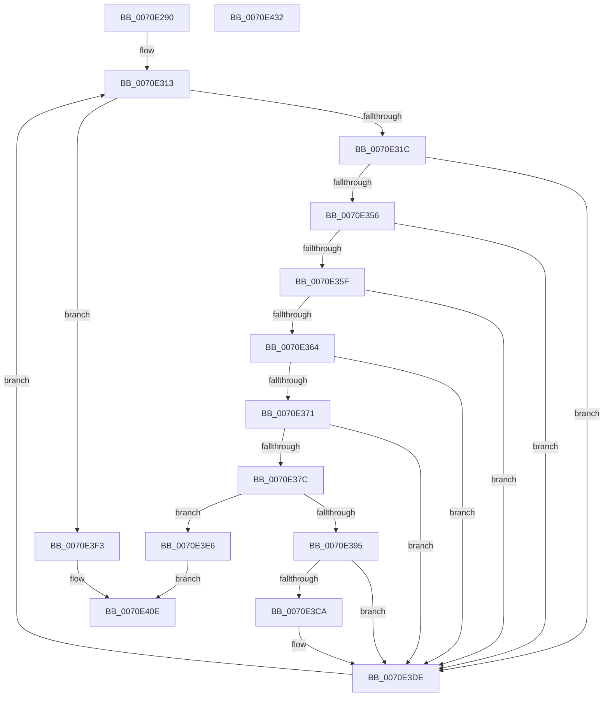

# ArbBootAllocation

- RVA: `0x0070E290`–`0x0070E433` (길이 `419` bytes)
- VA: `0x000000014070E290`
- 실행 섹션: `PAGE`
- PDB 이름 있음: `예`; PDB Function 태그: `아니요`
- unwind 정보 RVA: `0x000C56BC`
- 디코드: `112`개 명령, `419/419` bytes 표시
- 미해석 바이트: `0` (있으면 어셈블리에 `.byte`로 보존)

> 이 문서는 커널 이미지의 기계어와 PDB 기호를 분석해 생성했습니다. 4번과 5번은 함수 원형과 자료형을 바이너리 사용 방식에서 추정한 C 해석이며 원본 소스 복구 결과는 아닙니다.

## 1. Dependencies

- 직접 호출 지점: **11**; 고유 호출 대상: **7**
- 직접 호출자로 확인된 함수: **0**
- RIP 상대 이미지 참조: **1**

### Outgoing calls
- `0x0070E2C8` → [memset](../../text/6C/memset_function_006C6C40.md) (function, `0x006C6C40`)
- `0x0070E2D7` → [memset](../../text/6C/memset_function_006C6C40.md) (function, `0x006C6C40`)
- `0x0070E308` → [RtlCopyRangeList](../A6/RtlCopyRangeList_function_00A69680.md) (function, `0x00A69680`)
- `0x0070E32B` → [ArbpBuildAlternative](../71/ArbpBuildAlternative_function_00710068.md) (function, `0x00710068`)
- `0x0070E38A` → [guard_dispatch_icall](../../text/6B/guard_dispatch_icall_function_006BAAD0.md) (function, `0x006BAAD0`)
- `0x0070E3A3` → [guard_dispatch_icall](../../text/6B/guard_dispatch_icall_function_006BAAD0.md) (function, `0x006BAAD0`)
- `0x0070E3BF` → [guard_dispatch_icall](../../text/6B/guard_dispatch_icall_function_006BAAD0.md) (function, `0x006BAAD0`)
- `0x0070E3D0` → [ExFreePoolWithTag](../../poolcode/B8/ExFreePoolWithTag_function_00B82870.md) (function, `0x00B82870`)
- `0x0070E3EA` → [RtlFreeRangeList](../A6/RtlFreeRangeList_function_00A69850.md) (function, `0x00A69850`)
- `0x0070E3F7` → [RtlFreeRangeList](../A6/RtlFreeRangeList_function_00A69850.md) (function, `0x00A69850`)
- `0x0070E415` → [_security_check_cookie](../../text/6A/_security_check_cookie_function_006AC640.md) (function, `0x006AC640`)

### Direct callers
- 이 함수 시작 RVA로 연결되는 직접 call은 확인되지 않았습니다. 간접 호출은 완전히 역산할 수 없습니다.

### Static image references
- `0x0070E2AA` → RVA `0x00E0A740` (`.data`; read)

## 2. Other-region calls and transfers

- 다른 실행 섹션으로 향하는 call: **7**
  - `0x0070E2C8` → [memset](../../text/6C/memset_function_006C6C40.md) (`PAGE` → `.text`)
  - `0x0070E2D7` → [memset](../../text/6C/memset_function_006C6C40.md) (`PAGE` → `.text`)
  - `0x0070E38A` → [guard_dispatch_icall](../../text/6B/guard_dispatch_icall_function_006BAAD0.md) (`PAGE` → `.text`)
  - `0x0070E3A3` → [guard_dispatch_icall](../../text/6B/guard_dispatch_icall_function_006BAAD0.md) (`PAGE` → `.text`)
  - `0x0070E3BF` → [guard_dispatch_icall](../../text/6B/guard_dispatch_icall_function_006BAAD0.md) (`PAGE` → `.text`)
  - `0x0070E3D0` → [ExFreePoolWithTag](../../poolcode/B8/ExFreePoolWithTag_function_00B82870.md) (`PAGE` → `POOLCODE`)
  - `0x0070E415` → [_security_check_cookie](../../text/6A/_security_check_cookie_function_006AC640.md) (`PAGE` → `.text`)
- 별도 외부 분기/꼬리 이동을 확인하지 못했습니다.

## 3. Assembly (complete function range)

```asm
0070E290  48 89 5C 24 18                  mov qword ptr [rsp + 0x18], rbx
0070E295  48 89 74 24 20                  mov qword ptr [rsp + 0x20], rsi
0070E29A  55                              push rbp
0070E29B  57                              push rdi
0070E29C  41 56                           push r14
0070E29E  48 8D 6C 24 B9                  lea rbp, [rsp - 0x47]
0070E2A3  48 81 EC C0 00 00 00            sub rsp, 0xc0
0070E2AA  48 8B 05 8F C4 6F 00            mov rax, qword ptr [rip + 0x6fc48f]
0070E2B1  48 33 C4                        xor rax, rsp
0070E2B4  48 89 45 37                     mov qword ptr [rbp + 0x37], rax
0070E2B8  4C 8B F2                        mov r14, rdx
0070E2BB  48 8B D9                        mov rbx, rcx
0070E2BE  33 D2                           xor edx, edx
0070E2C0  48 8D 4D A7                     lea rcx, [rbp - 0x59]
0070E2C4  44 8D 42 50                     lea r8d, [rdx + 0x50]
0070E2C8  E8 73 89 FB FF                  call 0x1406c6c40
0070E2CD  33 D2                           xor edx, edx
0070E2CF  48 8D 4D F7                     lea rcx, [rbp - 9]
0070E2D3  44 8D 42 40                     lea r8d, [rdx + 0x40]
0070E2D7  E8 64 89 FB FF                  call 0x1406c6c40
0070E2DC  48 8B 53 28                     mov rdx, qword ptr [rbx + 0x28]
0070E2E0  48 8D 45 F7                     lea rax, [rbp - 9]
0070E2E4  48 8B 4B 30                     mov rcx, qword ptr [rbx + 0x30]
0070E2E8  48 89 45 DF                     mov qword ptr [rbp - 0x21], rax
0070E2EC  48 8D 45 F7                     lea rax, [rbp - 9]
0070E2F0  48 89 45 CF                     mov qword ptr [rbp - 0x31], rax
0070E2F4  B8 02 00 00 00                  mov eax, 2
0070E2F9  66 89 45 E7                     mov word ptr [rbp - 0x19], ax
0070E2FD  C7 45 D7 01 00 00 00            mov dword ptr [rbp - 0x29], 1
0070E304  C6 45 E9 01                     mov byte ptr [rbp - 0x17], 1
0070E308  E8 73 B3 35 00                  call 0x140a69680
0070E30D  49 8B 06                        mov rax, qword ptr [r14]
0070E310  48 8B 38                        mov rdi, qword ptr [rax]
0070E313  49 39 3E                        cmp qword ptr [r14], rdi
0070E316  0F 84 D7 00 00 00               je 0x14070e3f3
0070E31C  48 89 7D C7                     mov qword ptr [rbp - 0x39], rdi
0070E320  4C 8D 45 F7                     lea r8, [rbp - 9]
0070E324  48 8B 57 18                     mov rdx, qword ptr [rdi + 0x18]
0070E328  48 8B CB                        mov rcx, rbx
0070E32B  E8 38 1D 00 00                  call 0x140710068
0070E330  4C 8B 55 07                     mov r10, qword ptr [rbp + 7]
0070E334  48 83 65 EF 00                  and qword ptr [rbp - 0x11], 0
0070E339  4C 8B 45 F7                     mov r8, qword ptr [rbp - 9]
0070E33D  48 8B 4D FF                     mov rcx, qword ptr [rbp - 1]
0070E341  4C 89 45 A7                     mov qword ptr [rbp - 0x59], r8
0070E345  48 89 4D AF                     mov qword ptr [rbp - 0x51], rcx
0070E349  C6 45 EA 00                     mov byte ptr [rbp - 0x16], 0
0070E34D  4D 85 D2                        test r10, r10
0070E350  0F 84 88 00 00 00               je 0x14070e3de
0070E356  4C 8B 4D 0F                     mov r9, qword ptr [rbp + 0xf]
0070E35A  4D 85 C9                        test r9, r9
0070E35D  74 7F                           je 0x14070e3de
0070E35F  49 3B C8                        cmp rcx, r8
0070E362  72 7A                           jb 0x14070e3de
0070E364  33 D2                           xor edx, edx
0070E366  49 8B C0                        mov rax, r8
0070E369  49 F7 F1                        div r9
0070E36C  48 85 D2                        test rdx, rdx
0070E36F  75 6D                           jne 0x14070e3de
0070E371  49 2B C8                        sub rcx, r8
0070E374  48 FF C1                        inc rcx
0070E377  49 3B CA                        cmp rcx, r10
0070E37A  75 62                           jne 0x14070e3de
0070E37C  48 8B 83 E0 00 00 00            mov rax, qword ptr [rbx + 0xe0]
0070E383  48 8D 55 A7                     lea rdx, [rbp - 0x59]
0070E387  48 8B CB                        mov rcx, rbx
0070E38A  E8 41 C7 FA FF                  call 0x1406baad0
0070E38F  8B F0                           mov esi, eax
0070E391  85 C0                           test eax, eax
0070E393  78 51                           js 0x14070e3e6
0070E395  48 8B 83 00 01 00 00            mov rax, qword ptr [rbx + 0x100]
0070E39C  48 8D 55 A7                     lea rdx, [rbp - 0x59]
0070E3A0  48 8B CB                        mov rcx, rbx
0070E3A3  E8 28 C7 FA FF                  call 0x1406baad0
0070E3A8  48 8B 4D CF                     mov rcx, qword ptr [rbp - 0x31]
0070E3AC  48 8B 83 80 00 00 00            mov rax, qword ptr [rbx + 0x80]
0070E3B3  4C 8B 47 48                     mov r8, qword ptr [rdi + 0x48]
0070E3B7  48 8B 55 A7                     mov rdx, qword ptr [rbp - 0x59]
0070E3BB  48 8B 49 28                     mov rcx, qword ptr [rcx + 0x28]
0070E3BF  E8 0C C7 FA FF                  call 0x1406baad0
0070E3C4  F6 45 E7 10                     test byte ptr [rbp - 0x19], 0x10
0070E3C8  74 14                           je 0x14070e3de
0070E3CA  48 8B 4D EF                     mov rcx, qword ptr [rbp - 0x11]
0070E3CE  33 D2                           xor edx, edx
0070E3D0  E8 9B 44 47 00                  call 0x140b82870
0070E3D5  B8 EF FF 00 00                  mov eax, 0xffef
0070E3DA  66 21 45 E7                     and word ptr [rbp - 0x19], ax
0070E3DE  48 8B 3F                        mov rdi, qword ptr [rdi]
0070E3E1  E9 2D FF FF FF                  jmp 0x14070e313
0070E3E6  48 8B 4B 30                     mov rcx, qword ptr [rbx + 0x30]
0070E3EA  E8 61 B4 35 00                  call 0x140a69850
0070E3EF  8B C6                           mov eax, esi
0070E3F1  EB 1B                           jmp 0x14070e40e
0070E3F3  48 8B 4B 28                     mov rcx, qword ptr [rbx + 0x28]
0070E3F7  E8 54 B4 35 00                  call 0x140a69850
0070E3FC  48 8B 43 30                     mov rax, qword ptr [rbx + 0x30]
0070E400  48 8B 4B 28                     mov rcx, qword ptr [rbx + 0x28]
0070E404  48 89 43 28                     mov qword ptr [rbx + 0x28], rax
0070E408  33 C0                           xor eax, eax
0070E40A  48 89 4B 30                     mov qword ptr [rbx + 0x30], rcx
0070E40E  48 8B 4D 37                     mov rcx, qword ptr [rbp + 0x37]
0070E412  48 33 CC                        xor rcx, rsp
0070E415  E8 26 E2 F9 FF                  call 0x1406ac640
0070E41A  4C 8D 9C 24 C0 00 00 00         lea r11, [rsp + 0xc0]
0070E422  49 8B 5B 30                     mov rbx, qword ptr [r11 + 0x30]
0070E426  49 8B 73 38                     mov rsi, qword ptr [r11 + 0x38]
0070E42A  49 8B E3                        mov rsp, r11
0070E42D  41 5E                           pop r14
0070E42F  5F                              pop rdi
0070E430  5D                              pop rbp
0070E431  C3                              ret
0070E432  CC                              int3
```

## 4. C-style interpretation (structured pseudocode)

```c
__int64 __fastcall ArbBootAllocation(__int64 a1, __int64 a2)
{
    __int64 result;
    __int64 v_rsp;
    unsigned __int64 v_stack_m18;
    unsigned __int64 v_stack_m28;
    unsigned __int64 v_stack_m50;
    unsigned __int64 v_stack_m58;
    unsigned __int64 v_stack_m5F;
    unsigned __int64 v_stack_m60;
    unsigned __int64 v_stack_m68;
    unsigned __int64 v_stack_m70;
    unsigned __int8 v_stack_m75;
    unsigned __int8 v_stack_m76;
    unsigned __int16 v_stack_m78;
    unsigned __int64 v_stack_m80;
    unsigned int v_stack_m88;
    unsigned __int64 v_stack_m90;
    unsigned __int64 v_stack_m98;
    unsigned __int64 v_stack_mB0;
    unsigned __int64 v_stack_mB8;
    unsigned __int64 v_stack_p18;
    unsigned __int64 v_stack_p20;

    v_stack_p18 = v_rbx;
    v_stack_p20 = v_rsi;
    v_rsp = (v_rsp) - (192);
    result = (*(unsigned __int64 *)(v_rip + 7324815)) ^ (v_rsp);
    v_stack_m28 = result;
    a2 = 0;
    result = memset(v_stack_mB8, a2, a2 + 80, a4);
    a2 = 0;
    result = memset(v_stack_m68, a2, a2 + 64, a4);
    v_stack_m80 = v_stack_m68;
    v_stack_m90 = v_stack_m68;
    v_stack_m78 = 2;
    v_stack_m88 = 1;
    v_stack_m76 = 1;
    result = RtlCopyRangeList(*(unsigned __int64 *)(a1 + 48), *(unsigned __int64 *)(a1 + 40), a2 + 64, a4);
loc_0070E313:
    if ((*(unsigned __int64 *)(a2)) == (*(unsigned __int64 *)(*(unsigned __int64 *)(a2)))) goto loc_0070E3F3;
    v_stack_m98 = *(unsigned __int64 *)(*(unsigned __int64 *)(a2));
    result = ArbpBuildAlternative(a1, *(unsigned __int64 *)(*(unsigned __int64 *)(*(unsigned __int64 *)(a2)) + 24), v_stack_m68, a4);
    v_stack_mB8 = v_stack_m68;
    v_stack_mB0 = v_stack_m60;
    v_stack_m75 = 0;
    if (v_stack_m58 == 0) goto loc_0070E3DE;
    if (v_stack_m50 == 0) goto loc_0070E3DE;
    if (v_stack_m60 < v_stack_m68) goto loc_0070E3DE;
    a2 = 0;
    if (0 != 0) goto loc_0070E3DE;
    a1 = (v_stack_m60) - (v_stack_m68);
    a1 = (a1) + 1;
    if (a1 != v_stack_m58) goto loc_0070E3DE;
    result = guard_dispatch_icall(a1, v_stack_mB8, v_stack_m68, v_stack_m50);
    if (sign_flag) goto loc_0070E3E6;
    result = guard_dispatch_icall(a1, v_stack_mB8, v_stack_m68, v_stack_m50);
    result = guard_dispatch_icall(*(unsigned __int64 *)(v_stack_m90 + 40), v_stack_mB8, *(unsigned __int64 *)(*(unsigned __int64 *)(*(unsigned __int64 *)(a2)) + 72), v_stack_m50);
    if (((v_stack_m78) & (16)) != 0) {
        a1 = v_stack_m70;
        a2 = 0;
        result = ExFreePoolWithTag(a1, a2, *(unsigned __int64 *)(*(unsigned __int64 *)(*(unsigned __int64 *)(a2)) + 72), v_stack_m50);
        result = 0xFFEFULL;
    }
    goto loc_0070E313;
loc_0070E3E6:
    result = RtlFreeRangeList(*(unsigned __int64 *)(a1 + 48), a2, *(unsigned __int64 *)(*(unsigned __int64 *)(*(unsigned __int64 *)(a2)) + 72), v_stack_m50);
    goto loc_0070E40E;
loc_0070E3F3:
    result = RtlFreeRangeList(*(unsigned __int64 *)(a1 + 40), a2, *(unsigned __int64 *)(*(unsigned __int64 *)(*(unsigned __int64 *)(a2)) + 72), v_stack_m50);
    *(unsigned __int64 *)(a1 + 40) = *(unsigned __int64 *)(a1 + 48);
    result = 0;
    *(unsigned __int64 *)(a1 + 48) = *(unsigned __int64 *)(a1 + 40);
loc_0070E40E:
    a1 = (v_stack_m28) ^ (v_rsp);
    result = _security_check_cookie(a1, a2, *(unsigned __int64 *)(*(unsigned __int64 *)(*(unsigned __int64 *)(a2)) + 72), v_stack_m50);
    return result;
}
```

## 5. (Beta) C Style

```c
int64_t ArbBootAllocation(void *Arg1, void *Arg2)
{
    uint8_t *arg1 = (uint8_t *)Arg1;
    uint8_t *arg2 = (uint8_t *)Arg2;

    int64_t result;
    int64_t local_rsp;
    uint64_t v_stack_m18;
    uint64_t v_stack_m28;
    uint64_t v_stack_m50;
    uint64_t v_stack_m58;
    uint64_t v_stack_m5F;
    uint64_t v_stack_m60;
    uint64_t v_stack_m68;
    uint64_t v_stack_m70;
    uint8_t v_stack_m75;
    uint8_t v_stack_m76;
    uint16_t v_stack_m78;
    uint64_t v_stack_m80;
    uint32_t v_stack_m88;
    uint64_t v_stack_m90;
    uint64_t v_stack_m98;
    uint64_t v_stack_mB0;
    uint64_t v_stack_mB8;
    uint64_t v_stack_p18;
    uint64_t v_stack_p20;

    v_stack_p18 = local_rbx;
    v_stack_p20 = local_rsi;
    local_rsp = (local_rsp) - (192);
    result = (*(uint64_t *)(v_rip + 0x6FC48F)) ^ (local_rsp);
    v_stack_m28 = result;
    Arg2 = 0;
    result = memset(v_stack_mB8, Arg2, Arg2 + 80, a4);
    Arg2 = 0;
    result = memset(v_stack_m68, Arg2, Arg2 + 64, a4);
    v_stack_m80 = v_stack_m68;
    v_stack_m90 = v_stack_m68;
    v_stack_m78 = 2;
    v_stack_m88 = 1;
    v_stack_m76 = 1;
    result = RtlCopyRangeList(*(uint64_t *)(arg1 + 0x30), *(uint64_t *)(arg1 + 0x28), Arg2 + 64, a4);
loc_0070E313:
    if ((*(uint64_t *)(arg2)) == (*(uint64_t *)(*(uint64_t *)(arg2)))) goto loc_0070E3F3;
    v_stack_m98 = *(uint64_t *)(*(uint64_t *)(arg2));
    result = ArbpBuildAlternative(Arg1, *(uint64_t *)(*(uint64_t *)(*(uint64_t *)(arg2)) + 0x18), v_stack_m68, a4);
    v_stack_mB8 = v_stack_m68;
    v_stack_mB0 = v_stack_m60;
    v_stack_m75 = 0;
    if (v_stack_m58 == 0) goto loc_0070E3DE;
    if (v_stack_m50 == 0) goto loc_0070E3DE;
    if (v_stack_m60 < v_stack_m68) goto loc_0070E3DE;
    Arg2 = 0;
    if (0 != 0) goto loc_0070E3DE;
    Arg1 = (v_stack_m60) - (v_stack_m68);
    Arg1 = (Arg1) + 1;
    if (Arg1 != v_stack_m58) goto loc_0070E3DE;
    result = guard_dispatch_icall(Arg1, v_stack_mB8, v_stack_m68, v_stack_m50);
    if (sign_flag) goto loc_0070E3E6;
    result = guard_dispatch_icall(Arg1, v_stack_mB8, v_stack_m68, v_stack_m50);
    result = guard_dispatch_icall(*(uint64_t *)(v_stack_m90 + 0x28), v_stack_mB8, *(uint64_t *)(*(uint64_t *)(*(uint64_t *)(arg2)) + 0x48), v_stack_m50);
    if (((v_stack_m78) & (16)) != 0) {
        Arg1 = v_stack_m70;
        Arg2 = 0;
        result = ExFreePoolWithTag(Arg1, Arg2, *(uint64_t *)(*(uint64_t *)(*(uint64_t *)(arg2)) + 0x48), v_stack_m50);
        result = 0xFFEFULL;
    }
    goto loc_0070E313;
loc_0070E3E6:
    result = RtlFreeRangeList(*(uint64_t *)(arg1 + 0x30), Arg2, *(uint64_t *)(*(uint64_t *)(*(uint64_t *)(arg2)) + 0x48), v_stack_m50);
    goto loc_0070E40E;
loc_0070E3F3:
    result = RtlFreeRangeList(*(uint64_t *)(arg1 + 0x28), Arg2, *(uint64_t *)(*(uint64_t *)(*(uint64_t *)(arg2)) + 0x48), v_stack_m50);
    *(uint64_t *)(arg1 + 0x28) = *(uint64_t *)(arg1 + 0x30);
    result = 0;
    *(uint64_t *)(arg1 + 0x30) = *(uint64_t *)(arg1 + 0x28);
loc_0070E40E:
    Arg1 = (v_stack_m28) ^ (local_rsp);
    result = _security_check_cookie(Arg1, Arg2, *(uint64_t *)(*(uint64_t *)(*(uint64_t *)(arg2)) + 0x48), v_stack_m50);
    return result;
}
```

### 관측된 메모리 오프셋

구조체 형식이 확인되지 않은 접근은 인자 기준의 오프셋으로만 기록했습니다.

| 기준 인자 | 오프셋 표현 | 폭 (bit) | 접근 |
|---|---:|---:|---|
| `Arg1` | `+ 0x28` | `64` | `R` |
| `Arg1` | `+ 0x28` | `64` | `W` |
| `Arg1` | `+ 0x30` | `64` | `R` |
| `Arg1` | `+ 0x30` | `64` | `W` |
| `Arg1` | `+ 0x80` | `64` | `R` |
| `Arg1` | `+ 0xE0` | `64` | `R` |
| `Arg1` | `+ 0x100` | `64` | `R` |
| `Arg2` | `+ 0x0` | `64` | `R` |

## 6. Execution-region graph

[열기: 2D/3D 그래프와 함수 탐색 컨트롤 패널](../../../control-panel.html?section=page&rva=0x0070E290&view=graph)

- 2D 그래프는 위에서 아래로 흐르고, 3D 그래프는 빈 공간을 드래그해 회전합니다. Shift+드래그는 이동, 휠은 확대·축소, 함수 노드 선택은 대상 보고서 이동입니다.

### Static fallback


