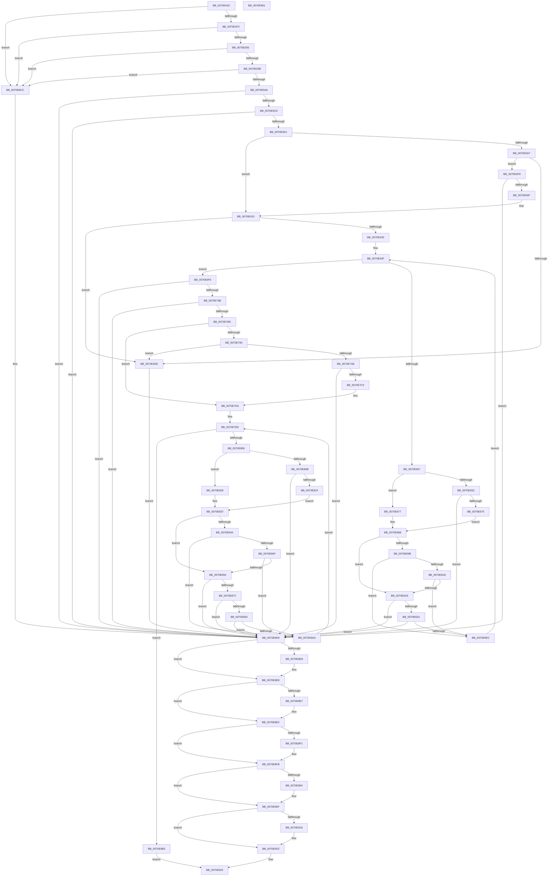

# ArbBuildAssignmentOrdering

- RVA: `0x0070E43C`–`0x0070E962` (길이 `1,318` bytes)
- VA: `0x000000014070E43C`
- 실행 섹션: `PAGE`
- PDB 이름 있음: `예`; PDB Function 태그: `아니요`
- unwind 정보 RVA: `0x000C5694`
- 디코드: `354`개 명령, `1,318/1,318` bytes 표시
- 미해석 바이트: `0` (있으면 어셈블리에 `.byte`로 보존)

> 이 문서는 커널 이미지의 기계어와 PDB 기호를 분석해 생성했습니다. 4번과 5번은 함수 원형과 자료형을 바이너리 사용 방식에서 추정한 C 해석이며 원본 소스 복구 결과는 아닙니다.

## 1. Dependencies

- 직접 호출 지점: **34**; 고유 호출 대상: **14**
- 직접 호출자로 확인된 함수: **1**
- RIP 상대 이미지 참조: **5**

### Outgoing calls
- `0x0070E4C8` → [KeWaitForSingleObject](../../text/20/KeWaitForSingleObject_function_0020E6B0.md) (function, `0x0020E6B0`)
- `0x0070E4D1` → [ArbFreeOrderingList](ArbFreeOrderingList_function_0070EAF8.md) (function, `0x0070EAF8`)
- `0x0070E4DA` → [ArbFreeOrderingList](ArbFreeOrderingList_function_0070EAF8.md) (function, `0x0070EAF8`)
- `0x0070E4E3` → [ArbInitializeOrderingList](ArbInitializeOrderingList_function_0070F024.md) (function, `0x0070F024`)
- `0x0070E4F6` → [ArbInitializeOrderingList](ArbInitializeOrderingList_function_0070F024.md) (function, `0x0070F024`)
- `0x0070E54C` → [ZwOpenKey](../../text/6A/ZwOpenKey_function_006AD310.md) (function, `0x006AD310`)
- `0x0070E597` → [ZwOpenKey](../../text/6A/ZwOpenKey_function_006AD310.md) (function, `0x006AD310`)
- `0x0070E5B5` → [ArbpGetRegistryValue](../71/ArbpGetRegistryValue_function_00710124.md) (function, `0x00710124`)
- `0x0070E600` → [ArbpGetRegistryValue](../71/ArbpGetRegistryValue_function_00710124.md) (function, `0x00710124`)
- `0x0070E614` → [ExFreePoolWithTag](../../poolcode/B8/ExFreePoolWithTag_function_00B82870.md) (function, `0x00B82870`)
- `0x0070E621` → [ZwClose](../../text/6A/ZwClose_function_006AD2B0.md) (function, `0x006AD2B0`)
- `0x0070E666` → [guard_dispatch_icall](../../text/6B/guard_dispatch_icall_function_006BAAD0.md) (function, `0x006BAAD0`)
- `0x0070E6C2` → [guard_dispatch_icall](../../text/6B/guard_dispatch_icall_function_006BAAD0.md) (function, `0x006BAAD0`)
- `0x0070E6DD` → [ArbAddOrdering](ArbAddOrdering_function_0070E184.md) (function, `0x0070E184`)
- `0x0070E6FA` → [ExFreePoolWithTag](../../poolcode/B8/ExFreePoolWithTag_function_00B82870.md) (function, `0x00B82870`)
- `0x0070E75C` → [ZwCreateKey](../../text/6A/ZwCreateKey_function_006AD470.md) (function, `0x006AD470`)
- `0x0070E77A` → [ArbpGetRegistryValue](../71/ArbpGetRegistryValue_function_00710124.md) (function, `0x00710124`)
- `0x0070E7B6` → [ArbpGetRegistryValue](../71/ArbpGetRegistryValue_function_00710124.md) (function, `0x00710124`)
- `0x0070E7CA` → [ExFreePoolWithTag](../../poolcode/B8/ExFreePoolWithTag_function_00B82870.md) (function, `0x00B82870`)
- `0x0070E7D7` → [ZwClose](../../text/6A/ZwClose_function_006AD2B0.md) (function, `0x006AD2B0`)
- `0x0070E815` → [guard_dispatch_icall](../../text/6B/guard_dispatch_icall_function_006BAAD0.md) (function, `0x006BAAD0`)
- `0x0070E871` → [guard_dispatch_icall](../../text/6B/guard_dispatch_icall_function_006BAAD0.md) (function, `0x006BAAD0`)
- `0x0070E888` → [ArbAddOrdering](ArbAddOrdering_function_0070E184.md) (function, `0x0070E184`)
- `0x0070E89F` → [ArbPruneOrdering](ArbPruneOrdering_function_0070F26C.md) (function, `0x0070F26C`)
- `0x0070E8B8` → [ExFreePoolWithTag](../../poolcode/B8/ExFreePoolWithTag_function_00B82870.md) (function, `0x00B82870`)
- `0x0070E8C1` → [ZwClose](../../text/6A/ZwClose_function_006AD2B0.md) (function, `0x006AD2B0`)
- `0x0070E8D9` → [ZwClose](../../text/6A/ZwClose_function_006AD2B0.md) (function, `0x006AD2B0`)
- `0x0070E8E7` → [ZwClose](../../text/6A/ZwClose_function_006AD2B0.md) (function, `0x006AD2B0`)
- `0x0070E8F6` → [ExFreePoolWithTag](../../poolcode/B8/ExFreePoolWithTag_function_00B82870.md) (function, `0x00B82870`)
- `0x0070E906` → [ExFreePoolWithTag](../../poolcode/B8/ExFreePoolWithTag_function_00B82870.md) (function, `0x00B82870`)
- `0x0070E91A` → [ExFreePoolWithTag](../../poolcode/B8/ExFreePoolWithTag_function_00B82870.md) (function, `0x00B82870`)
- `0x0070E92E` → [KeSetEvent](../../text/33/KeSetEvent_function_0033F310.md) (function, `0x0033F310`)
- `0x0070E933` → [KeLeaveCriticalRegion](../../text/25/KeLeaveCriticalRegion_function_0025D8B0.md) (function, `0x0025D8B0`)
- `0x0070E941` → [_security_check_cookie](../../text/6A/_security_check_cookie_function_006AC640.md) (function, `0x006AC640`)

### Direct callers
- [ArbInitializeArbiterInstance](ArbInitializeArbiterInstance_function_0070ECB4.md) at `0x0070EFA1`

### Static image references
- `0x0070E458` → RVA `0x00E0A740` (`.data`; read)
- `0x0070E505` → RVA `0x00AFAF60` (` ?? ::NNGAKEGL::`string'`; read)
- `0x0070E55B` → RVA `0x00AFAFE0` (` ?? ::NNGAKEGL::`string'`; read)
- `0x0070E5AE` → RVA `0x00AFE210` (` ?? ::NNGAKEGL::`string'`; read)
- `0x0070E6FF` → RVA `0x00AFAF00` (` ?? ::NNGAKEGL::`string'`; read)

## 2. Other-region calls and transfers

- 다른 실행 섹션으로 향하는 call: **23**
  - `0x0070E4C8` → [KeWaitForSingleObject](../../text/20/KeWaitForSingleObject_function_0020E6B0.md) (`PAGE` → `.text`)
  - `0x0070E54C` → [ZwOpenKey](../../text/6A/ZwOpenKey_function_006AD310.md) (`PAGE` → `.text`)
  - `0x0070E597` → [ZwOpenKey](../../text/6A/ZwOpenKey_function_006AD310.md) (`PAGE` → `.text`)
  - `0x0070E614` → [ExFreePoolWithTag](../../poolcode/B8/ExFreePoolWithTag_function_00B82870.md) (`PAGE` → `POOLCODE`)
  - `0x0070E621` → [ZwClose](../../text/6A/ZwClose_function_006AD2B0.md) (`PAGE` → `.text`)
  - `0x0070E666` → [guard_dispatch_icall](../../text/6B/guard_dispatch_icall_function_006BAAD0.md) (`PAGE` → `.text`)
  - `0x0070E6C2` → [guard_dispatch_icall](../../text/6B/guard_dispatch_icall_function_006BAAD0.md) (`PAGE` → `.text`)
  - `0x0070E6FA` → [ExFreePoolWithTag](../../poolcode/B8/ExFreePoolWithTag_function_00B82870.md) (`PAGE` → `POOLCODE`)
  - `0x0070E75C` → [ZwCreateKey](../../text/6A/ZwCreateKey_function_006AD470.md) (`PAGE` → `.text`)
  - `0x0070E7CA` → [ExFreePoolWithTag](../../poolcode/B8/ExFreePoolWithTag_function_00B82870.md) (`PAGE` → `POOLCODE`)
  - `0x0070E7D7` → [ZwClose](../../text/6A/ZwClose_function_006AD2B0.md) (`PAGE` → `.text`)
  - `0x0070E815` → [guard_dispatch_icall](../../text/6B/guard_dispatch_icall_function_006BAAD0.md) (`PAGE` → `.text`)
  - `0x0070E871` → [guard_dispatch_icall](../../text/6B/guard_dispatch_icall_function_006BAAD0.md) (`PAGE` → `.text`)
  - `0x0070E8B8` → [ExFreePoolWithTag](../../poolcode/B8/ExFreePoolWithTag_function_00B82870.md) (`PAGE` → `POOLCODE`)
  - `0x0070E8C1` → [ZwClose](../../text/6A/ZwClose_function_006AD2B0.md) (`PAGE` → `.text`)
  - `0x0070E8D9` → [ZwClose](../../text/6A/ZwClose_function_006AD2B0.md) (`PAGE` → `.text`)
  - `0x0070E8E7` → [ZwClose](../../text/6A/ZwClose_function_006AD2B0.md) (`PAGE` → `.text`)
  - `0x0070E8F6` → [ExFreePoolWithTag](../../poolcode/B8/ExFreePoolWithTag_function_00B82870.md) (`PAGE` → `POOLCODE`)
  - `0x0070E906` → [ExFreePoolWithTag](../../poolcode/B8/ExFreePoolWithTag_function_00B82870.md) (`PAGE` → `POOLCODE`)
  - `0x0070E91A` → [ExFreePoolWithTag](../../poolcode/B8/ExFreePoolWithTag_function_00B82870.md) (`PAGE` → `POOLCODE`)
  - `0x0070E92E` → [KeSetEvent](../../text/33/KeSetEvent_function_0033F310.md) (`PAGE` → `.text`)
  - `0x0070E933` → [KeLeaveCriticalRegion](../../text/25/KeLeaveCriticalRegion_function_0025D8B0.md) (`PAGE` → `.text`)
  - `0x0070E941` → [_security_check_cookie](../../text/6A/_security_check_cookie_function_006AC640.md) (`PAGE` → `.text`)
- 별도 외부 분기/꼬리 이동을 확인하지 못했습니다.

## 3. Assembly (complete function range)

```asm
0070E43C  48 89 5C 24 10                  mov qword ptr [rsp + 0x10], rbx
0070E441  55                              push rbp
0070E442  56                              push rsi
0070E443  57                              push rdi
0070E444  41 54                           push r12
0070E446  41 55                           push r13
0070E448  41 56                           push r14
0070E44A  41 57                           push r15
0070E44C  48 8D 6C 24 D9                  lea rbp, [rsp - 0x27]
0070E451  48 81 EC E0 00 00 00            sub rsp, 0xe0
0070E458  48 8B 05 E1 C2 6F 00            mov rax, qword ptr [rip + 0x6fc2e1]
0070E45F  48 33 C4                        xor rax, rsp
0070E462  48 89 45 17                     mov qword ptr [rbp + 0x17], rax
0070E466  33 DB                           xor ebx, ebx
0070E468  0F 57 C0                        xorps xmm0, xmm0
0070E46B  33 C0                           xor eax, eax
0070E46D  48 89 5D 97                     mov qword ptr [rbp - 0x69], rbx
0070E471  48 89 5D 8F                     mov qword ptr [rbp - 0x71], rbx
0070E475  4D 8B E1                        mov r12, r9
0070E478  0F 11 45 9F                     movups xmmword ptr [rbp - 0x61], xmm0
0070E47C  48 89 5D BF                     mov qword ptr [rbp - 0x41], rbx
0070E480  4C 8B F1                        mov r14, rcx
0070E483  48 89 5D B7                     mov qword ptr [rbp - 0x49], rbx
0070E487  45 33 C9                        xor r9d, r9d
0070E48A  48 89 5D AF                     mov qword ptr [rbp - 0x51], rbx
0070E48E  45 33 C0                        xor r8d, r8d
0070E491  0F 11 45 C7                     movups xmmword ptr [rbp - 0x39], xmm0
0070E495  48 89 45 E7                     mov qword ptr [rbp - 0x19], rax
0070E499  33 D2                           xor edx, edx
0070E49B  0F 11 45 D7                     movups xmmword ptr [rbp - 0x29], xmm0
0070E49F  89 45 EF                        mov dword ptr [rbp - 0x11], eax
0070E4A2  0F 11 45 F7                     movups xmmword ptr [rbp - 9], xmm0
0070E4A6  48 89 5D 87                     mov qword ptr [rbp - 0x79], rbx
0070E4AA  0F 11 45 07                     movups xmmword ptr [rbp + 7], xmm0
0070E4AE  65 48 8B 04 25 88 01 00 00      mov rax, qword ptr gs:[0x188]
0070E4B7  48 89 5C 24 20                  mov qword ptr [rsp + 0x20], rbx
0070E4BC  66 FF 88 E4 01 00 00            dec word ptr [rax + 0x1e4]
0070E4C3  90                              nop
0070E4C4  48 8B 49 08                     mov rcx, qword ptr [rcx + 8]
0070E4C8  E8 E3 01 B0 FF                  call 0x14020e6b0
0070E4CD  49 8D 4E 38                     lea rcx, [r14 + 0x38]
0070E4D1  E8 22 06 00 00                  call 0x14070eaf8
0070E4D6  49 8D 4E 48                     lea rcx, [r14 + 0x48]
0070E4DA  E8 19 06 00 00                  call 0x14070eaf8
0070E4DF  49 8D 4E 38                     lea rcx, [r14 + 0x38]
0070E4E3  E8 3C 0B 00 00                  call 0x14070f024
0070E4E8  8B F8                           mov edi, eax
0070E4EA  85 C0                           test eax, eax
0070E4EC  0F 88 DA 03 00 00               js 0x14070e8cc
0070E4F2  49 8D 4E 48                     lea rcx, [r14 + 0x48]
0070E4F6  E8 29 0B 00 00                  call 0x14070f024
0070E4FB  8B F8                           mov edi, eax
0070E4FD  85 C0                           test eax, eax
0070E4FF  0F 88 C7 03 00 00               js 0x14070e8cc
0070E505  48 8D 05 54 CA 3E 00            lea rax, [rip + 0x3eca54]
0070E50C  C7 45 9F 76 00 76 00            mov dword ptr [rbp - 0x61], 0x760076
0070E513  48 89 45 A7                     mov qword ptr [rbp - 0x59], rax
0070E517  8D 73 30                        lea esi, [rbx + 0x30]
0070E51A  48 8D 45 9F                     lea rax, [rbp - 0x61]
0070E51E  89 75 C7                        mov dword ptr [rbp - 0x39], esi
0070E521  0F 57 C0                        xorps xmm0, xmm0
0070E524  48 89 45 D7                     mov qword ptr [rbp - 0x29], rax
0070E528  41 BD 19 00 02 00               mov r13d, 0x20019
0070E52E  48 89 5D CF                     mov qword ptr [rbp - 0x31], rbx
0070E532  41 BF 40 02 00 00               mov r15d, 0x240
0070E538  4C 8D 45 C7                     lea r8, [rbp - 0x39]
0070E53C  41 8B D5                        mov edx, r13d
0070E53F  44 89 7D DF                     mov dword ptr [rbp - 0x21], r15d
0070E543  48 8D 4D 97                     lea rcx, [rbp - 0x69]
0070E547  F3 0F 7F 45 E7                  movdqu xmmword ptr [rbp - 0x19], xmm0
0070E54C  E8 BF ED F9 FF                  call 0x1406ad310
0070E551  8B F8                           mov edi, eax
0070E553  85 C0                           test eax, eax
0070E555  0F 88 71 03 00 00               js 0x14070e8cc
0070E55B  48 8D 05 7E CA 3E 00            lea rax, [rip + 0x3eca7e]
0070E562  C7 45 9F 1E 00 1E 00            mov dword ptr [rbp - 0x61], 0x1e001e
0070E569  48 89 45 A7                     mov qword ptr [rbp - 0x59], rax
0070E56D  4C 8D 45 C7                     lea r8, [rbp - 0x39]
0070E571  48 8B 45 97                     mov rax, qword ptr [rbp - 0x69]
0070E575  48 8D 4D 8F                     lea rcx, [rbp - 0x71]
0070E579  48 89 45 CF                     mov qword ptr [rbp - 0x31], rax
0070E57D  0F 57 C0                        xorps xmm0, xmm0
0070E580  48 8D 45 9F                     lea rax, [rbp - 0x61]
0070E584  89 75 C7                        mov dword ptr [rbp - 0x39], esi
0070E587  41 8B D5                        mov edx, r13d
0070E58A  48 89 45 D7                     mov qword ptr [rbp - 0x29], rax
0070E58E  44 89 7D DF                     mov dword ptr [rbp - 0x21], r15d
0070E592  F3 0F 7F 45 E7                  movdqu xmmword ptr [rbp - 0x19], xmm0
0070E597  E8 74 ED F9 FF                  call 0x1406ad310
0070E59C  8B F8                           mov edi, eax
0070E59E  85 C0                           test eax, eax
0070E5A0  0F 88 26 03 00 00               js 0x14070e8cc
0070E5A6  48 8B 4D 8F                     mov rcx, qword ptr [rbp - 0x71]
0070E5AA  4C 8D 45 87                     lea r8, [rbp - 0x79]
0070E5AE  48 8D 15 5B FC 3E 00            lea rdx, [rip + 0x3efc5b]
0070E5B5  E8 6A 1B 00 00                  call 0x140710124
0070E5BA  48 8B 75 87                     mov rsi, qword ptr [rbp - 0x79]
0070E5BE  8B F8                           mov edi, eax
0070E5C0  85 C0                           test eax, eax
0070E5C2  0F 88 08 03 00 00               js 0x14070e8d0
0070E5C8  48 85 F6                        test rsi, rsi
0070E5CB  0F 84 FF 02 00 00               je 0x14070e8d0
0070E5D1  83 7E 04 01                     cmp dword ptr [rsi + 4], 1
0070E5D5  75 46                           jne 0x14070e61d
0070E5D7  8B 56 08                        mov edx, dword ptr [rsi + 8]
0070E5DA  8B 46 0C                        mov eax, dword ptr [rsi + 0xc]
0070E5DD  48 03 D6                        add rdx, rsi
0070E5E0  48 D1 E8                        shr rax, 1
0070E5E3  48 89 5D 87                     mov qword ptr [rbp - 0x79], rbx
0070E5E7  66 39 5C 42 FE                  cmp word ptr [rdx + rax*2 - 2], bx
0070E5EC  74 0A                           je 0x14070e5f8
0070E5EE  BF 0D 00 00 C0                  mov edi, 0xc000000d
0070E5F3  E9 D8 02 00 00                  jmp 0x14070e8d0
0070E5F8  48 8B 4D 8F                     mov rcx, qword ptr [rbp - 0x71]
0070E5FC  4C 8D 45 87                     lea r8, [rbp - 0x79]
0070E600  E8 1F 1B 00 00                  call 0x140710124
0070E605  8B F8                           mov edi, eax
0070E607  85 C0                           test eax, eax
0070E609  0F 88 C1 02 00 00               js 0x14070e8d0
0070E60F  33 D2                           xor edx, edx
0070E611  48 8B CE                        mov rcx, rsi
0070E614  E8 57 42 47 00                  call 0x140b82870
0070E619  48 8B 75 87                     mov rsi, qword ptr [rbp - 0x79]
0070E61D  48 8B 4D 8F                     mov rcx, qword ptr [rbp - 0x71]
0070E621  E8 8A EC F9 FF                  call 0x1406ad2b0
0070E626  48 89 5D 8F                     mov qword ptr [rbp - 0x71], rbx
0070E62A  83 7E 04 0A                     cmp dword ptr [rsi + 4], 0xa
0070E62E  75 BE                           jne 0x14070e5ee
0070E630  44 8B 6E 08                     mov r13d, dword ptr [rsi + 8]
0070E634  49 83 C5 20                     add r13, 0x20
0070E638  4C 03 EE                        add r13, rsi
0070E63B  4D 8D 7D 08                     lea r15, [r13 + 8]
0070E63F  41 8B 45 04                     mov eax, dword ptr [r13 + 4]
0070E643  48 C1 E0 05                     shl rax, 5
0070E647  48 83 C0 08                     add rax, 8
0070E64B  49 03 C5                        add rax, r13
0070E64E  4C 3B F8                        cmp r15, rax
0070E651  0F 83 9E 00 00 00               jae 0x14070e6f5
0070E657  4D 85 E4                        test r12, r12
0070E65A  74 1B                           je 0x14070e677
0070E65C  49 8B D7                        mov rdx, r15
0070E65F  48 8D 4D F7                     lea rcx, [rbp - 9]
0070E663  49 8B C4                        mov rax, r12
0070E666  E8 65 C4 FA FF                  call 0x1406baad0
0070E66B  8B F8                           mov edi, eax
0070E66D  85 C0                           test eax, eax
0070E66F  0F 88 5B 02 00 00               js 0x14070e8d0
0070E675  EB 11                           jmp 0x14070e688
0070E677  41 0F 10 07                     movups xmm0, xmmword ptr [r15]
0070E67B  0F 11 45 F7                     movups xmmword ptr [rbp - 9], xmm0
0070E67F  41 0F 10 4F 10                  movups xmm1, xmmword ptr [r15 + 0x10]
0070E684  0F 11 4D 07                     movups xmmword ptr [rbp + 7], xmm1
0070E688  48 8B 45 F7                     mov rax, qword ptr [rbp - 9]
0070E68C  48 C1 E8 08                     shr rax, 8
0070E690  0F B6 C8                        movzx ecx, al
0070E693  41 8B 46 20                     mov eax, dword ptr [r14 + 0x20]
0070E697  3B C8                           cmp ecx, eax
0070E699  74 0A                           je 0x14070e6a5
0070E69B  80 F9 07                        cmp cl, 7
0070E69E  75 4C                           jne 0x14070e6ec
0070E6A0  83 F8 03                        cmp eax, 3
0070E6A3  75 47                           jne 0x14070e6ec
0070E6A5  49 8B 46 78                     mov rax, qword ptr [r14 + 0x78]
0070E6A9  48 8D 4D BF                     lea rcx, [rbp - 0x41]
0070E6AD  48 89 4C 24 20                  mov qword ptr [rsp + 0x20], rcx
0070E6B2  4C 8D 4D BF                     lea r9, [rbp - 0x41]
0070E6B6  48 8D 4D F7                     lea rcx, [rbp - 9]
0070E6BA  4C 8D 45 AF                     lea r8, [rbp - 0x51]
0070E6BE  48 8D 55 B7                     lea rdx, [rbp - 0x49]
0070E6C2  E8 09 C4 FA FF                  call 0x1406baad0
0070E6C7  8B F8                           mov edi, eax
0070E6C9  85 C0                           test eax, eax
0070E6CB  0F 88 FF 01 00 00               js 0x14070e8d0
0070E6D1  4C 8B 45 AF                     mov r8, qword ptr [rbp - 0x51]
0070E6D5  49 8D 4E 38                     lea rcx, [r14 + 0x38]
0070E6D9  48 8B 55 B7                     mov rdx, qword ptr [rbp - 0x49]
0070E6DD  E8 A2 FA FF FF                  call 0x14070e184
0070E6E2  8B F8                           mov edi, eax
0070E6E4  85 C0                           test eax, eax
0070E6E6  0F 88 E4 01 00 00               js 0x14070e8d0
0070E6EC  49 83 C7 20                     add r15, 0x20
0070E6F0  E9 4A FF FF FF                  jmp 0x14070e63f
0070E6F5  33 D2                           xor edx, edx
0070E6F7  48 8B CE                        mov rcx, rsi
0070E6FA  E8 71 41 47 00                  call 0x140b82870
0070E6FF  48 8D 05 FA C7 3E 00            lea rax, [rip + 0x3ec7fa]
0070E706  48 89 5C 24 30                  mov qword ptr [rsp + 0x30], rbx
0070E70B  48 89 45 A7                     mov qword ptr [rbp - 0x59], rax
0070E70F  4C 8D 45 C7                     lea r8, [rbp - 0x39]
0070E713  48 8B 45 97                     mov rax, qword ptr [rbp - 0x69]
0070E717  48 8D 4D 8F                     lea rcx, [rbp - 0x71]
0070E71B  48 89 45 CF                     mov qword ptr [rbp - 0x31], rax
0070E71F  0F 57 C0                        xorps xmm0, xmm0
0070E722  48 8D 45 9F                     lea rax, [rbp - 0x61]
0070E726  89 5C 24 28                     mov dword ptr [rsp + 0x28], ebx
0070E72A  45 33 C9                        xor r9d, r9d
0070E72D  48 89 45 D7                     mov qword ptr [rbp - 0x29], rax
0070E731  BA 19 00 02 00                  mov edx, 0x20019
0070E736  48 89 5D 87                     mov qword ptr [rbp - 0x79], rbx
0070E73A  48 8B F3                        mov rsi, rbx
0070E73D  C7 45 9F 22 00 22 00            mov dword ptr [rbp - 0x61], 0x220022
0070E744  C7 45 C7 30 00 00 00            mov dword ptr [rbp - 0x39], 0x30
0070E74B  C7 45 DF 40 02 00 00            mov dword ptr [rbp - 0x21], 0x240
0070E752  F3 0F 7F 45 E7                  movdqu xmmword ptr [rbp - 0x19], xmm0
0070E757  48 89 5C 24 20                  mov qword ptr [rsp + 0x20], rbx
0070E75C  E8 0F ED F9 FF                  call 0x1406ad470
0070E761  8B F8                           mov edi, eax
0070E763  85 C0                           test eax, eax
0070E765  0F 88 65 01 00 00               js 0x14070e8d0
0070E76B  48 8B 4D 8F                     mov rcx, qword ptr [rbp - 0x71]
0070E76F  4C 8D 45 87                     lea r8, [rbp - 0x79]
0070E773  48 8D 15 96 FA 3E 00            lea rdx, [rip + 0x3efa96]
0070E77A  E8 A5 19 00 00                  call 0x140710124
0070E77F  48 8B 75 87                     mov rsi, qword ptr [rbp - 0x79]
0070E783  8B F8                           mov edi, eax
0070E785  85 C0                           test eax, eax
0070E787  0F 88 43 01 00 00               js 0x14070e8d0
0070E78D  83 7E 04 01                     cmp dword ptr [rsi + 4], 1
0070E791  75 40                           jne 0x14070e7d3
0070E793  8B 56 08                        mov edx, dword ptr [rsi + 8]
0070E796  8B 46 0C                        mov eax, dword ptr [rsi + 0xc]
0070E799  48 03 D6                        add rdx, rsi
0070E79C  48 D1 E8                        shr rax, 1
0070E79F  48 89 5D 87                     mov qword ptr [rbp - 0x79], rbx
0070E7A3  66 39 5C 42 FE                  cmp word ptr [rdx + rax*2 - 2], bx
0070E7A8  0F 85 40 FE FF FF               jne 0x14070e5ee
0070E7AE  48 8B 4D 8F                     mov rcx, qword ptr [rbp - 0x71]
0070E7B2  4C 8D 45 87                     lea r8, [rbp - 0x79]
0070E7B6  E8 69 19 00 00                  call 0x140710124
0070E7BB  8B F8                           mov edi, eax
0070E7BD  85 C0                           test eax, eax
0070E7BF  0F 88 0B 01 00 00               js 0x14070e8d0
0070E7C5  33 D2                           xor edx, edx
0070E7C7  48 8B CE                        mov rcx, rsi
0070E7CA  E8 A1 40 47 00                  call 0x140b82870
0070E7CF  48 8B 75 87                     mov rsi, qword ptr [rbp - 0x79]
0070E7D3  48 8B 4D 8F                     mov rcx, qword ptr [rbp - 0x71]
0070E7D7  E8 D4 EA F9 FF                  call 0x1406ad2b0
0070E7DC  48 89 5D 8F                     mov qword ptr [rbp - 0x71], rbx
0070E7E0  4C 8D 6E 20                     lea r13, [rsi + 0x20]
0070E7E4  8B 46 08                        mov eax, dword ptr [rsi + 8]
0070E7E7  4C 03 E8                        add r13, rax
0070E7EA  4D 8D 7D 08                     lea r15, [r13 + 8]
0070E7EE  41 8B 45 04                     mov eax, dword ptr [r13 + 4]
0070E7F2  48 C1 E0 05                     shl rax, 5
0070E7F6  48 83 C0 08                     add rax, 8
0070E7FA  49 03 C5                        add rax, r13
0070E7FD  4C 3B F8                        cmp r15, rax
0070E800  0F 83 AD 00 00 00               jae 0x14070e8b3
0070E806  4D 85 E4                        test r12, r12
0070E809  74 1B                           je 0x14070e826
0070E80B  49 8B D7                        mov rdx, r15
0070E80E  48 8D 4D F7                     lea rcx, [rbp - 9]
0070E812  49 8B C4                        mov rax, r12
0070E815  E8 B6 C2 FA FF                  call 0x1406baad0
0070E81A  8B F8                           mov edi, eax
0070E81C  85 C0                           test eax, eax
0070E81E  0F 88 AC 00 00 00               js 0x14070e8d0
0070E824  EB 11                           jmp 0x14070e837
0070E826  41 0F 10 07                     movups xmm0, xmmword ptr [r15]
0070E82A  0F 11 45 F7                     movups xmmword ptr [rbp - 9], xmm0
0070E82E  41 0F 10 4F 10                  movups xmm1, xmmword ptr [r15 + 0x10]
0070E833  0F 11 4D 07                     movups xmmword ptr [rbp + 7], xmm1
0070E837  48 8B 45 F7                     mov rax, qword ptr [rbp - 9]
0070E83B  48 C1 E8 08                     shr rax, 8
0070E83F  0F B6 C8                        movzx ecx, al
0070E842  41 8B 46 20                     mov eax, dword ptr [r14 + 0x20]
0070E846  3B C8                           cmp ecx, eax
0070E848  74 0A                           je 0x14070e854
0070E84A  80 F9 07                        cmp cl, 7
0070E84D  75 5B                           jne 0x14070e8aa
0070E84F  83 F8 03                        cmp eax, 3
0070E852  75 56                           jne 0x14070e8aa
0070E854  49 8B 46 78                     mov rax, qword ptr [r14 + 0x78]
0070E858  48 8D 4D BF                     lea rcx, [rbp - 0x41]
0070E85C  48 89 4C 24 20                  mov qword ptr [rsp + 0x20], rcx
0070E861  4C 8D 4D BF                     lea r9, [rbp - 0x41]
0070E865  48 8D 4D F7                     lea rcx, [rbp - 9]
0070E869  4C 8D 45 AF                     lea r8, [rbp - 0x51]
0070E86D  48 8D 55 B7                     lea rdx, [rbp - 0x49]
0070E871  E8 5A C2 FA FF                  call 0x1406baad0
0070E876  8B F8                           mov edi, eax
0070E878  85 C0                           test eax, eax
0070E87A  78 54                           js 0x14070e8d0
0070E87C  4C 8B 45 AF                     mov r8, qword ptr [rbp - 0x51]
0070E880  49 8D 4E 48                     lea rcx, [r14 + 0x48]
0070E884  48 8B 55 B7                     mov rdx, qword ptr [rbp - 0x49]
0070E888  E8 F7 F8 FF FF                  call 0x14070e184
0070E88D  8B F8                           mov edi, eax
0070E88F  85 C0                           test eax, eax
0070E891  78 3D                           js 0x14070e8d0
0070E893  4C 8B 45 AF                     mov r8, qword ptr [rbp - 0x51]
0070E897  49 8D 4E 38                     lea rcx, [r14 + 0x38]
0070E89B  48 8B 55 B7                     mov rdx, qword ptr [rbp - 0x49]
0070E89F  E8 C8 09 00 00                  call 0x14070f26c
0070E8A4  8B F8                           mov edi, eax
0070E8A6  85 C0                           test eax, eax
0070E8A8  78 26                           js 0x14070e8d0
0070E8AA  49 83 C7 20                     add r15, 0x20
0070E8AE  E9 3B FF FF FF                  jmp 0x14070e7ee
0070E8B3  33 D2                           xor edx, edx
0070E8B5  48 8B CE                        mov rcx, rsi
0070E8B8  E8 B3 3F 47 00                  call 0x140b82870
0070E8BD  48 8B 4D 97                     mov rcx, qword ptr [rbp - 0x69]
0070E8C1  E8 EA E9 F9 FF                  call 0x1406ad2b0
0070E8C6  48 89 5D 97                     mov qword ptr [rbp - 0x69], rbx
0070E8CA  EB 59                           jmp 0x14070e925
0070E8CC  48 8B 75 87                     mov rsi, qword ptr [rbp - 0x79]
0070E8D0  48 8B 4D 97                     mov rcx, qword ptr [rbp - 0x69]
0070E8D4  48 85 C9                        test rcx, rcx
0070E8D7  74 05                           je 0x14070e8de
0070E8D9  E8 D2 E9 F9 FF                  call 0x1406ad2b0
0070E8DE  48 8B 4D 8F                     mov rcx, qword ptr [rbp - 0x71]
0070E8E2  48 85 C9                        test rcx, rcx
0070E8E5  74 05                           je 0x14070e8ec
0070E8E7  E8 C4 E9 F9 FF                  call 0x1406ad2b0
0070E8EC  48 85 F6                        test rsi, rsi
0070E8EF  74 0A                           je 0x14070e8fb
0070E8F1  33 D2                           xor edx, edx
0070E8F3  48 8B CE                        mov rcx, rsi
0070E8F6  E8 75 3F 47 00                  call 0x140b82870
0070E8FB  49 8B 4E 40                     mov rcx, qword ptr [r14 + 0x40]
0070E8FF  48 85 C9                        test rcx, rcx
0070E902  74 0B                           je 0x14070e90f
0070E904  33 D2                           xor edx, edx
0070E906  E8 65 3F 47 00                  call 0x140b82870
0070E90B  41 89 5E 38                     mov dword ptr [r14 + 0x38], ebx
0070E90F  49 8B 4E 50                     mov rcx, qword ptr [r14 + 0x50]
0070E913  48 85 C9                        test rcx, rcx
0070E916  74 0B                           je 0x14070e923
0070E918  33 D2                           xor edx, edx
0070E91A  E8 51 3F 47 00                  call 0x140b82870
0070E91F  41 89 5E 48                     mov dword ptr [r14 + 0x48], ebx
0070E923  8B DF                           mov ebx, edi
0070E925  49 8B 4E 08                     mov rcx, qword ptr [r14 + 8]
0070E929  45 33 C0                        xor r8d, r8d
0070E92C  33 D2                           xor edx, edx
0070E92E  E8 DD 09 C3 FF                  call 0x14033f310
0070E933  E8 78 EF B4 FF                  call 0x14025d8b0
0070E938  8B C3                           mov eax, ebx
0070E93A  48 8B 4D 17                     mov rcx, qword ptr [rbp + 0x17]
0070E93E  48 33 CC                        xor rcx, rsp
0070E941  E8 FA DC F9 FF                  call 0x1406ac640
0070E946  48 8B 9C 24 28 01 00 00         mov rbx, qword ptr [rsp + 0x128]
0070E94E  48 81 C4 E0 00 00 00            add rsp, 0xe0
0070E955  41 5F                           pop r15
0070E957  41 5E                           pop r14
0070E959  41 5D                           pop r13
0070E95B  41 5C                           pop r12
0070E95D  5F                              pop rdi
0070E95E  5E                              pop rsi
0070E95F  5D                              pop rbp
0070E960  C3                              ret
0070E961  CC                              int3
```

## 4. C-style interpretation (structured pseudocode)

```c
__int64 __fastcall ArbBuildAssignmentOrdering(__int64 a1, int a2, int a3, __int64 a4)
{
    __int64 result;
    __int64 v_r13;
    __int64 v_r15;
    __int64 v_rbx;
    __int64 v_rsp;
    unsigned __int64 v_stack_m48;
    unsigned __int64 v_stack_m58;
    unsigned __int64 v_stack_m5F;
    unsigned __int64 v_stack_m68;
    unsigned int v_stack_m70;
    unsigned __int64 v_stack_m78;
    unsigned int v_stack_m80;
    unsigned __int64 v_stack_m88;
    unsigned __int64 v_stack_m90;
    unsigned __int64 v_stack_m98;
    unsigned __int64 v_stack_mA0;
    unsigned __int64 v_stack_mA8;
    unsigned __int64 v_stack_mB0;
    unsigned __int64 v_stack_mB8;
    unsigned __int64 v_stack_mC0;
    unsigned __int64 v_stack_mC8;
    unsigned __int64 v_stack_mD0;
    unsigned __int64 v_stack_mD8;
    unsigned __int64 v_stack_mE8;
    unsigned int v_stack_mF0;
    unsigned __int64 v_stack_mF8;
    unsigned __int64 v_stack_p10;

    v_stack_p10 = v_rbx;
    v_rsp = (v_rsp) - (224);
    result = (*(unsigned __int64 *)(v_rip + 7324385)) ^ (v_rsp);
    v_stack_m48 = result;
    v_rbx = 0;
    result = 0;
    v_stack_mC8 = 0;
    v_stack_mD0 = 0;
    v_stack_mC0 = v_xmm0;
    v_stack_mA0 = 0;
    v_stack_mA8 = 0;
    a4 = 0;
    v_stack_mB0 = 0;
    a3 = 0;
    v_stack_m98 = v_xmm0;
    v_stack_m78 = 0;
    a2 = 0;
    v_stack_m88 = v_xmm0;
    v_stack_m70 = 0;
    v_stack_m68 = v_xmm0;
    v_stack_mD8 = 0;
    v_stack_m58 = v_xmm0;
    v_stack_mF8 = 0;
    result = KeWaitForSingleObject(*(unsigned __int64 *)(a1 + 8), a2, a3, a4);
    result = ArbFreeOrderingList(a1 + 56, a2, a3, a4);
    result = ArbFreeOrderingList(a1 + 72, a2, a3, a4);
    result = ArbInitializeOrderingList(a1 + 56, a2, a3, a4);
    if (sign_flag) goto loc_0070E8CC;
    result = ArbInitializeOrderingList(a1 + 72, a2, a3, a4);
    if (sign_flag) goto loc_0070E8CC;
    v_stack_mC0 = 0x760076ULL;
    v_stack_mB8 = v_rip + 4115028;
    v_stack_m98 = (unsigned int)(v_rbx + 48);
    v_stack_m88 = v_stack_mC0;
    v_stack_m90 = 0;
    v_stack_m80 = 576;
    v_stack_m78 = v_xmm0;
    result = ZwOpenKey(v_stack_mC8, (unsigned int)((unsigned int)((unsigned int)(0x20019ULL))), v_stack_m98, a4);
    if (sign_flag) goto loc_0070E8CC;
    v_stack_mC0 = 0x1E001EULL;
    v_stack_mB8 = v_rip + 4115070;
    v_stack_m90 = v_stack_mC8;
    v_stack_m98 = (unsigned int)(v_rbx + 48);
    v_stack_m88 = v_stack_mC0;
    v_stack_m80 = 576;
    v_stack_m78 = v_xmm0;
    result = ZwOpenKey(v_stack_mD0, (unsigned int)((unsigned int)((unsigned int)(0x20019ULL))), v_stack_m98, a4);
    if (sign_flag) goto loc_0070E8CC;
    result = ArbpGetRegistryValue(v_stack_mD0, v_rip + 4127835, v_stack_mD8, a4);
    if (sign_flag) goto loc_0070E8D0;
    if (v_stack_mD8 == 0) goto loc_0070E8D0;
    if ((*(unsigned int *)(v_stack_mD8 + 4)) != 1) goto loc_0070E61D;
    a2 = ((unsigned int)(*(unsigned int *)(v_stack_mD8 + 8))) + (v_stack_mD8);
    result = ((unsigned int)(*(unsigned int *)(v_stack_mD8 + 12))) >> (1);
    v_stack_mD8 = 0;
    if ((*(unsigned __int16 *)(a2 + result * 2 - 2)) == 0) goto loc_0070E5F8;
loc_0070E5EE:
    goto loc_0070E8D0;
loc_0070E5F8:
    result = ArbpGetRegistryValue(v_stack_mD0, a2, v_stack_mD8, a4);
    if (sign_flag) goto loc_0070E8D0;
    a2 = 0;
    result = ExFreePoolWithTag(v_stack_mD8, a2, v_stack_mD8, a4);
loc_0070E61D:
    result = ZwClose(v_stack_mD0, a2, v_stack_mD8, a4);
    v_stack_mD0 = 0;
    if ((*(unsigned int *)(v_stack_mD8 + 4)) != 10) goto loc_0070E5EE;
    v_r13 = ((unsigned int)(*(unsigned int *)(v_stack_mD8 + 8))) + (32);
    v_r13 = (v_r13) + (v_stack_mD8);
loc_0070E63F:
    result = ((unsigned int)(*(unsigned int *)(v_r13 + 4))) << (5);
    result = (result) + (8);
    result = (result) + (v_r13);
    if ((v_r13 + 8) >= result) goto loc_0070E6F5;
    if (0 == 0) goto loc_0070E677;
    result = guard_dispatch_icall(v_stack_m68, v_r13 + 8, v_stack_mD8, a4);
    if (sign_flag) goto loc_0070E8D0;
    goto loc_0070E688;
loc_0070E677:
    v_stack_m68 = v_xmm0;
    v_stack_m58 = v_xmm1;
loc_0070E688:
    result = (v_stack_m68) >> (8);
    if (((unsigned int)((unsigned __int8)(result))) == ((unsigned int)((unsigned int)(*(unsigned int *)(a1 + 32))))) goto loc_0070E6A5;
    if (((unsigned __int8)((unsigned __int8)(result))) != 7) goto loc_0070E6EC;
    if (((unsigned int)((unsigned int)(*(unsigned int *)(a1 + 32)))) != 3) goto loc_0070E6EC;
loc_0070E6A5:
    v_stack_mF8 = v_stack_mA0;
    result = guard_dispatch_icall(v_stack_m68, v_stack_mA8, v_stack_mB0, v_stack_mA0);
    if (sign_flag) goto loc_0070E8D0;
    result = ArbAddOrdering(a1 + 56, v_stack_mA8, v_stack_mB0, v_stack_mA0);
    if (sign_flag) goto loc_0070E8D0;
loc_0070E6EC:
    v_r15 = (v_r13 + 8) + (32);
    goto loc_0070E63F;
loc_0070E6F5:
    a2 = 0;
    result = ExFreePoolWithTag(v_stack_mD8, a2, v_stack_mB0, v_stack_mA0);
    v_stack_mE8 = 0;
    v_stack_mB8 = v_rip + 4114426;
    v_stack_m90 = v_stack_mC8;
    v_stack_mF0 = 0;
    a4 = 0;
    v_stack_m88 = v_stack_mC0;
    v_stack_mD8 = 0;
    v_stack_mC0 = 0x220022ULL;
    v_stack_m98 = 48;
    v_stack_m80 = 576;
    v_stack_m78 = v_xmm0;
    v_stack_mF8 = 0;
    result = ZwCreateKey(v_stack_mD0, (unsigned int)(0x20019ULL), v_stack_m98, a4);
    if (sign_flag) goto loc_0070E8D0;
    result = ArbpGetRegistryValue(v_stack_mD0, v_rip + 4127382, v_stack_mD8, a4);
    if (sign_flag) goto loc_0070E8D0;
    if ((*(unsigned int *)(v_stack_mD8 + 4)) != 1) goto loc_0070E7D3;
    a2 = ((unsigned int)(*(unsigned int *)(v_stack_mD8 + 8))) + (v_stack_mD8);
    result = ((unsigned int)(*(unsigned int *)(v_stack_mD8 + 12))) >> (1);
    v_stack_mD8 = 0;
    if ((*(unsigned __int16 *)(a2 + result * 2 - 2)) != 0) goto loc_0070E5EE;
    result = ArbpGetRegistryValue(v_stack_mD0, a2, v_stack_mD8, a4);
    if (sign_flag) goto loc_0070E8D0;
    a2 = 0;
    result = ExFreePoolWithTag(v_stack_mD8, a2, v_stack_mD8, a4);
loc_0070E7D3:
    result = ZwClose(v_stack_mD0, a2, v_stack_mD8, a4);
    v_stack_mD0 = 0;
    v_r13 = (v_stack_mD8 + 32) + ((unsigned int)(*(unsigned int *)(v_stack_mD8 + 8)));
loc_0070E7EE:
    result = ((unsigned int)(*(unsigned int *)(v_r13 + 4))) << (5);
    result = (result) + (8);
    result = (result) + (v_r13);
    if ((v_r13 + 8) >= result) goto loc_0070E8B3;
    if (0 == 0) goto loc_0070E826;
    result = guard_dispatch_icall(v_stack_m68, v_r13 + 8, v_stack_mD8, a4);
    if (sign_flag) goto loc_0070E8D0;
    goto loc_0070E837;
loc_0070E826:
    v_stack_m68 = v_xmm0;
    v_stack_m58 = v_xmm1;
loc_0070E837:
    result = (v_stack_m68) >> (8);
    if (((unsigned int)((unsigned __int8)(result))) == ((unsigned int)((unsigned int)(*(unsigned int *)(a1 + 32))))) goto loc_0070E854;
    if (((unsigned __int8)((unsigned __int8)(result))) != 7) goto loc_0070E8AA;
    if (((unsigned int)((unsigned int)(*(unsigned int *)(a1 + 32)))) != 3) goto loc_0070E8AA;
loc_0070E854:
    v_stack_mF8 = v_stack_mA0;
    result = guard_dispatch_icall(v_stack_m68, v_stack_mA8, v_stack_mB0, v_stack_mA0);
    if (sign_flag) goto loc_0070E8D0;
    result = ArbAddOrdering(a1 + 72, v_stack_mA8, v_stack_mB0, v_stack_mA0);
    if (sign_flag) goto loc_0070E8D0;
    result = ArbPruneOrdering(a1 + 56, v_stack_mA8, v_stack_mB0, v_stack_mA0);
    if (sign_flag) goto loc_0070E8D0;
loc_0070E8AA:
    v_r15 = (v_r13 + 8) + (32);
    goto loc_0070E7EE;
loc_0070E8B3:
    a2 = 0;
    result = ExFreePoolWithTag(v_stack_mD8, a2, v_stack_mB0, v_stack_mA0);
    result = ZwClose(v_stack_mC8, a2, v_stack_mB0, v_stack_mA0);
    v_stack_mC8 = 0;
    goto loc_0070E925;
loc_0070E8CC:
loc_0070E8D0:
    if (v_stack_mC8 != 0) {
        result = ZwClose(v_stack_mC8, a2, v_stack_mB0, v_stack_mA0);
    }
    if (v_stack_mD0 != 0) {
        result = ZwClose(v_stack_mD0, a2, v_stack_mB0, v_stack_mA0);
    }
    if (v_stack_mD8 != 0) {
        a2 = 0;
        a1 = v_stack_mD8;
        result = ExFreePoolWithTag(a1, a2, v_stack_mB0, v_stack_mA0);
    }
    if (*(unsigned __int64 *)(a1 + 64) != 0) {
        a2 = 0;
        result = ExFreePoolWithTag(*(unsigned __int64 *)(a1 + 64), a2, v_stack_mB0, v_stack_mA0);
        *(unsigned int *)(a1 + 56) = 0;
    }
    if (*(unsigned __int64 *)(a1 + 80) != 0) {
        a2 = 0;
        result = ExFreePoolWithTag(*(unsigned __int64 *)(a1 + 80), a2, v_stack_mB0, v_stack_mA0);
        *(unsigned int *)(a1 + 72) = 0;
    }
loc_0070E925:
    a3 = 0;
    a2 = 0;
    result = KeSetEvent(*(unsigned __int64 *)(a1 + 8), a2, a3, v_stack_mA0);
    result = KeLeaveCriticalRegion(*(unsigned __int64 *)(a1 + 8), a2, a3, v_stack_mA0);
    a1 = (v_stack_m48) ^ (v_rsp);
    result = _security_check_cookie(a1, a2, a3, v_stack_mA0);
    v_rsp = (v_rsp) + (224);
    return result;
}
```

## 5. (Beta) C Style

```c
int64_t ArbBuildAssignmentOrdering(void *Arg1, int32_t Arg2, int32_t Arg3, int64_t Arg4)
{
    uint8_t *arg1 = (uint8_t *)Arg1;

    int64_t result;
    int64_t local_r13;
    int64_t local_r15;
    int64_t local_rbx;
    int64_t local_rsp;
    uint64_t v_stack_m48;
    uint64_t v_stack_m58;
    uint64_t v_stack_m5F;
    uint64_t v_stack_m68;
    uint32_t v_stack_m70;
    uint64_t v_stack_m78;
    uint32_t v_stack_m80;
    uint64_t v_stack_m88;
    uint64_t v_stack_m90;
    uint64_t v_stack_m98;
    uint64_t v_stack_mA0;
    uint64_t v_stack_mA8;
    uint64_t v_stack_mB0;
    uint64_t v_stack_mB8;
    uint64_t v_stack_mC0;
    uint64_t v_stack_mC8;
    uint64_t v_stack_mD0;
    uint64_t v_stack_mD8;
    uint64_t v_stack_mE8;
    uint32_t v_stack_mF0;
    uint64_t v_stack_mF8;
    uint64_t v_stack_p10;

    v_stack_p10 = local_rbx;
    local_rsp = (local_rsp) - (224);
    result = (*(uint64_t *)(v_rip + 0x6FC2E1)) ^ (local_rsp);
    v_stack_m48 = result;
    local_rbx = 0;
    result = 0;
    v_stack_mC8 = 0;
    v_stack_mD0 = 0;
    v_stack_mC0 = v_xmm0;
    v_stack_mA0 = 0;
    v_stack_mA8 = 0;
    Arg4 = 0;
    v_stack_mB0 = 0;
    Arg3 = 0;
    v_stack_m98 = v_xmm0;
    v_stack_m78 = 0;
    Arg2 = 0;
    v_stack_m88 = v_xmm0;
    v_stack_m70 = 0;
    v_stack_m68 = v_xmm0;
    v_stack_mD8 = 0;
    v_stack_m58 = v_xmm0;
    v_stack_mF8 = 0;
    result = KeWaitForSingleObject(*(uint64_t *)(arg1 + 0x8), Arg2, Arg3, Arg4);
    result = ArbFreeOrderingList(Arg1 + 56, Arg2, Arg3, Arg4);
    result = ArbFreeOrderingList(Arg1 + 72, Arg2, Arg3, Arg4);
    result = ArbInitializeOrderingList(Arg1 + 56, Arg2, Arg3, Arg4);
    if (sign_flag) goto loc_0070E8CC;
    result = ArbInitializeOrderingList(Arg1 + 72, Arg2, Arg3, Arg4);
    if (sign_flag) goto loc_0070E8CC;
    v_stack_mC0 = 0x760076ULL;
    v_stack_mB8 = v_rip + 4115028;
    v_stack_m98 = (uint32_t)(local_rbx + 48);
    v_stack_m88 = v_stack_mC0;
    v_stack_m90 = 0;
    v_stack_m80 = 576;
    v_stack_m78 = v_xmm0;
    result = ZwOpenKey(v_stack_mC8, (uint32_t)((uint32_t)((uint32_t)(0x20019ULL))), v_stack_m98, Arg4);
    if (sign_flag) goto loc_0070E8CC;
    v_stack_mC0 = 0x1E001EULL;
    v_stack_mB8 = v_rip + 4115070;
    v_stack_m90 = v_stack_mC8;
    v_stack_m98 = (uint32_t)(local_rbx + 48);
    v_stack_m88 = v_stack_mC0;
    v_stack_m80 = 576;
    v_stack_m78 = v_xmm0;
    result = ZwOpenKey(v_stack_mD0, (uint32_t)((uint32_t)((uint32_t)(0x20019ULL))), v_stack_m98, Arg4);
    if (sign_flag) goto loc_0070E8CC;
    result = ArbpGetRegistryValue(v_stack_mD0, v_rip + 4127835, v_stack_mD8, Arg4);
    if (sign_flag) goto loc_0070E8D0;
    if (v_stack_mD8 == 0) goto loc_0070E8D0;
    if ((*(uint32_t *)(v_stack_mD8 + 0x4)) != 1) goto loc_0070E61D;
    Arg2 = ((uint32_t)(*(uint32_t *)(v_stack_mD8 + 0x8))) + (v_stack_mD8);
    result = ((uint32_t)(*(uint32_t *)(v_stack_mD8 + 0xC))) >> (1);
    v_stack_mD8 = 0;
    if ((*(uint16_t *)(Arg2 + result * 2 - 0x2)) == 0) goto loc_0070E5F8;
loc_0070E5EE:
    goto loc_0070E8D0;
loc_0070E5F8:
    result = ArbpGetRegistryValue(v_stack_mD0, Arg2, v_stack_mD8, Arg4);
    if (sign_flag) goto loc_0070E8D0;
    Arg2 = 0;
    result = ExFreePoolWithTag(v_stack_mD8, Arg2, v_stack_mD8, Arg4);
loc_0070E61D:
    result = ZwClose(v_stack_mD0, Arg2, v_stack_mD8, Arg4);
    v_stack_mD0 = 0;
    if ((*(uint32_t *)(v_stack_mD8 + 0x4)) != 10) goto loc_0070E5EE;
    local_r13 = ((uint32_t)(*(uint32_t *)(v_stack_mD8 + 0x8))) + (32);
    local_r13 = (local_r13) + (v_stack_mD8);
loc_0070E63F:
    result = ((uint32_t)(*(uint32_t *)(local_r13 + 0x4))) << (5);
    result = (result) + (8);
    result = (result) + (local_r13);
    if ((local_r13 + 8) >= result) goto loc_0070E6F5;
    if (0 == 0) goto loc_0070E677;
    result = guard_dispatch_icall(v_stack_m68, local_r13 + 8, v_stack_mD8, Arg4);
    if (sign_flag) goto loc_0070E8D0;
    goto loc_0070E688;
loc_0070E677:
    v_stack_m68 = v_xmm0;
    v_stack_m58 = v_xmm1;
loc_0070E688:
    result = (v_stack_m68) >> (8);
    if (((uint32_t)((uint8_t)(result))) == ((uint32_t)((uint32_t)(*(uint32_t *)(arg1 + 0x20))))) goto loc_0070E6A5;
    if (((uint8_t)((uint8_t)(result))) != 7) goto loc_0070E6EC;
    if (((uint32_t)((uint32_t)(*(uint32_t *)(arg1 + 0x20)))) != 3) goto loc_0070E6EC;
loc_0070E6A5:
    v_stack_mF8 = v_stack_mA0;
    result = guard_dispatch_icall(v_stack_m68, v_stack_mA8, v_stack_mB0, v_stack_mA0);
    if (sign_flag) goto loc_0070E8D0;
    result = ArbAddOrdering(Arg1 + 56, v_stack_mA8, v_stack_mB0, v_stack_mA0);
    if (sign_flag) goto loc_0070E8D0;
loc_0070E6EC:
    local_r15 = (local_r13 + 8) + (32);
    goto loc_0070E63F;
loc_0070E6F5:
    Arg2 = 0;
    result = ExFreePoolWithTag(v_stack_mD8, Arg2, v_stack_mB0, v_stack_mA0);
    v_stack_mE8 = 0;
    v_stack_mB8 = v_rip + 4114426;
    v_stack_m90 = v_stack_mC8;
    v_stack_mF0 = 0;
    Arg4 = 0;
    v_stack_m88 = v_stack_mC0;
    v_stack_mD8 = 0;
    v_stack_mC0 = 0x220022ULL;
    v_stack_m98 = 48;
    v_stack_m80 = 576;
    v_stack_m78 = v_xmm0;
    v_stack_mF8 = 0;
    result = ZwCreateKey(v_stack_mD0, (uint32_t)(0x20019ULL), v_stack_m98, Arg4);
    if (sign_flag) goto loc_0070E8D0;
    result = ArbpGetRegistryValue(v_stack_mD0, v_rip + 4127382, v_stack_mD8, Arg4);
    if (sign_flag) goto loc_0070E8D0;
    if ((*(uint32_t *)(v_stack_mD8 + 0x4)) != 1) goto loc_0070E7D3;
    Arg2 = ((uint32_t)(*(uint32_t *)(v_stack_mD8 + 0x8))) + (v_stack_mD8);
    result = ((uint32_t)(*(uint32_t *)(v_stack_mD8 + 0xC))) >> (1);
    v_stack_mD8 = 0;
    if ((*(uint16_t *)(Arg2 + result * 2 - 0x2)) != 0) goto loc_0070E5EE;
    result = ArbpGetRegistryValue(v_stack_mD0, Arg2, v_stack_mD8, Arg4);
    if (sign_flag) goto loc_0070E8D0;
    Arg2 = 0;
    result = ExFreePoolWithTag(v_stack_mD8, Arg2, v_stack_mD8, Arg4);
loc_0070E7D3:
    result = ZwClose(v_stack_mD0, Arg2, v_stack_mD8, Arg4);
    v_stack_mD0 = 0;
    local_r13 = (v_stack_mD8 + 32) + ((uint32_t)(*(uint32_t *)(v_stack_mD8 + 0x8)));
loc_0070E7EE:
    result = ((uint32_t)(*(uint32_t *)(local_r13 + 0x4))) << (5);
    result = (result) + (8);
    result = (result) + (local_r13);
    if ((local_r13 + 8) >= result) goto loc_0070E8B3;
    if (0 == 0) goto loc_0070E826;
    result = guard_dispatch_icall(v_stack_m68, local_r13 + 8, v_stack_mD8, Arg4);
    if (sign_flag) goto loc_0070E8D0;
    goto loc_0070E837;
loc_0070E826:
    v_stack_m68 = v_xmm0;
    v_stack_m58 = v_xmm1;
loc_0070E837:
    result = (v_stack_m68) >> (8);
    if (((uint32_t)((uint8_t)(result))) == ((uint32_t)((uint32_t)(*(uint32_t *)(arg1 + 0x20))))) goto loc_0070E854;
    if (((uint8_t)((uint8_t)(result))) != 7) goto loc_0070E8AA;
    if (((uint32_t)((uint32_t)(*(uint32_t *)(arg1 + 0x20)))) != 3) goto loc_0070E8AA;
loc_0070E854:
    v_stack_mF8 = v_stack_mA0;
    result = guard_dispatch_icall(v_stack_m68, v_stack_mA8, v_stack_mB0, v_stack_mA0);
    if (sign_flag) goto loc_0070E8D0;
    result = ArbAddOrdering(Arg1 + 72, v_stack_mA8, v_stack_mB0, v_stack_mA0);
    if (sign_flag) goto loc_0070E8D0;
    result = ArbPruneOrdering(Arg1 + 56, v_stack_mA8, v_stack_mB0, v_stack_mA0);
    if (sign_flag) goto loc_0070E8D0;
loc_0070E8AA:
    local_r15 = (local_r13 + 8) + (32);
    goto loc_0070E7EE;
loc_0070E8B3:
    Arg2 = 0;
    result = ExFreePoolWithTag(v_stack_mD8, Arg2, v_stack_mB0, v_stack_mA0);
    result = ZwClose(v_stack_mC8, Arg2, v_stack_mB0, v_stack_mA0);
    v_stack_mC8 = 0;
    goto loc_0070E925;
loc_0070E8CC:
loc_0070E8D0:
    if (v_stack_mC8 != 0) {
        result = ZwClose(v_stack_mC8, Arg2, v_stack_mB0, v_stack_mA0);
    }
    if (v_stack_mD0 != 0) {
        result = ZwClose(v_stack_mD0, Arg2, v_stack_mB0, v_stack_mA0);
    }
    if (v_stack_mD8 != 0) {
        Arg2 = 0;
        Arg1 = v_stack_mD8;
        result = ExFreePoolWithTag(Arg1, Arg2, v_stack_mB0, v_stack_mA0);
    }
    if (*(uint64_t *)(arg1 + 0x40) != 0) {
        Arg2 = 0;
        result = ExFreePoolWithTag(*(uint64_t *)(arg1 + 0x40), Arg2, v_stack_mB0, v_stack_mA0);
        *(uint32_t *)(arg1 + 0x38) = 0;
    }
    if (*(uint64_t *)(arg1 + 0x50) != 0) {
        Arg2 = 0;
        result = ExFreePoolWithTag(*(uint64_t *)(arg1 + 0x50), Arg2, v_stack_mB0, v_stack_mA0);
        *(uint32_t *)(arg1 + 0x48) = 0;
    }
loc_0070E925:
    Arg3 = 0;
    Arg2 = 0;
    result = KeSetEvent(*(uint64_t *)(arg1 + 0x8), Arg2, Arg3, v_stack_mA0);
    result = KeLeaveCriticalRegion(*(uint64_t *)(arg1 + 0x8), Arg2, Arg3, v_stack_mA0);
    Arg1 = (v_stack_m48) ^ (local_rsp);
    result = _security_check_cookie(Arg1, Arg2, Arg3, v_stack_mA0);
    local_rsp = (local_rsp) + (224);
    return result;
}
```

### 관측된 메모리 오프셋

구조체 형식이 확인되지 않은 접근은 인자 기준의 오프셋으로만 기록했습니다.

| 기준 인자 | 오프셋 표현 | 폭 (bit) | 접근 |
|---|---:|---:|---|
| `Arg1` | `+ 0x8` | `64` | `R` |
| `Arg1` | `+ 0x20` | `32` | `R` |
| `Arg1` | `+ 0x38` | `32` | `W` |
| `Arg1` | `+ 0x38` | `64` | `R` |
| `Arg1` | `+ 0x40` | `64` | `R` |
| `Arg1` | `+ 0x48` | `32` | `W` |
| `Arg1` | `+ 0x48` | `64` | `R` |
| `Arg1` | `+ 0x50` | `64` | `R` |
| `Arg1` | `+ 0x78` | `64` | `R` |

## 6. Execution-region graph

[열기: 2D/3D 그래프와 함수 탐색 컨트롤 패널](../../../control-panel.html?section=page&rva=0x0070E43C&view=graph)

- 2D 그래프는 위에서 아래로 흐르고, 3D 그래프는 빈 공간을 드래그해 회전합니다. Shift+드래그는 이동, 휠은 확대·축소, 함수 노드 선택은 대상 보고서 이동입니다.

### Static fallback


