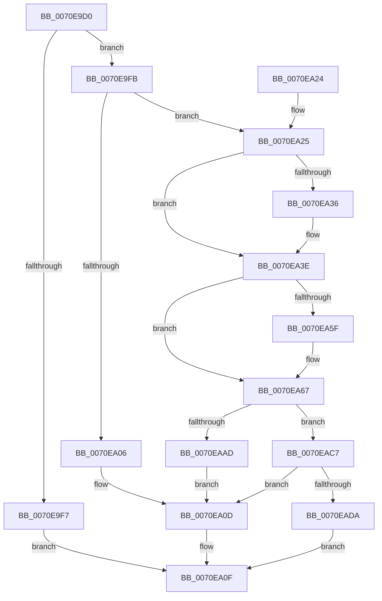

# ArbFindSuitableRange

- RVA: `0x0070E9D0`–`0x0070EAF1` (길이 `289` bytes)
- VA: `0x000000014070E9D0`
- 실행 섹션: `PAGE`
- PDB 이름 있음: `예`; PDB Function 태그: `아니요`
- unwind 정보 RVA: `0x000C567C`
- 디코드: `78`개 명령, `289/289` bytes 표시
- 미해석 바이트: `0` (있으면 어셈블리에 `.byte`로 보존)

> 이 문서는 커널 이미지의 기계어와 PDB 기호를 분석해 생성했습니다. 4번과 5번은 함수 원형과 자료형을 바이너리 사용 방식에서 추정한 C 해석이며 원본 소스 복구 결과는 아닙니다.

## 1. Dependencies

- 직접 호출 지점: **3**; 고유 호출 대상: **3**
- 직접 호출자로 확인된 함수: **1**
- RIP 상대 이미지 참조: **0**

### Outgoing calls
- `0x0070EAA4` → [RtlFindRange](../A3/RtlFindRange_function_00A35720.md) (function, `0x00A35720`)
- `0x0070EACD` → [ArbShareDriverExclusive](ArbShareDriverExclusive_function_0070FB1C.md) (function, `0x0070FB1C`)
- `0x0070EAE7` → [guard_dispatch_icall](../../text/6B/guard_dispatch_icall_function_006BAAD0.md) (function, `0x006BAAD0`)

### Direct callers
- [IopMemFindSuitableRange](../72/IopMemFindSuitableRange_function_0072F050.md) at `0x0072F066`

### Static image references
- 디코드된 RIP-relative 메모리 참조가 없습니다.

## 2. Other-region calls and transfers

- 다른 실행 섹션으로 향하는 call: **1**
  - `0x0070EAE7` → [guard_dispatch_icall](../../text/6B/guard_dispatch_icall_function_006BAAD0.md) (`PAGE` → `.text`)
- 별도 외부 분기/꼬리 이동을 확인하지 못했습니다.

## 3. Assembly (complete function range)

```asm
0070E9D0  48 89 5C 24 08                  mov qword ptr [rsp + 8], rbx
0070E9D5  48 89 6C 24 10                  mov qword ptr [rsp + 0x10], rbp
0070E9DA  48 89 74 24 18                  mov qword ptr [rsp + 0x18], rsi
0070E9DF  57                              push rdi
0070E9E0  48 83 EC 50                     sub rsp, 0x50
0070E9E4  4C 8B 52 10                     mov r10, qword ptr [rdx + 0x10]
0070E9E8  48 8B DA                        mov rbx, rdx
0070E9EB  4C 8B 5A 18                     mov r11, qword ptr [rdx + 0x18]
0070E9EF  48 8B F9                        mov rdi, rcx
0070E9F2  4D 3B D3                        cmp r10, r11
0070E9F5  76 04                           jbe 0x14070e9fb
0070E9F7  32 C0                           xor al, al
0070E9F9  EB 14                           jmp 0x14070ea0f
0070E9FB  4C 8B 4A 28                     mov r9, qword ptr [rdx + 0x28]
0070E9FF  49 83 79 10 00                  cmp qword ptr [r9 + 0x10], 0
0070EA04  75 1F                           jne 0x14070ea25
0070EA06  4C 89 12                        mov qword ptr [rdx], r10
0070EA09  4C 89 52 08                     mov qword ptr [rdx + 8], r10
0070EA0D  B0 01                           mov al, 1
0070EA0F  48 8B 5C 24 60                  mov rbx, qword ptr [rsp + 0x60]
0070EA14  48 8B 6C 24 68                  mov rbp, qword ptr [rsp + 0x68]
0070EA19  48 8B 74 24 70                  mov rsi, qword ptr [rsp + 0x70]
0070EA1E  48 83 C4 50                     add rsp, 0x50
0070EA22  5F                              pop rdi
0070EA23  C3                              ret
0070EA24  CC                              int3
0070EA25  48 8B 42 20                     mov rax, qword ptr [rdx + 0x20]
0070EA29  44 8A 42 43                     mov r8b, byte ptr [rdx + 0x43]
0070EA2D  F7 40 28 FD FF FF FF            test dword ptr [rax + 0x28], 0xfffffffd
0070EA34  75 08                           jne 0x14070ea3e
0070EA36  41 80 C8 01                     or r8b, 1
0070EA3A  44 88 42 43                     mov byte ptr [rdx + 0x43], r8b
0070EA3E  0F B7 52 40                     movzx edx, word ptr [rdx + 0x40]
0070EA42  41 8A F0                        mov sil, r8b
0070EA45  41 8B 49 24                     mov ecx, dword ptr [r9 + 0x24]
0070EA49  C1 EA 02                        shr edx, 2
0070EA4C  83 E2 02                        and edx, 2
0070EA4F  8B EA                           mov ebp, edx
0070EA51  83 CD 01                        or ebp, 1
0070EA54  F6 C1 01                        test cl, 1
0070EA57  0F 44 EA                        cmove ebp, edx
0070EA5A  F6 C1 08                        test cl, 8
0070EA5D  74 08                           je 0x14070ea67
0070EA5F  41 80 C8 40                     or r8b, 0x40
0070EA63  44 88 43 43                     mov byte ptr [rbx + 0x43], r8b
0070EA67  48 8B 87 50 01 00 00            mov rax, qword ptr [rdi + 0x150]
0070EA6E  49 8B D2                        mov rdx, r10
0070EA71  48 8B 4F 30                     mov rcx, qword ptr [rdi + 0x30]
0070EA75  48 89 5C 24 48                  mov qword ptr [rsp + 0x48], rbx
0070EA7A  48 89 44 24 40                  mov qword ptr [rsp + 0x40], rax
0070EA7F  48 8B 87 48 01 00 00            mov rax, qword ptr [rdi + 0x148]
0070EA86  48 89 44 24 38                  mov qword ptr [rsp + 0x38], rax
0070EA8B  49 8B 41 18                     mov rax, qword ptr [r9 + 0x18]
0070EA8F  4D 8B 49 10                     mov r9, qword ptr [r9 + 0x10]
0070EA93  44 88 44 24 30                  mov byte ptr [rsp + 0x30], r8b
0070EA98  4D 8B C3                        mov r8, r11
0070EA9B  89 6C 24 28                     mov dword ptr [rsp + 0x28], ebp
0070EA9F  48 89 44 24 20                  mov qword ptr [rsp + 0x20], rax
0070EAA4  E8 77 6C 32 00                  call 0x140a35720
0070EAA9  85 C0                           test eax, eax
0070EAAB  78 1A                           js 0x14070eac7
0070EAAD  48 8B 43 28                     mov rax, qword ptr [rbx + 0x28]
0070EAB1  48 8B 48 10                     mov rcx, qword ptr [rax + 0x10]
0070EAB5  48 8B 03                        mov rax, qword ptr [rbx]
0070EAB8  48 FF C8                        dec rax
0070EABB  48 03 C8                        add rcx, rax
0070EABE  48 89 4B 08                     mov qword ptr [rbx + 8], rcx
0070EAC2  E9 46 FF FF FF                  jmp 0x14070ea0d
0070EAC7  48 8B D3                        mov rdx, rbx
0070EACA  48 8B CF                        mov rcx, rdi
0070EACD  E8 4A 10 00 00                  call 0x14070fb1c
0070EAD2  84 C0                           test al, al
0070EAD4  0F 85 33 FF FF FF               jne 0x14070ea0d
0070EADA  48 8B 87 10 01 00 00            mov rax, qword ptr [rdi + 0x110]
0070EAE1  48 8B D3                        mov rdx, rbx
0070EAE4  48 8B CF                        mov rcx, rdi
0070EAE7  E8 E4 BF FA FF                  call 0x1406baad0
0070EAEC  E9 1E FF FF FF                  jmp 0x14070ea0f
```

## 4. C-style interpretation (structured pseudocode)

```c
__int64 __fastcall ArbFindSuitableRange(__int64 a1, __int64 a2)
{
    __int64 result;
    __int64 v_rbp;
    __int64 v_rsp;
    unsigned __int64 v_stack_p10;
    unsigned __int64 v_stack_p18;
    unsigned __int64 v_stack_p20;
    unsigned int v_stack_p28;
    unsigned __int8 v_stack_p30;
    unsigned __int64 v_stack_p38;
    unsigned __int64 v_stack_p40;
    unsigned __int64 v_stack_p48;
    unsigned __int64 v_stack_p8;

    v_stack_p8 = v_rbx;
    v_stack_p10 = v_rbp;
    v_stack_p18 = v_rsi;
    v_rsp = (v_rsp) - (80);
    if ((*(unsigned __int64 *)(a2 + 16)) <= (*(unsigned __int64 *)(a2 + 24))) goto loc_0070E9FB;
    result = 0;
    goto loc_0070EA0F;
loc_0070E9FB:
    if ((*(unsigned __int64 *)(*(unsigned __int64 *)(a2 + 40) + 16)) != 0) goto loc_0070EA25;
    *(unsigned __int64 *)(a2) = *(unsigned __int64 *)(a2 + 16);
    *(unsigned __int64 *)(a2 + 8) = *(unsigned __int64 *)(a2 + 16);
loc_0070EA0D:
loc_0070EA0F:
    v_rsp = (v_rsp) + (80);
    return 1;
loc_0070EA25:
    if (((*(unsigned int *)(*(unsigned __int64 *)(a2 + 32) + 40)) & (0xFFFFFFFDULL)) == 0) {
        a3 = (unsigned __int8)((*(unsigned __int8 *)(a2 + 67)) | (1));
        *(unsigned __int8 *)(a2 + 67) = (unsigned __int8)(a3);
    }
    a2 = (unsigned int)((*(unsigned __int16 *)(a2 + 64)) >> (2));
    a2 = (unsigned int)((a2) & (2));
    v_rbp = (unsigned int)(((unsigned int)((unsigned int)(a2))) | (1));
    if ((((unsigned __int8)((unsigned int)(*(unsigned int *)(*(unsigned __int64 *)(a2 + 40) + 36)))) & (1)) == 0) { v_rbp = (unsigned int)(a2); }
    if ((((unsigned __int8)((unsigned int)(*(unsigned int *)(*(unsigned __int64 *)(a2 + 40) + 36)))) & (8)) != 0) {
        a3 = (unsigned __int8)((a3) | (64));
        *(unsigned __int8 *)(v_stack_p8 + 67) = (unsigned __int8)(a3);
    }
    v_stack_p48 = v_stack_p8;
    v_stack_p40 = *(unsigned __int64 *)(a1 + 336);
    v_stack_p38 = *(unsigned __int64 *)(a1 + 328);
    v_stack_p30 = (unsigned __int8)(a3);
    v_stack_p28 = (unsigned int)(v_rbp);
    v_stack_p20 = *(unsigned __int64 *)(*(unsigned __int64 *)(a2 + 40) + 24);
    result = RtlFindRange(*(unsigned __int64 *)(a1 + 48), *(unsigned __int64 *)(a2 + 16), *(unsigned __int64 *)(a2 + 24), *(unsigned __int64 *)(*(unsigned __int64 *)(a2 + 40) + 16));
    if (sign_flag) goto loc_0070EAC7;
    result = (*(unsigned __int64 *)(v_stack_p8)) - 1;
    a1 = (*(unsigned __int64 *)(*(unsigned __int64 *)(v_stack_p8 + 40) + 16)) + (result);
    *(unsigned __int64 *)(v_stack_p8 + 8) = a1;
    goto loc_0070EA0D;
loc_0070EAC7:
    result = ArbShareDriverExclusive(a1, v_stack_p8, *(unsigned __int64 *)(a2 + 24), *(unsigned __int64 *)(*(unsigned __int64 *)(a2 + 40) + 16));
    if ((unsigned __int8)(result) != 0) goto loc_0070EA0D;
    result = guard_dispatch_icall(a1, v_stack_p8, *(unsigned __int64 *)(a2 + 24), *(unsigned __int64 *)(*(unsigned __int64 *)(a2 + 40) + 16));
    goto loc_0070EA0F;
}
```

## 5. (Beta) C Style

```c
int64_t ArbFindSuitableRange(void *Arg1, void *Arg2)
{
    uint8_t *arg1 = (uint8_t *)Arg1;
    uint8_t *arg2 = (uint8_t *)Arg2;

    int64_t result;
    int64_t local_rbp;
    int64_t local_rsp;
    uint64_t v_stack_p10;
    uint64_t v_stack_p18;
    uint64_t v_stack_p20;
    uint32_t v_stack_p28;
    uint8_t v_stack_p30;
    uint64_t v_stack_p38;
    uint64_t v_stack_p40;
    uint64_t v_stack_p48;
    uint64_t v_stack_p8;

    v_stack_p8 = local_rbx;
    v_stack_p10 = local_rbp;
    v_stack_p18 = local_rsi;
    local_rsp = (local_rsp) - (80);
    if ((*(uint64_t *)(arg2 + 0x10)) <= (*(uint64_t *)(arg2 + 0x18))) goto loc_0070E9FB;
    result = 0;
    goto loc_0070EA0F;
loc_0070E9FB:
    if ((*(uint64_t *)(*(uint64_t *)(arg2 + 0x28) + 0x10)) != 0) goto loc_0070EA25;
    *(uint64_t *)(arg2) = *(uint64_t *)(arg2 + 0x10);
    *(uint64_t *)(arg2 + 0x8) = *(uint64_t *)(arg2 + 0x10);
loc_0070EA0D:
loc_0070EA0F:
    local_rsp = (local_rsp) + (80);
    return 1;
loc_0070EA25:
    if (((*(uint32_t *)(*(uint64_t *)(arg2 + 0x20) + 0x28)) & (0xFFFFFFFDULL)) == 0) {
        a3 = (uint8_t)((*(uint8_t *)(arg2 + 0x43)) | (1));
        *(uint8_t *)(arg2 + 0x43) = (uint8_t)(a3);
    }
    Arg2 = (uint32_t)((*(uint16_t *)(arg2 + 0x40)) >> (2));
    Arg2 = (uint32_t)((Arg2) & (2));
    local_rbp = (uint32_t)(((uint32_t)((uint32_t)(Arg2))) | (1));
    if ((((uint8_t)((uint32_t)(*(uint32_t *)(*(uint64_t *)(arg2 + 0x28) + 0x24)))) & (1)) == 0) { local_rbp = (uint32_t)(Arg2); }
    if ((((uint8_t)((uint32_t)(*(uint32_t *)(*(uint64_t *)(arg2 + 0x28) + 0x24)))) & (8)) != 0) {
        a3 = (uint8_t)((a3) | (64));
        *(uint8_t *)(v_stack_p8 + 0x43) = (uint8_t)(a3);
    }
    v_stack_p48 = v_stack_p8;
    v_stack_p40 = *(uint64_t *)(arg1 + 0x150);
    v_stack_p38 = *(uint64_t *)(arg1 + 0x148);
    v_stack_p30 = (uint8_t)(a3);
    v_stack_p28 = (uint32_t)(local_rbp);
    v_stack_p20 = *(uint64_t *)(*(uint64_t *)(arg2 + 0x28) + 0x18);
    result = RtlFindRange(*(uint64_t *)(arg1 + 0x30), *(uint64_t *)(arg2 + 0x10), *(uint64_t *)(arg2 + 0x18), *(uint64_t *)(*(uint64_t *)(arg2 + 0x28) + 0x10));
    if (sign_flag) goto loc_0070EAC7;
    result = (*(uint64_t *)(v_stack_p8)) - 1;
    Arg1 = (*(uint64_t *)(*(uint64_t *)(v_stack_p8 + 0x28) + 0x10)) + (result);
    *(void **)(v_stack_p8 + 0x8) = Arg1;
    goto loc_0070EA0D;
loc_0070EAC7:
    result = ArbShareDriverExclusive(Arg1, v_stack_p8, *(uint64_t *)(arg2 + 0x18), *(uint64_t *)(*(uint64_t *)(arg2 + 0x28) + 0x10));
    if ((uint8_t)(result) != 0) goto loc_0070EA0D;
    result = guard_dispatch_icall(Arg1, v_stack_p8, *(uint64_t *)(arg2 + 0x18), *(uint64_t *)(*(uint64_t *)(arg2 + 0x28) + 0x10));
    goto loc_0070EA0F;
}
```

### 관측된 메모리 오프셋

구조체 형식이 확인되지 않은 접근은 인자 기준의 오프셋으로만 기록했습니다.

| 기준 인자 | 오프셋 표현 | 폭 (bit) | 접근 |
|---|---:|---:|---|
| `Arg1` | `+ 0x30` | `64` | `R` |
| `Arg1` | `+ 0x110` | `64` | `R` |
| `Arg1` | `+ 0x148` | `64` | `R` |
| `Arg1` | `+ 0x150` | `64` | `R` |
| `Arg2` | `+ 0x0` | `64` | `R` |
| `Arg2` | `+ 0x0` | `64` | `W` |
| `Arg2` | `+ 0x8` | `64` | `W` |
| `Arg2` | `+ 0x10` | `64` | `R` |
| `Arg2` | `+ 0x18` | `64` | `R` |
| `Arg2` | `+ 0x20` | `64` | `R` |
| `Arg2` | `+ 0x28` | `64` | `R` |
| `Arg2` | `+ 0x40` | `16` | `R` |
| `Arg2` | `+ 0x43` | `8` | `R` |
| `Arg2` | `+ 0x43` | `8` | `W` |

## 6. Execution-region graph

[열기: 2D/3D 그래프와 함수 탐색 컨트롤 패널](../../../control-panel.html?section=page&rva=0x0070E9D0&view=graph)

- 2D 그래프는 위에서 아래로 흐르고, 3D 그래프는 빈 공간을 드래그해 회전합니다. Shift+드래그는 이동, 휠은 확대·축소, 함수 노드 선택은 대상 보고서 이동입니다.

### Static fallback


