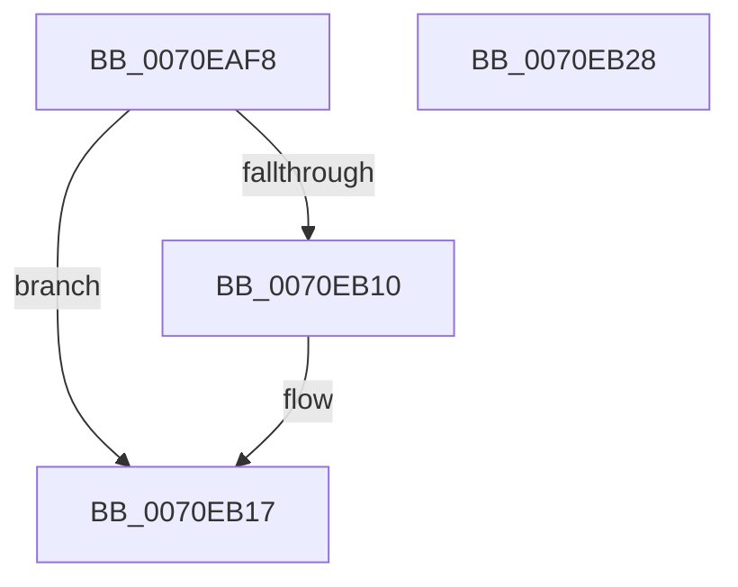

# ArbFreeOrderingList

- RVA: `0x0070EAF8`–`0x0070EB29` (길이 `49` bytes)
- VA: `0x000000014070EAF8`
- 실행 섹션: `PAGE`
- PDB 이름 있음: `예`; PDB Function 태그: `아니요`
- unwind 정보 RVA: `0x0005CAAC`
- 디코드: `17`개 명령, `49/49` bytes 표시
- 미해석 바이트: `0` (있으면 어셈블리에 `.byte`로 보존)

> 이 문서는 커널 이미지의 기계어와 PDB 기호를 분석해 생성했습니다. 4번과 5번은 함수 원형과 자료형을 바이너리 사용 방식에서 추정한 C 해석이며 원본 소스 복구 결과는 아닙니다.

## 1. Dependencies

- 직접 호출 지점: **1**; 고유 호출 대상: **1**
- 직접 호출자로 확인된 함수: **1**
- RIP 상대 이미지 참조: **0**

### Outgoing calls
- `0x0070EB12` → [ExFreePoolWithTag](../../poolcode/B8/ExFreePoolWithTag_function_00B82870.md) (function, `0x00B82870`)

### Direct callers
- [ArbBuildAssignmentOrdering](ArbBuildAssignmentOrdering_function_0070E43C.md) at `0x0070E4D1`
- [ArbBuildAssignmentOrdering](ArbBuildAssignmentOrdering_function_0070E43C.md) at `0x0070E4DA`

### Static image references
- 디코드된 RIP-relative 메모리 참조가 없습니다.

## 2. Other-region calls and transfers

- 다른 실행 섹션으로 향하는 call: **1**
  - `0x0070EB12` → [ExFreePoolWithTag](../../poolcode/B8/ExFreePoolWithTag_function_00B82870.md) (`PAGE` → `POOLCODE`)
- 별도 외부 분기/꼬리 이동을 확인하지 못했습니다.

## 3. Assembly (complete function range)

```asm
0070EAF8  48 89 5C 24 08                  mov qword ptr [rsp + 8], rbx
0070EAFD  57                              push rdi
0070EAFE  48 83 EC 20                     sub rsp, 0x20
0070EB02  48 8B D9                        mov rbx, rcx
0070EB05  33 FF                           xor edi, edi
0070EB07  48 8B 49 08                     mov rcx, qword ptr [rcx + 8]
0070EB0B  48 85 C9                        test rcx, rcx
0070EB0E  74 07                           je 0x14070eb17
0070EB10  33 D2                           xor edx, edx
0070EB12  E8 59 3D 47 00                  call 0x140b82870
0070EB17  89 3B                           mov dword ptr [rbx], edi
0070EB19  48 89 7B 08                     mov qword ptr [rbx + 8], rdi
0070EB1D  48 8B 5C 24 30                  mov rbx, qword ptr [rsp + 0x30]
0070EB22  48 83 C4 20                     add rsp, 0x20
0070EB26  5F                              pop rdi
0070EB27  C3                              ret
0070EB28  CC                              int3
```

## 4. C-style interpretation (structured pseudocode)

```c
__int64 __fastcall ArbFreeOrderingList(__int64 a1, int a2)
{
    __int64 result;
    __int64 v_rdi;
    __int64 v_rsp;
    unsigned __int64 v_stack_p8;

    v_stack_p8 = v_rbx;
    v_rsp = (v_rsp) - (32);
    v_rdi = 0;
    if (*(unsigned __int64 *)(a1 + 8) != 0) {
        a2 = 0;
        result = ExFreePoolWithTag(*(unsigned __int64 *)(a1 + 8), a2, a3, a4);
    }
    *(unsigned int *)(a1) = 0;
    *(unsigned __int64 *)(a1 + 8) = 0;
    v_rsp = (v_rsp) + (32);
    return result;
}
```

## 5. (Beta) C Style

```c
int64_t ArbFreeOrderingList(void *Arg1, int32_t Arg2)
{
    uint8_t *arg1 = (uint8_t *)Arg1;

    int64_t result;
    int64_t local_rdi;
    int64_t local_rsp;
    uint64_t v_stack_p8;

    v_stack_p8 = local_rbx;
    local_rsp = (local_rsp) - (32);
    local_rdi = 0;
    if (*(uint64_t *)(arg1 + 0x8) != 0) {
        Arg2 = 0;
        result = ExFreePoolWithTag(*(uint64_t *)(arg1 + 0x8), Arg2, a3, a4);
    }
    *(uint32_t *)(arg1) = 0;
    *(uint64_t *)(arg1 + 0x8) = 0;
    local_rsp = (local_rsp) + (32);
    return result;
}
```

### 관측된 메모리 오프셋

구조체 형식이 확인되지 않은 접근은 인자 기준의 오프셋으로만 기록했습니다.

| 기준 인자 | 오프셋 표현 | 폭 (bit) | 접근 |
|---|---:|---:|---|
| `Arg1` | `+ 0x0` | `32` | `W` |
| `Arg1` | `+ 0x8` | `64` | `R` |
| `Arg1` | `+ 0x8` | `64` | `W` |

## 6. Execution-region graph

[열기: 2D/3D 그래프와 함수 탐색 컨트롤 패널](../../../control-panel.html?section=page&rva=0x0070EAF8&view=graph)

- 2D 그래프는 위에서 아래로 흐르고, 3D 그래프는 빈 공간을 드래그해 회전합니다. Shift+드래그는 이동, 휠은 확대·축소, 함수 노드 선택은 대상 보고서 이동입니다.

### Static fallback


