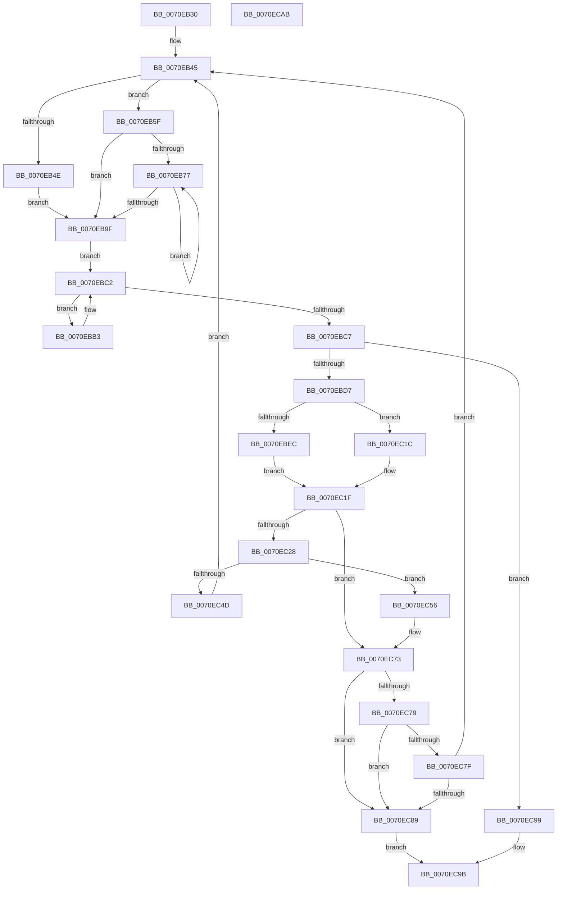

# ArbGetNextAllocationRange

- RVA: `0x0070EB30`–`0x0070ECAC` (길이 `380` bytes)
- VA: `0x000000014070EB30`
- 실행 섹션: `PAGE`
- PDB 이름 있음: `예`; PDB Function 태그: `아니요`
- unwind 정보 RVA: `0x00060BC4`
- 디코드: `116`개 명령, `380/380` bytes 표시
- 미해석 바이트: `0` (있으면 어셈블리에 `.byte`로 보존)

> 이 문서는 커널 이미지의 기계어와 PDB 기호를 분석해 생성했습니다. 4번과 5번은 함수 원형과 자료형을 바이너리 사용 방식에서 추정한 C 해석이며 원본 소스 복구 결과는 아닙니다.

## 1. Dependencies

- 직접 호출 지점: **2**; 고유 호출 대상: **1**
- 직접 호출자로 확인된 함수: **0**
- RIP 상대 이미지 참조: **0**

### Outgoing calls
- `0x0070EB51` → [ArbpUpdatePriority](../AC/ArbpUpdatePriority_function_00AC4CCC.md) (function, `0x00AC4CCC`)
- `0x0070EB81` → [ArbpUpdatePriority](../AC/ArbpUpdatePriority_function_00AC4CCC.md) (function, `0x00AC4CCC`)

### Direct callers
- 이 함수 시작 RVA로 연결되는 직접 call은 확인되지 않았습니다. 간접 호출은 완전히 역산할 수 없습니다.

### Static image references
- 디코드된 RIP-relative 메모리 참조가 없습니다.

## 2. Other-region calls and transfers

- 다른 실행 섹션으로 향하는 call: **0**
- 별도 외부 분기/꼬리 이동을 확인하지 못했습니다.

## 3. Assembly (complete function range)

```asm
0070EB30  48 89 5C 24 08                  mov qword ptr [rsp + 8], rbx
0070EB35  48 89 74 24 10                  mov qword ptr [rsp + 0x10], rsi
0070EB3A  57                              push rdi
0070EB3B  48 83 EC 20                     sub rsp, 0x20
0070EB3F  48 8B DA                        mov rbx, rdx
0070EB42  48 8B F1                        mov rsi, rcx
0070EB45  48 8B 53 28                     mov rdx, qword ptr [rbx + 0x28]
0070EB49  48 85 D2                        test rdx, rdx
0070EB4C  74 11                           je 0x14070eb5f
0070EB4E  48 8B CE                        mov rcx, rsi
0070EB51  E8 76 61 3B 00                  call 0x140ac4ccc
0070EB56  4C 8B 43 38                     mov r8, qword ptr [rbx + 0x38]
0070EB5A  8B 4B 30                        mov ecx, dword ptr [rbx + 0x30]
0070EB5D  EB 40                           jmp 0x14070eb9f
0070EB5F  4C 8B 43 38                     mov r8, qword ptr [rbx + 0x38]
0070EB63  8B 4B 30                        mov ecx, dword ptr [rbx + 0x30]
0070EB66  49 8B F8                        mov rdi, r8
0070EB69  8B C1                           mov eax, ecx
0070EB6B  48 C1 E0 06                     shl rax, 6
0070EB6F  49 03 C0                        add rax, r8
0070EB72  4C 3B C0                        cmp r8, rax
0070EB75  73 28                           jae 0x14070eb9f
0070EB77  83 67 20 00                     and dword ptr [rdi + 0x20], 0
0070EB7B  48 8B D7                        mov rdx, rdi
0070EB7E  48 8B CE                        mov rcx, rsi
0070EB81  E8 46 61 3B 00                  call 0x140ac4ccc
0070EB86  8B 4B 30                        mov ecx, dword ptr [rbx + 0x30]
0070EB89  48 83 C7 40                     add rdi, 0x40
0070EB8D  4C 8B 43 38                     mov r8, qword ptr [rbx + 0x38]
0070EB91  8B C1                           mov eax, ecx
0070EB93  48 C1 E0 06                     shl rax, 6
0070EB97  49 03 C0                        add rax, r8
0070EB9A  48 3B F8                        cmp rdi, rax
0070EB9D  72 D8                           jb 0x14070eb77
0070EB9F  44 8D 49 FF                     lea r9d, [rcx - 1]
0070EBA3  49 FF C1                        inc r9
0070EBA6  49 8D 50 40                     lea rdx, [r8 + 0x40]
0070EBAA  49 C1 E1 06                     shl r9, 6
0070EBAE  4D 03 C8                        add r9, r8
0070EBB1  EB 0F                           jmp 0x14070ebc2
0070EBB3  41 8B 40 20                     mov eax, dword ptr [r8 + 0x20]
0070EBB7  39 42 20                        cmp dword ptr [rdx + 0x20], eax
0070EBBA  4C 0F 4C C2                     cmovl r8, rdx
0070EBBE  48 83 C2 40                     add rdx, 0x40
0070EBC2  49 3B D1                        cmp rdx, r9
0070EBC5  72 EC                           jb 0x14070ebb3
0070EBC7  41 8B 50 20                     mov edx, dword ptr [r8 + 0x20]
0070EBCB  81 FA FF FF FF 7F               cmp edx, 0x7fffffff
0070EBD1  0F 84 C2 00 00 00               je 0x14070ec99
0070EBD7  4D 8B 50 08                     mov r10, qword ptr [r8 + 8]
0070EBDB  8D 82 03 00 00 80               lea eax, [rdx - 0x7ffffffd]
0070EBE1  4D 8B 08                        mov r9, qword ptr [r8]
0070EBE4  49 8B FA                        mov rdi, r10
0070EBE7  83 F8 01                        cmp eax, 1
0070EBEA  76 30                           jbe 0x14070ec1c
0070EBEC  85 D2                           test edx, edx
0070EBEE  8D 42 FF                        lea eax, [rdx - 1]
0070EBF1  8B CA                           mov ecx, edx
0070EBF3  F7 D1                           not ecx
0070EBF5  0F 4E C1                        cmovle eax, ecx
0070EBF8  8B C8                           mov ecx, eax
0070EBFA  48 C1 E1 04                     shl rcx, 4
0070EBFE  48 03 4E 40                     add rcx, qword ptr [rsi + 0x40]
0070EC02  48 8B 51 08                     mov rdx, qword ptr [rcx + 8]
0070EC06  48 8B 01                        mov rax, qword ptr [rcx]
0070EC09  49 8B C9                        mov rcx, r9
0070EC0C  4C 3B C8                        cmp r9, rax
0070EC0F  48 0F 46 C8                     cmovbe rcx, rax
0070EC13  4C 3B D2                        cmp r10, rdx
0070EC16  48 0F 43 FA                     cmovae rdi, rdx
0070EC1A  EB 03                           jmp 0x14070ec1f
0070EC1C  49 8B C9                        mov rcx, r9
0070EC1F  4D 8B 58 10                     mov r11, qword ptr [r8 + 0x10]
0070EC23  4D 85 DB                        test r11, r11
0070EC26  74 4B                           je 0x14070ec73
0070EC28  4D 8B 50 18                     mov r10, qword ptr [r8 + 0x18]
0070EC2C  4C 8D 49 FF                     lea r9, [rcx - 1]
0070EC30  4D 03 CA                        add r9, r10
0070EC33  33 D2                           xor edx, edx
0070EC35  49 8B C1                        mov rax, r9
0070EC38  48 8B CF                        mov rcx, rdi
0070EC3B  49 F7 F2                        div r10
0070EC3E  49 8D 43 FF                     lea rax, [r11 - 1]
0070EC42  4C 2B CA                        sub r9, rdx
0070EC45  49 2B C9                        sub rcx, r9
0070EC48  48 3B C1                        cmp rax, rcx
0070EC4B  76 09                           jbe 0x14070ec56
0070EC4D  4C 89 43 28                     mov qword ptr [rbx + 0x28], r8
0070EC51  E9 EF FE FF FF                  jmp 0x14070eb45
0070EC56  33 D2                           xor edx, edx
0070EC58  B8 01 00 00 00                  mov eax, 1
0070EC5D  49 2B C3                        sub rax, r11
0070EC60  48 03 F8                        add rdi, rax
0070EC63  48 8B C7                        mov rax, rdi
0070EC66  49 F7 F2                        div r10
0070EC69  4C 2B DA                        sub r11, rdx
0070EC6C  4D 8D 53 FF                     lea r10, [r11 - 1]
0070EC70  4C 03 D7                        add r10, rdi
0070EC73  4C 3B 4B 10                     cmp r9, qword ptr [rbx + 0x10]
0070EC77  75 10                           jne 0x14070ec89
0070EC79  4C 3B 53 18                     cmp r10, qword ptr [rbx + 0x18]
0070EC7D  75 0A                           jne 0x14070ec89
0070EC7F  4C 39 43 28                     cmp qword ptr [rbx + 0x28], r8
0070EC83  0F 84 BC FE FF FF               je 0x14070eb45
0070EC89  4C 89 4B 10                     mov qword ptr [rbx + 0x10], r9
0070EC8D  B0 01                           mov al, 1
0070EC8F  4C 89 53 18                     mov qword ptr [rbx + 0x18], r10
0070EC93  4C 89 43 28                     mov qword ptr [rbx + 0x28], r8
0070EC97  EB 02                           jmp 0x14070ec9b
0070EC99  32 C0                           xor al, al
0070EC9B  48 8B 5C 24 30                  mov rbx, qword ptr [rsp + 0x30]
0070ECA0  48 8B 74 24 38                  mov rsi, qword ptr [rsp + 0x38]
0070ECA5  48 83 C4 20                     add rsp, 0x20
0070ECA9  5F                              pop rdi
0070ECAA  C3                              ret
0070ECAB  CC                              int3
```

## 4. C-style interpretation (structured pseudocode)

```c
__int64 __fastcall ArbGetNextAllocationRange(__int64 a1, __int64 a2)
{
    __int64 result;
    __int64 v_r10;
    __int64 v_r11;
    __int64 v_rdi;
    __int64 v_rsp;
    unsigned __int64 v_stack_p10;
    unsigned __int64 v_stack_p8;

    v_stack_p8 = v_rbx;
    v_stack_p10 = v_rsi;
    v_rsp = (v_rsp) - (32);
loc_0070EB45:
    if (*(unsigned __int64 *)(a2 + 40) == 0) goto loc_0070EB5F;
    result = ArbpUpdatePriority(a1, *(unsigned __int64 *)(a2 + 40), a3, a4);
    goto loc_0070EB9F;
loc_0070EB5F:
    result = ((unsigned int)((unsigned int)((unsigned int)(*(unsigned int *)(a2 + 48))))) << (6);
    result = (result) + (*(unsigned __int64 *)(a2 + 56));
    if ((*(unsigned __int64 *)(a2 + 56)) >= result) goto loc_0070EB9F;
loc_0070EB77:
    result = ArbpUpdatePriority(a1, *(unsigned __int64 *)(a2 + 56), *(unsigned __int64 *)(a2 + 56), a4);
    v_rdi = (*(unsigned __int64 *)(a2 + 56)) + (64);
    result = ((unsigned int)((unsigned int)((unsigned int)(*(unsigned int *)(a2 + 48))))) << (6);
    result = (result) + (*(unsigned __int64 *)(a2 + 56));
    if (v_rdi < result) goto loc_0070EB77;
loc_0070EB9F:
    a4 = ((unsigned int)(*(unsigned int *)(a2 + 48)) - 1) + 1;
    a4 = (a4) << (6);
    a4 = (a4) + (*(unsigned __int64 *)(a2 + 56));
    goto loc_0070EBC2;
loc_0070EBB3:
    a3 = *(unsigned __int64 *)(a2 + 56);
    if ((*(unsigned int *)(*(unsigned __int64 *)(a2 + 56) + 64 + 32)) < ((unsigned int)((unsigned int)(*(unsigned int *)(*(unsigned __int64 *)(a2 + 56) + 32))))) { a3 = *(unsigned __int64 *)(a2 + 56) + 64; }
    a2 = (*(unsigned __int64 *)(a2 + 56) + 64) + (64);
loc_0070EBC2:
    if (a2 < a4) goto loc_0070EBB3;
    if (((unsigned int)((unsigned int)(*(unsigned int *)(a3 + 32)))) == 0x7FFFFFFFULL) goto loc_0070EC99;
    if (((unsigned int)((unsigned int)(*(unsigned int *)(a3 + 32)) - 2147483645)) <= 1) goto loc_0070EC1C;
    a1 = (unsigned int)(~((unsigned int)((unsigned int)((unsigned int)(*(unsigned int *)(a3 + 32))))));
    result = (unsigned int)(*(unsigned int *)(a3 + 32)) - 1;
    if (condition_is_less_or_equal) { result = (unsigned int)(a1); }
    a1 = ((unsigned int)((unsigned int)(result))) << (4);
    a1 = (a1) + (*(unsigned __int64 *)(a1 + 64));
    a1 = *(unsigned __int64 *)(a3);
    if ((*(unsigned __int64 *)(a3)) <= (*(unsigned __int64 *)(a1))) { a1 = *(unsigned __int64 *)(a1); }
    v_rdi = *(unsigned __int64 *)(a3 + 8);
    if ((*(unsigned __int64 *)(a3 + 8)) >= (*(unsigned __int64 *)(a1 + 8))) { v_rdi = *(unsigned __int64 *)(a1 + 8); }
    goto loc_0070EC1F;
loc_0070EC1C:
loc_0070EC1F:
    if (*(unsigned __int64 *)(a3 + 16) == 0) goto loc_0070EC73;
    a4 = (*(unsigned __int64 *)(a3) - 1) + (*(unsigned __int64 *)(a3 + 24));
    a2 = 0;
    a4 = (a4) - (0);
    a1 = (v_rdi) - (a4);
    if ((*(unsigned __int64 *)(a3 + 16) - 1) <= a1) goto loc_0070EC56;
    *(unsigned __int64 *)(a2 + 40) = a3;
    goto loc_0070EB45;
loc_0070EC56:
    a2 = 0;
    result = (1) - (*(unsigned __int64 *)(a3 + 16));
    v_rdi = (v_rdi) + (result);
    v_r11 = (*(unsigned __int64 *)(a3 + 16)) - (0);
    v_r10 = (v_r11 - 1) + (v_rdi);
loc_0070EC73:
    if (a4 != (*(unsigned __int64 *)(a2 + 16))) goto loc_0070EC89;
    if (v_r10 != (*(unsigned __int64 *)(a2 + 24))) goto loc_0070EC89;
    if ((*(unsigned __int64 *)(a2 + 40)) == a3) goto loc_0070EB45;
loc_0070EC89:
    *(unsigned __int64 *)(a2 + 16) = a4;
    *(unsigned __int64 *)(a2 + 24) = v_r10;
    *(unsigned __int64 *)(a2 + 40) = a3;
    goto loc_0070EC9B;
loc_0070EC99:
    result = 0;
loc_0070EC9B:
    v_rsp = (v_rsp) + (32);
    return result;
}
```

## 5. (Beta) C Style

```c
int64_t ArbGetNextAllocationRange(void *Arg1, void *Arg2)
{
    uint8_t *arg1 = (uint8_t *)Arg1;
    uint8_t *arg2 = (uint8_t *)Arg2;

    int64_t result;
    int64_t local_r10;
    int64_t local_r11;
    int64_t local_rdi;
    int64_t local_rsp;
    uint64_t v_stack_p10;
    uint64_t v_stack_p8;

    v_stack_p8 = local_rbx;
    v_stack_p10 = local_rsi;
    local_rsp = (local_rsp) - (32);
loc_0070EB45:
    if (*(uint64_t *)(arg2 + 0x28) == 0) goto loc_0070EB5F;
    result = ArbpUpdatePriority(Arg1, *(uint64_t *)(arg2 + 0x28), a3, a4);
    goto loc_0070EB9F;
loc_0070EB5F:
    result = ((uint32_t)((uint32_t)((uint32_t)(*(uint32_t *)(arg2 + 0x30))))) << (6);
    result = (result) + (*(uint64_t *)(arg2 + 0x38));
    if ((*(uint64_t *)(arg2 + 0x38)) >= result) goto loc_0070EB9F;
loc_0070EB77:
    result = ArbpUpdatePriority(Arg1, *(uint64_t *)(arg2 + 0x38), *(uint64_t *)(arg2 + 0x38), a4);
    local_rdi = (*(uint64_t *)(arg2 + 0x38)) + (64);
    result = ((uint32_t)((uint32_t)((uint32_t)(*(uint32_t *)(arg2 + 0x30))))) << (6);
    result = (result) + (*(uint64_t *)(arg2 + 0x38));
    if (local_rdi < result) goto loc_0070EB77;
loc_0070EB9F:
    a4 = ((uint32_t)(*(uint32_t *)(arg2 + 0x30)) - 1) + 1;
    a4 = (a4) << (6);
    a4 = (a4) + (*(uint64_t *)(arg2 + 0x38));
    goto loc_0070EBC2;
loc_0070EBB3:
    a3 = *(uint64_t *)(arg2 + 0x38);
    if ((*(uint32_t *)(*(uint64_t *)(arg2 + 0x38) + 0x40 + 0x20)) < ((uint32_t)((uint32_t)(*(uint32_t *)(*(uint64_t *)(arg2 + 0x38) + 0x20))))) { a3 = *(uint64_t *)(arg2 + 0x38) + 64; }
    Arg2 = (*(uint64_t *)(arg2 + 0x38) + 64) + (64);
loc_0070EBC2:
    if (Arg2 < a4) goto loc_0070EBB3;
    if (((uint32_t)((uint32_t)(*(uint32_t *)(a3 + 0x20)))) == 0x7FFFFFFFULL) goto loc_0070EC99;
    if (((uint32_t)((uint32_t)(*(uint32_t *)(a3 + 0x20)) - 2147483645)) <= 1) goto loc_0070EC1C;
    Arg1 = (uint32_t)(~((uint32_t)((uint32_t)((uint32_t)(*(uint32_t *)(a3 + 0x20))))));
    result = (uint32_t)(*(uint32_t *)(a3 + 0x20)) - 1;
    if (condition_is_less_or_equal) { result = (uint32_t)(Arg1); }
    Arg1 = ((uint32_t)((uint32_t)(result))) << (4);
    Arg1 = (Arg1) + (*(uint64_t *)(arg1 + 0x40));
    Arg1 = *(uint64_t *)(a3);
    if ((*(uint64_t *)(a3)) <= (*(uint64_t *)(arg1))) { Arg1 = *(uint64_t *)(arg1); }
    local_rdi = *(uint64_t *)(a3 + 0x8);
    if ((*(uint64_t *)(a3 + 0x8)) >= (*(uint64_t *)(arg1 + 0x8))) { local_rdi = *(uint64_t *)(arg1 + 0x8); }
    goto loc_0070EC1F;
loc_0070EC1C:
loc_0070EC1F:
    if (*(uint64_t *)(a3 + 0x10) == 0) goto loc_0070EC73;
    a4 = (*(uint64_t *)(a3) - 1) + (*(uint64_t *)(a3 + 0x18));
    Arg2 = 0;
    a4 = (a4) - (0);
    Arg1 = (local_rdi) - (a4);
    if ((*(uint64_t *)(a3 + 0x10) - 1) <= Arg1) goto loc_0070EC56;
    *(uint64_t *)(arg2 + 0x28) = a3;
    goto loc_0070EB45;
loc_0070EC56:
    Arg2 = 0;
    result = (1) - (*(uint64_t *)(a3 + 0x10));
    local_rdi = (local_rdi) + (result);
    local_r11 = (*(uint64_t *)(a3 + 0x10)) - (0);
    local_r10 = (local_r11 - 1) + (local_rdi);
loc_0070EC73:
    if (a4 != (*(uint64_t *)(arg2 + 0x10))) goto loc_0070EC89;
    if (local_r10 != (*(uint64_t *)(arg2 + 0x18))) goto loc_0070EC89;
    if ((*(uint64_t *)(arg2 + 0x28)) == a3) goto loc_0070EB45;
loc_0070EC89:
    *(uint64_t *)(arg2 + 0x10) = a4;
    *(uint64_t *)(arg2 + 0x18) = local_r10;
    *(uint64_t *)(arg2 + 0x28) = a3;
    goto loc_0070EC9B;
loc_0070EC99:
    result = 0;
loc_0070EC9B:
    local_rsp = (local_rsp) + (32);
    return result;
}
```

### 관측된 메모리 오프셋

구조체 형식이 확인되지 않은 접근은 인자 기준의 오프셋으로만 기록했습니다.

| 기준 인자 | 오프셋 표현 | 폭 (bit) | 접근 |
|---|---:|---:|---|
| `Arg1` | `+ 0x40` | `64` | `R` |
| `Arg2` | `+ 0x10` | `64` | `R` |
| `Arg2` | `+ 0x10` | `64` | `W` |
| `Arg2` | `+ 0x18` | `64` | `R` |
| `Arg2` | `+ 0x18` | `64` | `W` |
| `Arg2` | `+ 0x28` | `64` | `R` |
| `Arg2` | `+ 0x28` | `64` | `W` |
| `Arg2` | `+ 0x30` | `32` | `R` |
| `Arg2` | `+ 0x38` | `64` | `R` |

## 6. Execution-region graph

[열기: 2D/3D 그래프와 함수 탐색 컨트롤 패널](../../../control-panel.html?section=page&rva=0x0070EB30&view=graph)

- 2D 그래프는 위에서 아래로 흐르고, 3D 그래프는 빈 공간을 드래그해 회전합니다. Shift+드래그는 이동, 휠은 확대·축소, 함수 노드 선택은 대상 보고서 이동입니다.

### Static fallback


