# ArbInitializeArbiterInstance

- RVA: `0x0070ECB4`–`0x0070F01E` (길이 `874` bytes)
- VA: `0x000000014070ECB4`
- 실행 섹션: `PAGE`
- PDB 이름 있음: `예`; PDB Function 태그: `아니요`
- unwind 정보 RVA: `0x00060300`
- 디코드: `194`개 명령, `874/874` bytes 표시
- 미해석 바이트: `0` (있으면 어셈블리에 `.byte`로 보존)

> 이 문서는 커널 이미지의 기계어와 PDB 기호를 분석해 생성했습니다. 4번과 5번은 함수 원형과 자료형을 바이너리 사용 방식에서 추정한 C 해석이며 원본 소스 복구 결과는 아닙니다.

## 1. Dependencies

- 직접 호출 지점: **13**; 고유 호출 대상: **4**
- 직접 호출자로 확인된 함수: **5**
- RIP 상대 이미지 참조: **18**

### Outgoing calls
- `0x0070ECF2` → [ExAllocatePool2](../../poolcode/B8/ExAllocatePool2_function_00B820F0.md) (function, `0x00B820F0`)
- `0x0070ED19` → [KeInitializeEvent](../../text/40/KeInitializeEvent_function_0040DD10.md) (function, `0x0040DD10`)
- `0x0070ED32` → [ExAllocatePool2](../../poolcode/B8/ExAllocatePool2_function_00B820F0.md) (function, `0x00B820F0`)
- `0x0070ED62` → [ExAllocatePool2](../../poolcode/B8/ExAllocatePool2_function_00B820F0.md) (function, `0x00B820F0`)
- `0x0070ED7E` → [ExAllocatePool2](../../poolcode/B8/ExAllocatePool2_function_00B820F0.md) (function, `0x00B820F0`)
- `0x0070EDC7` → [ExAllocatePool2](../../poolcode/B8/ExAllocatePool2_function_00B820F0.md) (function, `0x00B820F0`)
- `0x0070EDE4` → [KeInitializeEvent](../../text/40/KeInitializeEvent_function_0040DD10.md) (function, `0x0040DD10`)
- `0x0070EFA1` → [ArbBuildAssignmentOrdering](ArbBuildAssignmentOrdering_function_0070E43C.md) (function, `0x0070E43C`)
- `0x0070EFB7` → [ExFreePoolWithTag](../../poolcode/B8/ExFreePoolWithTag_function_00B82870.md) (function, `0x00B82870`)
- `0x0070EFCA` → [ExFreePoolWithTag](../../poolcode/B8/ExFreePoolWithTag_function_00B82870.md) (function, `0x00B82870`)
- `0x0070EFDA` → [ExFreePoolWithTag](../../poolcode/B8/ExFreePoolWithTag_function_00B82870.md) (function, `0x00B82870`)
- `0x0070EFEA` → [ExFreePoolWithTag](../../poolcode/B8/ExFreePoolWithTag_function_00B82870.md) (function, `0x00B82870`)
- `0x0070EFF9` → [ExFreePoolWithTag](../../poolcode/B8/ExFreePoolWithTag_function_00B82870.md) (function, `0x00B82870`)

### Direct callers
- [IopMemInitialize](../72/IopMemInitialize_function_0072F078.md) at `0x0072F0F0`
- [IopPortInitialize](../72/IopPortInitialize_function_0072F500.md) at `0x0072F586`
- [IopDmaInitialize](../72/IopDmaInitialize_function_0072F634.md) at `0x0072F698`
- [IopIrqInitialize](../72/IopIrqInitialize_function_0072F758.md) at `0x0072F7AE`
- [IopBusNumberInitialize](../72/IopBusNumberInitialize_function_0072F828.md) at `0x0072F87E`

### Static image references
- `0x0070EDE9` → RVA `0x00AFE210` (` ?? ::NNGAKEGL::`string'`; read)
- `0x0070EE04` → RVA `0x0070FD90` (`ArbTestAllocation`; read)
- `0x0070EE1B` → RVA `0x0070F940` (`ArbRetestAllocation`; read)
- `0x0070EE32` → RVA `0x0070E970` (`ArbCommitAllocation`; read)
- `0x0070EE49` → RVA `0x0070FB00` (`ArbRollbackAllocation`; read)
- `0x0070EE60` → RVA `0x00A84330` (`ArbAddReserved`; read)
- `0x0070EE77` → RVA `0x00A97CF0` (`ArbPreprocessEntry`; read)
- `0x0070EE8E` → RVA `0x00AC5730` (`ArbAllocateEntry`; read)
- `0x0070EEA5` → RVA `0x0070EB30` (`ArbGetNextAllocationRange`; read)
- `0x0070EEBC` → RVA `0x0070E9D0` (`ArbFindSuitableRange`; read)
- `0x0070EED3` → RVA `0x0070DE60` (`ArbAddAllocation`; read)
- `0x0070EEEA` → RVA `0x0070E260` (`ArbBacktrackAllocation`; read)
- `0x0070EF01` → RVA `0x0070F1A0` (`ArbOverrideConflict`; read)
- `0x0070EF18` → RVA `0x0070E290` (`ArbBootAllocation`; read)
- `0x0070EF2F` → RVA `0x0070F410` (`ArbQueryConflict`; read)
- `0x0070EF5D` → RVA `0x0070FD40` (`ArbStartArbiter`; read)
- `0x0070EF74` → RVA `0x0070F070` (`ArbInitializeRangeList`; read)
- `0x0070EF8B` → RVA `0x0070E9B0` (`ArbDeleteOwnerRanges`; read)

## 2. Other-region calls and transfers

- 다른 실행 섹션으로 향하는 call: **12**
  - `0x0070ECF2` → [ExAllocatePool2](../../poolcode/B8/ExAllocatePool2_function_00B820F0.md) (`PAGE` → `POOLCODE`)
  - `0x0070ED19` → [KeInitializeEvent](../../text/40/KeInitializeEvent_function_0040DD10.md) (`PAGE` → `.text`)
  - `0x0070ED32` → [ExAllocatePool2](../../poolcode/B8/ExAllocatePool2_function_00B820F0.md) (`PAGE` → `POOLCODE`)
  - `0x0070ED62` → [ExAllocatePool2](../../poolcode/B8/ExAllocatePool2_function_00B820F0.md) (`PAGE` → `POOLCODE`)
  - `0x0070ED7E` → [ExAllocatePool2](../../poolcode/B8/ExAllocatePool2_function_00B820F0.md) (`PAGE` → `POOLCODE`)
  - `0x0070EDC7` → [ExAllocatePool2](../../poolcode/B8/ExAllocatePool2_function_00B820F0.md) (`PAGE` → `POOLCODE`)
  - `0x0070EDE4` → [KeInitializeEvent](../../text/40/KeInitializeEvent_function_0040DD10.md) (`PAGE` → `.text`)
  - `0x0070EFB7` → [ExFreePoolWithTag](../../poolcode/B8/ExFreePoolWithTag_function_00B82870.md) (`PAGE` → `POOLCODE`)
  - `0x0070EFCA` → [ExFreePoolWithTag](../../poolcode/B8/ExFreePoolWithTag_function_00B82870.md) (`PAGE` → `POOLCODE`)
  - `0x0070EFDA` → [ExFreePoolWithTag](../../poolcode/B8/ExFreePoolWithTag_function_00B82870.md) (`PAGE` → `POOLCODE`)
  - `0x0070EFEA` → [ExFreePoolWithTag](../../poolcode/B8/ExFreePoolWithTag_function_00B82870.md) (`PAGE` → `POOLCODE`)
  - `0x0070EFF9` → [ExFreePoolWithTag](../../poolcode/B8/ExFreePoolWithTag_function_00B82870.md) (`PAGE` → `POOLCODE`)
- 별도 외부 분기/꼬리 이동을 확인하지 못했습니다.

## 3. Assembly (complete function range)

```asm
0070ECB4  48 89 5C 24 08                  mov qword ptr [rsp + 8], rbx
0070ECB9  48 89 6C 24 10                  mov qword ptr [rsp + 0x10], rbp
0070ECBE  48 89 74 24 18                  mov qword ptr [rsp + 0x18], rsi
0070ECC3  57                              push rdi
0070ECC4  41 56                           push r14
0070ECC6  41 57                           push r15
0070ECC8  48 83 EC 20                     sub rsp, 0x20
0070ECCC  45 33 F6                        xor r14d, r14d
0070ECCF  C7 01 41 72 62 73               mov dword ptr [rcx], 0x73627241
0070ECD5  41 8B E8                        mov ebp, r8d
0070ECD8  4C 89 B1 40 01 00 00            mov qword ptr [rcx + 0x140], r14
0070ECDF  48 8B D9                        mov rbx, rcx
0070ECE2  41 B8 41 72 62 4D               mov r8d, 0x4d627241
0070ECE8  49 8B F9                        mov rdi, r9
0070ECEB  41 8D 56 18                     lea edx, [r14 + 0x18]
0070ECEF  8D 4A 28                        lea ecx, [rdx + 0x28]
0070ECF2  E8 F9 33 47 00                  call 0x140b820f0
0070ECF7  48 89 43 08                     mov qword ptr [rbx + 8], rax
0070ECFB  48 85 C0                        test rax, rax
0070ECFE  75 0E                           jne 0x14070ed0e
0070ED00  BF 9A 00 00 C0                  mov edi, 0xc000009a
0070ED05  48 8D 73 70                     lea rsi, [rbx + 0x70]
0070ED09  E9 9E 02 00 00                  jmp 0x14070efac
0070ED0E  41 B0 01                        mov r8b, 1
0070ED11  BA 01 00 00 00                  mov edx, 1
0070ED16  48 8B C8                        mov rcx, rax
0070ED19  E8 F2 EF CF FF                  call 0x14040dd10
0070ED1E  41 BF 00 01 00 00               mov r15d, 0x100
0070ED24  BA 00 10 00 00                  mov edx, 0x1000
0070ED29  41 8B CF                        mov ecx, r15d
0070ED2C  41 B8 41 72 62 41               mov r8d, 0x41627241
0070ED32  E8 B9 33 47 00                  call 0x140b820f0
0070ED37  48 8D 73 70                     lea rsi, [rbx + 0x70]
0070ED3B  48 89 06                        mov qword ptr [rsi], rax
0070ED3E  48 85 C0                        test rax, rax
0070ED41  75 0A                           jne 0x14070ed4d
0070ED43  BF 9A 00 00 C0                  mov edi, 0xc000009a
0070ED48  E9 5F 02 00 00                  jmp 0x14070efac
0070ED4D  BA 20 00 00 00                  mov edx, 0x20
0070ED52  C7 43 68 00 10 00 00            mov dword ptr [rbx + 0x68], 0x1000
0070ED59  41 B8 41 72 62 52               mov r8d, 0x52627241
0070ED5F  49 8B CF                        mov rcx, r15
0070ED62  E8 89 33 47 00                  call 0x140b820f0
0070ED67  48 89 43 28                     mov qword ptr [rbx + 0x28], rax
0070ED6B  48 85 C0                        test rax, rax
0070ED6E  74 D3                           je 0x14070ed43
0070ED70  BA 20 00 00 00                  mov edx, 0x20
0070ED75  41 B8 41 72 62 52               mov r8d, 0x52627241
0070ED7B  49 8B CF                        mov rcx, r15
0070ED7E  E8 6D 33 47 00                  call 0x140b820f0
0070ED83  48 89 43 30                     mov qword ptr [rbx + 0x30], rax
0070ED87  48 85 C0                        test rax, rax
0070ED8A  74 B7                           je 0x14070ed43
0070ED8C  48 8B 43 28                     mov rax, qword ptr [rbx + 0x28]
0070ED90  BA 18 00 00 00                  mov edx, 0x18
0070ED95  41 B8 41 72 62 4D               mov r8d, 0x4d627241
0070ED9B  48 89 40 08                     mov qword ptr [rax + 8], rax
0070ED9F  8D 4A 28                        lea ecx, [rdx + 0x28]
0070EDA2  48 89 00                        mov qword ptr [rax], rax
0070EDA5  4C 89 70 10                     mov qword ptr [rax + 0x10], r14
0070EDA9  44 89 70 18                     mov dword ptr [rax + 0x18], r14d
0070EDAD  48 8B 43 30                     mov rax, qword ptr [rbx + 0x30]
0070EDB1  48 89 40 08                     mov qword ptr [rax + 8], rax
0070EDB5  48 89 00                        mov qword ptr [rax], rax
0070EDB8  4C 89 70 10                     mov qword ptr [rax + 0x10], r14
0070EDBC  44 89 70 18                     mov dword ptr [rax + 0x18], r14d
0070EDC0  44 88 B3 28 01 00 00            mov byte ptr [rbx + 0x128], r14b
0070EDC7  E8 24 33 47 00                  call 0x140b820f0
0070EDCC  48 89 83 30 01 00 00            mov qword ptr [rbx + 0x130], rax
0070EDD3  48 85 C0                        test rax, rax
0070EDD6  0F 84 67 FF FF FF               je 0x14070ed43
0070EDDC  41 B0 01                        mov r8b, 1
0070EDDF  33 D2                           xor edx, edx
0070EDE1  48 8B C8                        mov rcx, rax
0070EDE4  E8 27 EF CF FF                  call 0x14040dd10
0070EDE9  48 8D 05 20 F4 3E 00            lea rax, [rip + 0x3ef420]
0070EDF0  48 89 7B 10                     mov qword ptr [rbx + 0x10], rdi
0070EDF4  48 89 43 18                     mov qword ptr [rbx + 0x18], rax
0070EDF8  89 6B 20                        mov dword ptr [rbx + 0x20], ebp
0070EDFB  4C 39 B3 98 00 00 00            cmp qword ptr [rbx + 0x98], r14
0070EE02  75 0E                           jne 0x14070ee12
0070EE04  48 8D 05 85 0F 00 00            lea rax, [rip + 0xf85]
0070EE0B  48 89 83 98 00 00 00            mov qword ptr [rbx + 0x98], rax
0070EE12  4C 39 B3 A0 00 00 00            cmp qword ptr [rbx + 0xa0], r14
0070EE19  75 0E                           jne 0x14070ee29
0070EE1B  48 8D 05 1E 0B 00 00            lea rax, [rip + 0xb1e]
0070EE22  48 89 83 A0 00 00 00            mov qword ptr [rbx + 0xa0], rax
0070EE29  4C 39 B3 A8 00 00 00            cmp qword ptr [rbx + 0xa8], r14
0070EE30  75 0E                           jne 0x14070ee40
0070EE32  48 8D 05 37 FB FF FF            lea rax, [rip - 0x4c9]
0070EE39  48 89 83 A8 00 00 00            mov qword ptr [rbx + 0xa8], rax
0070EE40  4C 39 B3 B0 00 00 00            cmp qword ptr [rbx + 0xb0], r14
0070EE47  75 0E                           jne 0x14070ee57
0070EE49  48 8D 05 B0 0C 00 00            lea rax, [rip + 0xcb0]
0070EE50  48 89 83 B0 00 00 00            mov qword ptr [rbx + 0xb0], rax
0070EE57  4C 39 B3 D0 00 00 00            cmp qword ptr [rbx + 0xd0], r14
0070EE5E  75 0E                           jne 0x14070ee6e
0070EE60  48 8D 05 C9 54 37 00            lea rax, [rip + 0x3754c9]
0070EE67  48 89 83 D0 00 00 00            mov qword ptr [rbx + 0xd0], rax
0070EE6E  4C 39 B3 E0 00 00 00            cmp qword ptr [rbx + 0xe0], r14
0070EE75  75 0E                           jne 0x14070ee85
0070EE77  48 8D 05 72 8E 38 00            lea rax, [rip + 0x388e72]
0070EE7E  48 89 83 E0 00 00 00            mov qword ptr [rbx + 0xe0], rax
0070EE85  4C 39 B3 E8 00 00 00            cmp qword ptr [rbx + 0xe8], r14
0070EE8C  75 0E                           jne 0x14070ee9c
0070EE8E  48 8D 05 9B 68 3B 00            lea rax, [rip + 0x3b689b]
0070EE95  48 89 83 E8 00 00 00            mov qword ptr [rbx + 0xe8], rax
0070EE9C  4C 39 B3 F0 00 00 00            cmp qword ptr [rbx + 0xf0], r14
0070EEA3  75 0E                           jne 0x14070eeb3
0070EEA5  48 8D 05 84 FC FF FF            lea rax, [rip - 0x37c]
0070EEAC  48 89 83 F0 00 00 00            mov qword ptr [rbx + 0xf0], rax
0070EEB3  4C 39 B3 F8 00 00 00            cmp qword ptr [rbx + 0xf8], r14
0070EEBA  75 0E                           jne 0x14070eeca
0070EEBC  48 8D 05 0D FB FF FF            lea rax, [rip - 0x4f3]
0070EEC3  48 89 83 F8 00 00 00            mov qword ptr [rbx + 0xf8], rax
0070EECA  4C 39 B3 00 01 00 00            cmp qword ptr [rbx + 0x100], r14
0070EED1  75 0E                           jne 0x14070eee1
0070EED3  48 8D 05 86 EF FF FF            lea rax, [rip - 0x107a]
0070EEDA  48 89 83 00 01 00 00            mov qword ptr [rbx + 0x100], rax
0070EEE1  4C 39 B3 08 01 00 00            cmp qword ptr [rbx + 0x108], r14
0070EEE8  75 0E                           jne 0x14070eef8
0070EEEA  48 8D 05 6F F3 FF FF            lea rax, [rip - 0xc91]
0070EEF1  48 89 83 08 01 00 00            mov qword ptr [rbx + 0x108], rax
0070EEF8  4C 39 B3 10 01 00 00            cmp qword ptr [rbx + 0x110], r14
0070EEFF  75 0E                           jne 0x14070ef0f
0070EF01  48 8D 05 98 02 00 00            lea rax, [rip + 0x298]
0070EF08  48 89 83 10 01 00 00            mov qword ptr [rbx + 0x110], rax
0070EF0F  4C 39 B3 B8 00 00 00            cmp qword ptr [rbx + 0xb8], r14
0070EF16  75 0E                           jne 0x14070ef26
0070EF18  48 8D 05 71 F3 FF FF            lea rax, [rip - 0xc8f]
0070EF1F  48 89 83 B8 00 00 00            mov qword ptr [rbx + 0xb8], rax
0070EF26  4C 39 B3 C8 00 00 00            cmp qword ptr [rbx + 0xc8], r14
0070EF2D  75 0E                           jne 0x14070ef3d
0070EF2F  48 8D 05 DA 04 00 00            lea rax, [rip + 0x4da]
0070EF36  48 89 83 C8 00 00 00            mov qword ptr [rbx + 0xc8], rax
0070EF3D  4C 39 B3 C0 00 00 00            cmp qword ptr [rbx + 0xc0], r14
0070EF44  75 0E                           jne 0x14070ef54
0070EF46  48 8D 05 A3 8D 38 00            lea rax, [rip + 0x388da3]
0070EF4D  48 89 83 C0 00 00 00            mov qword ptr [rbx + 0xc0], rax
0070EF54  4C 39 B3 D8 00 00 00            cmp qword ptr [rbx + 0xd8], r14
0070EF5B  75 0E                           jne 0x14070ef6b
0070EF5D  48 8D 05 DC 0D 00 00            lea rax, [rip + 0xddc]
0070EF64  48 89 83 D8 00 00 00            mov qword ptr [rbx + 0xd8], rax
0070EF6B  4C 39 B3 18 01 00 00            cmp qword ptr [rbx + 0x118], r14
0070EF72  75 0E                           jne 0x14070ef82
0070EF74  48 8D 05 F5 00 00 00            lea rax, [rip + 0xf5]
0070EF7B  48 89 83 18 01 00 00            mov qword ptr [rbx + 0x118], rax
0070EF82  4C 39 B3 20 01 00 00            cmp qword ptr [rbx + 0x120], r14
0070EF89  75 0E                           jne 0x14070ef99
0070EF8B  48 8D 05 1E FA FF FF            lea rax, [rip - 0x5e2]
0070EF92  48 89 83 20 01 00 00            mov qword ptr [rbx + 0x120], rax
0070EF99  4C 8B 4C 24 68                  mov r9, qword ptr [rsp + 0x68]
0070EF9E  48 8B CB                        mov rcx, rbx
0070EFA1  E8 96 F4 FF FF                  call 0x14070e43c
0070EFA6  8B F8                           mov edi, eax
0070EFA8  85 C0                           test eax, eax
0070EFAA  79 56                           jns 0x14070f002
0070EFAC  48 8B 4B 08                     mov rcx, qword ptr [rbx + 8]
0070EFB0  48 85 C9                        test rcx, rcx
0070EFB3  74 07                           je 0x14070efbc
0070EFB5  33 D2                           xor edx, edx
0070EFB7  E8 B4 38 47 00                  call 0x140b82870
0070EFBC  48 8B 8B 30 01 00 00            mov rcx, qword ptr [rbx + 0x130]
0070EFC3  48 85 C9                        test rcx, rcx
0070EFC6  74 07                           je 0x14070efcf
0070EFC8  33 D2                           xor edx, edx
0070EFCA  E8 A1 38 47 00                  call 0x140b82870
0070EFCF  48 8B 4B 28                     mov rcx, qword ptr [rbx + 0x28]
0070EFD3  48 85 C9                        test rcx, rcx
0070EFD6  74 07                           je 0x14070efdf
0070EFD8  33 D2                           xor edx, edx
0070EFDA  E8 91 38 47 00                  call 0x140b82870
0070EFDF  48 8B 4B 30                     mov rcx, qword ptr [rbx + 0x30]
0070EFE3  48 85 C9                        test rcx, rcx
0070EFE6  74 07                           je 0x14070efef
0070EFE8  33 D2                           xor edx, edx
0070EFEA  E8 81 38 47 00                  call 0x140b82870
0070EFEF  48 8B 0E                        mov rcx, qword ptr [rsi]
0070EFF2  48 85 C9                        test rcx, rcx
0070EFF5  74 07                           je 0x14070effe
0070EFF7  33 D2                           xor edx, edx
0070EFF9  E8 72 38 47 00                  call 0x140b82870
0070EFFE  8B C7                           mov eax, edi
0070F000  EB 02                           jmp 0x14070f004
0070F002  33 C0                           xor eax, eax
0070F004  48 8B 5C 24 40                  mov rbx, qword ptr [rsp + 0x40]
0070F009  48 8B 6C 24 48                  mov rbp, qword ptr [rsp + 0x48]
0070F00E  48 8B 74 24 50                  mov rsi, qword ptr [rsp + 0x50]
0070F013  48 83 C4 20                     add rsp, 0x20
0070F017  41 5F                           pop r15
0070F019  41 5E                           pop r14
0070F01B  5F                              pop rdi
0070F01C  C3                              ret
0070F01D  CC                              int3
```

## 4. C-style interpretation (structured pseudocode)

```c
__int64 __fastcall ArbInitializeArbiterInstance(__int64 a1, __int64 a2, int a3, __int64 a4, __int64 a5, __int64 a6)
{
    __int64 result;
    __int64 v_r14;
    __int64 v_rsp;
    unsigned __int64 v_stack_p10;
    unsigned __int64 v_stack_p18;
    unsigned __int64 v_stack_p8;

    v_stack_p8 = v_rbx;
    v_stack_p10 = v_rbp;
    v_stack_p18 = v_rsi;
    v_rsp = (v_rsp) - (32);
    v_r14 = 0;
    *(unsigned int *)(a1) = 0x73627241ULL;
    *(unsigned __int64 *)(a1 + 320) = 0;
    result = ExAllocatePool2(v_r14 + 24 + 40, v_r14 + 24, (unsigned int)(0x4D627241ULL), a4);
    *(unsigned __int64 *)(a1 + 8) = result;
    if (result != 0) goto loc_0070ED0E;
    goto loc_0070EFAC;
loc_0070ED0E:
    result = KeInitializeEvent(result, 1, 1, a4);
    result = ExAllocatePool2(256, (unsigned int)(0x1000ULL), (unsigned int)(0x41627241ULL), a4);
    *(unsigned __int64 *)(a1 + 112) = result;
    if (result != 0) goto loc_0070ED4D;
loc_0070ED43:
    goto loc_0070EFAC;
loc_0070ED4D:
    *(unsigned int *)(a1 + 104) = 0x1000ULL;
    result = ExAllocatePool2(256, 32, (unsigned int)(0x52627241ULL), a4);
    *(unsigned __int64 *)(a1 + 40) = result;
    if (result == 0) goto loc_0070ED43;
    result = ExAllocatePool2(256, 32, (unsigned int)(0x52627241ULL), a4);
    *(unsigned __int64 *)(a1 + 48) = result;
    if (result == 0) goto loc_0070ED43;
    *(unsigned __int64 *)(*(unsigned __int64 *)(a1 + 40) + 8) = *(unsigned __int64 *)(a1 + 40);
    *(unsigned __int64 *)(*(unsigned __int64 *)(a1 + 40)) = *(unsigned __int64 *)(a1 + 40);
    *(unsigned __int64 *)(*(unsigned __int64 *)(a1 + 40) + 16) = 0;
    *(unsigned int *)(*(unsigned __int64 *)(a1 + 40) + 24) = 0;
    *(unsigned __int64 *)(*(unsigned __int64 *)(a1 + 48) + 8) = *(unsigned __int64 *)(a1 + 48);
    *(unsigned __int64 *)(*(unsigned __int64 *)(a1 + 48)) = *(unsigned __int64 *)(a1 + 48);
    *(unsigned __int64 *)(*(unsigned __int64 *)(a1 + 48) + 16) = 0;
    *(unsigned int *)(*(unsigned __int64 *)(a1 + 48) + 24) = 0;
    *(unsigned __int8 *)(a1 + 296) = 0;
    result = ExAllocatePool2(24 + 40, 24, (unsigned int)(0x4D627241ULL), a4);
    *(unsigned __int64 *)(a1 + 304) = result;
    if (result == 0) goto loc_0070ED43;
    a2 = 0;
    result = KeInitializeEvent(result, a2, 1, a4);
    *(unsigned __int64 *)(a1 + 16) = (unsigned int)(0xC000009AULL);
    *(unsigned __int64 *)(a1 + 24) = v_rip + 4125728;
    *(unsigned int *)(a1 + 32) = (unsigned int)((unsigned int)(a3));
    result = v_rip + 4125728;
    if ((*(unsigned __int64 *)(a1 + 152)) == 0) {
        result = v_rip + 3973;
        *(unsigned __int64 *)(a1 + 152) = result;
    }
    if ((*(unsigned __int64 *)(a1 + 160)) == 0) {
        result = v_rip + 2846;
        *(unsigned __int64 *)(a1 + 160) = result;
    }
    if ((*(unsigned __int64 *)(a1 + 168)) == 0) {
        result = v_rip - 1225;
        *(unsigned __int64 *)(a1 + 168) = result;
    }
    if ((*(unsigned __int64 *)(a1 + 176)) == 0) {
        result = v_rip + 3248;
        *(unsigned __int64 *)(a1 + 176) = result;
    }
    if ((*(unsigned __int64 *)(a1 + 208)) == 0) {
        result = v_rip + 3626185;
        *(unsigned __int64 *)(a1 + 208) = result;
    }
    if ((*(unsigned __int64 *)(a1 + 224)) == 0) {
        result = v_rip + 3706482;
        *(unsigned __int64 *)(a1 + 224) = result;
    }
    if ((*(unsigned __int64 *)(a1 + 232)) == 0) {
        result = v_rip + 3893403;
        *(unsigned __int64 *)(a1 + 232) = result;
    }
    if ((*(unsigned __int64 *)(a1 + 240)) == 0) {
        result = v_rip - 892;
        *(unsigned __int64 *)(a1 + 240) = result;
    }
    if ((*(unsigned __int64 *)(a1 + 248)) == 0) {
        result = v_rip - 1267;
        *(unsigned __int64 *)(a1 + 248) = result;
    }
    if ((*(unsigned __int64 *)(a1 + 256)) == 0) {
        result = v_rip - 4218;
        *(unsigned __int64 *)(a1 + 256) = result;
    }
    if ((*(unsigned __int64 *)(a1 + 264)) == 0) {
        result = v_rip - 3217;
        *(unsigned __int64 *)(a1 + 264) = result;
    }
    if ((*(unsigned __int64 *)(a1 + 272)) == 0) {
        result = v_rip + 664;
        *(unsigned __int64 *)(a1 + 272) = result;
    }
    if ((*(unsigned __int64 *)(a1 + 184)) == 0) {
        result = v_rip - 3215;
        *(unsigned __int64 *)(a1 + 184) = result;
    }
    if ((*(unsigned __int64 *)(a1 + 200)) == 0) {
        result = v_rip + 1242;
        *(unsigned __int64 *)(a1 + 200) = result;
    }
    if ((*(unsigned __int64 *)(a1 + 192)) == 0) {
        result = v_rip + 3706275;
        *(unsigned __int64 *)(a1 + 192) = result;
    }
    if ((*(unsigned __int64 *)(a1 + 216)) == 0) {
        result = v_rip + 3548;
        *(unsigned __int64 *)(a1 + 216) = result;
    }
    if ((*(unsigned __int64 *)(a1 + 280)) == 0) {
        result = v_rip + 245;
        *(unsigned __int64 *)(a1 + 280) = result;
    }
    if ((*(unsigned __int64 *)(a1 + 288)) == 0) {
        result = v_rip - 1506;
        *(unsigned __int64 *)(a1 + 288) = result;
    }
    result = ArbBuildAssignmentOrdering(a1, a2, 1, a6);
    if (!sign_flag) goto loc_0070F002;
loc_0070EFAC:
    if (*(unsigned __int64 *)(a1 + 8) != 0) {
        a2 = 0;
        result = ExFreePoolWithTag(*(unsigned __int64 *)(a1 + 8), a2, 1, a6);
    }
    if (*(unsigned __int64 *)(a1 + 304) != 0) {
        a2 = 0;
        result = ExFreePoolWithTag(*(unsigned __int64 *)(a1 + 304), a2, 1, a6);
    }
    if (*(unsigned __int64 *)(a1 + 40) != 0) {
        a2 = 0;
        result = ExFreePoolWithTag(*(unsigned __int64 *)(a1 + 40), a2, 1, a6);
    }
    if (*(unsigned __int64 *)(a1 + 48) != 0) {
        a2 = 0;
        result = ExFreePoolWithTag(*(unsigned __int64 *)(a1 + 48), a2, 1, a6);
    }
    if (*(unsigned __int64 *)(a1 + 112) != 0) {
        a2 = 0;
        result = ExFreePoolWithTag(*(unsigned __int64 *)(a1 + 112), a2, 1, a6);
    }
    goto loc_0070F004;
loc_0070F002:
    result = 0;
loc_0070F004:
    v_rsp = (v_rsp) + (32);
    return result;
}
```

## 5. (Beta) C Style

```c
int64_t ArbInitializeArbiterInstance(void *Arg1, int64_t Arg2, int32_t Arg3, int64_t Arg4, uint64_t Arg5, int64_t Arg6)
{
    uint8_t *arg1 = (uint8_t *)Arg1;

    int64_t result;
    int64_t local_r14;
    int64_t local_rsp;
    uint64_t v_stack_p10;
    uint64_t v_stack_p18;
    uint64_t v_stack_p8;

    v_stack_p8 = local_rbx;
    v_stack_p10 = local_rbp;
    v_stack_p18 = local_rsi;
    local_rsp = (local_rsp) - (32);
    local_r14 = 0;
    *(uint32_t *)(arg1) = 0x73627241ULL;
    *(uint64_t *)(arg1 + 0x140) = 0;
    result = ExAllocatePool2(local_r14 + 24 + 40, local_r14 + 24, (uint32_t)(0x4D627241ULL), Arg4);
    *(uint64_t *)(arg1 + 0x8) = result;
    if (result != 0) goto loc_0070ED0E;
    goto loc_0070EFAC;
loc_0070ED0E:
    result = KeInitializeEvent(result, 1, 1, Arg4);
    result = ExAllocatePool2(256, (uint32_t)(0x1000ULL), (uint32_t)(0x41627241ULL), Arg4);
    *(uint64_t *)(arg1 + 0x70) = result;
    if (result != 0) goto loc_0070ED4D;
loc_0070ED43:
    goto loc_0070EFAC;
loc_0070ED4D:
    *(uint32_t *)(arg1 + 0x68) = 0x1000ULL;
    result = ExAllocatePool2(256, 32, (uint32_t)(0x52627241ULL), Arg4);
    *(uint64_t *)(arg1 + 0x28) = result;
    if (result == 0) goto loc_0070ED43;
    result = ExAllocatePool2(256, 32, (uint32_t)(0x52627241ULL), Arg4);
    *(uint64_t *)(arg1 + 0x30) = result;
    if (result == 0) goto loc_0070ED43;
    *(uint64_t *)(*(uint64_t *)(arg1 + 0x28) + 0x8) = *(uint64_t *)(arg1 + 0x28);
    *(uint64_t *)(*(uint64_t *)(arg1 + 0x28)) = *(uint64_t *)(arg1 + 0x28);
    *(uint64_t *)(*(uint64_t *)(arg1 + 0x28) + 0x10) = 0;
    *(uint32_t *)(*(uint64_t *)(arg1 + 0x28) + 0x18) = 0;
    *(uint64_t *)(*(uint64_t *)(arg1 + 0x30) + 0x8) = *(uint64_t *)(arg1 + 0x30);
    *(uint64_t *)(*(uint64_t *)(arg1 + 0x30)) = *(uint64_t *)(arg1 + 0x30);
    *(uint64_t *)(*(uint64_t *)(arg1 + 0x30) + 0x10) = 0;
    *(uint32_t *)(*(uint64_t *)(arg1 + 0x30) + 0x18) = 0;
    *(uint8_t *)(arg1 + 0x128) = 0;
    result = ExAllocatePool2(24 + 40, 24, (uint32_t)(0x4D627241ULL), Arg4);
    *(uint64_t *)(arg1 + 0x130) = result;
    if (result == 0) goto loc_0070ED43;
    Arg2 = 0;
    result = KeInitializeEvent(result, Arg2, 1, Arg4);
    *(uint64_t *)(arg1 + 0x10) = (uint32_t)(0xC000009AULL);
    *(uint64_t *)(arg1 + 0x18) = v_rip + 4125728;
    *(uint32_t *)(arg1 + 0x20) = (uint32_t)((uint32_t)(Arg3));
    result = v_rip + 4125728;
    if ((*(uint64_t *)(arg1 + 0x98)) == 0) {
        result = v_rip + 3973;
        *(uint64_t *)(arg1 + 0x98) = result;
    }
    if ((*(uint64_t *)(arg1 + 0xA0)) == 0) {
        result = v_rip + 2846;
        *(uint64_t *)(arg1 + 0xA0) = result;
    }
    if ((*(uint64_t *)(arg1 + 0xA8)) == 0) {
        result = v_rip - 1225;
        *(uint64_t *)(arg1 + 0xA8) = result;
    }
    if ((*(uint64_t *)(arg1 + 0xB0)) == 0) {
        result = v_rip + 3248;
        *(uint64_t *)(arg1 + 0xB0) = result;
    }
    if ((*(uint64_t *)(arg1 + 0xD0)) == 0) {
        result = v_rip + 3626185;
        *(uint64_t *)(arg1 + 0xD0) = result;
    }
    if ((*(uint64_t *)(arg1 + 0xE0)) == 0) {
        result = v_rip + 3706482;
        *(uint64_t *)(arg1 + 0xE0) = result;
    }
    if ((*(uint64_t *)(arg1 + 0xE8)) == 0) {
        result = v_rip + 3893403;
        *(uint64_t *)(arg1 + 0xE8) = result;
    }
    if ((*(uint64_t *)(arg1 + 0xF0)) == 0) {
        result = v_rip - 892;
        *(uint64_t *)(arg1 + 0xF0) = result;
    }
    if ((*(uint64_t *)(arg1 + 0xF8)) == 0) {
        result = v_rip - 1267;
        *(uint64_t *)(arg1 + 0xF8) = result;
    }
    if ((*(uint64_t *)(arg1 + 0x100)) == 0) {
        result = v_rip - 4218;
        *(uint64_t *)(arg1 + 0x100) = result;
    }
    if ((*(uint64_t *)(arg1 + 0x108)) == 0) {
        result = v_rip - 3217;
        *(uint64_t *)(arg1 + 0x108) = result;
    }
    if ((*(uint64_t *)(arg1 + 0x110)) == 0) {
        result = v_rip + 664;
        *(uint64_t *)(arg1 + 0x110) = result;
    }
    if ((*(uint64_t *)(arg1 + 0xB8)) == 0) {
        result = v_rip - 3215;
        *(uint64_t *)(arg1 + 0xB8) = result;
    }
    if ((*(uint64_t *)(arg1 + 0xC8)) == 0) {
        result = v_rip + 1242;
        *(uint64_t *)(arg1 + 0xC8) = result;
    }
    if ((*(uint64_t *)(arg1 + 0xC0)) == 0) {
        result = v_rip + 3706275;
        *(uint64_t *)(arg1 + 0xC0) = result;
    }
    if ((*(uint64_t *)(arg1 + 0xD8)) == 0) {
        result = v_rip + 3548;
        *(uint64_t *)(arg1 + 0xD8) = result;
    }
    if ((*(uint64_t *)(arg1 + 0x118)) == 0) {
        result = v_rip + 245;
        *(uint64_t *)(arg1 + 0x118) = result;
    }
    if ((*(uint64_t *)(arg1 + 0x120)) == 0) {
        result = v_rip - 1506;
        *(uint64_t *)(arg1 + 0x120) = result;
    }
    result = ArbBuildAssignmentOrdering(Arg1, Arg2, 1, Arg6);
    if (!sign_flag) goto loc_0070F002;
loc_0070EFAC:
    if (*(uint64_t *)(arg1 + 0x8) != 0) {
        Arg2 = 0;
        result = ExFreePoolWithTag(*(uint64_t *)(arg1 + 0x8), Arg2, 1, Arg6);
    }
    if (*(uint64_t *)(arg1 + 0x130) != 0) {
        Arg2 = 0;
        result = ExFreePoolWithTag(*(uint64_t *)(arg1 + 0x130), Arg2, 1, Arg6);
    }
    if (*(uint64_t *)(arg1 + 0x28) != 0) {
        Arg2 = 0;
        result = ExFreePoolWithTag(*(uint64_t *)(arg1 + 0x28), Arg2, 1, Arg6);
    }
    if (*(uint64_t *)(arg1 + 0x30) != 0) {
        Arg2 = 0;
        result = ExFreePoolWithTag(*(uint64_t *)(arg1 + 0x30), Arg2, 1, Arg6);
    }
    if (*(uint64_t *)(arg1 + 0x70) != 0) {
        Arg2 = 0;
        result = ExFreePoolWithTag(*(uint64_t *)(arg1 + 0x70), Arg2, 1, Arg6);
    }
    goto loc_0070F004;
loc_0070F002:
    result = 0;
loc_0070F004:
    local_rsp = (local_rsp) + (32);
    return result;
}
```

### 관측된 메모리 오프셋

구조체 형식이 확인되지 않은 접근은 인자 기준의 오프셋으로만 기록했습니다.

| 기준 인자 | 오프셋 표현 | 폭 (bit) | 접근 |
|---|---:|---:|---|
| `Arg1` | `+ 0x0` | `32` | `W` |
| `Arg1` | `+ 0x0` | `64` | `R` |
| `Arg1` | `+ 0x0` | `64` | `W` |
| `Arg1` | `+ 0x8` | `64` | `R` |
| `Arg1` | `+ 0x8` | `64` | `W` |
| `Arg1` | `+ 0x10` | `64` | `W` |
| `Arg1` | `+ 0x18` | `64` | `W` |
| `Arg1` | `+ 0x20` | `32` | `W` |
| `Arg1` | `+ 0x28` | `64` | `R` |
| `Arg1` | `+ 0x28` | `64` | `W` |
| `Arg1` | `+ 0x30` | `64` | `R` |
| `Arg1` | `+ 0x30` | `64` | `W` |
| `Arg1` | `+ 0x68` | `32` | `W` |
| `Arg1` | `+ 0x70` | `64` | `R` |
| `Arg1` | `+ 0x98` | `64` | `R` |
| `Arg1` | `+ 0x98` | `64` | `W` |
| `Arg1` | `+ 0xA0` | `64` | `R` |
| `Arg1` | `+ 0xA0` | `64` | `W` |
| `Arg1` | `+ 0xA8` | `64` | `R` |
| `Arg1` | `+ 0xA8` | `64` | `W` |
| `Arg1` | `+ 0xB0` | `64` | `R` |
| `Arg1` | `+ 0xB0` | `64` | `W` |
| `Arg1` | `+ 0xB8` | `64` | `R` |
| `Arg1` | `+ 0xB8` | `64` | `W` |
| `Arg1` | `+ 0xC0` | `64` | `R` |
| `Arg1` | `+ 0xC0` | `64` | `W` |
| `Arg1` | `+ 0xC8` | `64` | `R` |
| `Arg1` | `+ 0xC8` | `64` | `W` |
| `Arg1` | `+ 0xD0` | `64` | `R` |
| `Arg1` | `+ 0xD0` | `64` | `W` |
| `Arg1` | `+ 0xD8` | `64` | `R` |
| `Arg1` | `+ 0xD8` | `64` | `W` |

추가 오프셋 22개는 표에서 생략했습니다.

## 6. Execution-region graph

[열기: 2D/3D 그래프와 함수 탐색 컨트롤 패널](../../../control-panel.html?section=page&rva=0x0070ECB4&view=graph)

- 2D 그래프는 위에서 아래로 흐르고, 3D 그래프는 빈 공간을 드래그해 회전합니다. Shift+드래그는 이동, 휠은 확대·축소, 함수 노드 선택은 대상 보고서 이동입니다.

### Static fallback

```mermaid
flowchart TD
  bb_0070ECB4[BB_0070ECB4]
  bb_0070ED00[BB_0070ED00]
  bb_0070ED0E[BB_0070ED0E]
  bb_0070ED43[BB_0070ED43]
  bb_0070ED4D[BB_0070ED4D]
  bb_0070ED70[BB_0070ED70]
  bb_0070ED8C[BB_0070ED8C]
  bb_0070EDDC[BB_0070EDDC]
  bb_0070EE04[BB_0070EE04]
  bb_0070EE12[BB_0070EE12]
  bb_0070EE1B[BB_0070EE1B]
  bb_0070EE29[BB_0070EE29]
  bb_0070EE32[BB_0070EE32]
  bb_0070EE40[BB_0070EE40]
  bb_0070EE49[BB_0070EE49]
  bb_0070EE57[BB_0070EE57]
  bb_0070EE60[BB_0070EE60]
  bb_0070EE6E[BB_0070EE6E]
  bb_0070EE77[BB_0070EE77]
  bb_0070EE85[BB_0070EE85]
  bb_0070EE8E[BB_0070EE8E]
  bb_0070EE9C[BB_0070EE9C]
  bb_0070EEA5[BB_0070EEA5]
  bb_0070EEB3[BB_0070EEB3]
  bb_0070EEBC[BB_0070EEBC]
  bb_0070EECA[BB_0070EECA]
  bb_0070EED3[BB_0070EED3]
  bb_0070EEE1[BB_0070EEE1]
  bb_0070EEEA[BB_0070EEEA]
  bb_0070EEF8[BB_0070EEF8]
  bb_0070EF01[BB_0070EF01]
  bb_0070EF0F[BB_0070EF0F]
  bb_0070EF18[BB_0070EF18]
  bb_0070EF26[BB_0070EF26]
  bb_0070EF2F[BB_0070EF2F]
  bb_0070EF3D[BB_0070EF3D]
  bb_0070EF46[BB_0070EF46]
  bb_0070EF54[BB_0070EF54]
  bb_0070EF5D[BB_0070EF5D]
  bb_0070EF6B[BB_0070EF6B]
  bb_0070EF74[BB_0070EF74]
  bb_0070EF82[BB_0070EF82]
  bb_0070EF8B[BB_0070EF8B]
  bb_0070EF99[BB_0070EF99]
  bb_0070EFAC[BB_0070EFAC]
  bb_0070EFB5[BB_0070EFB5]
  bb_0070EFBC[BB_0070EFBC]
  bb_0070EFC8[BB_0070EFC8]
  bb_0070EFCF[BB_0070EFCF]
  bb_0070EFD8[BB_0070EFD8]
  bb_0070EFDF[BB_0070EFDF]
  bb_0070EFE8[BB_0070EFE8]
  bb_0070EFEF[BB_0070EFEF]
  bb_0070EFF7[BB_0070EFF7]
  bb_0070EFFE[BB_0070EFFE]
  bb_0070F002[BB_0070F002]
  bb_0070F004[BB_0070F004]
  bb_0070F01D[BB_0070F01D]
  bb_0070ECB4 -->|branch| bb_0070ED0E
  bb_0070ECB4 -->|fallthrough| bb_0070ED00
  bb_0070ED00 -->|branch| bb_0070EFAC
  bb_0070ED0E -->|branch| bb_0070ED4D
  bb_0070ED0E -->|fallthrough| bb_0070ED43
  bb_0070ED43 -->|branch| bb_0070EFAC
  bb_0070ED4D -->|branch| bb_0070ED43
  bb_0070ED4D -->|fallthrough| bb_0070ED70
  bb_0070ED70 -->|branch| bb_0070ED43
  bb_0070ED70 -->|fallthrough| bb_0070ED8C
  bb_0070ED8C -->|branch| bb_0070ED43
  bb_0070ED8C -->|fallthrough| bb_0070EDDC
  bb_0070EDDC -->|branch| bb_0070EE12
  bb_0070EDDC -->|fallthrough| bb_0070EE04
  bb_0070EE04 -->|flow| bb_0070EE12
  bb_0070EE12 -->|branch| bb_0070EE29
  bb_0070EE12 -->|fallthrough| bb_0070EE1B
  bb_0070EE1B -->|flow| bb_0070EE29
  bb_0070EE29 -->|branch| bb_0070EE40
  bb_0070EE29 -->|fallthrough| bb_0070EE32
  bb_0070EE32 -->|flow| bb_0070EE40
  bb_0070EE40 -->|branch| bb_0070EE57
  bb_0070EE40 -->|fallthrough| bb_0070EE49
  bb_0070EE49 -->|flow| bb_0070EE57
  bb_0070EE57 -->|branch| bb_0070EE6E
  bb_0070EE57 -->|fallthrough| bb_0070EE60
  bb_0070EE60 -->|flow| bb_0070EE6E
  bb_0070EE6E -->|branch| bb_0070EE85
  bb_0070EE6E -->|fallthrough| bb_0070EE77
  bb_0070EE77 -->|flow| bb_0070EE85
  bb_0070EE85 -->|branch| bb_0070EE9C
  bb_0070EE85 -->|fallthrough| bb_0070EE8E
  bb_0070EE8E -->|flow| bb_0070EE9C
  bb_0070EE9C -->|branch| bb_0070EEB3
  bb_0070EE9C -->|fallthrough| bb_0070EEA5
  bb_0070EEA5 -->|flow| bb_0070EEB3
  bb_0070EEB3 -->|branch| bb_0070EECA
  bb_0070EEB3 -->|fallthrough| bb_0070EEBC
  bb_0070EEBC -->|flow| bb_0070EECA
  bb_0070EECA -->|branch| bb_0070EEE1
  bb_0070EECA -->|fallthrough| bb_0070EED3
  bb_0070EED3 -->|flow| bb_0070EEE1
  bb_0070EEE1 -->|branch| bb_0070EEF8
  bb_0070EEE1 -->|fallthrough| bb_0070EEEA
  bb_0070EEEA -->|flow| bb_0070EEF8
  bb_0070EEF8 -->|branch| bb_0070EF0F
  bb_0070EEF8 -->|fallthrough| bb_0070EF01
  bb_0070EF01 -->|flow| bb_0070EF0F
  bb_0070EF0F -->|branch| bb_0070EF26
  bb_0070EF0F -->|fallthrough| bb_0070EF18
  bb_0070EF18 -->|flow| bb_0070EF26
  bb_0070EF26 -->|branch| bb_0070EF3D
  bb_0070EF26 -->|fallthrough| bb_0070EF2F
  bb_0070EF2F -->|flow| bb_0070EF3D
  bb_0070EF3D -->|branch| bb_0070EF54
  bb_0070EF3D -->|fallthrough| bb_0070EF46
  bb_0070EF46 -->|flow| bb_0070EF54
  bb_0070EF54 -->|branch| bb_0070EF6B
  bb_0070EF54 -->|fallthrough| bb_0070EF5D
  bb_0070EF5D -->|flow| bb_0070EF6B
  bb_0070EF6B -->|branch| bb_0070EF82
  bb_0070EF6B -->|fallthrough| bb_0070EF74
  bb_0070EF74 -->|flow| bb_0070EF82
  bb_0070EF82 -->|branch| bb_0070EF99
  bb_0070EF82 -->|fallthrough| bb_0070EF8B
  bb_0070EF8B -->|flow| bb_0070EF99
  bb_0070EF99 -->|branch| bb_0070F002
  bb_0070EF99 -->|fallthrough| bb_0070EFAC
  bb_0070EFAC -->|branch| bb_0070EFBC
  bb_0070EFAC -->|fallthrough| bb_0070EFB5
  bb_0070EFB5 -->|flow| bb_0070EFBC
  bb_0070EFBC -->|branch| bb_0070EFCF
  bb_0070EFBC -->|fallthrough| bb_0070EFC8
  bb_0070EFC8 -->|flow| bb_0070EFCF
  bb_0070EFCF -->|branch| bb_0070EFDF
  bb_0070EFCF -->|fallthrough| bb_0070EFD8
  bb_0070EFD8 -->|flow| bb_0070EFDF
  bb_0070EFDF -->|branch| bb_0070EFEF
  bb_0070EFDF -->|fallthrough| bb_0070EFE8
  bb_0070EFE8 -->|flow| bb_0070EFEF
  bb_0070EFEF -->|branch| bb_0070EFFE
  bb_0070EFEF -->|fallthrough| bb_0070EFF7
  bb_0070EFF7 -->|flow| bb_0070EFFE
  bb_0070EFFE -->|branch| bb_0070F004
  bb_0070F002 -->|flow| bb_0070F004
```


