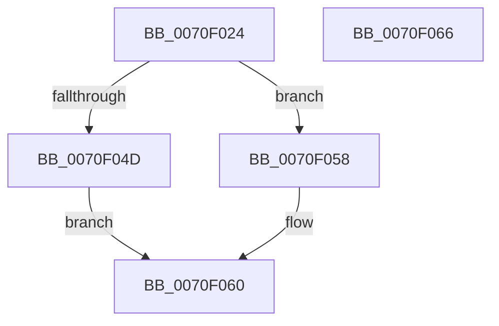

# ArbInitializeOrderingList

- RVA: `0x0070F024`–`0x0070F067` (길이 `67` bytes)
- VA: `0x000000014070F024`
- 실행 섹션: `PAGE`
- PDB 이름 있음: `예`; PDB Function 태그: `아니요`
- unwind 정보 RVA: `0x0005CF00`
- 디코드: `21`개 명령, `67/67` bytes 표시
- 미해석 바이트: `0` (있으면 어셈블리에 `.byte`로 보존)

> 이 문서는 커널 이미지의 기계어와 PDB 기호를 분석해 생성했습니다. 4번과 5번은 함수 원형과 자료형을 바이너리 사용 방식에서 추정한 C 해석이며 원본 소스 복구 결과는 아닙니다.

## 1. Dependencies

- 직접 호출 지점: **1**; 고유 호출 대상: **1**
- 직접 호출자로 확인된 함수: **1**
- RIP 상대 이미지 참조: **0**

### Outgoing calls
- `0x0070F03A` → [ExAllocatePool2](../../poolcode/B8/ExAllocatePool2_function_00B820F0.md) (function, `0x00B820F0`)

### Direct callers
- [ArbBuildAssignmentOrdering](ArbBuildAssignmentOrdering_function_0070E43C.md) at `0x0070E4E3`
- [ArbBuildAssignmentOrdering](ArbBuildAssignmentOrdering_function_0070E43C.md) at `0x0070E4F6`

### Static image references
- 디코드된 RIP-relative 메모리 참조가 없습니다.

## 2. Other-region calls and transfers

- 다른 실행 섹션으로 향하는 call: **1**
  - `0x0070F03A` → [ExAllocatePool2](../../poolcode/B8/ExAllocatePool2_function_00B820F0.md) (`PAGE` → `POOLCODE`)
- 별도 외부 분기/꼬리 이동을 확인하지 못했습니다.

## 3. Assembly (complete function range)

```asm
0070F024  40 53                           push rbx
0070F026  48 83 EC 20                     sub rsp, 0x20
0070F02A  48 8B D9                        mov rbx, rcx
0070F02D  41 B8 41 72 62 4C               mov r8d, 0x4c627241
0070F033  B9 00 01 00 00                  mov ecx, 0x100
0070F038  8B D1                           mov edx, ecx
0070F03A  E8 B1 30 47 00                  call 0x140b820f0
0070F03F  33 C9                           xor ecx, ecx
0070F041  48 89 43 08                     mov qword ptr [rbx + 8], rax
0070F045  66 89 0B                        mov word ptr [rbx], cx
0070F048  48 85 C0                        test rax, rax
0070F04B  75 0B                           jne 0x14070f058
0070F04D  66 89 4B 02                     mov word ptr [rbx + 2], cx
0070F051  B8 9A 00 00 C0                  mov eax, 0xc000009a
0070F056  EB 08                           jmp 0x14070f060
0070F058  66 C7 43 02 10 00               mov word ptr [rbx + 2], 0x10
0070F05E  33 C0                           xor eax, eax
0070F060  48 83 C4 20                     add rsp, 0x20
0070F064  5B                              pop rbx
0070F065  C3                              ret
0070F066  CC                              int3
```

## 4. C-style interpretation (structured pseudocode)

```c
__int64 __fastcall ArbInitializeOrderingList(__int64 a1)
{
    __int64 result;
    __int64 v_rsp;

    v_rsp = (v_rsp) - (32);
    result = ExAllocatePool2(256, 256, (unsigned int)(0x4C627241ULL), a4);
    a1 = 0;
    *(unsigned __int64 *)(a1 + 8) = result;
    *(unsigned __int16 *)(a1) = 0;
    if (result != 0) goto loc_0070F058;
    *(unsigned __int16 *)(a1 + 2) = 0;
    goto loc_0070F060;
loc_0070F058:
    *(unsigned __int16 *)(a1 + 2) = 16;
    result = 0;
loc_0070F060:
    v_rsp = (v_rsp) + (32);
    return result;
}
```

## 5. (Beta) C Style

```c
int64_t ArbInitializeOrderingList(void *Arg1)
{
    uint8_t *arg1 = (uint8_t *)Arg1;

    int64_t result;
    int64_t local_rsp;

    local_rsp = (local_rsp) - (32);
    result = ExAllocatePool2(256, 256, (uint32_t)(0x4C627241ULL), a4);
    Arg1 = 0;
    *(uint64_t *)(arg1 + 0x8) = result;
    *(uint16_t *)(arg1) = 0;
    if (result != 0) goto loc_0070F058;
    *(uint16_t *)(arg1 + 0x2) = 0;
    goto loc_0070F060;
loc_0070F058:
    *(uint16_t *)(arg1 + 0x2) = 16;
    result = 0;
loc_0070F060:
    local_rsp = (local_rsp) + (32);
    return result;
}
```

### 관측된 메모리 오프셋

구조체 형식이 확인되지 않은 접근은 인자 기준의 오프셋으로만 기록했습니다.

| 기준 인자 | 오프셋 표현 | 폭 (bit) | 접근 |
|---|---:|---:|---|
| `Arg1` | `+ 0x0` | `16` | `W` |
| `Arg1` | `+ 0x2` | `16` | `W` |
| `Arg1` | `+ 0x8` | `64` | `W` |

## 6. Execution-region graph

[열기: 2D/3D 그래프와 함수 탐색 컨트롤 패널](../../../control-panel.html?section=page&rva=0x0070F024&view=graph)

- 2D 그래프는 위에서 아래로 흐르고, 3D 그래프는 빈 공간을 드래그해 회전합니다. Shift+드래그는 이동, 휠은 확대·축소, 함수 노드 선택은 대상 보고서 이동입니다.

### Static fallback


