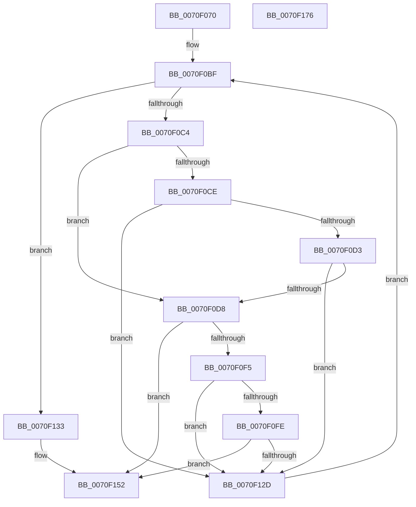

# ArbInitializeRangeList

- RVA: `0x0070F070`–`0x0070F177` (길이 `263` bytes)
- VA: `0x000000014070F070`
- 실행 섹션: `PAGE`
- PDB 이름 있음: `예`; PDB Function 태그: `아니요`
- unwind 정보 RVA: `0x000C38F4`
- 디코드: `82`개 명령, `263/263` bytes 표시
- 미해석 바이트: `0` (있으면 어셈블리에 `.byte`로 보존)

> 이 문서는 커널 이미지의 기계어와 PDB 기호를 분석해 생성했습니다. 4번과 5번은 함수 원형과 자료형을 바이너리 사용 방식에서 추정한 C 해석이며 원본 소스 복구 결과는 아닙니다.

## 1. Dependencies

- 직접 호출 지점: **4**; 고유 호출 대상: **4**
- 직접 호출자로 확인된 함수: **0**
- RIP 상대 이미지 참조: **0**

### Outgoing calls
- `0x0070F0EA` → [guard_dispatch_icall](../../text/6B/guard_dispatch_icall_function_006BAAD0.md) (function, `0x006BAAD0`)
- `0x0070F122` → [RtlAddRange](../A8/RtlAddRange_function_00A8E860.md) (function, `0x00A8E860`)
- `0x0070F145` → [RtlInvertRangeListEx](../A8/RtlInvertRangeListEx_function_00A8E760.md) (function, `0x00A8E760`)
- `0x0070F156` → [RtlFreeRangeList](../A6/RtlFreeRangeList_function_00A69850.md) (function, `0x00A69850`)

### Direct callers
- 이 함수 시작 RVA로 연결되는 직접 call은 확인되지 않았습니다. 간접 호출은 완전히 역산할 수 없습니다.

### Static image references
- 디코드된 RIP-relative 메모리 참조가 없습니다.

## 2. Other-region calls and transfers

- 다른 실행 섹션으로 향하는 call: **1**
  - `0x0070F0EA` → [guard_dispatch_icall](../../text/6B/guard_dispatch_icall_function_006BAAD0.md) (`PAGE` → `.text`)
- 별도 외부 분기/꼬리 이동을 확인하지 못했습니다.

## 3. Assembly (complete function range)

```asm
0070F070  48 89 5C 24 08                  mov qword ptr [rsp + 8], rbx
0070F075  48 89 74 24 10                  mov qword ptr [rsp + 0x10], rsi
0070F07A  55                              push rbp
0070F07B  57                              push rdi
0070F07C  41 54                           push r12
0070F07E  41 56                           push r14
0070F080  41 57                           push r15
0070F082  48 8B EC                        mov rbp, rsp
0070F085  48 83 EC 70                     sub rsp, 0x70
0070F089  45 33 E4                        xor r12d, r12d
0070F08C  48 8D 45 D8                     lea rax, [rbp - 0x28]
0070F090  48 89 45 E0                     mov qword ptr [rbp - 0x20], rax
0070F094  48 8B F1                        mov rsi, rcx
0070F097  48 8D 45 D8                     lea rax, [rbp - 0x28]
0070F09B  4C 89 65 F0                     mov qword ptr [rbp - 0x10], r12
0070F09F  48 89 45 D8                     mov qword ptr [rbp - 0x28], rax
0070F0A3  4D 8B F9                        mov r15, r9
0070F0A6  8B C2                           mov eax, edx
0070F0A8  49 8B F8                        mov rdi, r8
0070F0AB  4C 89 65 D0                     mov qword ptr [rbp - 0x30], r12
0070F0AF  4C 89 65 40                     mov qword ptr [rbp + 0x40], r12
0070F0B3  4C 89 65 E8                     mov qword ptr [rbp - 0x18], r12
0070F0B7  48 8D 0C 80                     lea rcx, [rax + rax*4]
0070F0BB  4D 8D 34 88                     lea r14, [r8 + rcx*4]
0070F0BF  49 3B FE                        cmp rdi, r14
0070F0C2  73 6F                           jae 0x14070f133
0070F0C4  0F B6 0F                        movzx ecx, byte ptr [rdi]
0070F0C7  8B 46 20                        mov eax, dword ptr [rsi + 0x20]
0070F0CA  3B C8                           cmp ecx, eax
0070F0CC  74 0A                           je 0x14070f0d8
0070F0CE  80 F9 07                        cmp cl, 7
0070F0D1  75 5A                           jne 0x14070f12d
0070F0D3  83 F8 03                        cmp eax, 3
0070F0D6  75 55                           jne 0x14070f12d
0070F0D8  48 8B 86 88 00 00 00            mov rax, qword ptr [rsi + 0x88]
0070F0DF  4C 8D 45 40                     lea r8, [rbp + 0x40]
0070F0E3  48 8D 55 D0                     lea rdx, [rbp - 0x30]
0070F0E7  48 8B CF                        mov rcx, rdi
0070F0EA  E8 E1 B9 FA FF                  call 0x1406baad0
0070F0EF  8B D8                           mov ebx, eax
0070F0F1  85 C0                           test eax, eax
0070F0F3  78 5D                           js 0x14070f152
0070F0F5  48 8B 45 40                     mov rax, qword ptr [rbp + 0x40]
0070F0F9  48 85 C0                        test rax, rax
0070F0FC  74 2F                           je 0x14070f12d
0070F0FE  48 8B 55 D0                     mov rdx, qword ptr [rbp - 0x30]
0070F102  4C 8D 40 FF                     lea r8, [rax - 1]
0070F106  4C 89 64 24 30                  mov qword ptr [rsp + 0x30], r12
0070F10B  48 8D 4D D8                     lea rcx, [rbp - 0x28]
0070F10F  4C 03 C2                        add r8, rdx
0070F112  4C 89 64 24 28                  mov qword ptr [rsp + 0x28], r12
0070F117  45 33 C9                        xor r9d, r9d
0070F11A  C7 44 24 20 03 00 00 00         mov dword ptr [rsp + 0x20], 3
0070F122  E8 39 F7 37 00                  call 0x140a8e860
0070F127  8B D8                           mov ebx, eax
0070F129  85 C0                           test eax, eax
0070F12B  78 25                           js 0x14070f152
0070F12D  48 83 C7 14                     add rdi, 0x14
0070F131  EB 8C                           jmp 0x14070f0bf
0070F133  45 33 C9                        xor r9d, r9d
0070F136  4C 89 64 24 20                  mov qword ptr [rsp + 0x20], r12
0070F13B  45 33 C0                        xor r8d, r8d
0070F13E  48 8D 55 D8                     lea rdx, [rbp - 0x28]
0070F142  49 8B CF                        mov rcx, r15
0070F145  E8 16 F6 37 00                  call 0x140a8e760
0070F14A  85 C0                           test eax, eax
0070F14C  8B D8                           mov ebx, eax
0070F14E  41 0F 49 DC                     cmovns ebx, r12d
0070F152  48 8D 4D D8                     lea rcx, [rbp - 0x28]
0070F156  E8 F5 A6 35 00                  call 0x140a69850
0070F15B  4C 8D 5C 24 70                  lea r11, [rsp + 0x70]
0070F160  8B C3                           mov eax, ebx
0070F162  49 8B 5B 30                     mov rbx, qword ptr [r11 + 0x30]
0070F166  49 8B 73 38                     mov rsi, qword ptr [r11 + 0x38]
0070F16A  49 8B E3                        mov rsp, r11
0070F16D  41 5F                           pop r15
0070F16F  41 5E                           pop r14
0070F171  41 5C                           pop r12
0070F173  5F                              pop rdi
0070F174  5D                              pop rbp
0070F175  C3                              ret
0070F176  CC                              int3
```

## 4. C-style interpretation (structured pseudocode)

```c
__int64 __fastcall ArbInitializeRangeList(__int64 a1, int a2, __int64 a3, __int64 a4)
{
    __int64 result;
    __int64 v_r12;
    __int64 v_rbx;
    __int64 v_rdi;
    __int64 v_rsp;
    unsigned __int64 v_stack_m28;
    unsigned __int64 v_stack_m38;
    unsigned __int64 v_stack_m40;
    unsigned __int64 v_stack_m48;
    unsigned __int64 v_stack_m50;
    unsigned __int64 v_stack_m58;
    unsigned __int64 v_stack_m68;
    unsigned __int64 v_stack_m70;
    unsigned int v_stack_m78;
    unsigned __int64 v_stack_p10;
    unsigned __int64 v_stack_p18;
    unsigned __int64 v_stack_p8;

    v_stack_p8 = v_rbx;
    v_stack_p10 = v_rsi;
    v_rsp = (v_rsp) - (112);
    v_r12 = 0;
    v_stack_m48 = v_stack_m50;
    v_stack_m38 = 0;
    v_stack_m50 = v_stack_m50;
    v_stack_m58 = 0;
    v_stack_p18 = 0;
    v_stack_m40 = 0;
loc_0070F0BF:
    if (a3 >= (a3 + (unsigned int)(a2) + (unsigned int)(a2) * 4 * 4)) goto loc_0070F133;
    if (((unsigned int)(*(unsigned __int8 *)(a3))) == ((unsigned int)((unsigned int)(*(unsigned int *)(a1 + 32))))) goto loc_0070F0D8;
    if (((unsigned __int8)(*(unsigned __int8 *)(a3))) != 7) goto loc_0070F12D;
    if (((unsigned int)((unsigned int)(*(unsigned int *)(a1 + 32)))) != 3) goto loc_0070F12D;
loc_0070F0D8:
    result = guard_dispatch_icall(a3, v_stack_m58, v_stack_p18, a4);
    if (sign_flag) goto loc_0070F152;
    if (v_stack_p18 == 0) goto loc_0070F12D;
    v_stack_m68 = 0;
    a3 = (v_stack_p18 - 1) + (v_stack_m58);
    v_stack_m70 = 0;
    a4 = 0;
    v_stack_m78 = 3;
    result = RtlAddRange(v_stack_m50, v_stack_m58, a3, a4);
    if (sign_flag) goto loc_0070F152;
loc_0070F12D:
    v_rdi = (a3) + (20);
    goto loc_0070F0BF;
loc_0070F133:
    a4 = 0;
    v_stack_m78 = 0;
    a3 = 0;
    result = RtlInvertRangeListEx(0, v_stack_m50, a3, a4);
    v_rbx = (unsigned int)((unsigned int)(result));
    if (!sign_flag) { v_rbx = 0; }
loc_0070F152:
    result = RtlFreeRangeList(v_stack_m50, v_stack_m50, a3, a4);
    return (unsigned int)((unsigned int)(v_rbx));
}
```

## 5. (Beta) C Style

```c
int64_t ArbInitializeRangeList(void *Arg1, void *Arg2, void *Arg3, int64_t Arg4)
{
    uint8_t *arg1 = (uint8_t *)Arg1;
    uint8_t *arg2 = (uint8_t *)Arg2;
    uint8_t *arg3 = (uint8_t *)Arg3;

    int64_t result;
    int64_t local_r12;
    int64_t local_rbx;
    int64_t local_rdi;
    int64_t local_rsp;
    uint64_t v_stack_m28;
    uint64_t v_stack_m38;
    uint64_t v_stack_m40;
    uint64_t v_stack_m48;
    uint64_t v_stack_m50;
    uint64_t v_stack_m58;
    uint64_t v_stack_m68;
    uint64_t v_stack_m70;
    uint32_t v_stack_m78;
    uint64_t v_stack_p10;
    uint64_t v_stack_p18;
    uint64_t v_stack_p8;

    v_stack_p8 = local_rbx;
    v_stack_p10 = local_rsi;
    local_rsp = (local_rsp) - (112);
    local_r12 = 0;
    v_stack_m48 = v_stack_m50;
    v_stack_m38 = 0;
    v_stack_m50 = v_stack_m50;
    v_stack_m58 = 0;
    v_stack_p18 = 0;
    v_stack_m40 = 0;
loc_0070F0BF:
    if (Arg3 >= (Arg3 + (uint32_t)(Arg2) + (uint32_t)(Arg2) * 4 * 4)) goto loc_0070F133;
    if (((uint32_t)(*(uint8_t *)(arg3))) == ((uint32_t)((uint32_t)(*(uint32_t *)(arg1 + 0x20))))) goto loc_0070F0D8;
    if (((uint8_t)(*(uint8_t *)(arg3))) != 7) goto loc_0070F12D;
    if (((uint32_t)((uint32_t)(*(uint32_t *)(arg1 + 0x20)))) != 3) goto loc_0070F12D;
loc_0070F0D8:
    result = guard_dispatch_icall(Arg3, v_stack_m58, v_stack_p18, Arg4);
    if (sign_flag) goto loc_0070F152;
    if (v_stack_p18 == 0) goto loc_0070F12D;
    v_stack_m68 = 0;
    Arg3 = (v_stack_p18 - 1) + (v_stack_m58);
    v_stack_m70 = 0;
    Arg4 = 0;
    v_stack_m78 = 3;
    result = RtlAddRange(v_stack_m50, v_stack_m58, Arg3, Arg4);
    if (sign_flag) goto loc_0070F152;
loc_0070F12D:
    local_rdi = (Arg3) + (20);
    goto loc_0070F0BF;
loc_0070F133:
    Arg4 = 0;
    v_stack_m78 = 0;
    Arg3 = 0;
    result = RtlInvertRangeListEx(0, v_stack_m50, Arg3, Arg4);
    local_rbx = (uint32_t)((uint32_t)(result));
    if (!sign_flag) { local_rbx = 0; }
loc_0070F152:
    result = RtlFreeRangeList(v_stack_m50, v_stack_m50, Arg3, Arg4);
    return (uint32_t)((uint32_t)(local_rbx));
}
```

### 관측된 메모리 오프셋

구조체 형식이 확인되지 않은 접근은 인자 기준의 오프셋으로만 기록했습니다.

| 기준 인자 | 오프셋 표현 | 폭 (bit) | 접근 |
|---|---:|---:|---|
| `Arg1` | `+ 0x20` | `32` | `R` |
| `Arg1` | `+ 0x88` | `64` | `R` |
| `Arg2` | `+ 0x0 + rax*4` | `64` | `R` |
| `Arg3` | `+ 0x0 + rcx*4` | `64` | `R` |

## 6. Execution-region graph

[열기: 2D/3D 그래프와 함수 탐색 컨트롤 패널](../../../control-panel.html?section=page&rva=0x0070F070&view=graph)

- 2D 그래프는 위에서 아래로 흐르고, 3D 그래프는 빈 공간을 드래그해 회전합니다. Shift+드래그는 이동, 휠은 확대·축소, 함수 노드 선택은 대상 보고서 이동입니다.

### Static fallback


