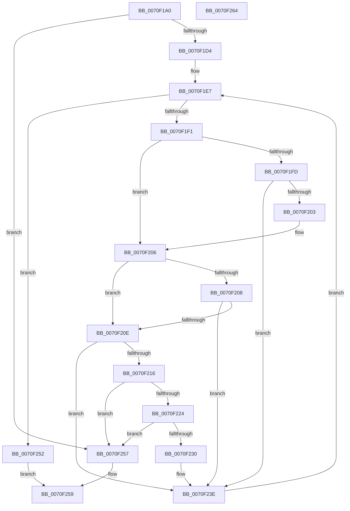

# ArbOverrideConflict

- RVA: `0x0070F1A0`–`0x0070F265` (길이 `197` bytes)
- VA: `0x000000014070F1A0`
- 실행 섹션: `PAGE`
- PDB 이름 있음: `예`; PDB Function 태그: `아니요`
- unwind 정보 RVA: `0x000718C0`
- 디코드: `59`개 명령, `197/197` bytes 표시
- 미해석 바이트: `0` (있으면 어셈블리에 `.byte`로 보존)

> 이 문서는 커널 이미지의 기계어와 PDB 기호를 분석해 생성했습니다. 4번과 5번은 함수 원형과 자료형을 바이너리 사용 방식에서 추정한 C 해석이며 원본 소스 복구 결과는 아닙니다.

## 1. Dependencies

- 직접 호출 지점: **2**; 고유 호출 대상: **2**
- 직접 호출자로 확인된 함수: **0**
- RIP 상대 이미지 참조: **0**

### Outgoing calls
- `0x0070F1E2` → [RtlGetFirstRange](../A7/RtlGetFirstRange_function_00A7EA70.md) (function, `0x00A7EA70`)
- `0x0070F24B` → [RtlGetNextRange](../A3/RtlGetNextRange_function_00A35A40.md) (function, `0x00A35A40`)

### Direct callers
- 이 함수 시작 RVA로 연결되는 직접 call은 확인되지 않았습니다. 간접 호출은 완전히 역산할 수 없습니다.

### Static image references
- 디코드된 RIP-relative 메모리 참조가 없습니다.

## 2. Other-region calls and transfers

- 다른 실행 섹션으로 향하는 call: **0**
- 별도 외부 분기/꼬리 이동을 확인하지 못했습니다.

## 3. Assembly (complete function range)

```asm
0070F1A0  48 8B C4                        mov rax, rsp
0070F1A3  48 89 58 08                     mov qword ptr [rax + 8], rbx
0070F1A7  57                              push rdi
0070F1A8  48 83 EC 40                     sub rsp, 0x40
0070F1AC  48 83 60 10 00                  and qword ptr [rax + 0x10], 0
0070F1B1  0F 57 C0                        xorps xmm0, xmm0
0070F1B4  0F 11 40 D8                     movups xmmword ptr [rax - 0x28], xmm0
0070F1B8  40 32 FF                        xor dil, dil
0070F1BB  48 8B DA                        mov rbx, rdx
0070F1BE  0F 11 40 E8                     movups xmmword ptr [rax - 0x18], xmm0
0070F1C2  48 8B 42 28                     mov rax, qword ptr [rdx + 0x28]
0070F1C6  44 8B 40 24                     mov r8d, dword ptr [rax + 0x24]
0070F1CA  41 F6 C0 02                     test r8b, 2
0070F1CE  0F 84 83 00 00 00               je 0x14070f257
0070F1D4  48 8B 49 30                     mov rcx, qword ptr [rcx + 0x30]
0070F1D8  4C 8D 44 24 58                  lea r8, [rsp + 0x58]
0070F1DD  48 8D 54 24 20                  lea rdx, [rsp + 0x20]
0070F1E2  E8 89 F8 36 00                  call 0x140a7ea70
0070F1E7  48 8B 54 24 58                  mov rdx, qword ptr [rsp + 0x58]
0070F1EC  48 85 D2                        test rdx, rdx
0070F1EF  74 61                           je 0x14070f252
0070F1F1  48 8B 02                        mov rax, qword ptr [rdx]
0070F1F4  4C 8B 43 10                     mov r8, qword ptr [rbx + 0x10]
0070F1F8  4C 3B C0                        cmp r8, rax
0070F1FB  76 09                           jbe 0x14070f206
0070F1FD  4C 39 42 08                     cmp qword ptr [rdx + 8], r8
0070F201  72 3B                           jb 0x14070f23e
0070F203  4C 3B C0                        cmp r8, rax
0070F206  73 06                           jae 0x14070f20e
0070F208  48 39 43 18                     cmp qword ptr [rbx + 0x18], rax
0070F20C  72 30                           jb 0x14070f23e
0070F20E  8A 42 20                        mov al, byte ptr [rdx + 0x20]
0070F211  84 43 43                        test byte ptr [rbx + 0x43], al
0070F214  75 28                           jne 0x14070f23e
0070F216  48 8B 43 20                     mov rax, qword ptr [rbx + 0x20]
0070F21A  48 8B 48 20                     mov rcx, qword ptr [rax + 0x20]
0070F21E  48 39 4A 18                     cmp qword ptr [rdx + 0x18], rcx
0070F222  75 33                           jne 0x14070f257
0070F224  48 8B 43 28                     mov rax, qword ptr [rbx + 0x28]
0070F228  8B 48 24                        mov ecx, dword ptr [rax + 0x24]
0070F22B  F6 C1 02                        test cl, 2
0070F22E  74 27                           je 0x14070f257
0070F230  48 8B 43 18                     mov rax, qword ptr [rbx + 0x18]
0070F234  40 B7 01                        mov dil, 1
0070F237  48 89 43 08                     mov qword ptr [rbx + 8], rax
0070F23B  4C 89 03                        mov qword ptr [rbx], r8
0070F23E  41 B0 01                        mov r8b, 1
0070F241  48 8D 54 24 58                  lea rdx, [rsp + 0x58]
0070F246  48 8D 4C 24 20                  lea rcx, [rsp + 0x20]
0070F24B  E8 F0 67 32 00                  call 0x140a35a40
0070F250  EB 95                           jmp 0x14070f1e7
0070F252  40 8A C7                        mov al, dil
0070F255  EB 02                           jmp 0x14070f259
0070F257  32 C0                           xor al, al
0070F259  48 8B 5C 24 50                  mov rbx, qword ptr [rsp + 0x50]
0070F25E  48 83 C4 40                     add rsp, 0x40
0070F262  5F                              pop rdi
0070F263  C3                              ret
0070F264  CC                              int3
```

## 4. C-style interpretation (structured pseudocode)

```c
__int64 __fastcall ArbOverrideConflict(__int64 a1, __int64 a2)
{
    __int64 result;
    __int64 v_rdi;
    __int64 v_rsp;
    unsigned __int64 v_stack_m28;
    unsigned __int64 v_stack_p10;
    unsigned __int64 v_stack_p8;

    *(unsigned __int64 *)(v_rsp + 8) = v_rbx;
    v_rsp = (v_rsp) - (64);
    *(unsigned __int64 *)(v_rsp - 40) = v_xmm0;
    v_rdi = 0;
    *(unsigned __int64 *)(v_rsp - 24) = v_xmm0;
    if ((((unsigned __int8)((unsigned int)(*(unsigned int *)(*(unsigned __int64 *)(a2 + 40) + 36)))) & (2)) == 0) goto loc_0070F257;
    result = RtlGetFirstRange(*(unsigned __int64 *)(a1 + 48), v_stack_m28, v_stack_p10, a4);
loc_0070F1E7:
    if (v_stack_p10 == 0) goto loc_0070F252;
    if ((*(unsigned __int64 *)(a2 + 16)) <= (*(unsigned __int64 *)(v_stack_p10))) goto loc_0070F206;
    if ((*(unsigned __int64 *)(v_stack_p10 + 8)) < (*(unsigned __int64 *)(a2 + 16))) goto loc_0070F23E;
loc_0070F206:
    if ((*(unsigned __int64 *)(a2 + 16)) >= (*(unsigned __int64 *)(v_stack_p10))) goto loc_0070F20E;
    if ((*(unsigned __int64 *)(a2 + 24)) < (*(unsigned __int64 *)(v_stack_p10))) goto loc_0070F23E;
loc_0070F20E:
    if (((*(unsigned __int8 *)(a2 + 67)) & ((unsigned __int8)(*(unsigned __int8 *)(v_stack_p10 + 32)))) != 0) goto loc_0070F23E;
    if ((*(unsigned __int64 *)(v_stack_p10 + 24)) != (*(unsigned __int64 *)(*(unsigned __int64 *)(a2 + 32) + 32))) goto loc_0070F257;
    if ((((unsigned __int8)((unsigned int)(*(unsigned int *)(*(unsigned __int64 *)(a2 + 40) + 36)))) & (2)) == 0) goto loc_0070F257;
    *(unsigned __int64 *)(a2 + 8) = *(unsigned __int64 *)(a2 + 24);
    *(unsigned __int64 *)(a2) = *(unsigned __int64 *)(a2 + 16);
loc_0070F23E:
    result = RtlGetNextRange(v_stack_m28, v_stack_p10, 1, a4);
    goto loc_0070F1E7;
loc_0070F252:
    goto loc_0070F259;
loc_0070F257:
    result = 0;
loc_0070F259:
    v_rsp = (v_rsp) + (64);
    return result;
}
```

## 5. (Beta) C Style

```c
int64_t ArbOverrideConflict(void *Arg1, void *Arg2)
{
    uint8_t *arg1 = (uint8_t *)Arg1;
    uint8_t *arg2 = (uint8_t *)Arg2;

    int64_t result;
    int64_t local_rdi;
    int64_t local_rsp;
    uint64_t v_stack_m28;
    uint64_t v_stack_p10;
    uint64_t v_stack_p8;

    *(uint64_t *)(local_rsp + 0x8) = local_rbx;
    local_rsp = (local_rsp) - (64);
    *(uint64_t *)(local_rsp - 0x28) = v_xmm0;
    local_rdi = 0;
    *(uint64_t *)(local_rsp - 0x18) = v_xmm0;
    if ((((uint8_t)((uint32_t)(*(uint32_t *)(*(uint64_t *)(arg2 + 0x28) + 0x24)))) & (2)) == 0) goto loc_0070F257;
    result = RtlGetFirstRange(*(uint64_t *)(arg1 + 0x30), v_stack_m28, v_stack_p10, a4);
loc_0070F1E7:
    if (v_stack_p10 == 0) goto loc_0070F252;
    if ((*(uint64_t *)(arg2 + 0x10)) <= (*(uint64_t *)(v_stack_p10))) goto loc_0070F206;
    if ((*(uint64_t *)(v_stack_p10 + 0x8)) < (*(uint64_t *)(arg2 + 0x10))) goto loc_0070F23E;
loc_0070F206:
    if ((*(uint64_t *)(arg2 + 0x10)) >= (*(uint64_t *)(v_stack_p10))) goto loc_0070F20E;
    if ((*(uint64_t *)(arg2 + 0x18)) < (*(uint64_t *)(v_stack_p10))) goto loc_0070F23E;
loc_0070F20E:
    if (((*(uint8_t *)(arg2 + 0x43)) & ((uint8_t)(*(uint8_t *)(v_stack_p10 + 0x20)))) != 0) goto loc_0070F23E;
    if ((*(uint64_t *)(v_stack_p10 + 0x18)) != (*(uint64_t *)(*(uint64_t *)(arg2 + 0x20) + 0x20))) goto loc_0070F257;
    if ((((uint8_t)((uint32_t)(*(uint32_t *)(*(uint64_t *)(arg2 + 0x28) + 0x24)))) & (2)) == 0) goto loc_0070F257;
    *(uint64_t *)(arg2 + 0x8) = *(uint64_t *)(arg2 + 0x18);
    *(uint64_t *)(arg2) = *(uint64_t *)(arg2 + 0x10);
loc_0070F23E:
    result = RtlGetNextRange(v_stack_m28, v_stack_p10, 1, a4);
    goto loc_0070F1E7;
loc_0070F252:
    goto loc_0070F259;
loc_0070F257:
    result = 0;
loc_0070F259:
    local_rsp = (local_rsp) + (64);
    return result;
}
```

### 관측된 메모리 오프셋

구조체 형식이 확인되지 않은 접근은 인자 기준의 오프셋으로만 기록했습니다.

| 기준 인자 | 오프셋 표현 | 폭 (bit) | 접근 |
|---|---:|---:|---|
| `Arg1` | `+ 0x30` | `64` | `R` |
| `Arg2` | `+ 0x0` | `64` | `W` |
| `Arg2` | `+ 0x8` | `64` | `W` |
| `Arg2` | `+ 0x10` | `64` | `R` |
| `Arg2` | `+ 0x18` | `64` | `R` |
| `Arg2` | `+ 0x20` | `64` | `R` |
| `Arg2` | `+ 0x28` | `64` | `R` |
| `Arg2` | `+ 0x43` | `8` | `R` |

## 6. Execution-region graph

[열기: 2D/3D 그래프와 함수 탐색 컨트롤 패널](../../../control-panel.html?section=page&rva=0x0070F1A0&view=graph)

- 2D 그래프는 위에서 아래로 흐르고, 3D 그래프는 빈 공간을 드래그해 회전합니다. Shift+드래그는 이동, 휠은 확대·축소, 함수 노드 선택은 대상 보고서 이동입니다.

### Static fallback


