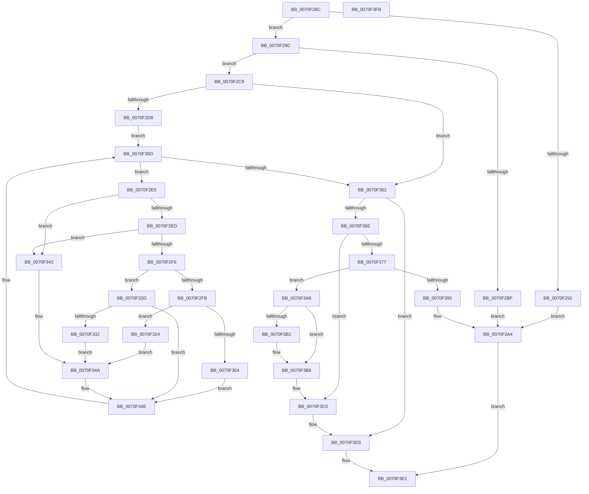

# ArbPruneOrdering

- RVA: `0x0070F26C`–`0x0070F3FC` (길이 `400` bytes)
- VA: `0x000000014070F26C`
- 실행 섹션: `PAGE`
- PDB 이름 있음: `예`; PDB Function 태그: `아니요`
- unwind 정보 RVA: `0x00060300`
- 디코드: `119`개 명령, `400/400` bytes 표시
- 미해석 바이트: `0` (있으면 어셈블리에 `.byte`로 보존)

> 이 문서는 커널 이미지의 기계어와 PDB 기호를 분석해 생성했습니다. 4번과 5번은 함수 원형과 자료형을 바이너리 사용 방식에서 추정한 C 해석이며 원본 소스 복구 결과는 아닙니다.

## 1. Dependencies

- 직접 호출 지점: **6**; 고유 호출 대상: **3**
- 직접 호출자로 확인된 함수: **1**
- RIP 상대 이미지 참조: **0**

### Outgoing calls
- `0x0070F2B2` → [ExAllocatePool2](../../poolcode/B8/ExAllocatePool2_function_00B820F0.md) (function, `0x00B820F0`)
- `0x0070F388` → [ExAllocatePool2](../../poolcode/B8/ExAllocatePool2_function_00B820F0.md) (function, `0x00B820F0`)
- `0x0070F39F` → [ExFreePoolWithTag](../../poolcode/B8/ExFreePoolWithTag_function_00B82870.md) (function, `0x00B82870`)
- `0x0070F3B3` → [ExFreePoolWithTag](../../poolcode/B8/ExFreePoolWithTag_function_00B82870.md) (function, `0x00B82870`)
- `0x0070F3CE` → [memcpy](../../text/6C/memcpy_function_006C6840.md) (function, `0x006C6840`)
- `0x0070F3D8` → [ExFreePoolWithTag](../../poolcode/B8/ExFreePoolWithTag_function_00B82870.md) (function, `0x00B82870`)

### Direct callers
- [ArbBuildAssignmentOrdering](ArbBuildAssignmentOrdering_function_0070E43C.md) at `0x0070E89F`

### Static image references
- 디코드된 RIP-relative 메모리 참조가 없습니다.

## 2. Other-region calls and transfers

- 다른 실행 섹션으로 향하는 call: **6**
  - `0x0070F2B2` → [ExAllocatePool2](../../poolcode/B8/ExAllocatePool2_function_00B820F0.md) (`PAGE` → `POOLCODE`)
  - `0x0070F388` → [ExAllocatePool2](../../poolcode/B8/ExAllocatePool2_function_00B820F0.md) (`PAGE` → `POOLCODE`)
  - `0x0070F39F` → [ExFreePoolWithTag](../../poolcode/B8/ExFreePoolWithTag_function_00B82870.md) (`PAGE` → `POOLCODE`)
  - `0x0070F3B3` → [ExFreePoolWithTag](../../poolcode/B8/ExFreePoolWithTag_function_00B82870.md) (`PAGE` → `POOLCODE`)
  - `0x0070F3CE` → [memcpy](../../text/6C/memcpy_function_006C6840.md) (`PAGE` → `.text`)
  - `0x0070F3D8` → [ExFreePoolWithTag](../../poolcode/B8/ExFreePoolWithTag_function_00B82870.md) (`PAGE` → `POOLCODE`)
- 별도 외부 분기/꼬리 이동을 확인하지 못했습니다.

## 3. Assembly (complete function range)

```asm
0070F26C  48 89 5C 24 08                  mov qword ptr [rsp + 8], rbx
0070F271  48 89 6C 24 10                  mov qword ptr [rsp + 0x10], rbp
0070F276  48 89 74 24 18                  mov qword ptr [rsp + 0x18], rsi
0070F27B  57                              push rdi
0070F27C  41 56                           push r14
0070F27E  41 57                           push r15
0070F280  48 83 EC 20                     sub rsp, 0x20
0070F284  49 8B E8                        mov rbp, r8
0070F287  4C 8B F2                        mov r14, rdx
0070F28A  48 8B F9                        mov rdi, rcx
0070F28D  4C 3B C2                        cmp r8, rdx
0070F290  73 0A                           jae 0x14070f29c
0070F292  BB 0D 00 00 C0                  mov ebx, 0xc000000d
0070F297  E9 08 01 00 00                  jmp 0x14070f3a4
0070F29C  0F B7 11                        movzx edx, word ptr [rcx]
0070F29F  41 B8 41 72 62 4C               mov r8d, 0x4c627241
0070F2A5  48 C1 E2 05                     shl rdx, 5
0070F2A9  B9 00 01 00 00                  mov ecx, 0x100
0070F2AE  48 83 C2 10                     add rdx, 0x10
0070F2B2  E8 39 2E 47 00                  call 0x140b820f0
0070F2B7  48 8B F0                        mov rsi, rax
0070F2BA  48 85 C0                        test rax, rax
0070F2BD  75 0A                           jne 0x14070f2c9
0070F2BF  BB 9A 00 00 C0                  mov ebx, 0xc000009a
0070F2C4  E9 DB 00 00 00                  jmp 0x14070f3a4
0070F2C9  0F B7 07                        movzx eax, word ptr [rdi]
0070F2CC  48 8B DE                        mov rbx, rsi
0070F2CF  66 85 C0                        test ax, ax
0070F2D2  0F 84 8A 00 00 00               je 0x14070f362
0070F2D8  48 8B 4F 08                     mov rcx, qword ptr [rdi + 8]
0070F2DC  48 C1 E0 04                     shl rax, 4
0070F2E0  48 03 C1                        add rax, rcx
0070F2E3  EB 78                           jmp 0x14070f35d
0070F2E5  48 8B 01                        mov rax, qword ptr [rcx]
0070F2E8  48 3B E8                        cmp rbp, rax
0070F2EB  72 56                           jb 0x14070f343
0070F2ED  48 8B 51 08                     mov rdx, qword ptr [rcx + 8]
0070F2F1  4C 3B F2                        cmp r14, rdx
0070F2F4  77 4D                           ja 0x14070f343
0070F2F6  4C 3B F0                        cmp r14, rax
0070F2F9  76 32                           jbe 0x14070f32d
0070F2FB  4D 8D 46 FF                     lea r8, [r14 - 1]
0070F2FF  48 3B EA                        cmp rbp, rdx
0070F302  73 20                           jae 0x14070f324
0070F304  48 8D 45 01                     lea rax, [rbp + 1]
0070F308  48 89 03                        mov qword ptr [rbx], rax
0070F30B  48 8B 41 08                     mov rax, qword ptr [rcx + 8]
0070F30F  48 89 43 08                     mov qword ptr [rbx + 8], rax
0070F313  48 8B 01                        mov rax, qword ptr [rcx]
0070F316  48 89 43 10                     mov qword ptr [rbx + 0x10], rax
0070F31A  4C 89 43 18                     mov qword ptr [rbx + 0x18], r8
0070F31E  48 83 C3 20                     add rbx, 0x20
0070F322  EB 2A                           jmp 0x14070f34e
0070F324  48 89 03                        mov qword ptr [rbx], rax
0070F327  4C 89 43 08                     mov qword ptr [rbx + 8], r8
0070F32B  EB 1D                           jmp 0x14070f34a
0070F32D  48 3B EA                        cmp rbp, rdx
0070F330  73 1C                           jae 0x14070f34e
0070F332  48 8D 45 01                     lea rax, [rbp + 1]
0070F336  48 89 03                        mov qword ptr [rbx], rax
0070F339  48 8B 41 08                     mov rax, qword ptr [rcx + 8]
0070F33D  48 89 43 08                     mov qword ptr [rbx + 8], rax
0070F341  EB 07                           jmp 0x14070f34a
0070F343  0F 10 01                        movups xmm0, xmmword ptr [rcx]
0070F346  F3 0F 7F 03                     movdqu xmmword ptr [rbx], xmm0
0070F34A  48 83 C3 10                     add rbx, 0x10
0070F34E  0F B7 07                        movzx eax, word ptr [rdi]
0070F351  48 83 C1 10                     add rcx, 0x10
0070F355  48 C1 E0 04                     shl rax, 4
0070F359  48 03 47 08                     add rax, qword ptr [rdi + 8]
0070F35D  48 3B C8                        cmp rcx, rax
0070F360  72 83                           jb 0x14070f2e5
0070F362  48 2B DE                        sub rbx, rsi
0070F365  48 C1 FB 04                     sar rbx, 4
0070F369  66 85 DB                        test bx, bx
0070F36C  74 65                           je 0x14070f3d3
0070F36E  0F B7 EB                        movzx ebp, bx
0070F371  66 3B 5F 02                     cmp bx, word ptr [rdi + 2]
0070F375  76 49                           jbe 0x14070f3c0
0070F377  8B D5                           mov edx, ebp
0070F379  B9 00 01 00 00                  mov ecx, 0x100
0070F37E  48 C1 E2 04                     shl rdx, 4
0070F382  41 B8 41 72 62 4C               mov r8d, 0x4c627241
0070F388  E8 63 2D 47 00                  call 0x140b820f0
0070F38D  4C 8B F0                        mov r14, rax
0070F390  48 85 C0                        test rax, rax
0070F393  75 13                           jne 0x14070f3a8
0070F395  BB 9A 00 00 C0                  mov ebx, 0xc000009a
0070F39A  33 D2                           xor edx, edx
0070F39C  48 8B CE                        mov rcx, rsi
0070F39F  E8 CC 34 47 00                  call 0x140b82870
0070F3A4  8B C3                           mov eax, ebx
0070F3A6  EB 3A                           jmp 0x14070f3e2
0070F3A8  48 8B 4F 08                     mov rcx, qword ptr [rdi + 8]
0070F3AC  48 85 C9                        test rcx, rcx
0070F3AF  74 07                           je 0x14070f3b8
0070F3B1  33 D2                           xor edx, edx
0070F3B3  E8 B8 34 47 00                  call 0x140b82870
0070F3B8  4C 89 77 08                     mov qword ptr [rdi + 8], r14
0070F3BC  66 89 5F 02                     mov word ptr [rdi + 2], bx
0070F3C0  48 8B 4F 08                     mov rcx, qword ptr [rdi + 8]
0070F3C4  48 8B D6                        mov rdx, rsi
0070F3C7  48 C1 E5 04                     shl rbp, 4
0070F3CB  4C 8B C5                        mov r8, rbp
0070F3CE  E8 6D 74 FB FF                  call 0x1406c6840
0070F3D3  33 D2                           xor edx, edx
0070F3D5  48 8B CE                        mov rcx, rsi
0070F3D8  E8 93 34 47 00                  call 0x140b82870
0070F3DD  33 C0                           xor eax, eax
0070F3DF  66 89 1F                        mov word ptr [rdi], bx
0070F3E2  48 8B 5C 24 40                  mov rbx, qword ptr [rsp + 0x40]
0070F3E7  48 8B 6C 24 48                  mov rbp, qword ptr [rsp + 0x48]
0070F3EC  48 8B 74 24 50                  mov rsi, qword ptr [rsp + 0x50]
0070F3F1  48 83 C4 20                     add rsp, 0x20
0070F3F5  41 5F                           pop r15
0070F3F7  41 5E                           pop r14
0070F3F9  5F                              pop rdi
0070F3FA  C3                              ret
0070F3FB  CC                              int3
```

## 4. C-style interpretation (structured pseudocode)

```c
__int64 __fastcall ArbPruneOrdering(__int64 a1, __int64 a2, __int64 a3)
{
    __int64 result;
    __int64 v_rbp;
    __int64 v_rbx;
    __int64 v_rsp;
    unsigned __int64 v_stack_p10;
    unsigned __int64 v_stack_p18;
    unsigned __int64 v_stack_p8;

    v_stack_p8 = v_rbx;
    v_stack_p10 = v_rbp;
    v_stack_p18 = v_rsi;
    v_rsp = (v_rsp) - (32);
    if (a3 >= a2) goto loc_0070F29C;
    goto loc_0070F3A4;
loc_0070F29C:
    a2 = (*(unsigned __int16 *)(a1)) << (5);
    a2 = (a2) + (16);
    result = ExAllocatePool2(256, a2, (unsigned int)(0x4C627241ULL), a4);
    if (result != 0) goto loc_0070F2C9;
    goto loc_0070F3A4;
loc_0070F2C9:
    if ((unsigned __int16)(*(unsigned __int16 *)(a1)) == 0) goto loc_0070F362;
    result = (*(unsigned __int16 *)(a1)) << (4);
    result = (result) + (*(unsigned __int64 *)(a1 + 8));
    goto loc_0070F35D;
loc_0070F2E5:
    if (a3 < (*(unsigned __int64 *)(*(unsigned __int64 *)(a1 + 8)))) goto loc_0070F343;
    if (a2 > (*(unsigned __int64 *)(*(unsigned __int64 *)(a1 + 8) + 8))) goto loc_0070F343;
    if (a2 <= (*(unsigned __int64 *)(*(unsigned __int64 *)(a1 + 8)))) goto loc_0070F32D;
    if (a3 >= (*(unsigned __int64 *)(*(unsigned __int64 *)(a1 + 8) + 8))) goto loc_0070F324;
    *(unsigned __int64 *)(result) = a3 + 1;
    *(unsigned __int64 *)(result + 8) = *(unsigned __int64 *)(*(unsigned __int64 *)(a1 + 8) + 8);
    *(unsigned __int64 *)(result + 16) = *(unsigned __int64 *)(*(unsigned __int64 *)(a1 + 8));
    *(unsigned __int64 *)(result + 24) = a2 - 1;
    v_rbx = (result) + (32);
    goto loc_0070F34E;
loc_0070F324:
    *(unsigned __int64 *)(v_rbx) = *(unsigned __int64 *)(*(unsigned __int64 *)(a1 + 8));
    *(unsigned __int64 *)(v_rbx + 8) = a2 - 1;
    goto loc_0070F34A;
loc_0070F32D:
    if (a3 >= (*(unsigned __int64 *)(*(unsigned __int64 *)(a1 + 8) + 8))) goto loc_0070F34E;
    *(unsigned __int64 *)(v_rbx) = a3 + 1;
    *(unsigned __int64 *)(v_rbx + 8) = *(unsigned __int64 *)(*(unsigned __int64 *)(a1 + 8) + 8);
    goto loc_0070F34A;
loc_0070F343:
    *(unsigned __int64 *)(v_rbx) = v_xmm0;
loc_0070F34A:
    v_rbx = (v_rbx) + (16);
loc_0070F34E:
    a1 = (*(unsigned __int64 *)(a1 + 8)) + (16);
    result = (*(unsigned __int16 *)(a1)) << (4);
    result = (result) + (*(unsigned __int64 *)(a1 + 8));
loc_0070F35D:
    if (a1 < result) goto loc_0070F2E5;
loc_0070F362:
    v_rbx = (v_rbx) - (result);
    v_rbx = (v_rbx) >> (4);
    if ((unsigned __int16)(v_rbx) == 0) goto loc_0070F3D3;
    if (((unsigned __int16)(v_rbx)) <= (*(unsigned __int16 *)(a1 + 2))) goto loc_0070F3C0;
    a2 = ((unsigned int)((unsigned int)((unsigned __int16)(v_rbx)))) << (4);
    result = ExAllocatePool2(256, a2, (unsigned int)(0x4C627241ULL), a4);
    if (result != 0) goto loc_0070F3A8;
    a2 = 0;
    result = ExFreePoolWithTag(result, a2, (unsigned int)(0x4C627241ULL), a4);
loc_0070F3A4:
    goto loc_0070F3E2;
loc_0070F3A8:
    result = (unsigned int)((unsigned int)((unsigned int)(0xC000009AULL)));
    if (*(unsigned __int64 *)(a1 + 8) != 0) {
        a2 = 0;
        result = ExFreePoolWithTag(*(unsigned __int64 *)(a1 + 8), a2, (unsigned int)(0x4C627241ULL), a4);
    }
    *(unsigned __int64 *)(a1 + 8) = result;
    *(unsigned __int16 *)(a1 + 2) = (unsigned __int16)((unsigned int)(0xC000009AULL));
loc_0070F3C0:
    v_rbp = ((unsigned __int16)(v_rbx)) << (4);
    result = memcpy(*(unsigned __int64 *)(a1 + 8), result, v_rbp, a4);
loc_0070F3D3:
    a2 = 0;
    result = ExFreePoolWithTag(result, a2, v_rbp, a4);
    result = 0;
    *(unsigned __int16 *)(a1) = (unsigned __int16)((unsigned int)(0xC000009AULL));
loc_0070F3E2:
    v_rsp = (v_rsp) + (32);
    return result;
}
```

## 5. (Beta) C Style

```c
int64_t ArbPruneOrdering(void *Arg1, int64_t Arg2, int64_t Arg3)
{
    uint8_t *arg1 = (uint8_t *)Arg1;

    int64_t result;
    int64_t local_rbp;
    int64_t local_rbx;
    int64_t local_rsp;
    uint64_t v_stack_p10;
    uint64_t v_stack_p18;
    uint64_t v_stack_p8;

    v_stack_p8 = local_rbx;
    v_stack_p10 = local_rbp;
    v_stack_p18 = local_rsi;
    local_rsp = (local_rsp) - (32);
    if (Arg3 >= Arg2) goto loc_0070F29C;
    goto loc_0070F3A4;
loc_0070F29C:
    Arg2 = (*(uint16_t *)(arg1)) << (5);
    Arg2 = (Arg2) + (16);
    result = ExAllocatePool2(256, Arg2, (uint32_t)(0x4C627241ULL), a4);
    if (result != 0) goto loc_0070F2C9;
    goto loc_0070F3A4;
loc_0070F2C9:
    if ((uint16_t)(*(uint16_t *)(arg1)) == 0) goto loc_0070F362;
    result = (*(uint16_t *)(arg1)) << (4);
    result = (result) + (*(uint64_t *)(arg1 + 0x8));
    goto loc_0070F35D;
loc_0070F2E5:
    if (Arg3 < (*(uint64_t *)(*(uint64_t *)(arg1 + 0x8)))) goto loc_0070F343;
    if (Arg2 > (*(uint64_t *)(*(uint64_t *)(arg1 + 0x8) + 0x8))) goto loc_0070F343;
    if (Arg2 <= (*(uint64_t *)(*(uint64_t *)(arg1 + 0x8)))) goto loc_0070F32D;
    if (Arg3 >= (*(uint64_t *)(*(uint64_t *)(arg1 + 0x8) + 0x8))) goto loc_0070F324;
    *(uint64_t *)(result) = Arg3 + 1;
    *(uint64_t *)(result + 0x8) = *(uint64_t *)(*(uint64_t *)(arg1 + 0x8) + 0x8);
    *(uint64_t *)(result + 0x10) = *(uint64_t *)(*(uint64_t *)(arg1 + 0x8));
    *(uint64_t *)(result + 0x18) = Arg2 - 1;
    local_rbx = (result) + (32);
    goto loc_0070F34E;
loc_0070F324:
    *(uint64_t *)(local_rbx) = *(uint64_t *)(*(uint64_t *)(arg1 + 0x8));
    *(uint64_t *)(local_rbx + 0x8) = Arg2 - 1;
    goto loc_0070F34A;
loc_0070F32D:
    if (Arg3 >= (*(uint64_t *)(*(uint64_t *)(arg1 + 0x8) + 0x8))) goto loc_0070F34E;
    *(uint64_t *)(local_rbx) = Arg3 + 1;
    *(uint64_t *)(local_rbx + 0x8) = *(uint64_t *)(*(uint64_t *)(arg1 + 0x8) + 0x8);
    goto loc_0070F34A;
loc_0070F343:
    *(uint64_t *)(local_rbx) = v_xmm0;
loc_0070F34A:
    local_rbx = (local_rbx) + (16);
loc_0070F34E:
    Arg1 = (*(uint64_t *)(arg1 + 0x8)) + (16);
    result = (*(uint16_t *)(arg1)) << (4);
    result = (result) + (*(uint64_t *)(arg1 + 0x8));
loc_0070F35D:
    if (Arg1 < result) goto loc_0070F2E5;
loc_0070F362:
    local_rbx = (local_rbx) - (result);
    local_rbx = (local_rbx) >> (4);
    if ((uint16_t)(local_rbx) == 0) goto loc_0070F3D3;
    if (((uint16_t)(local_rbx)) <= (*(uint16_t *)(arg1 + 0x2))) goto loc_0070F3C0;
    Arg2 = ((uint32_t)((uint32_t)((uint16_t)(local_rbx)))) << (4);
    result = ExAllocatePool2(256, Arg2, (uint32_t)(0x4C627241ULL), a4);
    if (result != 0) goto loc_0070F3A8;
    Arg2 = 0;
    result = ExFreePoolWithTag(result, Arg2, (uint32_t)(0x4C627241ULL), a4);
loc_0070F3A4:
    goto loc_0070F3E2;
loc_0070F3A8:
    result = (uint32_t)((uint32_t)((uint32_t)(0xC000009AULL)));
    if (*(uint64_t *)(arg1 + 0x8) != 0) {
        Arg2 = 0;
        result = ExFreePoolWithTag(*(uint64_t *)(arg1 + 0x8), Arg2, (uint32_t)(0x4C627241ULL), a4);
    }
    *(uint64_t *)(arg1 + 0x8) = result;
    *(uint16_t *)(arg1 + 0x2) = (uint16_t)((uint32_t)(0xC000009AULL));
loc_0070F3C0:
    local_rbp = ((uint16_t)(local_rbx)) << (4);
    result = memcpy(*(uint64_t *)(arg1 + 0x8), result, local_rbp, a4);
loc_0070F3D3:
    Arg2 = 0;
    result = ExFreePoolWithTag(result, Arg2, local_rbp, a4);
    result = 0;
    *(uint16_t *)(arg1) = (uint16_t)((uint32_t)(0xC000009AULL));
loc_0070F3E2:
    local_rsp = (local_rsp) + (32);
    return result;
}
```

### 관측된 메모리 오프셋

구조체 형식이 확인되지 않은 접근은 인자 기준의 오프셋으로만 기록했습니다.

| 기준 인자 | 오프셋 표현 | 폭 (bit) | 접근 |
|---|---:|---:|---|
| `Arg1` | `+ 0x0` | `16` | `R` |
| `Arg1` | `+ 0x0` | `16` | `W` |
| `Arg1` | `+ 0x2` | `16` | `R` |
| `Arg1` | `+ 0x2` | `16` | `W` |
| `Arg1` | `+ 0x8` | `64` | `R` |
| `Arg1` | `+ 0x8` | `64` | `W` |

## 6. Execution-region graph

[열기: 2D/3D 그래프와 함수 탐색 컨트롤 패널](../../../control-panel.html?section=page&rva=0x0070F26C&view=graph)

- 2D 그래프는 위에서 아래로 흐르고, 3D 그래프는 빈 공간을 드래그해 회전합니다. Shift+드래그는 이동, 휠은 확대·축소, 함수 노드 선택은 대상 보고서 이동입니다.

### Static fallback


