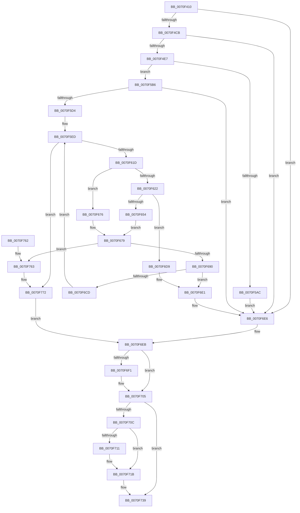

# ArbQueryConflict

- RVA: `0x0070F410`–`0x0070F7A6` (길이 `918` bytes)
- VA: `0x000000014070F410`
- 실행 섹션: `PAGE`
- PDB 이름 있음: `예`; PDB Function 태그: `아니요`
- unwind 정보 RVA: `0x000C5634`
- 디코드: `234`개 명령, `918/918` bytes 표시
- 미해석 바이트: `0` (있으면 어셈블리에 `.byte`로 보존)

> 이 문서는 커널 이미지의 기계어와 PDB 기호를 분석해 생성했습니다. 4번과 5번은 함수 원형과 자료형을 바이너리 사용 방식에서 추정한 C 해석이며 원본 소스 복구 결과는 아닙니다.

## 1. Dependencies

- 직접 호출 지점: **20**; 고유 호출 대상: **11**
- 직접 호출자로 확인된 함수: **1**
- RIP 상대 이미지 참조: **2**

### Outgoing calls
- `0x0070F44A` → [memset](../../text/6C/memset_function_006C6C40.md) (function, `0x006C6C40`)
- `0x0070F459` → [memset](../../text/6C/memset_function_006C6C40.md) (function, `0x006C6C40`)
- `0x0070F47D` → [memset](../../text/6C/memset_function_006C6C40.md) (function, `0x006C6C40`)
- `0x0070F4BC` → [RtlCopyRangeList](../A6/RtlCopyRangeList_function_00A69680.md) (function, `0x00A69680`)
- `0x0070F4D6` → [ArbpBuildAlternative](../71/ArbpBuildAlternative_function_00710068.md) (function, `0x00710068`)
- `0x0070F558` → [IoGetDeviceProperty](../8F/IoGetDeviceProperty_function_008FA720.md) (function, `0x008FA720`)
- `0x0070F57F` → [IoGetDeviceProperty](../8F/IoGetDeviceProperty_function_008FA720.md) (function, `0x008FA720`)
- `0x0070F59F` → [ExAllocatePool2](../../poolcode/B8/ExAllocatePool2_function_00B820F0.md) (function, `0x00B820F0`)
- `0x0070F5C5` → [guard_dispatch_icall](../../text/6B/guard_dispatch_icall_function_006BAAD0.md) (function, `0x006BAAD0`)
- `0x0070F5E1` → [RtlDeleteOwnersRanges](../A8/RtlDeleteOwnersRanges_function_00A828B0.md) (function, `0x00A828B0`)
- `0x0070F610` → [guard_dispatch_icall](../../text/6B/guard_dispatch_icall_function_006BAAD0.md) (function, `0x006BAAD0`)
- `0x0070F643` → [ExAllocatePool2](../../poolcode/B8/ExAllocatePool2_function_00B820F0.md) (function, `0x00B820F0`)
- `0x0070F665` → [memcpy](../../text/6C/memcpy_function_006C6840.md) (function, `0x006C6840`)
- `0x0070F66F` → [ExFreePoolWithTag](../../poolcode/B8/ExFreePoolWithTag_function_00B82870.md) (function, `0x00B82870`)
- `0x0070F6C0` → [RtlDeleteOwnersRanges](../A8/RtlDeleteOwnersRanges_function_00A828B0.md) (function, `0x00A828B0`)
- `0x0070F6F7` → [ExFreePoolWithTag](../../poolcode/B8/ExFreePoolWithTag_function_00B82870.md) (function, `0x00B82870`)
- `0x0070F716` → [ExFreePoolWithTag](../../poolcode/B8/ExFreePoolWithTag_function_00B82870.md) (function, `0x00B82870`)
- `0x0070F71F` → [RtlFreeRangeList](../A6/RtlFreeRangeList_function_00A69850.md) (function, `0x00A69850`)
- `0x0070F742` → [_security_check_cookie](../../text/6A/_security_check_cookie_function_006AC640.md) (function, `0x006AC640`)
- `0x0070F776` → [RtlFreeRangeList](../A6/RtlFreeRangeList_function_00A69850.md) (function, `0x00A69850`)

### Direct callers
- [IopMemQueryConflict](../72/IopMemQueryConflict_function_0072F160.md) at `0x0072F17A`

### Static image references
- `0x0070F42C` → RVA `0x00E0A740` (`.data`; read)
- `0x0070F489` → RVA `0x00710210` (`ArbpQueryConflictCallback`; read)

## 2. Other-region calls and transfers

- 다른 실행 섹션으로 향하는 call: **12**
  - `0x0070F44A` → [memset](../../text/6C/memset_function_006C6C40.md) (`PAGE` → `.text`)
  - `0x0070F459` → [memset](../../text/6C/memset_function_006C6C40.md) (`PAGE` → `.text`)
  - `0x0070F47D` → [memset](../../text/6C/memset_function_006C6C40.md) (`PAGE` → `.text`)
  - `0x0070F59F` → [ExAllocatePool2](../../poolcode/B8/ExAllocatePool2_function_00B820F0.md) (`PAGE` → `POOLCODE`)
  - `0x0070F5C5` → [guard_dispatch_icall](../../text/6B/guard_dispatch_icall_function_006BAAD0.md) (`PAGE` → `.text`)
  - `0x0070F610` → [guard_dispatch_icall](../../text/6B/guard_dispatch_icall_function_006BAAD0.md) (`PAGE` → `.text`)
  - `0x0070F643` → [ExAllocatePool2](../../poolcode/B8/ExAllocatePool2_function_00B820F0.md) (`PAGE` → `POOLCODE`)
  - `0x0070F665` → [memcpy](../../text/6C/memcpy_function_006C6840.md) (`PAGE` → `.text`)
  - `0x0070F66F` → [ExFreePoolWithTag](../../poolcode/B8/ExFreePoolWithTag_function_00B82870.md) (`PAGE` → `POOLCODE`)
  - `0x0070F6F7` → [ExFreePoolWithTag](../../poolcode/B8/ExFreePoolWithTag_function_00B82870.md) (`PAGE` → `POOLCODE`)
  - `0x0070F716` → [ExFreePoolWithTag](../../poolcode/B8/ExFreePoolWithTag_function_00B82870.md) (`PAGE` → `POOLCODE`)
  - `0x0070F742` → [_security_check_cookie](../../text/6A/_security_check_cookie_function_006AC640.md) (`PAGE` → `.text`)
- 별도 외부 분기/꼬리 이동을 확인하지 못했습니다.

## 3. Assembly (complete function range)

```asm
0070F410  48 89 5C 24 18                  mov qword ptr [rsp + 0x18], rbx
0070F415  55                              push rbp
0070F416  56                              push rsi
0070F417  57                              push rdi
0070F418  41 54                           push r12
0070F41A  41 55                           push r13
0070F41C  41 56                           push r14
0070F41E  41 57                           push r15
0070F420  48 8D 6C 24 B0                  lea rbp, [rsp - 0x50]
0070F425  48 81 EC 50 01 00 00            sub rsp, 0x150
0070F42C  48 8B 05 0D B3 6F 00            mov rax, qword ptr [rip + 0x6fb30d]
0070F433  48 33 C4                        xor rax, rsp
0070F436  48 89 45 40                     mov qword ptr [rbp + 0x40], rax
0070F43A  4C 8B FA                        mov r15, rdx
0070F43D  48 8B D9                        mov rbx, rcx
0070F440  33 D2                           xor edx, edx
0070F442  48 8D 4D A0                     lea rcx, [rbp - 0x60]
0070F446  44 8D 42 60                     lea r8d, [rdx + 0x60]
0070F44A  E8 F1 77 FB FF                  call 0x1406c6c40
0070F44F  33 D2                           xor edx, edx
0070F451  48 8D 4D 00                     lea rcx, [rbp]
0070F455  44 8D 42 40                     lea r8d, [rdx + 0x40]
0070F459  E8 E2 77 FB FF                  call 0x1406c6c40
0070F45E  33 C0                           xor eax, eax
0070F460  48 8D 4C 24 50                  lea rcx, [rsp + 0x50]
0070F465  33 D2                           xor edx, edx
0070F467  48 89 44 24 30                  mov qword ptr [rsp + 0x30], rax
0070F46C  44 8B F0                        mov r14d, eax
0070F46F  89 44 24 40                     mov dword ptr [rsp + 0x40], eax
0070F473  8B F0                           mov esi, eax
0070F475  44 8D 40 50                     lea r8d, [rax + 0x50]
0070F479  44 8D 68 0A                     lea r13d, [rax + 0xa]
0070F47D  E8 BE 77 FB FF                  call 0x1406c6c40
0070F482  48 8B 83 48 01 00 00            mov rax, qword ptr [rbx + 0x148]
0070F489  48 8D 0D 80 0D 00 00            lea rcx, [rip + 0xd80]
0070F490  4C 8B A3 50 01 00 00            mov r12, qword ptr [rbx + 0x150]
0070F497  48 8B 53 28                     mov rdx, qword ptr [rbx + 0x28]
0070F49B  48 89 44 24 38                  mov qword ptr [rsp + 0x38], rax
0070F4A0  48 8D 44 24 30                  lea rax, [rsp + 0x30]
0070F4A5  48 89 8B 50 01 00 00            mov qword ptr [rbx + 0x150], rcx
0070F4AC  48 8B 4B 30                     mov rcx, qword ptr [rbx + 0x30]
0070F4B0  48 89 83 48 01 00 00            mov qword ptr [rbx + 0x148], rax
0070F4B7  4C 89 64 24 48                  mov qword ptr [rsp + 0x48], r12
0070F4BC  E8 BF A1 35 00                  call 0x140a69680
0070F4C1  8B F8                           mov edi, eax
0070F4C3  85 C0                           test eax, eax
0070F4C5  0F 88 1B 02 00 00               js 0x14070f6e6
0070F4CB  49 8B 57 08                     mov rdx, qword ptr [r15 + 8]
0070F4CF  4C 8D 45 00                     lea r8, [rbp]
0070F4D3  48 8B CB                        mov rcx, rbx
0070F4D6  E8 8D 0B 00 00                  call 0x140710068
0070F4DB  8B F8                           mov edi, eax
0070F4DD  33 C0                           xor eax, eax
0070F4DF  85 FF                           test edi, edi
0070F4E1  0F 88 FF 01 00 00               js 0x14070f6e6
0070F4E7  48 8B 4D 00                     mov rcx, qword ptr [rbp]
0070F4EB  8D 7E 01                        lea edi, [rsi + 1]
0070F4EE  48 89 45 92                     mov qword ptr [rbp - 0x6e], rax
0070F4F2  8D 77 03                        lea esi, [rdi + 3]
0070F4F5  89 45 9A                        mov dword ptr [rbp - 0x66], eax
0070F4F8  4C 8D 4D D8                     lea r9, [rbp - 0x28]
0070F4FC  66 89 45 9E                     mov word ptr [rbp - 0x62], ax
0070F500  8D 57 0C                        lea edx, [rdi + 0xc]
0070F503  48 8B 45 08                     mov rax, qword ptr [rbp + 8]
0070F507  44 8B C6                        mov r8d, esi
0070F50A  48 89 44 24 58                  mov qword ptr [rsp + 0x58], rax
0070F50F  48 89 44 24 68                  mov qword ptr [rsp + 0x68], rax
0070F514  48 8D 45 00                     lea rax, [rbp]
0070F518  48 89 44 24 78                  mov qword ptr [rsp + 0x78], rax
0070F51D  48 8D 45 00                     lea rax, [rbp]
0070F521  48 89 45 88                     mov qword ptr [rbp - 0x78], rax
0070F525  48 8D 45 A0                     lea rax, [rbp - 0x60]
0070F529  48 89 44 24 70                  mov qword ptr [rsp + 0x70], rax
0070F52E  48 8D 44 24 40                  lea rax, [rsp + 0x40]
0070F533  48 89 4C 24 50                  mov qword ptr [rsp + 0x50], rcx
0070F538  48 89 4C 24 60                  mov qword ptr [rsp + 0x60], rcx
0070F53D  49 8B 0F                        mov rcx, qword ptr [r15]
0070F540  48 89 44 24 20                  mov qword ptr [rsp + 0x20], rax
0070F545  48 C7 45 80 01 00 00 00         mov qword ptr [rbp - 0x80], 1
0070F54D  66 89 75 90                     mov word ptr [rbp - 0x70], si
0070F551  89 75 C8                        mov dword ptr [rbp - 0x38], esi
0070F554  48 89 4D C0                     mov qword ptr [rbp - 0x40], rcx
0070F558  E8 C3 B1 1E 00                  call 0x1408fa720
0070F55D  8B 4D D8                        mov ecx, dword ptr [rbp - 0x28]
0070F560  4C 8D 4D E0                     lea r9, [rbp - 0x20]
0070F564  85 C0                           test eax, eax
0070F566  8D 57 0D                        lea edx, [rdi + 0xd]
0070F569  48 8D 44 24 40                  lea rax, [rsp + 0x40]
0070F56E  44 8B C6                        mov r8d, esi
0070F571  0F 48 CF                        cmovs ecx, edi
0070F574  48 89 44 24 20                  mov qword ptr [rsp + 0x20], rax
0070F579  89 4D D8                        mov dword ptr [rbp - 0x28], ecx
0070F57C  49 8B 0F                        mov rcx, qword ptr [r15]
0070F57F  E8 9C B1 1E 00                  call 0x1408fa720
0070F584  8B 4D E0                        mov ecx, dword ptr [rbp - 0x20]
0070F587  33 FF                           xor edi, edi
0070F589  85 C0                           test eax, eax
0070F58B  BA F0 00 00 00                  mov edx, 0xf0
0070F590  41 B8 41 72 62 43               mov r8d, 0x43627241
0070F596  0F 48 CF                        cmovs ecx, edi
0070F599  89 4D E0                        mov dword ptr [rbp - 0x20], ecx
0070F59C  8D 4A 10                        lea ecx, [rdx + 0x10]
0070F59F  E8 4C 2B 47 00                  call 0x140b820f0
0070F5A4  48 8B F0                        mov rsi, rax
0070F5A7  48 85 C0                        test rax, rax
0070F5AA  75 0A                           jne 0x14070f5b6
0070F5AC  BF 9A 00 00 C0                  mov edi, 0xc000009a
0070F5B1  E9 30 01 00 00                  jmp 0x14070f6e6
0070F5B6  48 8B 83 E0 00 00 00            mov rax, qword ptr [rbx + 0xe0]
0070F5BD  48 8D 54 24 50                  lea rdx, [rsp + 0x50]
0070F5C2  48 8B CB                        mov rcx, rbx
0070F5C5  E8 06 B5 FA FF                  call 0x1406baad0
0070F5CA  8B F8                           mov edi, eax
0070F5CC  85 C0                           test eax, eax
0070F5CE  0F 88 12 01 00 00               js 0x14070f6e6
0070F5D4  48 8B 54 24 70                  mov rdx, qword ptr [rsp + 0x70]
0070F5D9  48 8B 4B 30                     mov rcx, qword ptr [rbx + 0x30]
0070F5DD  48 8B 52 20                     mov rdx, qword ptr [rdx + 0x20]
0070F5E1  E8 CA 32 37 00                  call 0x140a828b0
0070F5E6  33 FF                           xor edi, edi
0070F5E8  48 89 7C 24 30                  mov qword ptr [rsp + 0x30], rdi
0070F5ED  48 8B 44 24 50                  mov rax, qword ptr [rsp + 0x50]
0070F5F2  48 8D 54 24 50                  lea rdx, [rsp + 0x50]
0070F5F7  48 89 44 24 60                  mov qword ptr [rsp + 0x60], rax
0070F5FC  48 8B CB                        mov rcx, rbx
0070F5FF  48 8B 44 24 58                  mov rax, qword ptr [rsp + 0x58]
0070F604  48 89 44 24 68                  mov qword ptr [rsp + 0x68], rax
0070F609  48 8B 83 F8 00 00 00            mov rax, qword ptr [rbx + 0xf8]
0070F610  E8 BB B4 FA FF                  call 0x1406baad0
0070F615  84 C0                           test al, al
0070F617  0F 85 55 01 00 00               jne 0x14070f772
0070F61D  45 3B F5                        cmp r14d, r13d
0070F620  75 54                           jne 0x14070f676
0070F622  41 83 C5 05                     add r13d, 5
0070F626  B9 00 01 00 00                  mov ecx, 0x100
0070F62B  41 B8 41 72 62 43               mov r8d, 0x43627241
0070F631  4C 8B E6                        mov r12, rsi
0070F634  4A 8D 14 6D 00 00 00 00         lea rdx, [r13*2]
0070F63C  49 03 D5                        add rdx, r13
0070F63F  48 C1 E2 03                     shl rdx, 3
0070F643  E8 A8 2A 47 00                  call 0x140b820f0
0070F648  48 8B F0                        mov rsi, rax
0070F64B  48 85 C0                        test rax, rax
0070F64E  0F 84 85 00 00 00               je 0x14070f6d9
0070F654  41 8B FE                        mov edi, r14d
0070F657  49 8B D4                        mov rdx, r12
0070F65A  48 8B C8                        mov rcx, rax
0070F65D  4C 8D 04 7F                     lea r8, [rdi + rdi*2]
0070F661  49 C1 E0 03                     shl r8, 3
0070F665  E8 D6 71 FB FF                  call 0x1406c6840
0070F66A  33 D2                           xor edx, edx
0070F66C  49 8B CC                        mov rcx, r12
0070F66F  E8 FC 31 47 00                  call 0x140b82870
0070F674  EB 03                           jmp 0x14070f679
0070F676  41 8B FE                        mov edi, r14d
0070F679  48 8B 44 24 30                  mov rax, qword ptr [rsp + 0x30]
0070F67E  48 8D 14 7F                     lea rdx, [rdi + rdi*2]
0070F682  33 FF                           xor edi, edi
0070F684  41 FF C6                        inc r14d
0070F687  48 85 C0                        test rax, rax
0070F68A  0F 84 D3 00 00 00               je 0x14070f763
0070F690  48 8B 40 18                     mov rax, qword ptr [rax + 0x18]
0070F694  48 89 04 D6                     mov qword ptr [rsi + rdx*8], rax
0070F698  48 8B 44 24 30                  mov rax, qword ptr [rsp + 0x30]
0070F69D  48 8B 08                        mov rcx, qword ptr [rax]
0070F6A0  48 89 4C D6 08                  mov qword ptr [rsi + rdx*8 + 8], rcx
0070F6A5  48 8B 44 24 30                  mov rax, qword ptr [rsp + 0x30]
0070F6AA  48 8B 48 08                     mov rcx, qword ptr [rax + 8]
0070F6AE  48 89 4C D6 10                  mov qword ptr [rsi + rdx*8 + 0x10], rcx
0070F6B3  48 8B 54 24 30                  mov rdx, qword ptr [rsp + 0x30]
0070F6B8  48 8B 4B 30                     mov rcx, qword ptr [rbx + 0x30]
0070F6BC  48 8B 52 18                     mov rdx, qword ptr [rdx + 0x18]
0070F6C0  E8 EB 31 37 00                  call 0x140a828b0
0070F6C5  8B F8                           mov edi, eax
0070F6C7  33 C0                           xor eax, eax
0070F6C9  85 FF                           test edi, edi
0070F6CB  78 14                           js 0x14070f6e1
0070F6CD  48 89 44 24 30                  mov qword ptr [rsp + 0x30], rax
0070F6D2  33 FF                           xor edi, edi
0070F6D4  E9 14 FF FF FF                  jmp 0x14070f5ed
0070F6D9  BF 9A 00 00 C0                  mov edi, 0xc000009a
0070F6DE  49 8B F4                        mov rsi, r12
0070F6E1  4C 8B 64 24 48                  mov r12, qword ptr [rsp + 0x48]
0070F6E6  4C 8B 6C 24 38                  mov r13, qword ptr [rsp + 0x38]
0070F6EB  F6 45 90 10                     test byte ptr [rbp - 0x70], 0x10
0070F6EF  74 14                           je 0x14070f705
0070F6F1  48 8B 4D 98                     mov rcx, qword ptr [rbp - 0x68]
0070F6F5  33 D2                           xor edx, edx
0070F6F7  E8 74 31 47 00                  call 0x140b82870
0070F6FC  B8 EF FF 00 00                  mov eax, 0xffef
0070F701  66 21 45 90                     and word ptr [rbp - 0x70], ax
0070F705  45 33 F6                        xor r14d, r14d
0070F708  85 FF                           test edi, edi
0070F70A  79 2D                           jns 0x14070f739
0070F70C  48 85 F6                        test rsi, rsi
0070F70F  74 0A                           je 0x14070f71b
0070F711  33 D2                           xor edx, edx
0070F713  48 8B CE                        mov rcx, rsi
0070F716  E8 55 31 47 00                  call 0x140b82870
0070F71B  48 8B 4B 30                     mov rcx, qword ptr [rbx + 0x30]
0070F71F  E8 2C A1 35 00                  call 0x140a69850
0070F724  4C 89 A3 50 01 00 00            mov qword ptr [rbx + 0x150], r12
0070F72B  4C 89 AB 48 01 00 00            mov qword ptr [rbx + 0x148], r13
0070F732  49 8B 47 18                     mov rax, qword ptr [r15 + 0x18]
0070F736  4C 89 30                        mov qword ptr [rax], r14
0070F739  8B C7                           mov eax, edi
0070F73B  48 8B 4D 40                     mov rcx, qword ptr [rbp + 0x40]
0070F73F  48 33 CC                        xor rcx, rsp
0070F742  E8 F9 CE F9 FF                  call 0x1406ac640
0070F747  48 8B 9C 24 A0 01 00 00         mov rbx, qword ptr [rsp + 0x1a0]
0070F74F  48 81 C4 50 01 00 00            add rsp, 0x150
0070F756  41 5F                           pop r15
0070F758  41 5E                           pop r14
0070F75A  41 5D                           pop r13
0070F75C  41 5C                           pop r12
0070F75E  5F                              pop rdi
0070F75F  5E                              pop rsi
0070F760  5D                              pop rbp
0070F761  C3                              ret
0070F762  CC                              int3
0070F763  48 83 4C D6 10 FF               or qword ptr [rsi + rdx*8 + 0x10], 0xffffffffffffffff
0070F769  48 89 3C D6                     mov qword ptr [rsi + rdx*8], rdi
0070F76D  48 89 7C D6 08                  mov qword ptr [rsi + rdx*8 + 8], rdi
0070F772  48 8B 4B 30                     mov rcx, qword ptr [rbx + 0x30]
0070F776  E8 D5 A0 35 00                  call 0x140a69850
0070F77B  4C 8B 64 24 48                  mov r12, qword ptr [rsp + 0x48]
0070F780  4C 8B 6C 24 38                  mov r13, qword ptr [rsp + 0x38]
0070F785  4C 89 A3 50 01 00 00            mov qword ptr [rbx + 0x150], r12
0070F78C  4C 89 AB 48 01 00 00            mov qword ptr [rbx + 0x148], r13
0070F793  49 8B 47 18                     mov rax, qword ptr [r15 + 0x18]
0070F797  48 89 30                        mov qword ptr [rax], rsi
0070F79A  49 8B 47 10                     mov rax, qword ptr [r15 + 0x10]
0070F79E  44 89 30                        mov dword ptr [rax], r14d
0070F7A1  E9 45 FF FF FF                  jmp 0x14070f6eb
```

## 4. C-style interpretation (structured pseudocode)

```c
__int64 __fastcall ArbQueryConflict(__int64 a1, __int64 a2)
{
    __int64 result;
    __int64 v_r13;
    __int64 v_r14;
    __int64 v_rdi;
    __int64 v_rsp;
    unsigned __int64 v_stack_m100;
    unsigned __int64 v_stack_m108;
    unsigned __int64 v_stack_m110;
    unsigned __int64 v_stack_m118;
    unsigned __int64 v_stack_m120;
    unsigned __int64 v_stack_m128;
    unsigned __int64 v_stack_m130;
    unsigned __int64 v_stack_m138;
    unsigned __int64 v_stack_m140;
    unsigned int v_stack_m148;
    unsigned __int64 v_stack_m150;
    unsigned __int64 v_stack_m158;
    unsigned __int64 v_stack_m168;
    unsigned __int64 v_stack_m48;
    unsigned __int64 v_stack_m80;
    unsigned __int64 v_stack_m88;
    unsigned __int64 v_stack_mA8;
    unsigned __int64 v_stack_mB0;
    unsigned int v_stack_mC0;
    unsigned __int64 v_stack_mC8;
    unsigned __int64 v_stack_mE8;
    unsigned __int16 v_stack_mEA;
    unsigned int v_stack_mEE;
    unsigned __int64 v_stack_mF0;
    unsigned __int64 v_stack_mF6;
    unsigned __int16 v_stack_mF8;
    unsigned __int64 v_stack_p18;
    unsigned __int64 v_stack_p38;
    unsigned __int64 v_stack_p48;

    v_stack_p18 = v_rbx;
    v_rsp = (v_rsp) - (336);
    result = (*(unsigned __int64 *)(v_rip + 7320333)) ^ (v_rsp);
    v_stack_m48 = result;
    a2 = 0;
    result = memset(v_stack_mE8, a2, a2 + 96, a4);
    a2 = 0;
    result = memset(v_stack_m88, a2, a2 + 64, a4);
    result = 0;
    a2 = 0;
    v_stack_m158 = 0;
    v_stack_m148 = 0;
    result = memset(v_stack_m138, a2, result + 80, a4);
    v_stack_m150 = *(unsigned __int64 *)(a1 + 328);
    *(unsigned __int64 *)(a1 + 336) = v_rip + 3456;
    *(unsigned __int64 *)(a1 + 328) = v_stack_m158;
    v_stack_m140 = *(unsigned __int64 *)(a1 + 336);
    result = RtlCopyRangeList(*(unsigned __int64 *)(a1 + 48), *(unsigned __int64 *)(a1 + 40), result + 80, a4);
    if (sign_flag) goto loc_0070F6E6;
    result = ArbpBuildAlternative(a1, *(unsigned __int64 *)(a2 + 8), v_stack_m88, a4);
    result = 0;
    if (sign_flag) goto loc_0070F6E6;
    v_stack_mF6 = 0;
    v_stack_mEE = 0;
    v_stack_mEA = 0;
    v_stack_m130 = v_stack_m80;
    v_stack_m120 = v_stack_m80;
    v_stack_m110 = v_stack_m88;
    v_stack_m100 = v_stack_m88;
    v_stack_m118 = v_stack_mE8;
    v_stack_m138 = v_stack_m88;
    v_stack_m128 = v_stack_m88;
    v_stack_m168 = v_stack_m148;
    v_stack_m108 = 1;
    v_stack_mF8 = (unsigned __int16)(0 + 1 + 3);
    v_stack_mC0 = (unsigned int)(0 + 1 + 3);
    v_stack_mC8 = *(unsigned __int64 *)(a2);
    result = IoGetDeviceProperty(*(unsigned __int64 *)(a2), 0 + 1 + 12, (unsigned int)((unsigned int)(0 + 1 + 3)), v_stack_mB0);
    a1 = (unsigned int)(v_stack_mB0);
    if (sign_flag) { a1 = (unsigned int)(0 + 1); }
    v_stack_m168 = v_stack_m148;
    v_stack_mB0 = (unsigned int)(a1);
    result = IoGetDeviceProperty(*(unsigned __int64 *)(a2), 0 + 1 + 13, (unsigned int)((unsigned int)(0 + 1 + 3)), v_stack_mA8);
    v_rdi = 0;
    a1 = (unsigned int)(v_stack_mA8);
    if (sign_flag) { a1 = 0; }
    v_stack_mA8 = (unsigned int)(a1);
    result = ExAllocatePool2(240 + 16, 240, (unsigned int)(0x43627241ULL), v_stack_mA8);
    if (result != 0) goto loc_0070F5B6;
    goto loc_0070F6E6;
loc_0070F5B6:
    result = guard_dispatch_icall(a1, v_stack_m138, (unsigned int)(0x43627241ULL), v_stack_mA8);
    if (sign_flag) goto loc_0070F6E6;
    result = RtlDeleteOwnersRanges(*(unsigned __int64 *)(a1 + 48), *(unsigned __int64 *)(v_stack_m118 + 32), (unsigned int)(0x43627241ULL), v_stack_mA8);
    v_rdi = 0;
    v_stack_m158 = 0;
loc_0070F5ED:
    v_stack_m128 = v_stack_m138;
    v_stack_m120 = v_stack_m130;
    result = guard_dispatch_icall(a1, v_stack_m138, (unsigned int)(0x43627241ULL), v_stack_mA8);
    if ((unsigned __int8)(result) != 0) goto loc_0070F772;
    if (0 != ((unsigned int)(result + 10))) goto loc_0070F676;
    v_r13 = (unsigned int)((result + 10) + (5));
    a2 = (v_r13 * 2) + (v_r13);
    a2 = (a2) << (3);
    result = ExAllocatePool2(256, a2, (unsigned int)(0x43627241ULL), v_stack_mA8);
    if (result == 0) goto loc_0070F6D9;
    a3 = (0 + 0 * 2) << (3);
    result = memcpy(result, result, a3, v_stack_mA8);
    a2 = 0;
    result = ExFreePoolWithTag(result, a2, a3, v_stack_mA8);
    goto loc_0070F679;
loc_0070F676:
loc_0070F679:
    v_rdi = 0;
    v_r14 = (unsigned int)((0) + 1);
    if (v_stack_m158 == 0) goto loc_0070F763;
    *(unsigned __int64 *)(result + 0 + 0 * 2 * 8) = *(unsigned __int64 *)(v_stack_m158 + 24);
    *(unsigned __int64 *)(result + 0 + 0 * 2 * 8 + 8) = *(unsigned __int64 *)(v_stack_m158);
    *(unsigned __int64 *)(result + 0 + 0 * 2 * 8 + 16) = *(unsigned __int64 *)(v_stack_m158 + 8);
    result = RtlDeleteOwnersRanges(*(unsigned __int64 *)(a1 + 48), *(unsigned __int64 *)(v_stack_m158 + 24), a3, v_stack_mA8);
    result = 0;
    if (sign_flag) goto loc_0070F6E1;
    v_stack_m158 = 0;
    v_rdi = 0;
    goto loc_0070F5ED;
loc_0070F6D9:
loc_0070F6E1:
loc_0070F6E6:
loc_0070F6EB:
    if (((v_stack_mF8) & (16)) != 0) {
        a1 = v_stack_mF0;
        a2 = 0;
        result = ExFreePoolWithTag(a1, a2, a3, v_stack_mA8);
        result = 0xFFEFULL;
    }
    v_r14 = 0;
    if (!sign_flag) goto loc_0070F739;
    if (0 != 0) {
        a2 = 0;
        a1 = 0;
        result = ExFreePoolWithTag(a1, a2, a3, v_stack_mA8);
    }
    result = RtlFreeRangeList(*(unsigned __int64 *)(a1 + 48), a2, a3, v_stack_mA8);
    *(unsigned __int64 *)(a1 + 336) = v_stack_m140;
    *(unsigned __int64 *)(a1 + 328) = v_stack_m150;
    *(unsigned __int64 *)(*(unsigned __int64 *)(a2 + 24)) = 0;
loc_0070F739:
    a1 = (v_stack_m48) ^ (v_rsp);
    result = _security_check_cookie(a1, a2, a3, v_stack_mA8);
    v_rsp = (v_rsp) + (336);
    return result;
loc_0070F763:
    *(unsigned __int64 *)(0 + a2 * 8) = (unsigned int)(0xC000009AULL);
    *(unsigned __int64 *)(0 + a2 * 8 + 8) = (unsigned int)(0xC000009AULL);
loc_0070F772:
    result = RtlFreeRangeList(*(unsigned __int64 *)(v_stack_p18 + 48), a2, a3, v_stack_mA8);
    *(unsigned __int64 *)(v_stack_p18 + 336) = v_stack_p48;
    *(unsigned __int64 *)(v_stack_p18 + 328) = v_stack_p38;
    *(unsigned __int64 *)(*(unsigned __int64 *)(a2 + 24)) = 0;
    *(unsigned int *)(*(unsigned __int64 *)(a2 + 16)) = 0;
    goto loc_0070F6EB;
}
```

## 5. (Beta) C Style

```c
int64_t ArbQueryConflict(void *Arg1, void *Arg2)
{
    uint8_t *arg1 = (uint8_t *)Arg1;
    uint8_t *arg2 = (uint8_t *)Arg2;

    int64_t result;
    int64_t local_r13;
    int64_t local_r14;
    int64_t local_rdi;
    int64_t local_rsp;
    uint64_t v_stack_m100;
    uint64_t v_stack_m108;
    uint64_t v_stack_m110;
    uint64_t v_stack_m118;
    uint64_t v_stack_m120;
    uint64_t v_stack_m128;
    uint64_t v_stack_m130;
    uint64_t v_stack_m138;
    uint64_t v_stack_m140;
    uint32_t v_stack_m148;
    uint64_t v_stack_m150;
    uint64_t v_stack_m158;
    uint64_t v_stack_m168;
    uint64_t v_stack_m48;
    uint64_t v_stack_m80;
    uint64_t v_stack_m88;
    uint64_t v_stack_mA8;
    uint64_t v_stack_mB0;
    uint32_t v_stack_mC0;
    uint64_t v_stack_mC8;
    uint64_t v_stack_mE8;
    uint16_t v_stack_mEA;
    uint32_t v_stack_mEE;
    uint64_t v_stack_mF0;
    uint64_t v_stack_mF6;
    uint16_t v_stack_mF8;
    uint64_t v_stack_p18;
    uint64_t v_stack_p38;
    uint64_t v_stack_p48;

    v_stack_p18 = local_rbx;
    local_rsp = (local_rsp) - (336);
    result = (*(uint64_t *)(v_rip + 0x6FB30D)) ^ (local_rsp);
    v_stack_m48 = result;
    Arg2 = 0;
    result = memset(v_stack_mE8, Arg2, Arg2 + 96, a4);
    Arg2 = 0;
    result = memset(v_stack_m88, Arg2, Arg2 + 64, a4);
    result = 0;
    Arg2 = 0;
    v_stack_m158 = 0;
    v_stack_m148 = 0;
    result = memset(v_stack_m138, Arg2, result + 80, a4);
    v_stack_m150 = *(uint64_t *)(arg1 + 0x148);
    *(uint64_t *)(arg1 + 0x150) = v_rip + 3456;
    *(uint64_t *)(arg1 + 0x148) = v_stack_m158;
    v_stack_m140 = *(uint64_t *)(arg1 + 0x150);
    result = RtlCopyRangeList(*(uint64_t *)(arg1 + 0x30), *(uint64_t *)(arg1 + 0x28), result + 80, a4);
    if (sign_flag) goto loc_0070F6E6;
    result = ArbpBuildAlternative(Arg1, *(uint64_t *)(arg2 + 0x8), v_stack_m88, a4);
    result = 0;
    if (sign_flag) goto loc_0070F6E6;
    v_stack_mF6 = 0;
    v_stack_mEE = 0;
    v_stack_mEA = 0;
    v_stack_m130 = v_stack_m80;
    v_stack_m120 = v_stack_m80;
    v_stack_m110 = v_stack_m88;
    v_stack_m100 = v_stack_m88;
    v_stack_m118 = v_stack_mE8;
    v_stack_m138 = v_stack_m88;
    v_stack_m128 = v_stack_m88;
    v_stack_m168 = v_stack_m148;
    v_stack_m108 = 1;
    v_stack_mF8 = (uint16_t)(0 + 1 + 3);
    v_stack_mC0 = (uint32_t)(0 + 1 + 3);
    v_stack_mC8 = *(uint64_t *)(arg2);
    result = IoGetDeviceProperty(*(uint64_t *)(arg2), 0 + 1 + 12, (uint32_t)((uint32_t)(0 + 1 + 3)), v_stack_mB0);
    Arg1 = (uint32_t)(v_stack_mB0);
    if (sign_flag) { Arg1 = (uint32_t)(0 + 1); }
    v_stack_m168 = v_stack_m148;
    v_stack_mB0 = (uint32_t)(Arg1);
    result = IoGetDeviceProperty(*(uint64_t *)(arg2), 0 + 1 + 13, (uint32_t)((uint32_t)(0 + 1 + 3)), v_stack_mA8);
    local_rdi = 0;
    Arg1 = (uint32_t)(v_stack_mA8);
    if (sign_flag) { Arg1 = 0; }
    v_stack_mA8 = (uint32_t)(Arg1);
    result = ExAllocatePool2(240 + 16, 240, (uint32_t)(0x43627241ULL), v_stack_mA8);
    if (result != 0) goto loc_0070F5B6;
    goto loc_0070F6E6;
loc_0070F5B6:
    result = guard_dispatch_icall(Arg1, v_stack_m138, (uint32_t)(0x43627241ULL), v_stack_mA8);
    if (sign_flag) goto loc_0070F6E6;
    result = RtlDeleteOwnersRanges(*(uint64_t *)(arg1 + 0x30), *(uint64_t *)(v_stack_m118 + 0x20), (uint32_t)(0x43627241ULL), v_stack_mA8);
    local_rdi = 0;
    v_stack_m158 = 0;
loc_0070F5ED:
    v_stack_m128 = v_stack_m138;
    v_stack_m120 = v_stack_m130;
    result = guard_dispatch_icall(Arg1, v_stack_m138, (uint32_t)(0x43627241ULL), v_stack_mA8);
    if ((uint8_t)(result) != 0) goto loc_0070F772;
    if (0 != ((uint32_t)(result + 10))) goto loc_0070F676;
    local_r13 = (uint32_t)((result + 10) + (5));
    Arg2 = (local_r13 * 2) + (local_r13);
    Arg2 = (Arg2) << (3);
    result = ExAllocatePool2(256, Arg2, (uint32_t)(0x43627241ULL), v_stack_mA8);
    if (result == 0) goto loc_0070F6D9;
    a3 = (0 + 0 * 2) << (3);
    result = memcpy(result, result, a3, v_stack_mA8);
    Arg2 = 0;
    result = ExFreePoolWithTag(result, Arg2, a3, v_stack_mA8);
    goto loc_0070F679;
loc_0070F676:
loc_0070F679:
    local_rdi = 0;
    local_r14 = (uint32_t)((0) + 1);
    if (v_stack_m158 == 0) goto loc_0070F763;
    *(uint64_t *)(result + 0x0 + 0x0 * 2 * 8) = *(uint64_t *)(v_stack_m158 + 0x18);
    *(uint64_t *)(result + 0x0 + 0x0 * 2 * 8 + 0x8) = *(uint64_t *)(v_stack_m158);
    *(uint64_t *)(result + 0x0 + 0x0 * 2 * 8 + 0x10) = *(uint64_t *)(v_stack_m158 + 0x8);
    result = RtlDeleteOwnersRanges(*(uint64_t *)(arg1 + 0x30), *(uint64_t *)(v_stack_m158 + 0x18), a3, v_stack_mA8);
    result = 0;
    if (sign_flag) goto loc_0070F6E1;
    v_stack_m158 = 0;
    local_rdi = 0;
    goto loc_0070F5ED;
loc_0070F6D9:
loc_0070F6E1:
loc_0070F6E6:
loc_0070F6EB:
    if (((v_stack_mF8) & (16)) != 0) {
        Arg1 = v_stack_mF0;
        Arg2 = 0;
        result = ExFreePoolWithTag(Arg1, Arg2, a3, v_stack_mA8);
        result = 0xFFEFULL;
    }
    local_r14 = 0;
    if (!sign_flag) goto loc_0070F739;
    if (0 != 0) {
        Arg2 = 0;
        Arg1 = 0;
        result = ExFreePoolWithTag(Arg1, Arg2, a3, v_stack_mA8);
    }
    result = RtlFreeRangeList(*(uint64_t *)(arg1 + 0x30), Arg2, a3, v_stack_mA8);
    *(uint64_t *)(arg1 + 0x150) = v_stack_m140;
    *(uint64_t *)(arg1 + 0x148) = v_stack_m150;
    *(uint64_t *)(*(uint64_t *)(arg2 + 0x18)) = 0;
loc_0070F739:
    Arg1 = (v_stack_m48) ^ (local_rsp);
    result = _security_check_cookie(Arg1, Arg2, a3, v_stack_mA8);
    local_rsp = (local_rsp) + (336);
    return result;
loc_0070F763:
    *(uint64_t *)(0 + arg2 * 8) = (uint32_t)(0xC000009AULL);
    *(uint64_t *)(0 + arg2 * 8 + 0x8) = (uint32_t)(0xC000009AULL);
loc_0070F772:
    result = RtlFreeRangeList(*(uint64_t *)(v_stack_p18 + 0x30), Arg2, a3, v_stack_mA8);
    *(uint64_t *)(v_stack_p18 + 0x150) = v_stack_p48;
    *(uint64_t *)(v_stack_p18 + 0x148) = v_stack_p38;
    *(uint64_t *)(*(uint64_t *)(arg2 + 0x18)) = 0;
    *(uint32_t *)(*(uint64_t *)(arg2 + 0x10)) = 0;
    goto loc_0070F6EB;
}
```

### 관측된 메모리 오프셋

구조체 형식이 확인되지 않은 접근은 인자 기준의 오프셋으로만 기록했습니다.

| 기준 인자 | 오프셋 표현 | 폭 (bit) | 접근 |
|---|---:|---:|---|
| `Arg1` | `+ 0x28` | `64` | `R` |
| `Arg1` | `+ 0x30` | `64` | `R` |
| `Arg1` | `+ 0xE0` | `64` | `R` |
| `Arg1` | `+ 0xF8` | `64` | `R` |
| `Arg1` | `+ 0x148` | `64` | `R` |
| `Arg1` | `+ 0x148` | `64` | `W` |
| `Arg1` | `+ 0x150` | `64` | `R` |
| `Arg1` | `+ 0x150` | `64` | `W` |
| `Arg2` | `+ 0x0` | `64` | `R` |
| `Arg2` | `+ 0x8` | `64` | `R` |
| `Arg2` | `+ 0x10` | `64` | `R` |
| `Arg2` | `+ 0x18` | `64` | `R` |

## 6. Execution-region graph

[열기: 2D/3D 그래프와 함수 탐색 컨트롤 패널](../../../control-panel.html?section=page&rva=0x0070F410&view=graph)

- 2D 그래프는 위에서 아래로 흐르고, 3D 그래프는 빈 공간을 드래그해 회전합니다. Shift+드래그는 이동, 휠은 확대·축소, 함수 노드 선택은 대상 보고서 이동입니다.

### Static fallback


