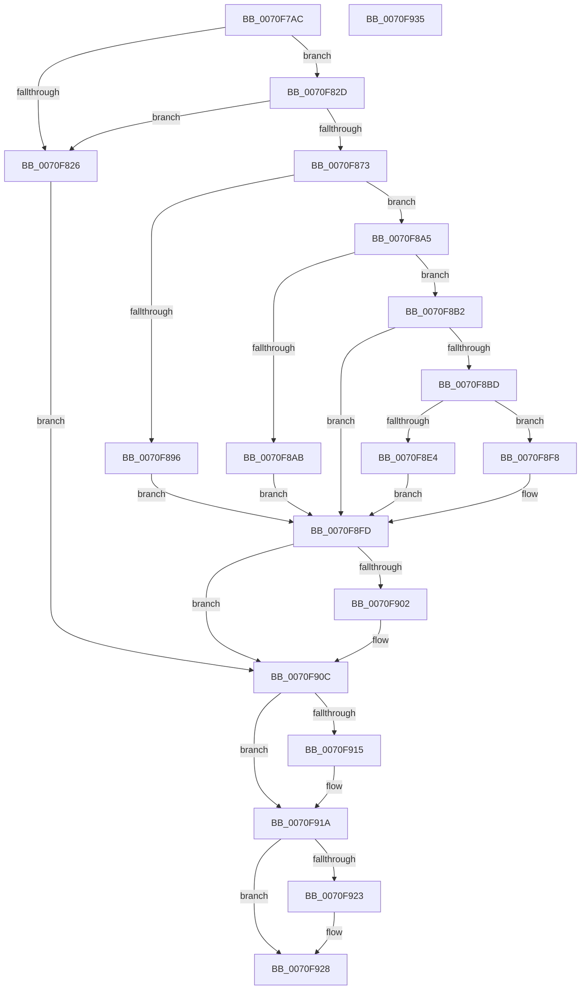

# ArbRegReadMmConfigRanges

- RVA: `0x0070F7AC`–`0x0070F936` (길이 `394` bytes)
- VA: `0x000000014070F7AC`
- 실행 섹션: `PAGE`
- PDB 이름 있음: `예`; PDB Function 태그: `아니요`
- unwind 정보 RVA: `0x000BEF34`
- 디코드: `111`개 명령, `394/394` bytes 표시
- 미해석 바이트: `0` (있으면 어셈블리에 `.byte`로 보존)

> 이 문서는 커널 이미지의 기계어와 PDB 기호를 분석해 생성했습니다. 4번과 5번은 함수 원형과 자료형을 바이너리 사용 방식에서 추정한 C 해석이며 원본 소스 복구 결과는 아닙니다.

## 1. Dependencies

- 직접 호출 지점: **8**; 고유 호출 대상: **6**
- 직접 호출자로 확인된 함수: **1**
- RIP 상대 이미지 참조: **4**

### Outgoing calls
- `0x0070F81D` → [ZwOpenKey](../../text/6A/ZwOpenKey_function_006AD310.md) (function, `0x006AD310`)
- `0x0070F86A` → [ZwOpenKey](../../text/6A/ZwOpenKey_function_006AD310.md) (function, `0x006AD310`)
- `0x0070F887` → [ArbpGetRegistryValue](../71/ArbpGetRegistryValue_function_00710124.md) (function, `0x00710124`)
- `0x0070F8D3` → [ExAllocatePool2](../../poolcode/B8/ExAllocatePool2_function_00B820F0.md) (function, `0x00B820F0`)
- `0x0070F8F1` → [memcpy](../../text/6C/memcpy_function_006C6840.md) (function, `0x006C6840`)
- `0x0070F907` → [ExFreePoolWithTag](../../poolcode/B8/ExFreePoolWithTag_function_00B82870.md) (function, `0x00B82870`)
- `0x0070F915` → [ZwClose](../../text/6A/ZwClose_function_006AD2B0.md) (function, `0x006AD2B0`)
- `0x0070F923` → [ZwClose](../../text/6A/ZwClose_function_006AD2B0.md) (function, `0x006AD2B0`)

### Direct callers
- [ArbLibraryInitialize](ArbLibraryInitialize_function_0070F180.md) at `0x0070F184`

### Static image references
- `0x0070F7BE` → RVA `0x00AFAF60` (` ?? ::NNGAKEGL::`string'`; read)
- `0x0070F82D` → RVA `0x00AFAF00` (` ?? ::NNGAKEGL::`string'`; read)
- `0x0070F880` → RVA `0x00AFB010` (` ?? ::NNGAKEGL::`string'`; read)
- `0x0070F8D8` → RVA `0x00E65AD8` (`.data`; write)

## 2. Other-region calls and transfers

- 다른 실행 섹션으로 향하는 call: **7**
  - `0x0070F81D` → [ZwOpenKey](../../text/6A/ZwOpenKey_function_006AD310.md) (`PAGE` → `.text`)
  - `0x0070F86A` → [ZwOpenKey](../../text/6A/ZwOpenKey_function_006AD310.md) (`PAGE` → `.text`)
  - `0x0070F8D3` → [ExAllocatePool2](../../poolcode/B8/ExAllocatePool2_function_00B820F0.md) (`PAGE` → `POOLCODE`)
  - `0x0070F8F1` → [memcpy](../../text/6C/memcpy_function_006C6840.md) (`PAGE` → `.text`)
  - `0x0070F907` → [ExFreePoolWithTag](../../poolcode/B8/ExFreePoolWithTag_function_00B82870.md) (`PAGE` → `POOLCODE`)
  - `0x0070F915` → [ZwClose](../../text/6A/ZwClose_function_006AD2B0.md) (`PAGE` → `.text`)
  - `0x0070F923` → [ZwClose](../../text/6A/ZwClose_function_006AD2B0.md) (`PAGE` → `.text`)
- 별도 외부 분기/꼬리 이동을 확인하지 못했습니다.

## 3. Assembly (complete function range)

```asm
0070F7AC  40 55                           push rbp
0070F7AE  53                              push rbx
0070F7AF  56                              push rsi
0070F7B0  57                              push rdi
0070F7B1  41 56                           push r14
0070F7B3  48 8B EC                        mov rbp, rsp
0070F7B6  48 83 EC 70                     sub rsp, 0x70
0070F7BA  83 65 EC 00                     and dword ptr [rbp - 0x14], 0
0070F7BE  48 8D 05 9B B7 3E 00            lea rax, [rip + 0x3eb79b]
0070F7C5  83 65 B4 00                     and dword ptr [rbp - 0x4c], 0
0070F7C9  4C 8D 45 D0                     lea r8, [rbp - 0x30]
0070F7CD  48 83 65 38 00                  and qword ptr [rbp + 0x38], 0
0070F7D2  48 8D 4D 38                     lea rcx, [rbp + 0x38]
0070F7D6  48 83 65 30 00                  and qword ptr [rbp + 0x30], 0
0070F7DB  0F 57 C0                        xorps xmm0, xmm0
0070F7DE  48 83 65 D8 00                  and qword ptr [rbp - 0x28], 0
0070F7E3  BF 40 02 00 00                  mov edi, 0x240
0070F7E8  48 89 45 B8                     mov qword ptr [rbp - 0x48], rax
0070F7EC  BA 19 00 02 00                  mov edx, 0x20019
0070F7F1  48 8D 45 B0                     lea rax, [rbp - 0x50]
0070F7F5  48 C7 45 D0 30 00 00 00         mov qword ptr [rbp - 0x30], 0x30
0070F7FD  83 65 D4 00                     and dword ptr [rbp - 0x2c], 0
0070F801  BB 30 00 00 00                  mov ebx, 0x30
0070F806  48 89 45 E0                     mov qword ptr [rbp - 0x20], rax
0070F80A  0F 11 45 C0                     movups xmmword ptr [rbp - 0x40], xmm0
0070F80E  C7 45 B0 76 00 76 00            mov dword ptr [rbp - 0x50], 0x760076
0070F815  89 7D E8                        mov dword ptr [rbp - 0x18], edi
0070F818  F3 0F 7F 45 F0                  movdqu xmmword ptr [rbp - 0x10], xmm0
0070F81D  E8 EE DA F9 FF                  call 0x1406ad310
0070F822  85 C0                           test eax, eax
0070F824  79 07                           jns 0x14070f82d
0070F826  33 DB                           xor ebx, ebx
0070F828  E9 DF 00 00 00                  jmp 0x14070f90c
0070F82D  48 8D 05 CC B6 3E 00            lea rax, [rip + 0x3eb6cc]
0070F834  C7 45 C0 22 00 22 00            mov dword ptr [rbp - 0x40], 0x220022
0070F83B  48 89 45 C8                     mov qword ptr [rbp - 0x38], rax
0070F83F  4C 8D 45 D0                     lea r8, [rbp - 0x30]
0070F843  48 8B 45 38                     mov rax, qword ptr [rbp + 0x38]
0070F847  48 8D 4D 30                     lea rcx, [rbp + 0x30]
0070F84B  48 89 45 D8                     mov qword ptr [rbp - 0x28], rax
0070F84F  0F 57 C0                        xorps xmm0, xmm0
0070F852  48 8D 45 C0                     lea rax, [rbp - 0x40]
0070F856  89 5D D0                        mov dword ptr [rbp - 0x30], ebx
0070F859  BA 1F 00 02 00                  mov edx, 0x2001f
0070F85E  48 89 45 E0                     mov qword ptr [rbp - 0x20], rax
0070F862  89 7D E8                        mov dword ptr [rbp - 0x18], edi
0070F865  F3 0F 7F 45 F0                  movdqu xmmword ptr [rbp - 0x10], xmm0
0070F86A  E8 A1 DA F9 FF                  call 0x1406ad310
0070F86F  85 C0                           test eax, eax
0070F871  78 B3                           js 0x14070f826
0070F873  48 8B 4D 30                     mov rcx, qword ptr [rbp + 0x30]
0070F877  4C 8D 45 40                     lea r8, [rbp + 0x40]
0070F87B  48 83 65 40 00                  and qword ptr [rbp + 0x40], 0
0070F880  48 8D 15 89 B7 3E 00            lea rdx, [rip + 0x3eb789]
0070F887  E8 98 08 00 00                  call 0x140710124
0070F88C  48 8B 7D 40                     mov rdi, qword ptr [rbp + 0x40]
0070F890  8B D8                           mov ebx, eax
0070F892  85 C0                           test eax, eax
0070F894  79 0F                           jns 0x14070f8a5
0070F896  33 C0                           xor eax, eax
0070F898  81 FB 9A 00 00 C0               cmp ebx, 0xc000009a
0070F89E  0F 44 C3                        cmove eax, ebx
0070F8A1  8B D8                           mov ebx, eax
0070F8A3  EB 58                           jmp 0x14070f8fd
0070F8A5  83 7F 04 0A                     cmp dword ptr [rdi + 4], 0xa
0070F8A9  74 07                           je 0x14070f8b2
0070F8AB  BB 0D 00 00 C0                  mov ebx, 0xc000000d
0070F8B0  EB 4B                           jmp 0x14070f8fd
0070F8B2  8B 77 08                        mov esi, dword ptr [rdi + 8]
0070F8B5  8B 44 3E 24                     mov eax, dword ptr [rsi + rdi + 0x24]
0070F8B9  85 C0                           test eax, eax
0070F8BB  74 40                           je 0x14070f8fd
0070F8BD  C1 E0 05                        shl eax, 5
0070F8C0  41 B8 41 72 62 4E               mov r8d, 0x4e627241
0070F8C6  83 C0 08                        add eax, 8
0070F8C9  B9 40 00 00 00                  mov ecx, 0x40
0070F8CE  8B D0                           mov edx, eax
0070F8D0  44 8B F0                        mov r14d, eax
0070F8D3  E8 18 28 47 00                  call 0x140b820f0
0070F8D8  48 89 05 F9 61 75 00            mov qword ptr [rip + 0x7561f9], rax
0070F8DF  48 85 C0                        test rax, rax
0070F8E2  74 14                           je 0x14070f8f8
0070F8E4  48 8D 57 20                     lea rdx, [rdi + 0x20]
0070F8E8  45 8B C6                        mov r8d, r14d
0070F8EB  48 03 D6                        add rdx, rsi
0070F8EE  48 8B C8                        mov rcx, rax
0070F8F1  E8 4A 6F FB FF                  call 0x1406c6840
0070F8F6  EB 05                           jmp 0x14070f8fd
0070F8F8  BB 9A 00 00 C0                  mov ebx, 0xc000009a
0070F8FD  48 85 FF                        test rdi, rdi
0070F900  74 0A                           je 0x14070f90c
0070F902  33 D2                           xor edx, edx
0070F904  48 8B CF                        mov rcx, rdi
0070F907  E8 64 2F 47 00                  call 0x140b82870
0070F90C  48 8B 4D 30                     mov rcx, qword ptr [rbp + 0x30]
0070F910  48 85 C9                        test rcx, rcx
0070F913  74 05                           je 0x14070f91a
0070F915  E8 96 D9 F9 FF                  call 0x1406ad2b0
0070F91A  48 8B 4D 38                     mov rcx, qword ptr [rbp + 0x38]
0070F91E  48 85 C9                        test rcx, rcx
0070F921  74 05                           je 0x14070f928
0070F923  E8 88 D9 F9 FF                  call 0x1406ad2b0
0070F928  8B C3                           mov eax, ebx
0070F92A  48 83 C4 70                     add rsp, 0x70
0070F92E  41 5E                           pop r14
0070F930  5F                              pop rdi
0070F931  5E                              pop rsi
0070F932  5B                              pop rbx
0070F933  5D                              pop rbp
0070F934  C3                              ret
0070F935  CC                              int3
```

## 4. C-style interpretation (structured pseudocode)

```c
__int64 __fastcall ArbRegReadMmConfigRanges(void)
{
    __int64 result;
    __int64 v_rbx;
    __int64 v_rsp;
    unsigned __int64 v_stack_m38;
    unsigned int v_stack_m3C;
    unsigned int v_stack_m40;
    unsigned __int64 v_stack_m48;
    unsigned __int64 v_stack_m50;
    unsigned int v_stack_m54;
    unsigned __int64 v_stack_m58;
    unsigned __int64 v_stack_m60;
    unsigned __int64 v_stack_m68;
    unsigned __int64 v_stack_m70;
    unsigned int v_stack_m74;
    unsigned __int64 v_stack_m78;
    unsigned __int64 v_stack_p10;
    unsigned __int64 v_stack_p18;
    unsigned __int64 v_stack_p8;

    v_rsp = (v_rsp) - (112);
    v_stack_m70 = v_rip + 4110235;
    v_stack_m58 = 48;
    v_stack_m48 = v_stack_m78;
    v_stack_m68 = v_xmm0;
    v_stack_m78 = 0x760076ULL;
    v_stack_m40 = 576;
    v_stack_m38 = v_xmm0;
    result = ZwOpenKey(v_stack_p10, (unsigned int)(0x20019ULL), v_stack_m58, a4);
    if (!sign_flag) goto loc_0070F82D;
loc_0070F826:
    v_rbx = 0;
    goto loc_0070F90C;
loc_0070F82D:
    v_stack_m68 = 0x220022ULL;
    v_stack_m60 = v_rip + 4110028;
    v_stack_m50 = v_stack_p10;
    v_stack_m58 = 0;
    v_stack_m48 = v_stack_m68;
    v_stack_m40 = 576;
    v_stack_m38 = v_xmm0;
    result = ZwOpenKey(v_stack_p8, (unsigned int)(0x2001FULL), v_stack_m58, a4);
    if (sign_flag) goto loc_0070F826;
    result = ArbpGetRegistryValue(v_stack_p8, v_rip + 4110217, v_stack_p18, a4);
    if (!sign_flag) goto loc_0070F8A5;
    result = 0;
    if (((unsigned int)((unsigned int)((unsigned int)(result)))) == 0xC000009AULL) { result = (unsigned int)((unsigned int)((unsigned int)(result))); }
    goto loc_0070F8FD;
loc_0070F8A5:
    if ((*(unsigned int *)(v_stack_p18 + 4)) == 10) goto loc_0070F8B2;
    goto loc_0070F8FD;
loc_0070F8B2:
    if ((unsigned int)((unsigned int)(*(unsigned int *)((unsigned int)(*(unsigned int *)(v_stack_p18 + 8)) + v_stack_p18 * 1 + 36))) == 0) goto loc_0070F8FD;
    result = (unsigned int)(((unsigned int)(*(unsigned int *)((unsigned int)(*(unsigned int *)(v_stack_p18 + 8)) + v_stack_p18 * 1 + 36))) << (5));
    result = (unsigned int)((result) + (8));
    result = ExAllocatePool2(64, (unsigned int)((unsigned int)(result)), (unsigned int)(0x4E627241ULL), a4);
    *(unsigned __int64 *)(v_rip + 7692793) = result;
    if (result == 0) goto loc_0070F8F8;
    a2 = (v_stack_p18 + 32) + ((unsigned int)(*(unsigned int *)(v_stack_p18 + 8)));
    result = memcpy(result, a2, (unsigned int)((unsigned int)((unsigned int)((unsigned int)(result)))), a4);
    goto loc_0070F8FD;
loc_0070F8F8:
loc_0070F8FD:
    if (v_stack_p18 != 0) {
        a2 = 0;
        a1 = v_stack_p18;
        result = ExFreePoolWithTag(a1, a2, (unsigned int)((unsigned int)((unsigned int)((unsigned int)(result)))), a4);
    }
    if (v_stack_p8 != 0) {
        result = ZwClose(v_stack_p8, a2, (unsigned int)((unsigned int)((unsigned int)((unsigned int)(result)))), a4);
    }
    if (v_stack_p10 != 0) {
        result = ZwClose(v_stack_p10, a2, (unsigned int)((unsigned int)((unsigned int)((unsigned int)(result)))), a4);
    }
    v_rsp = (v_rsp) + (112);
    return (unsigned int)((unsigned int)((unsigned int)(0xC000009AULL)));
}
```

## 5. (Beta) C Style

```c
void ArbRegReadMmConfigRanges(void)
{
    int64_t result;
    int64_t local_rbx;
    int64_t local_rsp;
    uint64_t v_stack_m38;
    uint32_t v_stack_m3C;
    uint32_t v_stack_m40;
    uint64_t v_stack_m48;
    uint64_t v_stack_m50;
    uint32_t v_stack_m54;
    uint64_t v_stack_m58;
    uint64_t v_stack_m60;
    uint64_t v_stack_m68;
    uint64_t v_stack_m70;
    uint32_t v_stack_m74;
    uint64_t v_stack_m78;
    uint64_t v_stack_p10;
    uint64_t v_stack_p18;
    uint64_t v_stack_p8;

    local_rsp = (local_rsp) - (112);
    v_stack_m70 = v_rip + 4110235;
    v_stack_m58 = 48;
    v_stack_m48 = v_stack_m78;
    v_stack_m68 = v_xmm0;
    v_stack_m78 = 0x760076ULL;
    v_stack_m40 = 576;
    v_stack_m38 = v_xmm0;
    result = ZwOpenKey(v_stack_p10, (uint32_t)(0x20019ULL), v_stack_m58, a4);
    if (!sign_flag) goto loc_0070F82D;
loc_0070F826:
    local_rbx = 0;
    goto loc_0070F90C;
loc_0070F82D:
    v_stack_m68 = 0x220022ULL;
    v_stack_m60 = v_rip + 4110028;
    v_stack_m50 = v_stack_p10;
    v_stack_m58 = 0;
    v_stack_m48 = v_stack_m68;
    v_stack_m40 = 576;
    v_stack_m38 = v_xmm0;
    result = ZwOpenKey(v_stack_p8, (uint32_t)(0x2001FULL), v_stack_m58, a4);
    if (sign_flag) goto loc_0070F826;
    result = ArbpGetRegistryValue(v_stack_p8, v_rip + 4110217, v_stack_p18, a4);
    if (!sign_flag) goto loc_0070F8A5;
    result = 0;
    if (((uint32_t)((uint32_t)((uint32_t)(result)))) == 0xC000009AULL) { result = (uint32_t)((uint32_t)((uint32_t)(result))); }
    goto loc_0070F8FD;
loc_0070F8A5:
    if ((*(uint32_t *)(v_stack_p18 + 0x4)) == 10) goto loc_0070F8B2;
    goto loc_0070F8FD;
loc_0070F8B2:
    if ((uint32_t)((uint32_t)(*(uint32_t *)((uint32_t)(*(uint32_t *)(v_stack_p18 + 0x8)) + v_stack_p18 * 1 + 0x24))) == 0) goto loc_0070F8FD;
    result = (uint32_t)(((uint32_t)(*(uint32_t *)((uint32_t)(*(uint32_t *)(v_stack_p18 + 0x8)) + v_stack_p18 * 1 + 0x24))) << (5));
    result = (uint32_t)((result) + (8));
    result = ExAllocatePool2(64, (uint32_t)((uint32_t)(result)), (uint32_t)(0x4E627241ULL), a4);
    *(uint64_t *)(v_rip + 0x7561F9) = result;
    if (result == 0) goto loc_0070F8F8;
    a2 = (v_stack_p18 + 32) + ((uint32_t)(*(uint32_t *)(v_stack_p18 + 0x8)));
    result = memcpy(result, a2, (uint32_t)((uint32_t)((uint32_t)((uint32_t)(result)))), a4);
    goto loc_0070F8FD;
loc_0070F8F8:
loc_0070F8FD:
    if (v_stack_p18 != 0) {
        a2 = 0;
        a1 = v_stack_p18;
        result = ExFreePoolWithTag(a1, a2, (uint32_t)((uint32_t)((uint32_t)((uint32_t)(result)))), a4);
    }
    if (v_stack_p8 != 0) {
        result = ZwClose(v_stack_p8, a2, (uint32_t)((uint32_t)((uint32_t)((uint32_t)(result)))), a4);
    }
    if (v_stack_p10 != 0) {
        result = ZwClose(v_stack_p10, a2, (uint32_t)((uint32_t)((uint32_t)((uint32_t)(result)))), a4);
    }
    local_rsp = (local_rsp) + (112);
    return (uint32_t)((uint32_t)((uint32_t)(0xC000009AULL)));
}
```

## 6. Execution-region graph

[열기: 2D/3D 그래프와 함수 탐색 컨트롤 패널](../../../control-panel.html?section=page&rva=0x0070F7AC&view=graph)

- 2D 그래프는 위에서 아래로 흐르고, 3D 그래프는 빈 공간을 드래그해 회전합니다. Shift+드래그는 이동, 휠은 확대·축소, 함수 노드 선택은 대상 보고서 이동입니다.

### Static fallback


