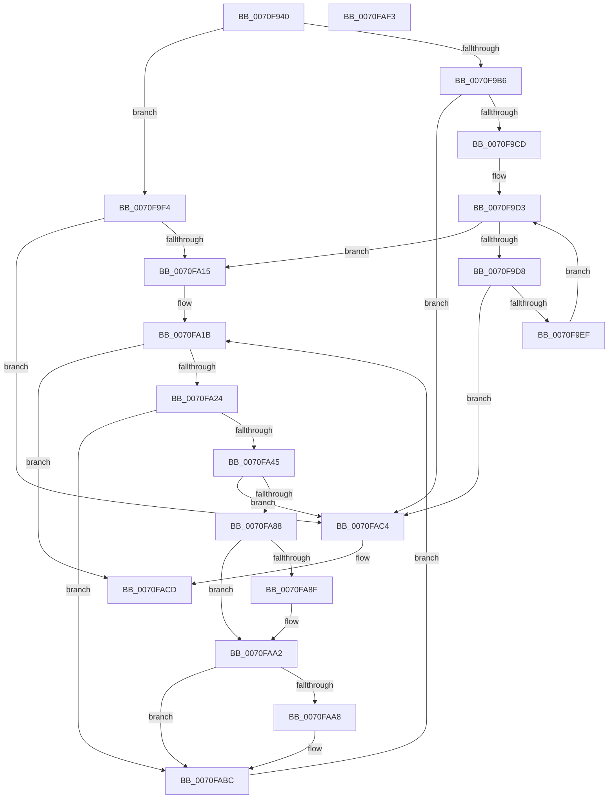

# ArbRetestAllocation

- RVA: `0x0070F940`–`0x0070FAF4` (길이 `436` bytes)
- VA: `0x000000014070F940`
- 실행 섹션: `PAGE`
- PDB 이름 있음: `예`; PDB Function 태그: `아니요`
- unwind 정보 RVA: `0x000BDCE8`
- 디코드: `117`개 명령, `436/436` bytes 표시
- 미해석 바이트: `0` (있으면 어셈블리에 `.byte`로 보존)

> 이 문서는 커널 이미지의 기계어와 PDB 기호를 분석해 생성했습니다. 4번과 5번은 함수 원형과 자료형을 바이너리 사용 방식에서 추정한 C 해석이며 원본 소스 복구 결과는 아닙니다.

## 1. Dependencies

- 직접 호출 지점: **12**; 고유 호출 대상: **8**
- 직접 호출자로 확인된 함수: **0**
- RIP 상대 이미지 참조: **1**

### Outgoing calls
- `0x0070F97D` → [memset](../../text/6C/memset_function_006C6C40.md) (function, `0x006C6C40`)
- `0x0070F98C` → [memset](../../text/6C/memset_function_006C6C40.md) (function, `0x006C6C40`)
- `0x0070F9BE` → [RtlCopyRangeList](../A6/RtlCopyRangeList_function_00A69680.md) (function, `0x00A69680`)
- `0x0070F9E0` → [RtlDeleteOwnersRanges](../A8/RtlDeleteOwnersRanges_function_00A828B0.md) (function, `0x00A828B0`)
- `0x0070FA06` → [guard_dispatch_icall](../../text/6B/guard_dispatch_icall_function_006BAAD0.md) (function, `0x006BAAD0`)
- `0x0070FA38` → [ArbpBuildAlternative](../71/ArbpBuildAlternative_function_00710068.md) (function, `0x00710068`)
- `0x0070FA58` → [guard_dispatch_icall](../../text/6B/guard_dispatch_icall_function_006BAAD0.md) (function, `0x006BAAD0`)
- `0x0070FA7D` → [guard_dispatch_icall](../../text/6B/guard_dispatch_icall_function_006BAAD0.md) (function, `0x006BAAD0`)
- `0x0070FA9D` → [guard_dispatch_icall](../../text/6B/guard_dispatch_icall_function_006BAAD0.md) (function, `0x006BAAD0`)
- `0x0070FAAE` → [ExFreePoolWithTag](../../poolcode/B8/ExFreePoolWithTag_function_00B82870.md) (function, `0x00B82870`)
- `0x0070FAC8` → [RtlFreeRangeList](../A6/RtlFreeRangeList_function_00A69850.md) (function, `0x00A69850`)
- `0x0070FAD6` → [_security_check_cookie](../../text/6A/_security_check_cookie_function_006AC640.md) (function, `0x006AC640`)

### Direct callers
- 이 함수 시작 RVA로 연결되는 직접 call은 확인되지 않았습니다. 간접 호출은 완전히 역산할 수 없습니다.

### Static image references
- `0x0070F95A` → RVA `0x00E0A740` (`.data`; read)

## 2. Other-region calls and transfers

- 다른 실행 섹션으로 향하는 call: **8**
  - `0x0070F97D` → [memset](../../text/6C/memset_function_006C6C40.md) (`PAGE` → `.text`)
  - `0x0070F98C` → [memset](../../text/6C/memset_function_006C6C40.md) (`PAGE` → `.text`)
  - `0x0070FA06` → [guard_dispatch_icall](../../text/6B/guard_dispatch_icall_function_006BAAD0.md) (`PAGE` → `.text`)
  - `0x0070FA58` → [guard_dispatch_icall](../../text/6B/guard_dispatch_icall_function_006BAAD0.md) (`PAGE` → `.text`)
  - `0x0070FA7D` → [guard_dispatch_icall](../../text/6B/guard_dispatch_icall_function_006BAAD0.md) (`PAGE` → `.text`)
  - `0x0070FA9D` → [guard_dispatch_icall](../../text/6B/guard_dispatch_icall_function_006BAAD0.md) (`PAGE` → `.text`)
  - `0x0070FAAE` → [ExFreePoolWithTag](../../poolcode/B8/ExFreePoolWithTag_function_00B82870.md) (`PAGE` → `POOLCODE`)
  - `0x0070FAD6` → [_security_check_cookie](../../text/6A/_security_check_cookie_function_006AC640.md) (`PAGE` → `.text`)
- 별도 외부 분기/꼬리 이동을 확인하지 못했습니다.

## 3. Assembly (complete function range)

```asm
0070F940  48 89 5C 24 18                  mov qword ptr [rsp + 0x18], rbx
0070F945  48 89 74 24 20                  mov qword ptr [rsp + 0x20], rsi
0070F94A  55                              push rbp
0070F94B  57                              push rdi
0070F94C  41 56                           push r14
0070F94E  48 8D 6C 24 B9                  lea rbp, [rsp - 0x47]
0070F953  48 81 EC E0 00 00 00            sub rsp, 0xe0
0070F95A  48 8B 05 DF AD 6F 00            mov rax, qword ptr [rip + 0x6faddf]
0070F961  48 33 C4                        xor rax, rsp
0070F964  48 89 45 37                     mov qword ptr [rbp + 0x37], rax
0070F968  48 83 65 97 00                  and qword ptr [rbp - 0x69], 0
0070F96D  4C 8B F2                        mov r14, rdx
0070F970  33 D2                           xor edx, edx
0070F972  48 8B D9                        mov rbx, rcx
0070F975  48 8D 4D A7                     lea rcx, [rbp - 0x59]
0070F979  44 8D 42 50                     lea r8d, [rdx + 0x50]
0070F97D  E8 BE 72 FB FF                  call 0x1406c6c40
0070F982  33 D2                           xor edx, edx
0070F984  48 8D 4D F7                     lea rcx, [rbp - 9]
0070F988  44 8D 42 40                     lea r8d, [rdx + 0x40]
0070F98C  E8 AF 72 FB FF                  call 0x1406c6c40
0070F991  4D 8B 46 10                     mov r8, qword ptr [r14 + 0x10]
0070F995  48 8D 45 F7                     lea rax, [rbp - 9]
0070F999  48 89 45 DF                     mov qword ptr [rbp - 0x21], rax
0070F99D  B9 01 00 00 00                  mov ecx, 1
0070F9A2  89 4D D7                        mov dword ptr [rbp - 0x29], ecx
0070F9A5  48 8D 45 F7                     lea rax, [rbp - 9]
0070F9A9  48 89 45 CF                     mov qword ptr [rbp - 0x31], rax
0070F9AD  66 89 4D E7                     mov word ptr [rbp - 0x19], cx
0070F9B1  4D 85 C0                        test r8, r8
0070F9B4  75 3E                           jne 0x14070f9f4
0070F9B6  48 8B 53 28                     mov rdx, qword ptr [rbx + 0x28]
0070F9BA  48 8B 4B 30                     mov rcx, qword ptr [rbx + 0x30]
0070F9BE  E8 BD 9C 35 00                  call 0x140a69680
0070F9C3  8B F8                           mov edi, eax
0070F9C5  85 C0                           test eax, eax
0070F9C7  0F 88 F7 00 00 00               js 0x14070fac4
0070F9CD  49 8B 0E                        mov rcx, qword ptr [r14]
0070F9D0  48 8B 31                        mov rsi, qword ptr [rcx]
0070F9D3  49 39 36                        cmp qword ptr [r14], rsi
0070F9D6  74 3D                           je 0x14070fa15
0070F9D8  48 8B 56 20                     mov rdx, qword ptr [rsi + 0x20]
0070F9DC  48 8B 4B 30                     mov rcx, qword ptr [rbx + 0x30]
0070F9E0  E8 CB 2E 37 00                  call 0x140a828b0
0070F9E5  8B F8                           mov edi, eax
0070F9E7  85 C0                           test eax, eax
0070F9E9  0F 88 D5 00 00 00               js 0x14070fac4
0070F9EF  48 8B 36                        mov rsi, qword ptr [rsi]
0070F9F2  EB DF                           jmp 0x14070f9d3
0070F9F4  48 8B 83 18 01 00 00            mov rax, qword ptr [rbx + 0x118]
0070F9FB  48 8B CB                        mov rcx, rbx
0070F9FE  4C 8B 4B 30                     mov r9, qword ptr [rbx + 0x30]
0070FA02  41 8B 56 08                     mov edx, dword ptr [r14 + 8]
0070FA06  E8 C5 B0 FA FF                  call 0x1406baad0
0070FA0B  8B F8                           mov edi, eax
0070FA0D  85 C0                           test eax, eax
0070FA0F  0F 88 AF 00 00 00               js 0x14070fac4
0070FA15  49 8B 06                        mov rax, qword ptr [r14]
0070FA18  48 8B 30                        mov rsi, qword ptr [rax]
0070FA1B  49 39 36                        cmp qword ptr [r14], rsi
0070FA1E  0F 84 A9 00 00 00               je 0x14070facd
0070FA24  48 83 65 EF 00                  and qword ptr [rbp - 0x11], 0
0070FA29  4C 8D 45 F7                     lea r8, [rbp - 9]
0070FA2D  48 89 75 C7                     mov qword ptr [rbp - 0x39], rsi
0070FA31  48 8B CB                        mov rcx, rbx
0070FA34  48 8B 56 50                     mov rdx, qword ptr [rsi + 0x50]
0070FA38  E8 2B 06 00 00                  call 0x140710068
0070FA3D  83 7E 58 02                     cmp dword ptr [rsi + 0x58], 2
0070FA41  8B F8                           mov edi, eax
0070FA43  74 77                           je 0x14070fabc
0070FA45  48 8B 83 88 00 00 00            mov rax, qword ptr [rbx + 0x88]
0070FA4C  4C 8D 45 97                     lea r8, [rbp - 0x69]
0070FA50  48 8B 4E 48                     mov rcx, qword ptr [rsi + 0x48]
0070FA54  48 8D 55 A7                     lea rdx, [rbp - 0x59]
0070FA58  E8 73 B0 FA FF                  call 0x1406baad0
0070FA5D  48 8B 45 A7                     mov rax, qword ptr [rbp - 0x59]
0070FA61  48 8D 55 A7                     lea rdx, [rbp - 0x59]
0070FA65  48 8B 4D 97                     mov rcx, qword ptr [rbp - 0x69]
0070FA69  48 FF C8                        dec rax
0070FA6C  48 03 C8                        add rcx, rax
0070FA6F  48 8B 83 E0 00 00 00            mov rax, qword ptr [rbx + 0xe0]
0070FA76  48 89 4D AF                     mov qword ptr [rbp - 0x51], rcx
0070FA7A  48 8B CB                        mov rcx, rbx
0070FA7D  E8 4E B0 FA FF                  call 0x1406baad0
0070FA82  8B F8                           mov edi, eax
0070FA84  85 C0                           test eax, eax
0070FA86  78 3C                           js 0x14070fac4
0070FA88  48 83 7D 97 00                  cmp qword ptr [rbp - 0x69], 0
0070FA8D  74 13                           je 0x14070faa2
0070FA8F  48 8B 83 00 01 00 00            mov rax, qword ptr [rbx + 0x100]
0070FA96  48 8D 55 A7                     lea rdx, [rbp - 0x59]
0070FA9A  48 8B CB                        mov rcx, rbx
0070FA9D  E8 2E B0 FA FF                  call 0x1406baad0
0070FAA2  F6 45 E7 10                     test byte ptr [rbp - 0x19], 0x10
0070FAA6  74 14                           je 0x14070fabc
0070FAA8  48 8B 4D EF                     mov rcx, qword ptr [rbp - 0x11]
0070FAAC  33 D2                           xor edx, edx
0070FAAE  E8 BD 2D 47 00                  call 0x140b82870
0070FAB3  B8 EF FF 00 00                  mov eax, 0xffef
0070FAB8  66 21 45 E7                     and word ptr [rbp - 0x19], ax
0070FABC  48 8B 36                        mov rsi, qword ptr [rsi]
0070FABF  E9 57 FF FF FF                  jmp 0x14070fa1b
0070FAC4  48 8B 4B 30                     mov rcx, qword ptr [rbx + 0x30]
0070FAC8  E8 83 9D 35 00                  call 0x140a69850
0070FACD  8B C7                           mov eax, edi
0070FACF  48 8B 4D 37                     mov rcx, qword ptr [rbp + 0x37]
0070FAD3  48 33 CC                        xor rcx, rsp
0070FAD6  E8 65 CB F9 FF                  call 0x1406ac640
0070FADB  4C 8D 9C 24 E0 00 00 00         lea r11, [rsp + 0xe0]
0070FAE3  49 8B 5B 30                     mov rbx, qword ptr [r11 + 0x30]
0070FAE7  49 8B 73 38                     mov rsi, qword ptr [r11 + 0x38]
0070FAEB  49 8B E3                        mov rsp, r11
0070FAEE  41 5E                           pop r14
0070FAF0  5F                              pop rdi
0070FAF1  5D                              pop rbp
0070FAF2  C3                              ret
0070FAF3  CC                              int3
```

## 4. C-style interpretation (structured pseudocode)

```c
__int64 __fastcall ArbRetestAllocation(__int64 a1, __int64 a2)
{
    __int64 result;
    __int64 v_rsp;
    unsigned __int64 v_stack_m18;
    unsigned __int64 v_stack_m28;
    unsigned __int64 v_stack_m5F;
    unsigned __int64 v_stack_m68;
    unsigned __int64 v_stack_m70;
    unsigned __int16 v_stack_m78;
    unsigned __int64 v_stack_m80;
    unsigned int v_stack_m88;
    unsigned __int64 v_stack_m90;
    unsigned __int64 v_stack_m98;
    unsigned __int64 v_stack_mB0;
    unsigned __int64 v_stack_mB8;
    unsigned __int64 v_stack_mC8;
    unsigned __int64 v_stack_p18;
    unsigned __int64 v_stack_p20;

    v_stack_p18 = v_rbx;
    v_stack_p20 = v_rsi;
    v_rsp = (v_rsp) - (224);
    result = (*(unsigned __int64 *)(v_rip + 7319007)) ^ (v_rsp);
    v_stack_m28 = result;
    a2 = 0;
    result = memset(v_stack_mB8, a2, a2 + 80, a4);
    a2 = 0;
    result = memset(v_stack_m68, a2, a2 + 64, a4);
    v_stack_m80 = v_stack_m68;
    v_stack_m88 = 1;
    v_stack_m90 = v_stack_m68;
    v_stack_m78 = 1;
    if (*(unsigned __int64 *)(a2 + 16) != 0) goto loc_0070F9F4;
    result = RtlCopyRangeList(*(unsigned __int64 *)(a1 + 48), *(unsigned __int64 *)(a1 + 40), *(unsigned __int64 *)(a2 + 16), a4);
    if (sign_flag) goto loc_0070FAC4;
loc_0070F9D3:
    if ((*(unsigned __int64 *)(a2)) == (*(unsigned __int64 *)(*(unsigned __int64 *)(a2)))) goto loc_0070FA15;
    result = RtlDeleteOwnersRanges(*(unsigned __int64 *)(a1 + 48), *(unsigned __int64 *)(*(unsigned __int64 *)(*(unsigned __int64 *)(a2)) + 32), *(unsigned __int64 *)(a2 + 16), a4);
    if (sign_flag) goto loc_0070FAC4;
    goto loc_0070F9D3;
loc_0070F9F4:
    result = guard_dispatch_icall(a1, (unsigned int)(*(unsigned int *)(a2 + 8)), *(unsigned __int64 *)(a2 + 16), *(unsigned __int64 *)(a1 + 48));
    if (sign_flag) goto loc_0070FAC4;
loc_0070FA15:
loc_0070FA1B:
    if ((*(unsigned __int64 *)(a2)) == (*(unsigned __int64 *)(*(unsigned __int64 *)(a2)))) goto loc_0070FACD;
    v_stack_m98 = *(unsigned __int64 *)(*(unsigned __int64 *)(a2));
    result = ArbpBuildAlternative(a1, *(unsigned __int64 *)(*(unsigned __int64 *)(*(unsigned __int64 *)(a2)) + 80), v_stack_m68, *(unsigned __int64 *)(a1 + 48));
    if ((*(unsigned int *)(*(unsigned __int64 *)(*(unsigned __int64 *)(a2)) + 88)) == 2) goto loc_0070FABC;
    result = guard_dispatch_icall(*(unsigned __int64 *)(*(unsigned __int64 *)(*(unsigned __int64 *)(a2)) + 72), v_stack_mB8, v_stack_mC8, *(unsigned __int64 *)(a1 + 48));
    result = (v_stack_mB8) - 1;
    a1 = (v_stack_mC8) + (result);
    v_stack_mB0 = a1;
    result = guard_dispatch_icall(a1, v_stack_mB8, v_stack_mC8, *(unsigned __int64 *)(a1 + 48));
    if (sign_flag) goto loc_0070FAC4;
    if (v_stack_mC8 != 0) {
        result = *(unsigned __int64 *)(a1 + 256);
        a2 = v_stack_mB8;
        a1 = a1;
        result = guard_dispatch_icall(a1, a2, v_stack_mC8, *(unsigned __int64 *)(a1 + 48));
    }
    if (((v_stack_m78) & (16)) != 0) {
        a1 = v_stack_m70;
        a2 = 0;
        result = ExFreePoolWithTag(a1, a2, v_stack_mC8, *(unsigned __int64 *)(a1 + 48));
        result = 0xFFEFULL;
    }
    goto loc_0070FA1B;
loc_0070FAC4:
    result = RtlFreeRangeList(*(unsigned __int64 *)(a1 + 48), a2, v_stack_mC8, *(unsigned __int64 *)(a1 + 48));
loc_0070FACD:
    a1 = (v_stack_m28) ^ (v_rsp);
    result = _security_check_cookie(a1, a2, v_stack_mC8, *(unsigned __int64 *)(a1 + 48));
    return result;
}
```

## 5. (Beta) C Style

```c
int64_t ArbRetestAllocation(void *Arg1, void *Arg2)
{
    uint8_t *arg1 = (uint8_t *)Arg1;
    uint8_t *arg2 = (uint8_t *)Arg2;

    int64_t result;
    int64_t local_rsp;
    uint64_t v_stack_m18;
    uint64_t v_stack_m28;
    uint64_t v_stack_m5F;
    uint64_t v_stack_m68;
    uint64_t v_stack_m70;
    uint16_t v_stack_m78;
    uint64_t v_stack_m80;
    uint32_t v_stack_m88;
    uint64_t v_stack_m90;
    uint64_t v_stack_m98;
    uint64_t v_stack_mB0;
    uint64_t v_stack_mB8;
    uint64_t v_stack_mC8;
    uint64_t v_stack_p18;
    uint64_t v_stack_p20;

    v_stack_p18 = local_rbx;
    v_stack_p20 = local_rsi;
    local_rsp = (local_rsp) - (224);
    result = (*(uint64_t *)(v_rip + 0x6FADDF)) ^ (local_rsp);
    v_stack_m28 = result;
    Arg2 = 0;
    result = memset(v_stack_mB8, Arg2, Arg2 + 80, a4);
    Arg2 = 0;
    result = memset(v_stack_m68, Arg2, Arg2 + 64, a4);
    v_stack_m80 = v_stack_m68;
    v_stack_m88 = 1;
    v_stack_m90 = v_stack_m68;
    v_stack_m78 = 1;
    if (*(uint64_t *)(arg2 + 0x10) != 0) goto loc_0070F9F4;
    result = RtlCopyRangeList(*(uint64_t *)(arg1 + 0x30), *(uint64_t *)(arg1 + 0x28), *(uint64_t *)(arg2 + 0x10), a4);
    if (sign_flag) goto loc_0070FAC4;
loc_0070F9D3:
    if ((*(uint64_t *)(arg2)) == (*(uint64_t *)(*(uint64_t *)(arg2)))) goto loc_0070FA15;
    result = RtlDeleteOwnersRanges(*(uint64_t *)(arg1 + 0x30), *(uint64_t *)(*(uint64_t *)(*(uint64_t *)(arg2)) + 0x20), *(uint64_t *)(arg2 + 0x10), a4);
    if (sign_flag) goto loc_0070FAC4;
    goto loc_0070F9D3;
loc_0070F9F4:
    result = guard_dispatch_icall(Arg1, (uint32_t)(*(uint32_t *)(arg2 + 0x8)), *(uint64_t *)(arg2 + 0x10), *(uint64_t *)(arg1 + 0x30));
    if (sign_flag) goto loc_0070FAC4;
loc_0070FA15:
loc_0070FA1B:
    if ((*(uint64_t *)(arg2)) == (*(uint64_t *)(*(uint64_t *)(arg2)))) goto loc_0070FACD;
    v_stack_m98 = *(uint64_t *)(*(uint64_t *)(arg2));
    result = ArbpBuildAlternative(Arg1, *(uint64_t *)(*(uint64_t *)(*(uint64_t *)(arg2)) + 0x50), v_stack_m68, *(uint64_t *)(arg1 + 0x30));
    if ((*(uint32_t *)(*(uint64_t *)(*(uint64_t *)(arg2)) + 0x58)) == 2) goto loc_0070FABC;
    result = guard_dispatch_icall(*(uint64_t *)(*(uint64_t *)(*(uint64_t *)(arg2)) + 0x48), v_stack_mB8, v_stack_mC8, *(uint64_t *)(arg1 + 0x30));
    result = (v_stack_mB8) - 1;
    Arg1 = (v_stack_mC8) + (result);
    v_stack_mB0 = Arg1;
    result = guard_dispatch_icall(Arg1, v_stack_mB8, v_stack_mC8, *(uint64_t *)(arg1 + 0x30));
    if (sign_flag) goto loc_0070FAC4;
    if (v_stack_mC8 != 0) {
        result = *(uint64_t *)(arg1 + 0x100);
        Arg2 = v_stack_mB8;
        Arg1 = Arg1;
        result = guard_dispatch_icall(Arg1, Arg2, v_stack_mC8, *(uint64_t *)(arg1 + 0x30));
    }
    if (((v_stack_m78) & (16)) != 0) {
        Arg1 = v_stack_m70;
        Arg2 = 0;
        result = ExFreePoolWithTag(Arg1, Arg2, v_stack_mC8, *(uint64_t *)(arg1 + 0x30));
        result = 0xFFEFULL;
    }
    goto loc_0070FA1B;
loc_0070FAC4:
    result = RtlFreeRangeList(*(uint64_t *)(arg1 + 0x30), Arg2, v_stack_mC8, *(uint64_t *)(arg1 + 0x30));
loc_0070FACD:
    Arg1 = (v_stack_m28) ^ (local_rsp);
    result = _security_check_cookie(Arg1, Arg2, v_stack_mC8, *(uint64_t *)(arg1 + 0x30));
    return result;
}
```

### 관측된 메모리 오프셋

구조체 형식이 확인되지 않은 접근은 인자 기준의 오프셋으로만 기록했습니다.

| 기준 인자 | 오프셋 표현 | 폭 (bit) | 접근 |
|---|---:|---:|---|
| `Arg1` | `+ 0x28` | `64` | `R` |
| `Arg1` | `+ 0x30` | `64` | `R` |
| `Arg1` | `+ 0x88` | `64` | `R` |
| `Arg1` | `+ 0xE0` | `64` | `R` |
| `Arg1` | `+ 0x100` | `64` | `R` |
| `Arg1` | `+ 0x118` | `64` | `R` |
| `Arg2` | `+ 0x0` | `64` | `R` |
| `Arg2` | `+ 0x8` | `32` | `R` |
| `Arg2` | `+ 0x10` | `64` | `R` |

## 6. Execution-region graph

[열기: 2D/3D 그래프와 함수 탐색 컨트롤 패널](../../../control-panel.html?section=page&rva=0x0070F940&view=graph)

- 2D 그래프는 위에서 아래로 흐르고, 3D 그래프는 빈 공간을 드래그해 회전합니다. Shift+드래그는 이동, 휠은 확대·축소, 함수 노드 선택은 대상 보고서 이동입니다.

### Static fallback


