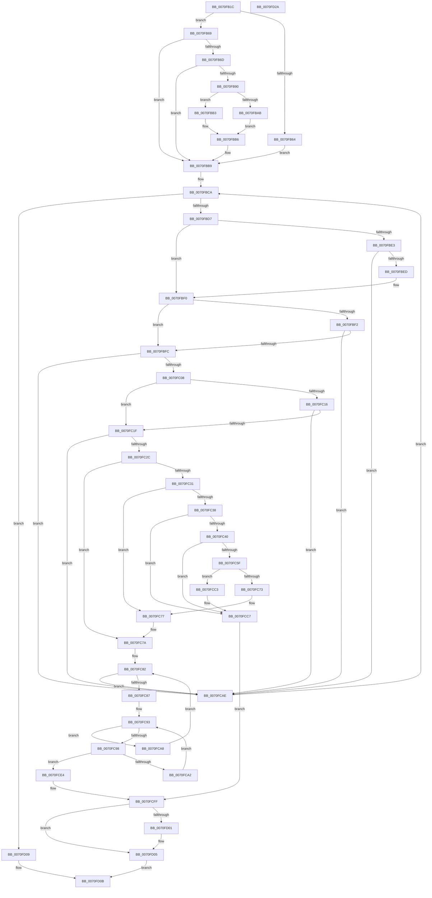

# ArbShareDriverExclusive

- RVA: `0x0070FB1C`–`0x0070FD2B` (길이 `527` bytes)
- VA: `0x000000014070FB1C`
- 실행 섹션: `PAGE`
- PDB 이름 있음: `예`; PDB Function 태그: `아니요`
- unwind 정보 RVA: `0x000C5618`
- 디코드: `149`개 명령, `527/527` bytes 표시
- 미해석 바이트: `0` (있으면 어셈블리에 `.byte`로 보존)

> 이 문서는 커널 이미지의 기계어와 PDB 기호를 분석해 생성했습니다. 4번과 5번은 함수 원형과 자료형을 바이너리 사용 방식에서 추정한 C 해석이며 원본 소스 복구 결과는 아닙니다.

## 1. Dependencies

- 직접 호출 지점: **7**; 고유 호출 대상: **5**
- 직접 호출자로 확인된 함수: **1**
- RIP 상대 이미지 참조: **2**

### Outgoing calls
- `0x0070FB87` → [IoGetDeviceProperty](../8F/IoGetDeviceProperty_function_008FA720.md) (function, `0x008FA720`)
- `0x0070FB9B` → [wcsicmp](../../text/50/wcsicmp_function_00500080.md) (function, `0x00500080`)
- `0x0070FBC5` → [RtlGetFirstRange](../A7/RtlGetFirstRange_function_00A7EA70.md) (function, `0x00A7EA70`)
- `0x0070FC56` → [IoGetDeviceProperty](../8F/IoGetDeviceProperty_function_008FA720.md) (function, `0x008FA720`)
- `0x0070FC6A` → [wcsicmp](../../text/50/wcsicmp_function_00500080.md) (function, `0x00500080`)
- `0x0070FCB9` → [RtlGetNextRange](../A3/RtlGetNextRange_function_00A35A40.md) (function, `0x00A35A40`)
- `0x0070FD12` → [_security_check_cookie](../../text/6A/_security_check_cookie_function_006AC640.md) (function, `0x006AC640`)

### Direct callers
- [ArbFindSuitableRange](ArbFindSuitableRange_function_0070E9D0.md) at `0x0070EACD`

### Static image references
- `0x0070FB2E` → RVA `0x00E0A740` (`.data`; read)
- `0x0070FB90` → RVA `0x00AFB000` (` ?? ::NNGAKEGL::`string'`; read)

## 2. Other-region calls and transfers

- 다른 실행 섹션으로 향하는 call: **3**
  - `0x0070FB9B` → [wcsicmp](../../text/50/wcsicmp_function_00500080.md) (`PAGE` → `.text`)
  - `0x0070FC6A` → [wcsicmp](../../text/50/wcsicmp_function_00500080.md) (`PAGE` → `.text`)
  - `0x0070FD12` → [_security_check_cookie](../../text/6A/_security_check_cookie_function_006AC640.md) (`PAGE` → `.text`)
- 별도 외부 분기/꼬리 이동을 확인하지 못했습니다.

## 3. Assembly (complete function range)

```asm
0070FB1C  48 89 5C 24 18                  mov qword ptr [rsp + 0x18], rbx
0070FB21  55                              push rbp
0070FB22  56                              push rsi
0070FB23  57                              push rdi
0070FB24  48 8B EC                        mov rbp, rsp
0070FB27  48 81 EC 80 00 00 00            sub rsp, 0x80
0070FB2E  48 8B 05 0B AC 6F 00            mov rax, qword ptr [rip + 0x6fac0b]
0070FB35  48 33 C4                        xor rax, rsp
0070FB38  48 89 45 F0                     mov qword ptr [rbp - 0x10], rax
0070FB3C  83 65 B0 00                     and dword ptr [rbp - 0x50], 0
0070FB40  0F 57 C0                        xorps xmm0, xmm0
0070FB43  48 83 65 B8 00                  and qword ptr [rbp - 0x48], 0
0070FB48  48 8B F9                        mov rdi, rcx
0070FB4B  48 8B 4A 20                     mov rcx, qword ptr [rdx + 0x20]
0070FB4F  40 32 F6                        xor sil, sil
0070FB52  48 8B DA                        mov rbx, rdx
0070FB55  0F 11 45 C0                     movups xmmword ptr [rbp - 0x40], xmm0
0070FB59  8B 41 2C                        mov eax, dword ptr [rcx + 0x2c]
0070FB5C  0F 11 45 D0                     movups xmmword ptr [rbp - 0x30], xmm0
0070FB60  A8 02                           test al, 2
0070FB62  74 05                           je 0x14070fb69
0070FB64  40 B6 01                        mov sil, 1
0070FB67  EB 50                           jmp 0x14070fbb9
0070FB69  A8 04                           test al, 4
0070FB6B  75 4C                           jne 0x14070fbb9
0070FB6D  48 8B 49 20                     mov rcx, qword ptr [rcx + 0x20]
0070FB71  48 8D 45 B0                     lea rax, [rbp - 0x50]
0070FB75  BA 0F 00 00 00                  mov edx, 0xf
0070FB7A  48 89 44 24 20                  mov qword ptr [rsp + 0x20], rax
0070FB7F  4C 8D 4D E0                     lea r9, [rbp - 0x20]
0070FB83  44 8D 42 FB                     lea r8d, [rdx - 5]
0070FB87  E8 94 AB 1E 00                  call 0x1408fa720
0070FB8C  85 C0                           test eax, eax
0070FB8E  78 29                           js 0x14070fbb9
0070FB90  48 8D 15 69 B4 3E 00            lea rdx, [rip + 0x3eb469]
0070FB97  48 8D 4D E0                     lea rcx, [rbp - 0x20]
0070FB9B  E8 E0 04 DF FF                  call 0x140500080
0070FBA0  48 8B 53 20                     mov rdx, qword ptr [rbx + 0x20]
0070FBA4  8B 4A 2C                        mov ecx, dword ptr [rdx + 0x2c]
0070FBA7  85 C0                           test eax, eax
0070FBA9  75 08                           jne 0x14070fbb3
0070FBAB  83 C9 02                        or ecx, 2
0070FBAE  40 B6 01                        mov sil, 1
0070FBB1  EB 03                           jmp 0x14070fbb6
0070FBB3  83 C9 04                        or ecx, 4
0070FBB6  89 4A 2C                        mov dword ptr [rdx + 0x2c], ecx
0070FBB9  48 8B 4F 30                     mov rcx, qword ptr [rdi + 0x30]
0070FBBD  4C 8D 45 B8                     lea r8, [rbp - 0x48]
0070FBC1  48 8D 55 C0                     lea rdx, [rbp - 0x40]
0070FBC5  E8 A6 EE 36 00                  call 0x140a7ea70
0070FBCA  48 8B 7D B8                     mov rdi, qword ptr [rbp - 0x48]
0070FBCE  48 85 FF                        test rdi, rdi
0070FBD1  0F 84 32 01 00 00               je 0x14070fd09
0070FBD7  48 8B 0F                        mov rcx, qword ptr [rdi]
0070FBDA  48 8B 43 10                     mov rax, qword ptr [rbx + 0x10]
0070FBDE  48 3B C1                        cmp rax, rcx
0070FBE1  76 0D                           jbe 0x14070fbf0
0070FBE3  48 39 47 08                     cmp qword ptr [rdi + 8], rax
0070FBE7  0F 82 C1 00 00 00               jb 0x14070fcae
0070FBED  48 3B C1                        cmp rax, rcx
0070FBF0  73 0A                           jae 0x14070fbfc
0070FBF2  48 39 4B 18                     cmp qword ptr [rbx + 0x18], rcx
0070FBF6  0F 82 B2 00 00 00               jb 0x14070fcae
0070FBFC  8A 57 20                        mov dl, byte ptr [rdi + 0x20]
0070FBFF  84 53 43                        test byte ptr [rbx + 0x43], dl
0070FC02  0F 85 A6 00 00 00               jne 0x14070fcae
0070FC08  48 8B 43 28                     mov rax, qword ptr [rbx + 0x28]
0070FC0C  48 8B 48 28                     mov rcx, qword ptr [rax + 0x28]
0070FC10  80 79 02 02                     cmp byte ptr [rcx + 2], 2
0070FC14  74 09                           je 0x14070fc1f
0070FC16  F6 C2 02                        test dl, 2
0070FC19  0F 84 8F 00 00 00               je 0x14070fcae
0070FC1F  48 8B 4F 18                     mov rcx, qword ptr [rdi + 0x18]
0070FC23  48 85 C9                        test rcx, rcx
0070FC26  0F 84 82 00 00 00               je 0x14070fcae
0070FC2C  40 84 F6                        test sil, sil
0070FC2F  74 49                           je 0x14070fc7a
0070FC31  8A 47 21                        mov al, byte ptr [rdi + 0x21]
0070FC34  A8 40                           test al, 0x40
0070FC36  75 3F                           jne 0x14070fc77
0070FC38  A8 20                           test al, 0x20
0070FC3A  0F 85 87 00 00 00               jne 0x14070fcc7
0070FC40  BA 0F 00 00 00                  mov edx, 0xf
0070FC45  48 8D 45 B0                     lea rax, [rbp - 0x50]
0070FC49  4C 8D 4D E0                     lea r9, [rbp - 0x20]
0070FC4D  48 89 44 24 20                  mov qword ptr [rsp + 0x20], rax
0070FC52  44 8D 42 FB                     lea r8d, [rdx - 5]
0070FC56  E8 C5 AA 1E 00                  call 0x1408fa720
0070FC5B  85 C0                           test eax, eax
0070FC5D  78 68                           js 0x14070fcc7
0070FC5F  48 8D 15 9A B3 3E 00            lea rdx, [rip + 0x3eb39a]
0070FC66  48 8D 4D E0                     lea rcx, [rbp - 0x20]
0070FC6A  E8 11 04 DF FF                  call 0x140500080
0070FC6F  85 C0                           test eax, eax
0070FC71  74 50                           je 0x14070fcc3
0070FC73  80 4F 21 40                     or byte ptr [rdi + 0x21], 0x40
0070FC77  40 32 F6                        xor sil, sil
0070FC7A  48 8B 47 18                     mov rax, qword ptr [rdi + 0x18]
0070FC7E  48 8B 50 18                     mov rdx, qword ptr [rax + 0x18]
0070FC82  48 85 D2                        test rdx, rdx
0070FC85  74 27                           je 0x14070fcae
0070FC87  48 8B 43 20                     mov rax, qword ptr [rbx + 0x20]
0070FC8B  48 8B 48 20                     mov rcx, qword ptr [rax + 0x20]
0070FC8F  4C 8B 41 18                     mov r8, qword ptr [rcx + 0x18]
0070FC93  4D 85 C0                        test r8, r8
0070FC96  74 10                           je 0x14070fca8
0070FC98  49 8B 40 08                     mov rax, qword ptr [r8 + 8]
0070FC9C  48 39 42 08                     cmp qword ptr [rdx + 8], rax
0070FCA0  74 42                           je 0x14070fce4
0070FCA2  4D 8B 40 18                     mov r8, qword ptr [r8 + 0x18]
0070FCA6  EB EB                           jmp 0x14070fc93
0070FCA8  48 8B 52 18                     mov rdx, qword ptr [rdx + 0x18]
0070FCAC  EB D4                           jmp 0x14070fc82
0070FCAE  41 B0 01                        mov r8b, 1
0070FCB1  48 8D 55 B8                     lea rdx, [rbp - 0x48]
0070FCB5  48 8D 4D C0                     lea rcx, [rbp - 0x40]
0070FCB9  E8 82 5D 32 00                  call 0x140a35a40
0070FCBE  E9 07 FF FF FF                  jmp 0x14070fbca
0070FCC3  80 4F 21 20                     or byte ptr [rdi + 0x21], 0x20
0070FCC7  48 8B 43 10                     mov rax, qword ptr [rbx + 0x10]
0070FCCB  48 89 03                        mov qword ptr [rbx], rax
0070FCCE  48 8B 43 18                     mov rax, qword ptr [rbx + 0x18]
0070FCD2  48 89 43 08                     mov qword ptr [rbx + 8], rax
0070FCD6  48 8B 43 28                     mov rax, qword ptr [rbx + 0x28]
0070FCDA  48 8B 48 28                     mov rcx, qword ptr [rax + 0x28]
0070FCDE  80 79 02 02                     cmp byte ptr [rcx + 2], 2
0070FCE2  EB 1B                           jmp 0x14070fcff
0070FCE4  48 8B 4B 10                     mov rcx, qword ptr [rbx + 0x10]
0070FCE8  48 89 0B                        mov qword ptr [rbx], rcx
0070FCEB  48 8B 4B 18                     mov rcx, qword ptr [rbx + 0x18]
0070FCEF  48 89 4B 08                     mov qword ptr [rbx + 8], rcx
0070FCF3  48 8B 4B 28                     mov rcx, qword ptr [rbx + 0x28]
0070FCF7  48 8B 51 28                     mov rdx, qword ptr [rcx + 0x28]
0070FCFB  80 7A 02 02                     cmp byte ptr [rdx + 2], 2
0070FCFF  75 04                           jne 0x14070fd05
0070FD01  80 4B 42 02                     or byte ptr [rbx + 0x42], 2
0070FD05  B0 01                           mov al, 1
0070FD07  EB 02                           jmp 0x14070fd0b
0070FD09  32 C0                           xor al, al
0070FD0B  48 8B 4D F0                     mov rcx, qword ptr [rbp - 0x10]
0070FD0F  48 33 CC                        xor rcx, rsp
0070FD12  E8 29 C9 F9 FF                  call 0x1406ac640
0070FD17  48 8B 9C 24 B0 00 00 00         mov rbx, qword ptr [rsp + 0xb0]
0070FD1F  48 81 C4 80 00 00 00            add rsp, 0x80
0070FD26  5F                              pop rdi
0070FD27  5E                              pop rsi
0070FD28  5D                              pop rbp
0070FD29  C3                              ret
0070FD2A  CC                              int3
```

## 4. C-style interpretation (structured pseudocode)

```c
__int64 __fastcall ArbShareDriverExclusive(__int64 a1, __int64 a2)
{
    __int64 result;
    __int64 v_rsi;
    __int64 v_rsp;
    unsigned __int64 v_stack_m28;
    unsigned __int64 v_stack_m38;
    unsigned __int64 v_stack_m48;
    unsigned __int64 v_stack_m58;
    unsigned __int64 v_stack_m60;
    unsigned int v_stack_m68;
    unsigned __int64 v_stack_m78;
    unsigned __int64 v_stack_p18;

    v_stack_p18 = v_rbx;
    v_rsp = (v_rsp) - (128);
    result = (*(unsigned __int64 *)(v_rip + 7318539)) ^ (v_rsp);
    v_stack_m28 = result;
    v_rsi = 0;
    v_stack_m58 = v_xmm0;
    v_stack_m48 = v_xmm0;
    if ((((unsigned __int8)((unsigned int)(*(unsigned int *)(*(unsigned __int64 *)(a2 + 32) + 44)))) & (2)) == 0) goto loc_0070FB69;
    goto loc_0070FBB9;
loc_0070FB69:
    if ((((unsigned __int8)((unsigned int)(*(unsigned int *)(*(unsigned __int64 *)(a2 + 32) + 44)))) & (4)) != 0) goto loc_0070FBB9;
    v_stack_m78 = v_stack_m68;
    result = IoGetDeviceProperty(*(unsigned __int64 *)(*(unsigned __int64 *)(a2 + 32) + 32), 15, 15 - 5, v_stack_m38);
    if (sign_flag) goto loc_0070FBB9;
    result = wcsicmp(v_stack_m38, v_rip + 4109417, 15 - 5, v_stack_m38);
    if ((unsigned int)(result) != 0) goto loc_0070FBB3;
    a1 = (unsigned int)(((unsigned int)(*(unsigned int *)(*(unsigned __int64 *)(a2 + 32) + 44))) | (2));
    goto loc_0070FBB6;
loc_0070FBB3:
    a1 = (unsigned int)((a1) | (4));
loc_0070FBB6:
    *(unsigned int *)(*(unsigned __int64 *)(a2 + 32) + 44) = (unsigned int)(a1);
loc_0070FBB9:
    result = RtlGetFirstRange(*(unsigned __int64 *)(a1 + 48), v_stack_m58, v_stack_m60, v_stack_m38);
loc_0070FBCA:
    if (v_stack_m60 == 0) goto loc_0070FD09;
    if ((*(unsigned __int64 *)(a2 + 16)) <= (*(unsigned __int64 *)(v_stack_m60))) goto loc_0070FBF0;
    if ((*(unsigned __int64 *)(v_stack_m60 + 8)) < (*(unsigned __int64 *)(a2 + 16))) goto loc_0070FCAE;
loc_0070FBF0:
    if ((*(unsigned __int64 *)(a2 + 16)) >= (*(unsigned __int64 *)(v_stack_m60))) goto loc_0070FBFC;
    if ((*(unsigned __int64 *)(a2 + 24)) < (*(unsigned __int64 *)(v_stack_m60))) goto loc_0070FCAE;
loc_0070FBFC:
    if (((*(unsigned __int8 *)(a2 + 67)) & ((unsigned __int8)(*(unsigned __int8 *)(v_stack_m60 + 32)))) != 0) goto loc_0070FCAE;
    if ((*(unsigned __int8 *)(*(unsigned __int64 *)(*(unsigned __int64 *)(a2 + 40) + 40) + 2)) == 2) goto loc_0070FC1F;
    if ((((unsigned __int8)(*(unsigned __int8 *)(v_stack_m60 + 32))) & (2)) == 0) goto loc_0070FCAE;
loc_0070FC1F:
    if (*(unsigned __int64 *)(v_stack_m60 + 24) == 0) goto loc_0070FCAE;
    if (1 == 0) goto loc_0070FC7A;
    if ((((unsigned __int8)(*(unsigned __int8 *)(v_stack_m60 + 33))) & (64)) != 0) goto loc_0070FC77;
    if ((((unsigned __int8)(*(unsigned __int8 *)(v_stack_m60 + 33))) & (32)) != 0) goto loc_0070FCC7;
    v_stack_m78 = v_stack_m68;
    result = IoGetDeviceProperty(*(unsigned __int64 *)(v_stack_m60 + 24), 15, 15 - 5, v_stack_m38);
    if (sign_flag) goto loc_0070FCC7;
    result = wcsicmp(v_stack_m38, v_rip + 4109210, 15 - 5, v_stack_m38);
    if ((unsigned int)(result) == 0) goto loc_0070FCC3;
loc_0070FC77:
    v_rsi = 0;
loc_0070FC7A:
loc_0070FC82:
    if (*(unsigned __int64 *)(*(unsigned __int64 *)(v_stack_m60 + 24) + 24) == 0) goto loc_0070FCAE;
loc_0070FC93:
    if (*(unsigned __int64 *)(*(unsigned __int64 *)(*(unsigned __int64 *)(a2 + 32) + 32) + 24) == 0) goto loc_0070FCA8;
    if ((*(unsigned __int64 *)(*(unsigned __int64 *)(*(unsigned __int64 *)(v_stack_m60 + 24) + 24) + 8)) == (*(unsigned __int64 *)(*(unsigned __int64 *)(*(unsigned __int64 *)(*(unsigned __int64 *)(a2 + 32) + 32) + 24) + 8))) goto loc_0070FCE4;
    goto loc_0070FC93;
loc_0070FCA8:
    goto loc_0070FC82;
loc_0070FCAE:
    result = RtlGetNextRange(v_stack_m58, v_stack_m60, 1, v_stack_m38);
    goto loc_0070FBCA;
loc_0070FCC3:
loc_0070FCC7:
    *(unsigned __int64 *)(a2) = *(unsigned __int64 *)(a2 + 16);
    *(unsigned __int64 *)(a2 + 8) = *(unsigned __int64 *)(a2 + 24);
    goto loc_0070FCFF;
loc_0070FCE4:
    *(unsigned __int64 *)(a2) = *(unsigned __int64 *)(a2 + 16);
    *(unsigned __int64 *)(a2 + 8) = *(unsigned __int64 *)(a2 + 24);
loc_0070FCFF:
    if ((*(unsigned __int8 *)(*(unsigned __int64 *)(*(unsigned __int64 *)(a2 + 40) + 40) + 2)) == 2) {
    }
    goto loc_0070FD0B;
loc_0070FD09:
    result = 0;
loc_0070FD0B:
    a1 = (v_stack_m28) ^ (v_rsp);
    result = _security_check_cookie(a1, *(unsigned __int64 *)(*(unsigned __int64 *)(a2 + 40) + 40), 1, v_stack_m38);
    v_rsp = (v_rsp) + (128);
    return result;
}
```

## 5. (Beta) C Style

```c
int64_t ArbShareDriverExclusive(void *Arg1, void *Arg2)
{
    uint8_t *arg1 = (uint8_t *)Arg1;
    uint8_t *arg2 = (uint8_t *)Arg2;

    int64_t result;
    int64_t local_rsi;
    int64_t local_rsp;
    uint64_t v_stack_m28;
    uint64_t v_stack_m38;
    uint64_t v_stack_m48;
    uint64_t v_stack_m58;
    uint64_t v_stack_m60;
    uint32_t v_stack_m68;
    uint64_t v_stack_m78;
    uint64_t v_stack_p18;

    v_stack_p18 = local_rbx;
    local_rsp = (local_rsp) - (128);
    result = (*(uint64_t *)(v_rip + 0x6FAC0B)) ^ (local_rsp);
    v_stack_m28 = result;
    local_rsi = 0;
    v_stack_m58 = v_xmm0;
    v_stack_m48 = v_xmm0;
    if ((((uint8_t)((uint32_t)(*(uint32_t *)(*(uint64_t *)(arg2 + 0x20) + 0x2C)))) & (2)) == 0) goto loc_0070FB69;
    goto loc_0070FBB9;
loc_0070FB69:
    if ((((uint8_t)((uint32_t)(*(uint32_t *)(*(uint64_t *)(arg2 + 0x20) + 0x2C)))) & (4)) != 0) goto loc_0070FBB9;
    v_stack_m78 = v_stack_m68;
    result = IoGetDeviceProperty(*(uint64_t *)(*(uint64_t *)(arg2 + 0x20) + 0x20), 15, 15 - 5, v_stack_m38);
    if (sign_flag) goto loc_0070FBB9;
    result = wcsicmp(v_stack_m38, v_rip + 4109417, 15 - 5, v_stack_m38);
    if ((uint32_t)(result) != 0) goto loc_0070FBB3;
    Arg1 = (uint32_t)(((uint32_t)(*(uint32_t *)(*(uint64_t *)(arg2 + 0x20) + 0x2C))) | (2));
    goto loc_0070FBB6;
loc_0070FBB3:
    Arg1 = (uint32_t)((Arg1) | (4));
loc_0070FBB6:
    *(uint32_t *)(*(uint64_t *)(arg2 + 0x20) + 0x2C) = (uint32_t)(Arg1);
loc_0070FBB9:
    result = RtlGetFirstRange(*(uint64_t *)(arg1 + 0x30), v_stack_m58, v_stack_m60, v_stack_m38);
loc_0070FBCA:
    if (v_stack_m60 == 0) goto loc_0070FD09;
    if ((*(uint64_t *)(arg2 + 0x10)) <= (*(uint64_t *)(v_stack_m60))) goto loc_0070FBF0;
    if ((*(uint64_t *)(v_stack_m60 + 0x8)) < (*(uint64_t *)(arg2 + 0x10))) goto loc_0070FCAE;
loc_0070FBF0:
    if ((*(uint64_t *)(arg2 + 0x10)) >= (*(uint64_t *)(v_stack_m60))) goto loc_0070FBFC;
    if ((*(uint64_t *)(arg2 + 0x18)) < (*(uint64_t *)(v_stack_m60))) goto loc_0070FCAE;
loc_0070FBFC:
    if (((*(uint8_t *)(arg2 + 0x43)) & ((uint8_t)(*(uint8_t *)(v_stack_m60 + 0x20)))) != 0) goto loc_0070FCAE;
    if ((*(uint8_t *)(*(uint64_t *)(*(uint64_t *)(arg2 + 0x28) + 0x28) + 0x2)) == 2) goto loc_0070FC1F;
    if ((((uint8_t)(*(uint8_t *)(v_stack_m60 + 0x20))) & (2)) == 0) goto loc_0070FCAE;
loc_0070FC1F:
    if (*(uint64_t *)(v_stack_m60 + 0x18) == 0) goto loc_0070FCAE;
    if (1 == 0) goto loc_0070FC7A;
    if ((((uint8_t)(*(uint8_t *)(v_stack_m60 + 0x21))) & (64)) != 0) goto loc_0070FC77;
    if ((((uint8_t)(*(uint8_t *)(v_stack_m60 + 0x21))) & (32)) != 0) goto loc_0070FCC7;
    v_stack_m78 = v_stack_m68;
    result = IoGetDeviceProperty(*(uint64_t *)(v_stack_m60 + 0x18), 15, 15 - 5, v_stack_m38);
    if (sign_flag) goto loc_0070FCC7;
    result = wcsicmp(v_stack_m38, v_rip + 4109210, 15 - 5, v_stack_m38);
    if ((uint32_t)(result) == 0) goto loc_0070FCC3;
loc_0070FC77:
    local_rsi = 0;
loc_0070FC7A:
loc_0070FC82:
    if (*(uint64_t *)(*(uint64_t *)(v_stack_m60 + 0x18) + 0x18) == 0) goto loc_0070FCAE;
loc_0070FC93:
    if (*(uint64_t *)(*(uint64_t *)(*(uint64_t *)(arg2 + 0x20) + 0x20) + 0x18) == 0) goto loc_0070FCA8;
    if ((*(uint64_t *)(*(uint64_t *)(*(uint64_t *)(v_stack_m60 + 0x18) + 0x18) + 0x8)) == (*(uint64_t *)(*(uint64_t *)(*(uint64_t *)(*(uint64_t *)(arg2 + 0x20) + 0x20) + 0x18) + 0x8))) goto loc_0070FCE4;
    goto loc_0070FC93;
loc_0070FCA8:
    goto loc_0070FC82;
loc_0070FCAE:
    result = RtlGetNextRange(v_stack_m58, v_stack_m60, 1, v_stack_m38);
    goto loc_0070FBCA;
loc_0070FCC3:
loc_0070FCC7:
    *(uint64_t *)(arg2) = *(uint64_t *)(arg2 + 0x10);
    *(uint64_t *)(arg2 + 0x8) = *(uint64_t *)(arg2 + 0x18);
    goto loc_0070FCFF;
loc_0070FCE4:
    *(uint64_t *)(arg2) = *(uint64_t *)(arg2 + 0x10);
    *(uint64_t *)(arg2 + 0x8) = *(uint64_t *)(arg2 + 0x18);
loc_0070FCFF:
    if ((*(uint8_t *)(*(uint64_t *)(*(uint64_t *)(arg2 + 0x28) + 0x28) + 0x2)) == 2) {
    }
    goto loc_0070FD0B;
loc_0070FD09:
    result = 0;
loc_0070FD0B:
    Arg1 = (v_stack_m28) ^ (local_rsp);
    result = _security_check_cookie(Arg1, *(uint64_t *)(*(uint64_t *)(arg2 + 0x28) + 0x28), 1, v_stack_m38);
    local_rsp = (local_rsp) + (128);
    return result;
}
```

### 관측된 메모리 오프셋

구조체 형식이 확인되지 않은 접근은 인자 기준의 오프셋으로만 기록했습니다.

| 기준 인자 | 오프셋 표현 | 폭 (bit) | 접근 |
|---|---:|---:|---|
| `Arg1` | `+ 0x30` | `64` | `R` |
| `Arg2` | `+ 0x0` | `64` | `W` |
| `Arg2` | `+ 0x8` | `64` | `W` |
| `Arg2` | `+ 0x10` | `64` | `R` |
| `Arg2` | `+ 0x18` | `64` | `R` |
| `Arg2` | `+ 0x20` | `64` | `R` |
| `Arg2` | `+ 0x28` | `64` | `R` |
| `Arg2` | `+ 0x42` | `8` | `R/W` |
| `Arg2` | `+ 0x43` | `8` | `R` |

## 6. Execution-region graph

[열기: 2D/3D 그래프와 함수 탐색 컨트롤 패널](../../../control-panel.html?section=page&rva=0x0070FB1C&view=graph)

- 2D 그래프는 위에서 아래로 흐르고, 3D 그래프는 빈 공간을 드래그해 회전합니다. Shift+드래그는 이동, 휠은 확대·축소, 함수 노드 선택은 대상 보고서 이동입니다.

### Static fallback


