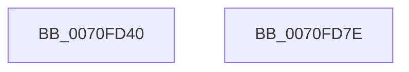

# ArbStartArbiter

- RVA: `0x0070FD40`–`0x0070FD7F` (길이 `63` bytes)
- VA: `0x000000014070FD40`
- 실행 섹션: `PAGE`
- PDB 이름 있음: `예`; PDB Function 태그: `아니요`
- unwind 정보 RVA: `0x0006E5F8`
- 디코드: `18`개 명령, `63/63` bytes 표시
- 미해석 바이트: `0` (있으면 어셈블리에 `.byte`로 보존)

> 이 문서는 커널 이미지의 기계어와 PDB 기호를 분석해 생성했습니다. 4번과 5번은 함수 원형과 자료형을 바이너리 사용 방식에서 추정한 C 해석이며 원본 소스 복구 결과는 아닙니다.

## 1. Dependencies

- 직접 호출 지점: **2**; 고유 호출 대상: **2**
- 직접 호출자로 확인된 함수: **0**
- RIP 상대 이미지 참조: **0**

### Outgoing calls
- `0x0070FD54` → [RtlFreeRangeList](../A6/RtlFreeRangeList_function_00A69850.md) (function, `0x00A69850`)
- `0x0070FD6E` → [guard_dispatch_icall](../../text/6B/guard_dispatch_icall_function_006BAAD0.md) (function, `0x006BAAD0`)

### Direct callers
- 이 함수 시작 RVA로 연결되는 직접 call은 확인되지 않았습니다. 간접 호출은 완전히 역산할 수 없습니다.

### Static image references
- 디코드된 RIP-relative 메모리 참조가 없습니다.

## 2. Other-region calls and transfers

- 다른 실행 섹션으로 향하는 call: **1**
  - `0x0070FD6E` → [guard_dispatch_icall](../../text/6B/guard_dispatch_icall_function_006BAAD0.md) (`PAGE` → `.text`)
- 별도 외부 분기/꼬리 이동을 확인하지 못했습니다.

## 3. Assembly (complete function range)

```asm
0070FD40  48 89 5C 24 08                  mov qword ptr [rsp + 8], rbx
0070FD45  57                              push rdi
0070FD46  48 83 EC 30                     sub rsp, 0x30
0070FD4A  48 8B F9                        mov rdi, rcx
0070FD4D  48 8B DA                        mov rbx, rdx
0070FD50  48 8B 49 28                     mov rcx, qword ptr [rcx + 0x28]
0070FD54  E8 F7 9A 35 00                  call 0x140a69850
0070FD59  48 8B 87 18 01 00 00            mov rax, qword ptr [rdi + 0x118]
0070FD60  4C 8D 43 14                     lea r8, [rbx + 0x14]
0070FD64  4C 8B 4F 28                     mov r9, qword ptr [rdi + 0x28]
0070FD68  48 8B CF                        mov rcx, rdi
0070FD6B  8B 53 10                        mov edx, dword ptr [rbx + 0x10]
0070FD6E  E8 5D AD FA FF                  call 0x1406baad0
0070FD73  48 8B 5C 24 40                  mov rbx, qword ptr [rsp + 0x40]
0070FD78  48 83 C4 30                     add rsp, 0x30
0070FD7C  5F                              pop rdi
0070FD7D  C3                              ret
0070FD7E  CC                              int3
```

## 4. C-style interpretation (structured pseudocode)

```c
__int64 __fastcall ArbStartArbiter(__int64 a1, __int64 a2)
{
    __int64 result;
    __int64 v_rsp;
    unsigned __int64 v_stack_p8;

    v_stack_p8 = v_rbx;
    v_rsp = (v_rsp) - (48);
    result = RtlFreeRangeList(*(unsigned __int64 *)(a1 + 40), a2, a3, a4);
    result = guard_dispatch_icall(a1, (unsigned int)(*(unsigned int *)(a2 + 16)), a2 + 20, *(unsigned __int64 *)(a1 + 40));
    v_rsp = (v_rsp) + (48);
    return result;
}
```

## 5. (Beta) C Style

```c
int64_t ArbStartArbiter(void *Arg1, void *Arg2)
{
    uint8_t *arg1 = (uint8_t *)Arg1;
    uint8_t *arg2 = (uint8_t *)Arg2;

    int64_t result;
    int64_t local_rsp;
    uint64_t v_stack_p8;

    v_stack_p8 = local_rbx;
    local_rsp = (local_rsp) - (48);
    result = RtlFreeRangeList(*(uint64_t *)(arg1 + 0x28), Arg2, a3, a4);
    result = guard_dispatch_icall(Arg1, (uint32_t)(*(uint32_t *)(arg2 + 0x10)), Arg2 + 20, *(uint64_t *)(arg1 + 0x28));
    local_rsp = (local_rsp) + (48);
    return result;
}
```

### 관측된 메모리 오프셋

구조체 형식이 확인되지 않은 접근은 인자 기준의 오프셋으로만 기록했습니다.

| 기준 인자 | 오프셋 표현 | 폭 (bit) | 접근 |
|---|---:|---:|---|
| `Arg1` | `+ 0x28` | `64` | `R` |
| `Arg1` | `+ 0x118` | `64` | `R` |
| `Arg2` | `+ 0x10` | `32` | `R` |
| `Arg2` | `+ 0x14` | `64` | `R` |

## 6. Execution-region graph

[열기: 2D/3D 그래프와 함수 탐색 컨트롤 패널](../../../control-panel.html?section=page&rva=0x0070FD40&view=graph)

- 2D 그래프는 위에서 아래로 흐르고, 3D 그래프는 빈 공간을 드래그해 회전합니다. Shift+드래그는 이동, 휠은 확대·축소, 함수 노드 선택은 대상 보고서 이동입니다.

### Static fallback


