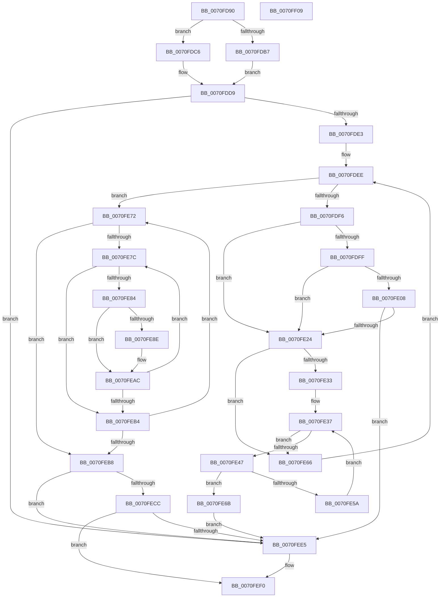

# ArbTestAllocation

- RVA: `0x0070FD90`–`0x0070FF0A` (길이 `378` bytes)
- VA: `0x000000014070FD90`
- 실행 섹션: `PAGE`
- PDB 이름 있음: `예`; PDB Function 태그: `아니요`
- unwind 정보 RVA: `0x00084C9C`
- 디코드: `115`개 명령, `378/378` bytes 표시
- 미해석 바이트: `0` (있으면 어셈블리에 `.byte`로 보존)

> 이 문서는 커널 이미지의 기계어와 PDB 기호를 분석해 생성했습니다. 4번과 5번은 함수 원형과 자료형을 바이너리 사용 방식에서 추정한 C 해석이며 원본 소스 복구 결과는 아닙니다.

## 1. Dependencies

- 직접 호출 지점: **7**; 고유 호출 대상: **4**
- 직접 호출자로 확인된 함수: **0**
- RIP 상대 이미지 참조: **0**

### Outgoing calls
- `0x0070FDBF` → [RtlCopyRangeList](../A6/RtlCopyRangeList_function_00A69680.md) (function, `0x00A69680`)
- `0x0070FDD4` → [guard_dispatch_icall](../../text/6B/guard_dispatch_icall_function_006BAAD0.md) (function, `0x006BAAD0`)
- `0x0070FE15` → [guard_dispatch_icall](../../text/6B/guard_dispatch_icall_function_006BAAD0.md) (function, `0x006BAAD0`)
- `0x0070FE51` → [guard_dispatch_icall](../../text/6B/guard_dispatch_icall_function_006BAAD0.md) (function, `0x006BAAD0`)
- `0x0070FEC1` → [ArbpBuildAllocationStack](ArbpBuildAllocationStack_function_0070FF10.md) (function, `0x0070FF10`)
- `0x0070FEDA` → [guard_dispatch_icall](../../text/6B/guard_dispatch_icall_function_006BAAD0.md) (function, `0x006BAAD0`)
- `0x0070FEE9` → [RtlFreeRangeList](../A6/RtlFreeRangeList_function_00A69850.md) (function, `0x00A69850`)

### Direct callers
- 이 함수 시작 RVA로 연결되는 직접 call은 확인되지 않았습니다. 간접 호출은 완전히 역산할 수 없습니다.

### Static image references
- 디코드된 RIP-relative 메모리 참조가 없습니다.

## 2. Other-region calls and transfers

- 다른 실행 섹션으로 향하는 call: **4**
  - `0x0070FDD4` → [guard_dispatch_icall](../../text/6B/guard_dispatch_icall_function_006BAAD0.md) (`PAGE` → `.text`)
  - `0x0070FE15` → [guard_dispatch_icall](../../text/6B/guard_dispatch_icall_function_006BAAD0.md) (`PAGE` → `.text`)
  - `0x0070FE51` → [guard_dispatch_icall](../../text/6B/guard_dispatch_icall_function_006BAAD0.md) (`PAGE` → `.text`)
  - `0x0070FEDA` → [guard_dispatch_icall](../../text/6B/guard_dispatch_icall_function_006BAAD0.md) (`PAGE` → `.text`)
- 별도 외부 분기/꼬리 이동을 확인하지 못했습니다.

## 3. Assembly (complete function range)

```asm
0070FD90  48 89 5C 24 08                  mov qword ptr [rsp + 8], rbx
0070FD95  48 89 6C 24 10                  mov qword ptr [rsp + 0x10], rbp
0070FD9A  48 89 74 24 18                  mov qword ptr [rsp + 0x18], rsi
0070FD9F  57                              push rdi
0070FDA0  41 56                           push r14
0070FDA2  41 57                           push r15
0070FDA4  48 83 EC 30                     sub rsp, 0x30
0070FDA8  4C 8B 42 10                     mov r8, qword ptr [rdx + 0x10]
0070FDAC  4C 8B F2                        mov r14, rdx
0070FDAF  48 8B F9                        mov rdi, rcx
0070FDB2  4D 85 C0                        test r8, r8
0070FDB5  75 0F                           jne 0x14070fdc6
0070FDB7  48 8B 51 28                     mov rdx, qword ptr [rcx + 0x28]
0070FDBB  48 8B 49 30                     mov rcx, qword ptr [rcx + 0x30]
0070FDBF  E8 BC 98 35 00                  call 0x140a69680
0070FDC4  EB 13                           jmp 0x14070fdd9
0070FDC6  48 8B 81 18 01 00 00            mov rax, qword ptr [rcx + 0x118]
0070FDCD  4C 8B 49 30                     mov r9, qword ptr [rcx + 0x30]
0070FDD1  8B 52 08                        mov edx, dword ptr [rdx + 8]
0070FDD4  E8 F7 AC FA FF                  call 0x1406baad0
0070FDD9  8B D8                           mov ebx, eax
0070FDDB  85 C0                           test eax, eax
0070FDDD  0F 88 02 01 00 00               js 0x14070fee5
0070FDE3  49 8B 06                        mov rax, qword ptr [r14]
0070FDE6  33 ED                           xor ebp, ebp
0070FDE8  45 33 FF                        xor r15d, r15d
0070FDEB  48 8B 30                        mov rsi, qword ptr [rax]
0070FDEE  4D 8B 06                        mov r8, qword ptr [r14]
0070FDF1  4C 3B C6                        cmp r8, rsi
0070FDF4  74 7C                           je 0x14070fe72
0070FDF6  FF C5                           inc ebp
0070FDF8  49 83 7E 10 00                  cmp qword ptr [r14 + 0x10], 0
0070FDFD  75 25                           jne 0x14070fe24
0070FDFF  48 8B 56 20                     mov rdx, qword ptr [rsi + 0x20]
0070FE03  4C 3B FA                        cmp r15, rdx
0070FE06  74 1C                           je 0x14070fe24
0070FE08  48 8B 87 20 01 00 00            mov rax, qword ptr [rdi + 0x120]
0070FE0F  48 8B CF                        mov rcx, rdi
0070FE12  4C 8B FA                        mov r15, rdx
0070FE15  E8 B6 AC FA FF                  call 0x1406baad0
0070FE1A  8B D8                           mov ebx, eax
0070FE1C  85 C0                           test eax, eax
0070FE1E  0F 88 C1 00 00 00               js 0x14070fee5
0070FE24  48 83 66 30 00                  and qword ptr [rsi + 0x30], 0
0070FE29  48 83 BF 90 00 00 00 00         cmp qword ptr [rdi + 0x90], 0
0070FE31  74 33                           je 0x14070fe66
0070FE33  48 8B 5E 18                     mov rbx, qword ptr [rsi + 0x18]
0070FE37  8B 46 10                        mov eax, dword ptr [rsi + 0x10]
0070FE3A  48 C1 E0 05                     shl rax, 5
0070FE3E  48 03 46 18                     add rax, qword ptr [rsi + 0x18]
0070FE42  48 3B D8                        cmp rbx, rax
0070FE45  73 1F                           jae 0x14070fe66
0070FE47  48 8B 87 90 00 00 00            mov rax, qword ptr [rdi + 0x90]
0070FE4E  48 8B CB                        mov rcx, rbx
0070FE51  E8 7A AC FA FF                  call 0x1406baad0
0070FE56  85 C0                           test eax, eax
0070FE58  78 11                           js 0x14070fe6b
0070FE5A  48 98                           cdqe
0070FE5C  48 01 46 30                     add qword ptr [rsi + 0x30], rax
0070FE60  48 83 C3 20                     add rbx, 0x20
0070FE64  EB D1                           jmp 0x14070fe37
0070FE66  48 8B 36                        mov rsi, qword ptr [rsi]
0070FE69  EB 83                           jmp 0x14070fdee
0070FE6B  BB 82 01 00 C0                  mov ebx, 0xc0000182
0070FE70  EB 73                           jmp 0x14070fee5
0070FE72  49 8B 10                        mov rdx, qword ptr [r8]
0070FE75  B1 01                           mov cl, 1
0070FE77  49 3B D0                        cmp rdx, r8
0070FE7A  74 3C                           je 0x14070feb8
0070FE7C  4C 8B 0A                        mov r9, qword ptr [rdx]
0070FE7F  4D 3B C8                        cmp r9, r8
0070FE82  74 30                           je 0x14070feb4
0070FE84  49 8B 41 30                     mov rax, qword ptr [r9 + 0x30]
0070FE88  48 39 42 30                     cmp qword ptr [rdx + 0x30], rax
0070FE8C  7E 1E                           jle 0x14070feac
0070FE8E  48 8B 4A 08                     mov rcx, qword ptr [rdx + 8]
0070FE92  49 8B 01                        mov rax, qword ptr [r9]
0070FE95  4C 89 09                        mov qword ptr [rcx], r9
0070FE98  48 89 50 08                     mov qword ptr [rax + 8], rdx
0070FE9C  48 89 02                        mov qword ptr [rdx], rax
0070FE9F  4C 89 4A 08                     mov qword ptr [rdx + 8], r9
0070FEA3  49 89 49 08                     mov qword ptr [r9 + 8], rcx
0070FEA7  32 C9                           xor cl, cl
0070FEA9  49 89 11                        mov qword ptr [r9], rdx
0070FEAC  48 8B 12                        mov rdx, qword ptr [rdx]
0070FEAF  49 3B D0                        cmp rdx, r8
0070FEB2  75 C8                           jne 0x14070fe7c
0070FEB4  84 C9                           test cl, cl
0070FEB6  74 BA                           je 0x14070fe72
0070FEB8  49 8B 16                        mov rdx, qword ptr [r14]
0070FEBB  44 8B C5                        mov r8d, ebp
0070FEBE  48 8B CF                        mov rcx, rdi
0070FEC1  E8 4A 00 00 00                  call 0x14070ff10
0070FEC6  8B D8                           mov ebx, eax
0070FEC8  85 C0                           test eax, eax
0070FECA  78 19                           js 0x14070fee5
0070FECC  48 8B 87 E8 00 00 00            mov rax, qword ptr [rdi + 0xe8]
0070FED3  48 8B CF                        mov rcx, rdi
0070FED6  48 8B 57 70                     mov rdx, qword ptr [rdi + 0x70]
0070FEDA  E8 F1 AB FA FF                  call 0x1406baad0
0070FEDF  8B D8                           mov ebx, eax
0070FEE1  85 C0                           test eax, eax
0070FEE3  79 0B                           jns 0x14070fef0
0070FEE5  48 8B 4F 30                     mov rcx, qword ptr [rdi + 0x30]
0070FEE9  E8 62 99 35 00                  call 0x140a69850
0070FEEE  8B C3                           mov eax, ebx
0070FEF0  48 8B 5C 24 50                  mov rbx, qword ptr [rsp + 0x50]
0070FEF5  48 8B 6C 24 58                  mov rbp, qword ptr [rsp + 0x58]
0070FEFA  48 8B 74 24 60                  mov rsi, qword ptr [rsp + 0x60]
0070FEFF  48 83 C4 30                     add rsp, 0x30
0070FF03  41 5F                           pop r15
0070FF05  41 5E                           pop r14
0070FF07  5F                              pop rdi
0070FF08  C3                              ret
0070FF09  CC                              int3
```

## 4. C-style interpretation (structured pseudocode)

```c
__int64 __fastcall ArbTestAllocation(__int64 a1, __int64 a2)
{
    __int64 result;
    __int64 v_r15;
    __int64 v_rbp;
    __int64 v_rbx;
    __int64 v_rsp;
    unsigned __int64 v_stack_p10;
    unsigned __int64 v_stack_p18;
    unsigned __int64 v_stack_p8;

    v_stack_p8 = v_rbx;
    v_stack_p10 = v_rbp;
    v_stack_p18 = v_rsi;
    v_rsp = (v_rsp) - (48);
    if (*(unsigned __int64 *)(a2 + 16) != 0) goto loc_0070FDC6;
    result = RtlCopyRangeList(*(unsigned __int64 *)(a1 + 48), *(unsigned __int64 *)(a1 + 40), *(unsigned __int64 *)(a2 + 16), a4);
    goto loc_0070FDD9;
loc_0070FDC6:
    result = guard_dispatch_icall(*(unsigned __int64 *)(a1 + 48), (unsigned int)(*(unsigned int *)(*(unsigned __int64 *)(a1 + 40) + 8)), *(unsigned __int64 *)(a2 + 16), *(unsigned __int64 *)(*(unsigned __int64 *)(a1 + 48) + 48));
loc_0070FDD9:
    if (sign_flag) goto loc_0070FEE5;
    v_rbp = 0;
    v_r15 = 0;
loc_0070FDEE:
    if ((*(unsigned __int64 *)(a2)) == (*(unsigned __int64 *)(*(unsigned __int64 *)(a2)))) goto loc_0070FE72;
    v_rbp = (unsigned int)((v_rbp) + 1);
    if ((*(unsigned __int64 *)(a2 + 16)) != 0) goto loc_0070FE24;
    if (0 == (*(unsigned __int64 *)(*(unsigned __int64 *)(*(unsigned __int64 *)(a2)) + 32))) goto loc_0070FE24;
    result = guard_dispatch_icall(a1, *(unsigned __int64 *)(*(unsigned __int64 *)(*(unsigned __int64 *)(a2)) + 32), *(unsigned __int64 *)(a2), *(unsigned __int64 *)(*(unsigned __int64 *)(a1 + 48) + 48));
    if (sign_flag) goto loc_0070FEE5;
loc_0070FE24:
    if ((*(unsigned __int64 *)(a1 + 144)) == 0) goto loc_0070FE66;
loc_0070FE37:
    result = ((unsigned int)(*(unsigned int *)(*(unsigned __int64 *)(*(unsigned __int64 *)(a2)) + 16))) << (5);
    result = (result) + (*(unsigned __int64 *)(*(unsigned __int64 *)(*(unsigned __int64 *)(a2)) + 24));
    if ((*(unsigned __int64 *)(*(unsigned __int64 *)(*(unsigned __int64 *)(a2)) + 24)) >= result) goto loc_0070FE66;
    result = guard_dispatch_icall(*(unsigned __int64 *)(*(unsigned __int64 *)(*(unsigned __int64 *)(a2)) + 24), *(unsigned __int64 *)(*(unsigned __int64 *)(*(unsigned __int64 *)(a2)) + 32), *(unsigned __int64 *)(a2), *(unsigned __int64 *)(*(unsigned __int64 *)(a1 + 48) + 48));
    if (sign_flag) goto loc_0070FE6B;
    v_rbx = (*(unsigned __int64 *)(*(unsigned __int64 *)(*(unsigned __int64 *)(a2)) + 24)) + (32);
    goto loc_0070FE37;
loc_0070FE66:
    goto loc_0070FDEE;
loc_0070FE6B:
    goto loc_0070FEE5;
loc_0070FE72:
    if ((*(unsigned __int64 *)(*(unsigned __int64 *)(a2))) == (*(unsigned __int64 *)(a2))) goto loc_0070FEB8;
loc_0070FE7C:
    if ((*(unsigned __int64 *)(*(unsigned __int64 *)(*(unsigned __int64 *)(a2)))) == (*(unsigned __int64 *)(a2))) goto loc_0070FEB4;
    result = *(unsigned __int64 *)(*(unsigned __int64 *)(*(unsigned __int64 *)(*(unsigned __int64 *)(a2))) + 48);
    if ((*(unsigned __int64 *)(*(unsigned __int64 *)(*(unsigned __int64 *)(a2)) + 48)) >= = (*(unsigned __int64 *)(*(unsigned __int64 *)(*(unsigned __int64 *)(*(unsigned __int64 *)(a2))) + 48))) {
        a1 = *(unsigned __int64 *)(*(unsigned __int64 *)(*(unsigned __int64 *)(a2)) + 8);
        result = *(unsigned __int64 *)(*(unsigned __int64 *)(*(unsigned __int64 *)(*(unsigned __int64 *)(a2))));
        *(unsigned __int64 *)(a1) = *(unsigned __int64 *)(*(unsigned __int64 *)(*(unsigned __int64 *)(a2)));
        *(unsigned __int64 *)(result + 8) = *(unsigned __int64 *)(*(unsigned __int64 *)(a2));
        *(unsigned __int64 *)(*(unsigned __int64 *)(*(unsigned __int64 *)(a2))) = result;
        *(unsigned __int64 *)(*(unsigned __int64 *)(*(unsigned __int64 *)(a2)) + 8) = *(unsigned __int64 *)(*(unsigned __int64 *)(*(unsigned __int64 *)(a2)));
        *(unsigned __int64 *)(*(unsigned __int64 *)(*(unsigned __int64 *)(*(unsigned __int64 *)(a2))) + 8) = a1;
        a1 = 0;
        *(unsigned __int64 *)(*(unsigned __int64 *)(*(unsigned __int64 *)(*(unsigned __int64 *)(a2)))) = *(unsigned __int64 *)(*(unsigned __int64 *)(a2));
    }
    if ((*(unsigned __int64 *)(*(unsigned __int64 *)(*(unsigned __int64 *)(a2)))) != (*(unsigned __int64 *)(a2))) goto loc_0070FE7C;
loc_0070FEB4:
    if (0 == 0) goto loc_0070FE72;
loc_0070FEB8:
    result = ArbpBuildAllocationStack(0, *(unsigned __int64 *)(a2), (unsigned int)((unsigned int)(v_rbp)), *(unsigned __int64 *)(*(unsigned __int64 *)(*(unsigned __int64 *)(a2))));
    if (sign_flag) goto loc_0070FEE5;
    result = guard_dispatch_icall(0, *(unsigned __int64 *)(a1 + 112), (unsigned int)((unsigned int)(v_rbp)), *(unsigned __int64 *)(*(unsigned __int64 *)(*(unsigned __int64 *)(a2))));
    if (sign_flag) {
        a1 = *(unsigned __int64 *)(a1 + 48);
        result = RtlFreeRangeList(a1, *(unsigned __int64 *)(a1 + 112), (unsigned int)((unsigned int)(v_rbp)), *(unsigned __int64 *)(*(unsigned __int64 *)(*(unsigned __int64 *)(a2))));
        result = (unsigned int)((unsigned int)((unsigned int)(result)));
    }
    v_rsp = (v_rsp) + (48);
    return result;
}
```

## 5. (Beta) C Style

```c
int64_t ArbTestAllocation(void *Arg1, void *Arg2)
{
    uint8_t *arg1 = (uint8_t *)Arg1;
    uint8_t *arg2 = (uint8_t *)Arg2;

    int64_t result;
    int64_t local_r15;
    int64_t local_rbp;
    int64_t local_rbx;
    int64_t local_rsp;
    uint64_t v_stack_p10;
    uint64_t v_stack_p18;
    uint64_t v_stack_p8;

    v_stack_p8 = local_rbx;
    v_stack_p10 = local_rbp;
    v_stack_p18 = local_rsi;
    local_rsp = (local_rsp) - (48);
    if (*(uint64_t *)(arg2 + 0x10) != 0) goto loc_0070FDC6;
    result = RtlCopyRangeList(*(uint64_t *)(arg1 + 0x30), *(uint64_t *)(arg1 + 0x28), *(uint64_t *)(arg2 + 0x10), a4);
    goto loc_0070FDD9;
loc_0070FDC6:
    result = guard_dispatch_icall(*(uint64_t *)(arg1 + 0x30), (uint32_t)(*(uint32_t *)(*(uint64_t *)(arg1 + 0x28) + 0x8)), *(uint64_t *)(arg2 + 0x10), *(uint64_t *)(*(uint64_t *)(arg1 + 0x30) + 0x30));
loc_0070FDD9:
    if (sign_flag) goto loc_0070FEE5;
    local_rbp = 0;
    local_r15 = 0;
loc_0070FDEE:
    if ((*(uint64_t *)(arg2)) == (*(uint64_t *)(*(uint64_t *)(arg2)))) goto loc_0070FE72;
    local_rbp = (uint32_t)((local_rbp) + 1);
    if ((*(uint64_t *)(arg2 + 0x10)) != 0) goto loc_0070FE24;
    if (0 == (*(uint64_t *)(*(uint64_t *)(*(uint64_t *)(arg2)) + 0x20))) goto loc_0070FE24;
    result = guard_dispatch_icall(Arg1, *(uint64_t *)(*(uint64_t *)(*(uint64_t *)(arg2)) + 0x20), *(uint64_t *)(arg2), *(uint64_t *)(*(uint64_t *)(arg1 + 0x30) + 0x30));
    if (sign_flag) goto loc_0070FEE5;
loc_0070FE24:
    if ((*(uint64_t *)(arg1 + 0x90)) == 0) goto loc_0070FE66;
loc_0070FE37:
    result = ((uint32_t)(*(uint32_t *)(*(uint64_t *)(*(uint64_t *)(arg2)) + 0x10))) << (5);
    result = (result) + (*(uint64_t *)(*(uint64_t *)(*(uint64_t *)(arg2)) + 0x18));
    if ((*(uint64_t *)(*(uint64_t *)(*(uint64_t *)(arg2)) + 0x18)) >= result) goto loc_0070FE66;
    result = guard_dispatch_icall(*(uint64_t *)(*(uint64_t *)(*(uint64_t *)(arg2)) + 0x18), *(uint64_t *)(*(uint64_t *)(*(uint64_t *)(arg2)) + 0x20), *(uint64_t *)(arg2), *(uint64_t *)(*(uint64_t *)(arg1 + 0x30) + 0x30));
    if (sign_flag) goto loc_0070FE6B;
    local_rbx = (*(uint64_t *)(*(uint64_t *)(*(uint64_t *)(arg2)) + 0x18)) + (32);
    goto loc_0070FE37;
loc_0070FE66:
    goto loc_0070FDEE;
loc_0070FE6B:
    goto loc_0070FEE5;
loc_0070FE72:
    if ((*(uint64_t *)(*(uint64_t *)(arg2))) == (*(uint64_t *)(arg2))) goto loc_0070FEB8;
loc_0070FE7C:
    if ((*(uint64_t *)(*(uint64_t *)(*(uint64_t *)(arg2)))) == (*(uint64_t *)(arg2))) goto loc_0070FEB4;
    result = *(uint64_t *)(*(uint64_t *)(*(uint64_t *)(*(uint64_t *)(arg2))) + 0x30);
    if ((*(uint64_t *)(*(uint64_t *)(*(uint64_t *)(arg2)) + 0x30)) >= = (*(uint64_t *)(*(uint64_t *)(*(uint64_t *)(*(uint64_t *)(arg2))) + 0x30))) {
        Arg1 = *(uint64_t *)(*(uint64_t *)(*(uint64_t *)(arg2)) + 0x8);
        result = *(uint64_t *)(*(uint64_t *)(*(uint64_t *)(*(uint64_t *)(arg2))));
        *(uint64_t *)(arg1) = *(uint64_t *)(*(uint64_t *)(*(uint64_t *)(arg2)));
        *(uint64_t *)(result + 0x8) = *(uint64_t *)(*(uint64_t *)(arg2));
        *(uint64_t *)(*(uint64_t *)(*(uint64_t *)(arg2))) = result;
        *(uint64_t *)(*(uint64_t *)(*(uint64_t *)(arg2)) + 0x8) = *(uint64_t *)(*(uint64_t *)(*(uint64_t *)(arg2)));
        *(void **)(*(uint64_t *)(*(uint64_t *)(*(uint64_t *)(arg2))) + 0x8) = Arg1;
        Arg1 = 0;
        *(uint64_t *)(*(uint64_t *)(*(uint64_t *)(*(uint64_t *)(arg2)))) = *(uint64_t *)(*(uint64_t *)(arg2));
    }
    if ((*(uint64_t *)(*(uint64_t *)(*(uint64_t *)(arg2)))) != (*(uint64_t *)(arg2))) goto loc_0070FE7C;
loc_0070FEB4:
    if (0 == 0) goto loc_0070FE72;
loc_0070FEB8:
    result = ArbpBuildAllocationStack(0, *(uint64_t *)(arg2), (uint32_t)((uint32_t)(local_rbp)), *(uint64_t *)(*(uint64_t *)(*(uint64_t *)(arg2))));
    if (sign_flag) goto loc_0070FEE5;
    result = guard_dispatch_icall(0, *(uint64_t *)(arg1 + 0x70), (uint32_t)((uint32_t)(local_rbp)), *(uint64_t *)(*(uint64_t *)(*(uint64_t *)(arg2))));
    if (sign_flag) {
        Arg1 = *(uint64_t *)(arg1 + 0x30);
        result = RtlFreeRangeList(Arg1, *(uint64_t *)(arg1 + 0x70), (uint32_t)((uint32_t)(local_rbp)), *(uint64_t *)(*(uint64_t *)(*(uint64_t *)(arg2))));
        result = (uint32_t)((uint32_t)((uint32_t)(result)));
    }
    local_rsp = (local_rsp) + (48);
    return result;
}
```

### 관측된 메모리 오프셋

구조체 형식이 확인되지 않은 접근은 인자 기준의 오프셋으로만 기록했습니다.

| 기준 인자 | 오프셋 표현 | 폭 (bit) | 접근 |
|---|---:|---:|---|
| `Arg1` | `+ 0x28` | `64` | `R` |
| `Arg1` | `+ 0x30` | `64` | `R` |
| `Arg1` | `+ 0x70` | `64` | `R` |
| `Arg1` | `+ 0x90` | `64` | `R` |
| `Arg1` | `+ 0xE8` | `64` | `R` |
| `Arg1` | `+ 0x118` | `64` | `R` |
| `Arg1` | `+ 0x120` | `64` | `R` |
| `Arg2` | `+ 0x0` | `64` | `R` |
| `Arg2` | `+ 0x8` | `32` | `R` |
| `Arg2` | `+ 0x10` | `64` | `R` |

## 6. Execution-region graph

[열기: 2D/3D 그래프와 함수 탐색 컨트롤 패널](../../../control-panel.html?section=page&rva=0x0070FD90&view=graph)

- 2D 그래프는 위에서 아래로 흐르고, 3D 그래프는 빈 공간을 드래그해 회전합니다. Shift+드래그는 이동, 휠은 확대·축소, 함수 노드 선택은 대상 보고서 이동입니다.

### Static fallback


