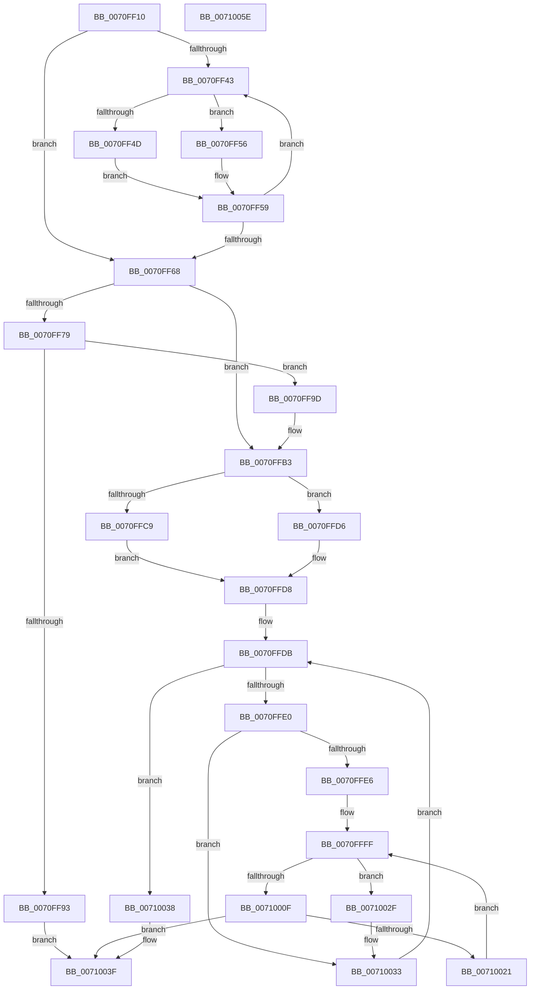

# ArbpBuildAllocationStack

- RVA: `0x0070FF10`–`0x0071005F` (길이 `335` bytes)
- VA: `0x000000014070FF10`
- 실행 섹션: `PAGE`
- PDB 이름 있음: `예`; PDB Function 태그: `아니요`
- unwind 정보 RVA: `0x0008A350`
- 디코드: `105`개 명령, `335/335` bytes 표시
- 미해석 바이트: `0` (있으면 어셈블리에 `.byte`로 보존)

> 이 문서는 커널 이미지의 기계어와 PDB 기호를 분석해 생성했습니다. 4번과 5번은 함수 원형과 자료형을 바이너리 사용 방식에서 추정한 C 해석이며 원본 소스 복구 결과는 아닙니다.

## 1. Dependencies

- 직접 호출 지점: **4**; 고유 호출 대상: **4**
- 직접 호출자로 확인된 함수: **1**
- RIP 상대 이미지 참조: **0**

### Outgoing calls
- `0x0070FF86` → [ExAllocatePool2](../../poolcode/B8/ExAllocatePool2_function_00B820F0.md) (function, `0x00B820F0`)
- `0x0070FFA6` → [ExFreePoolWithTag](../../poolcode/B8/ExFreePoolWithTag_function_00B82870.md) (function, `0x00B82870`)
- `0x0070FFBC` → [memset](../../text/6C/memset_function_006C6C40.md) (function, `0x006C6C40`)
- `0x00710018` → [ArbpBuildAlternative](../71/ArbpBuildAlternative_function_00710068.md) (function, `0x00710068`)

### Direct callers
- [ArbTestAllocation](ArbTestAllocation_function_0070FD90.md) at `0x0070FEC1`

### Static image references
- 디코드된 RIP-relative 메모리 참조가 없습니다.

## 2. Other-region calls and transfers

- 다른 실행 섹션으로 향하는 call: **3**
  - `0x0070FF86` → [ExAllocatePool2](../../poolcode/B8/ExAllocatePool2_function_00B820F0.md) (`PAGE` → `POOLCODE`)
  - `0x0070FFA6` → [ExFreePoolWithTag](../../poolcode/B8/ExFreePoolWithTag_function_00B82870.md) (`PAGE` → `POOLCODE`)
  - `0x0070FFBC` → [memset](../../text/6C/memset_function_006C6C40.md) (`PAGE` → `.text`)
- 별도 외부 분기/꼬리 이동을 확인하지 못했습니다.

## 3. Assembly (complete function range)

```asm
0070FF10  48 8B C4                        mov rax, rsp
0070FF13  48 89 58 08                     mov qword ptr [rax + 8], rbx
0070FF17  48 89 68 10                     mov qword ptr [rax + 0x10], rbp
0070FF1B  48 89 70 18                     mov qword ptr [rax + 0x18], rsi
0070FF1F  48 89 78 20                     mov qword ptr [rax + 0x20], rdi
0070FF23  41 55                           push r13
0070FF25  41 56                           push r14
0070FF27  41 57                           push r15
0070FF29  48 83 EC 20                     sub rsp, 0x20
0070FF2D  45 8D 70 01                     lea r14d, [r8 + 1]
0070FF31  33 FF                           xor edi, edi
0070FF33  4C 8B 02                        mov r8, qword ptr [rdx]
0070FF36  33 DB                           xor ebx, ebx
0070FF38  4C 8B FA                        mov r15, rdx
0070FF3B  4C 8B E9                        mov r13, rcx
0070FF3E  49 3B D0                        cmp rdx, r8
0070FF41  74 25                           je 0x14070ff68
0070FF43  41 8B 50 10                     mov edx, dword ptr [r8 + 0x10]
0070FF47  8B CB                           mov ecx, ebx
0070FF49  85 D2                           test edx, edx
0070FF4B  74 09                           je 0x14070ff56
0070FF4D  8B C2                           mov eax, edx
0070FF4F  C1 E0 06                        shl eax, 6
0070FF52  03 F8                           add edi, eax
0070FF54  EB 03                           jmp 0x14070ff59
0070FF56  41 FF CE                        dec r14d
0070FF59  4D 8B 00                        mov r8, qword ptr [r8]
0070FF5C  FF C3                           inc ebx
0070FF5E  85 D2                           test edx, edx
0070FF60  0F 44 D9                        cmove ebx, ecx
0070FF63  4D 3B F8                        cmp r15, r8
0070FF66  75 DB                           jne 0x14070ff43
0070FF68  43 8D 04 B6                     lea eax, [r14 + r14*4]
0070FF6C  C1 E0 04                        shl eax, 4
0070FF6F  03 F8                           add edi, eax
0070FF71  8B F7                           mov esi, edi
0070FF73  41 39 7D 68                     cmp dword ptr [r13 + 0x68], edi
0070FF77  73 3A                           jae 0x14070ffb3
0070FF79  41 B8 41 72 62 41               mov r8d, 0x41627241
0070FF7F  8B D6                           mov edx, esi
0070FF81  B9 00 01 00 00                  mov ecx, 0x100
0070FF86  E8 65 21 47 00                  call 0x140b820f0
0070FF8B  48 8B E8                        mov rbp, rax
0070FF8E  48 85 C0                        test rax, rax
0070FF91  75 0A                           jne 0x14070ff9d
0070FF93  B8 9A 00 00 C0                  mov eax, 0xc000009a
0070FF98  E9 A2 00 00 00                  jmp 0x14071003f
0070FF9D  49 8B 4D 70                     mov rcx, qword ptr [r13 + 0x70]
0070FFA1  BA 41 72 62 41                  mov edx, 0x41627241
0070FFA6  E8 C5 28 47 00                  call 0x140b82870
0070FFAB  49 89 6D 70                     mov qword ptr [r13 + 0x70], rbp
0070FFAF  41 89 7D 68                     mov dword ptr [r13 + 0x68], edi
0070FFB3  49 8B 4D 70                     mov rcx, qword ptr [r13 + 0x70]
0070FFB7  4C 8B C6                        mov r8, rsi
0070FFBA  33 D2                           xor edx, edx
0070FFBC  E8 7F 6C FB FF                  call 0x1406c6c40
0070FFC1  49 8B 75 70                     mov rsi, qword ptr [r13 + 0x70]
0070FFC5  85 DB                           test ebx, ebx
0070FFC7  74 0D                           je 0x14070ffd6
0070FFC9  4B 8D 3C B6                     lea rdi, [r14 + r14*4]
0070FFCD  48 C1 E7 04                     shl rdi, 4
0070FFD1  48 03 FE                        add rdi, rsi
0070FFD4  EB 02                           jmp 0x14070ffd8
0070FFD6  33 FF                           xor edi, edi
0070FFD8  49 8B 1F                        mov rbx, qword ptr [r15]
0070FFDB  4C 3B FB                        cmp r15, rbx
0070FFDE  74 58                           je 0x140710038
0070FFE0  83 7B 10 00                     cmp dword ptr [rbx + 0x10], 0
0070FFE4  74 4D                           je 0x140710033
0070FFE6  48 89 5E 20                     mov qword ptr [rsi + 0x20], rbx
0070FFEA  8B 43 10                        mov eax, dword ptr [rbx + 0x10]
0070FFED  89 46 30                        mov dword ptr [rsi + 0x30], eax
0070FFF0  48 89 7E 38                     mov qword ptr [rsi + 0x38], rdi
0070FFF4  48 C7 06 01 00 00 00            mov qword ptr [rsi], 1
0070FFFB  48 8B 6B 18                     mov rbp, qword ptr [rbx + 0x18]
0070FFFF  8B 43 10                        mov eax, dword ptr [rbx + 0x10]
00710002  48 C1 E0 05                     shl rax, 5
00710006  48 03 43 18                     add rax, qword ptr [rbx + 0x18]
0071000A  48 3B E8                        cmp rbp, rax
0071000D  73 20                           jae 0x14071002f
0071000F  4C 8B C7                        mov r8, rdi
00710012  48 8B D5                        mov rdx, rbp
00710015  49 8B CD                        mov rcx, r13
00710018  E8 4B 00 00 00                  call 0x140710068
0071001D  85 C0                           test eax, eax
0071001F  78 1E                           js 0x14071003f
00710021  83 67 20 00                     and dword ptr [rdi + 0x20], 0
00710025  48 83 C7 40                     add rdi, 0x40
00710029  48 83 C5 20                     add rbp, 0x20
0071002D  EB D0                           jmp 0x14070ffff
0071002F  48 83 C6 50                     add rsi, 0x50
00710033  48 8B 1B                        mov rbx, qword ptr [rbx]
00710036  EB A3                           jmp 0x14070ffdb
00710038  48 83 66 20 00                  and qword ptr [rsi + 0x20], 0
0071003D  33 C0                           xor eax, eax
0071003F  48 8B 5C 24 40                  mov rbx, qword ptr [rsp + 0x40]
00710044  48 8B 6C 24 48                  mov rbp, qword ptr [rsp + 0x48]
00710049  48 8B 74 24 50                  mov rsi, qword ptr [rsp + 0x50]
0071004E  48 8B 7C 24 58                  mov rdi, qword ptr [rsp + 0x58]
00710053  48 83 C4 20                     add rsp, 0x20
00710057  41 5F                           pop r15
00710059  41 5E                           pop r14
0071005B  41 5D                           pop r13
0071005D  C3                              ret
0071005E  CC                              int3
```

## 4. C-style interpretation (structured pseudocode)

```c
__int64 __fastcall ArbpBuildAllocationStack(__int64 a1, __int64 a2, __int64 a3)
{
    __int64 result;
    __int64 v_r14;
    __int64 v_rbp;
    __int64 v_rbx;
    __int64 v_rdi;
    __int64 v_rsi;
    __int64 v_rsp;
    unsigned __int64 v_stack_p10;
    unsigned __int64 v_stack_p18;
    unsigned __int64 v_stack_p20;
    unsigned __int64 v_stack_p8;

    *(unsigned __int64 *)(v_rsp + 8) = v_rbx;
    *(unsigned __int64 *)(v_rsp + 16) = v_rbp;
    *(unsigned __int64 *)(v_rsp + 24) = v_rsi;
    *(unsigned __int64 *)(v_rsp + 32) = v_rdi;
    v_rsp = (v_rsp) - (32);
    v_rdi = 0;
    v_rbx = 0;
    if (a2 == (*(unsigned __int64 *)(a2))) goto loc_0070FF68;
loc_0070FF43:
    if ((unsigned int)((unsigned int)(*(unsigned int *)(*(unsigned __int64 *)(a2) + 16))) == 0) goto loc_0070FF56;
    result = (unsigned int)(((unsigned int)((unsigned int)((unsigned int)(*(unsigned int *)(*(unsigned __int64 *)(a2) + 16))))) << (6));
    v_rdi = (unsigned int)((v_rdi) + ((unsigned int)(result)));
    goto loc_0070FF59;
loc_0070FF56:
    v_r14 = (unsigned int)((a3 + 1) - 1);
loc_0070FF59:
    v_rbx = (unsigned int)((v_rbx) + 1);
    if ((unsigned int)((unsigned int)(*(unsigned int *)(*(unsigned __int64 *)(a2) + 16))) == 0) { v_rbx = 0; }
    if (a2 != (*(unsigned __int64 *)(*(unsigned __int64 *)(a2)))) goto loc_0070FF43;
loc_0070FF68:
    result = (unsigned int)((v_r14 + v_r14 * 4) << (4));
    v_rdi = (unsigned int)((v_rdi) + ((unsigned int)(result)));
    if ((*(unsigned int *)(a1 + 104)) >= ((unsigned int)(v_rdi))) goto loc_0070FFB3;
    result = ExAllocatePool2(256, (unsigned int)((unsigned int)((unsigned int)((unsigned int)(v_rdi)))), (unsigned int)(0x41627241ULL), a4);
    if (result != 0) goto loc_0070FF9D;
    goto loc_0071003F;
loc_0070FF9D:
    result = ExFreePoolWithTag(*(unsigned __int64 *)(a1 + 112), (unsigned int)(0x41627241ULL), (unsigned int)(0x41627241ULL), a4);
    *(unsigned __int64 *)(a1 + 112) = result;
    *(unsigned int *)(a1 + 104) = (unsigned int)(v_rdi);
loc_0070FFB3:
    a2 = 0;
    result = memset(*(unsigned __int64 *)(a1 + 112), a2, (unsigned int)((unsigned int)(v_rdi)), a4);
    if ((unsigned int)(v_rbx) == 0) goto loc_0070FFD6;
    v_rdi = (v_r14 + v_r14 * 4) << (4);
    v_rdi = (v_rdi) + (*(unsigned __int64 *)(a1 + 112));
    goto loc_0070FFD8;
loc_0070FFD6:
    v_rdi = 0;
loc_0070FFD8:
loc_0070FFDB:
    if (0 == (*(unsigned __int64 *)(a2))) goto loc_00710038;
    if ((*(unsigned int *)(*(unsigned __int64 *)(a2) + 16)) == 0) goto loc_00710033;
    *(unsigned __int64 *)(*(unsigned __int64 *)(a1 + 112) + 32) = *(unsigned __int64 *)(a2);
    *(unsigned int *)(*(unsigned __int64 *)(a1 + 112) + 48) = (unsigned int)((unsigned int)(*(unsigned int *)(*(unsigned __int64 *)(a2) + 16)));
    *(unsigned __int64 *)(*(unsigned __int64 *)(a1 + 112) + 56) = 0;
    *(unsigned __int64 *)(*(unsigned __int64 *)(a1 + 112)) = 1;
loc_0070FFFF:
    result = ((unsigned int)(*(unsigned int *)(*(unsigned __int64 *)(a2) + 16))) << (5);
    result = (result) + (*(unsigned __int64 *)(*(unsigned __int64 *)(a2) + 24));
    if ((*(unsigned __int64 *)(*(unsigned __int64 *)(a2) + 24)) >= result) goto loc_0071002F;
    result = ArbpBuildAlternative(a1, *(unsigned __int64 *)(*(unsigned __int64 *)(a2) + 24), 0, a4);
    if (sign_flag) goto loc_0071003F;
    v_rdi = (v_rdi) + (64);
    v_rbp = (*(unsigned __int64 *)(*(unsigned __int64 *)(a2) + 24)) + (32);
    goto loc_0070FFFF;
loc_0071002F:
    v_rsi = (*(unsigned __int64 *)(a1 + 112)) + (80);
loc_00710033:
    goto loc_0070FFDB;
loc_00710038:
    result = 0;
loc_0071003F:
    v_rsp = (v_rsp) + (32);
    return result;
}
```

## 5. (Beta) C Style

```c
int64_t ArbpBuildAllocationStack(void *Arg1, void *Arg2, void *Arg3)
{
    uint8_t *arg1 = (uint8_t *)Arg1;
    uint8_t *arg2 = (uint8_t *)Arg2;
    uint8_t *arg3 = (uint8_t *)Arg3;

    int64_t result;
    int64_t local_r14;
    int64_t local_rbp;
    int64_t local_rbx;
    int64_t local_rdi;
    int64_t local_rsi;
    int64_t local_rsp;
    uint64_t v_stack_p10;
    uint64_t v_stack_p18;
    uint64_t v_stack_p20;
    uint64_t v_stack_p8;

    *(uint64_t *)(local_rsp + 0x8) = local_rbx;
    *(uint64_t *)(local_rsp + 0x10) = local_rbp;
    *(uint64_t *)(local_rsp + 0x18) = local_rsi;
    *(uint64_t *)(local_rsp + 0x20) = local_rdi;
    local_rsp = (local_rsp) - (32);
    local_rdi = 0;
    local_rbx = 0;
    if (Arg2 == (*(uint64_t *)(arg2))) goto loc_0070FF68;
loc_0070FF43:
    if ((uint32_t)((uint32_t)(*(uint32_t *)(*(uint64_t *)(arg2) + 0x10))) == 0) goto loc_0070FF56;
    result = (uint32_t)(((uint32_t)((uint32_t)((uint32_t)(*(uint32_t *)(*(uint64_t *)(arg2) + 0x10))))) << (6));
    local_rdi = (uint32_t)((local_rdi) + ((uint32_t)(result)));
    goto loc_0070FF59;
loc_0070FF56:
    local_r14 = (uint32_t)((Arg3 + 1) - 1);
loc_0070FF59:
    local_rbx = (uint32_t)((local_rbx) + 1);
    if ((uint32_t)((uint32_t)(*(uint32_t *)(*(uint64_t *)(arg2) + 0x10))) == 0) { local_rbx = 0; }
    if (Arg2 != (*(uint64_t *)(*(uint64_t *)(arg2)))) goto loc_0070FF43;
loc_0070FF68:
    result = (uint32_t)((local_r14 + local_r14 * 4) << (4));
    local_rdi = (uint32_t)((local_rdi) + ((uint32_t)(result)));
    if ((*(uint32_t *)(arg1 + 0x68)) >= ((uint32_t)(local_rdi))) goto loc_0070FFB3;
    result = ExAllocatePool2(256, (uint32_t)((uint32_t)((uint32_t)((uint32_t)(local_rdi)))), (uint32_t)(0x41627241ULL), a4);
    if (result != 0) goto loc_0070FF9D;
    goto loc_0071003F;
loc_0070FF9D:
    result = ExFreePoolWithTag(*(uint64_t *)(arg1 + 0x70), (uint32_t)(0x41627241ULL), (uint32_t)(0x41627241ULL), a4);
    *(uint64_t *)(arg1 + 0x70) = result;
    *(uint32_t *)(arg1 + 0x68) = (uint32_t)(local_rdi);
loc_0070FFB3:
    Arg2 = 0;
    result = memset(*(uint64_t *)(arg1 + 0x70), Arg2, (uint32_t)((uint32_t)(local_rdi)), a4);
    if ((uint32_t)(local_rbx) == 0) goto loc_0070FFD6;
    local_rdi = (local_r14 + local_r14 * 4) << (4);
    local_rdi = (local_rdi) + (*(uint64_t *)(arg1 + 0x70));
    goto loc_0070FFD8;
loc_0070FFD6:
    local_rdi = 0;
loc_0070FFD8:
loc_0070FFDB:
    if (0 == (*(uint64_t *)(arg2))) goto loc_00710038;
    if ((*(uint32_t *)(*(uint64_t *)(arg2) + 0x10)) == 0) goto loc_00710033;
    *(uint64_t *)(*(uint64_t *)(arg1 + 0x70) + 0x20) = *(uint64_t *)(arg2);
    *(uint32_t *)(*(uint64_t *)(arg1 + 0x70) + 0x30) = (uint32_t)((uint32_t)(*(uint32_t *)(*(uint64_t *)(arg2) + 0x10)));
    *(uint64_t *)(*(uint64_t *)(arg1 + 0x70) + 0x38) = 0;
    *(uint64_t *)(*(uint64_t *)(arg1 + 0x70)) = 1;
loc_0070FFFF:
    result = ((uint32_t)(*(uint32_t *)(*(uint64_t *)(arg2) + 0x10))) << (5);
    result = (result) + (*(uint64_t *)(*(uint64_t *)(arg2) + 0x18));
    if ((*(uint64_t *)(*(uint64_t *)(arg2) + 0x18)) >= result) goto loc_0071002F;
    result = ArbpBuildAlternative(Arg1, *(uint64_t *)(*(uint64_t *)(arg2) + 0x18), 0, a4);
    if (sign_flag) goto loc_0071003F;
    local_rdi = (local_rdi) + (64);
    local_rbp = (*(uint64_t *)(*(uint64_t *)(arg2) + 0x18)) + (32);
    goto loc_0070FFFF;
loc_0071002F:
    local_rsi = (*(uint64_t *)(arg1 + 0x70)) + (80);
loc_00710033:
    goto loc_0070FFDB;
loc_00710038:
    result = 0;
loc_0071003F:
    local_rsp = (local_rsp) + (32);
    return result;
}
```

### 관측된 메모리 오프셋

구조체 형식이 확인되지 않은 접근은 인자 기준의 오프셋으로만 기록했습니다.

| 기준 인자 | 오프셋 표현 | 폭 (bit) | 접근 |
|---|---:|---:|---|
| `Arg1` | `+ 0x68` | `32` | `R` |
| `Arg1` | `+ 0x68` | `32` | `W` |
| `Arg1` | `+ 0x70` | `64` | `R` |
| `Arg1` | `+ 0x70` | `64` | `W` |
| `Arg2` | `+ 0x0` | `64` | `R` |
| `Arg3` | `+ 0x1` | `32` | `R` |

## 6. Execution-region graph

[열기: 2D/3D 그래프와 함수 탐색 컨트롤 패널](../../../control-panel.html?section=page&rva=0x0070FF10&view=graph)

- 2D 그래프는 위에서 아래로 흐르고, 3D 그래프는 빈 공간을 드래그해 회전합니다. Shift+드래그는 이동, 휠은 확대·축소, 함수 노드 선택은 대상 보고서 이동입니다.

### Static fallback


