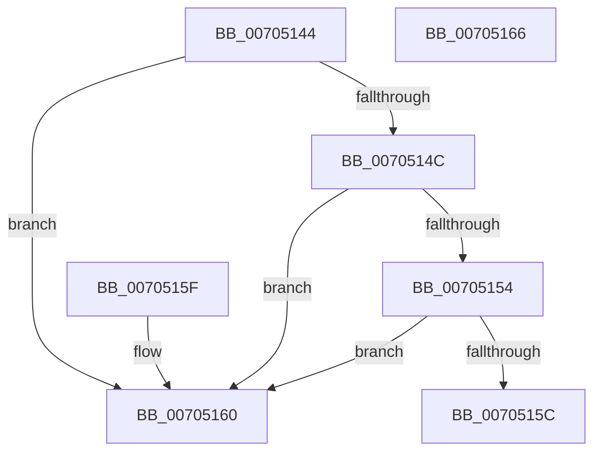

# AslFileNotFound

- RVA: `0x00705144`–`0x00705167` (길이 `35` bytes)
- VA: `0x0000000140705144`
- 실행 섹션: `PAGE`
- PDB 이름 있음: `예`; PDB Function 태그: `아니요`
- unwind 정보 RVA: `0x000DB714`
- 디코드: `12`개 명령, `35/35` bytes 표시
- 미해석 바이트: `0` (있으면 어셈블리에 `.byte`로 보존)

> 이 문서는 커널 이미지의 기계어와 PDB 기호를 분석해 생성했습니다. 4번과 5번은 함수 원형과 자료형을 바이너리 사용 방식에서 추정한 C 해석이며 원본 소스 복구 결과는 아닙니다.

## 1. Dependencies

- 직접 호출 지점: **0**; 고유 호출 대상: **0**
- 직접 호출자로 확인된 함수: **3**
- RIP 상대 이미지 참조: **0**

### Outgoing calls
- 직접 디코드된 call 명령이 없습니다.

### Direct callers
- [SdbpCheckMatchingFiles](../81/SdbpCheckMatchingFiles_function_00814080.md) at `0x00814136`
- [SdbpCheckMatchingTextEntry](../81/SdbpCheckMatchingTextEntry_function_00814A70.md) at `0x00814B92`
- [AslFileMappingCreate](../95/AslFileMappingCreate_function_00958448.md) at `0x00958525`

### Static image references
- 디코드된 RIP-relative 메모리 참조가 없습니다.

## 2. Other-region calls and transfers

- 다른 실행 섹션으로 향하는 call: **0**
- 별도 외부 분기/꼬리 이동을 확인하지 못했습니다.

## 3. Assembly (complete function range)

```asm
00705144  81 F9 3A 00 00 C0               cmp ecx, 0xc000003a
0070514A  74 14                           je 0x140705160
0070514C  81 F9 34 00 00 C0               cmp ecx, 0xc0000034
00705152  74 0C                           je 0x140705160
00705154  81 F9 CC 00 00 C0               cmp ecx, 0xc00000cc
0070515A  74 04                           je 0x140705160
0070515C  33 C0                           xor eax, eax
0070515E  C3                              ret
0070515F  CC                              int3
00705160  B8 01 00 00 00                  mov eax, 1
00705165  C3                              ret
00705166  CC                              int3
```

## 4. C-style interpretation (structured pseudocode)

```c
__int64 __fastcall AslFileNotFound(int a1)
{
    __int64 result;

    if (a1 == 0xC000003AULL) goto loc_00705160;
    if (a1 == 0xC0000034ULL) goto loc_00705160;
    if (a1 == 0xC00000CCULL) goto loc_00705160;
    result = 0;
    return result;
loc_00705160:
    return 1;
}
```

## 5. (Beta) C Style

```c
int64_t AslFileNotFound(int32_t Arg1)
{
    int64_t result;

    if (Arg1 == 0xC000003AULL) goto loc_00705160;
    if (Arg1 == 0xC0000034ULL) goto loc_00705160;
    if (Arg1 == 0xC00000CCULL) goto loc_00705160;
    result = 0;
    return result;
loc_00705160:
    return 1;
}
```

## 6. Execution-region graph

[열기: 2D/3D 그래프와 함수 탐색 컨트롤 패널](../../../control-panel.html?section=page&rva=0x00705144&view=graph)

- 2D 그래프는 위에서 아래로 흐르고, 3D 그래프는 빈 공간을 드래그해 회전합니다. Shift+드래그는 이동, 휠은 확대·축소, 함수 노드 선택은 대상 보고서 이동입니다.

### Static fallback


