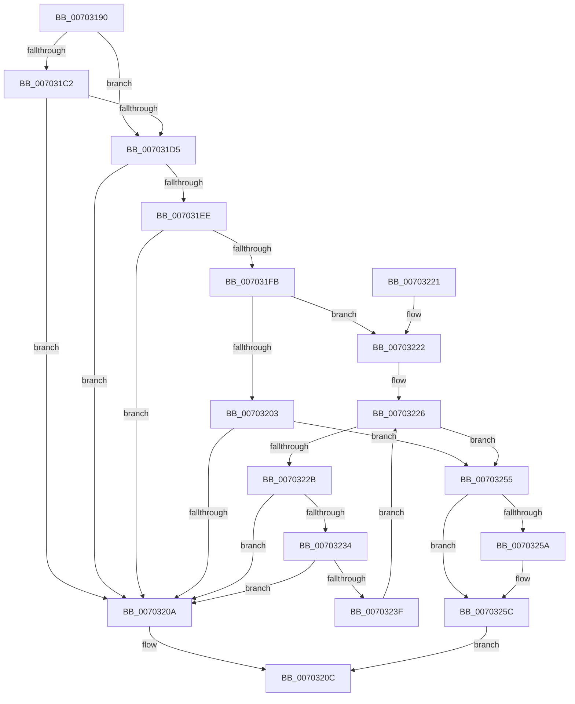

# BiIsValidDiskDevice

- RVA: `0x00703190`–`0x00703260` (길이 `208` bytes)
- VA: `0x0000000140703190`
- 실행 섹션: `PAGE`
- PDB 이름 있음: `예`; PDB Function 태그: `아니요`
- unwind 정보 RVA: `0x00093ED4`
- 디코드: `63`개 명령, `208/208` bytes 표시
- 미해석 바이트: `0` (있으면 어셈블리에 `.byte`로 보존)

> 이 문서는 커널 이미지의 기계어와 PDB 기호를 분석해 생성했습니다. 4번과 5번은 함수 원형과 자료형을 바이너리 사용 방식에서 추정한 C 해석이며 원본 소스 복구 결과는 아닙니다.

## 1. Dependencies

- 직접 호출 지점: **3**; 고유 호출 대상: **2**
- 직접 호출자로 확인된 함수: **2**
- RIP 상대 이미지 참조: **3**

### Outgoing calls
- `0x007031B7` → [wcsicmp](../../text/50/wcsicmp_function_00500080.md) (function, `0x00500080`)
- `0x007031CC` → [wcsicmp](../../text/50/wcsicmp_function_00500080.md) (function, `0x00500080`)
- `0x007031E5` → [wcsnicmp](../../text/50/wcsnicmp_function_005001C0.md) (function, `0x005001C0`)

### Direct callers
- [BiGetNtPartitionPath](../82/BiGetNtPartitionPath_function_0082546C.md) at `0x00825689`
- [BcdEnumerateDisks](../AB/BcdEnumerateDisks_function_00AB04CC.md) at `0x00AB0624`

### Static image references
- `0x007031AD` → RVA `0x00B0BDA0` (` ?? ::NNGAKEGL::`string'`; read)
- `0x007031C2` → RVA `0x00B06100` (` ?? ::NNGAKEGL::`string'`; read)
- `0x007031DB` → RVA `0x00B0BDC0` (` ?? ::NNGAKEGL::`string'`; read)

## 2. Other-region calls and transfers

- 다른 실행 섹션으로 향하는 call: **3**
  - `0x007031B7` → [wcsicmp](../../text/50/wcsicmp_function_00500080.md) (`PAGE` → `.text`)
  - `0x007031CC` → [wcsicmp](../../text/50/wcsicmp_function_00500080.md) (`PAGE` → `.text`)
  - `0x007031E5` → [wcsnicmp](../../text/50/wcsnicmp_function_005001C0.md) (`PAGE` → `.text`)
- 별도 외부 분기/꼬리 이동을 확인하지 못했습니다.

## 3. Assembly (complete function range)

```asm
00703190  48 89 5C 24 08                  mov qword ptr [rsp + 8], rbx
00703195  48 89 6C 24 10                  mov qword ptr [rsp + 0x10], rbp
0070319A  48 89 74 24 18                  mov qword ptr [rsp + 0x18], rsi
0070319F  57                              push rdi
007031A0  48 83 EC 20                     sub rsp, 0x20
007031A4  48 8B F2                        mov rsi, rdx
007031A7  48 8B D9                        mov rbx, rcx
007031AA  48 8B CE                        mov rcx, rsi
007031AD  48 8D 15 EC 8B 40 00            lea rdx, [rip + 0x408bec]
007031B4  49 8B F8                        mov rdi, r8
007031B7  E8 C4 CE DF FF                  call 0x140500080
007031BC  33 ED                           xor ebp, ebp
007031BE  85 C0                           test eax, eax
007031C0  74 13                           je 0x1407031d5
007031C2  48 8D 15 37 2F 40 00            lea rdx, [rip + 0x402f37]
007031C9  48 8B CE                        mov rcx, rsi
007031CC  E8 AF CE DF FF                  call 0x140500080
007031D1  85 C0                           test eax, eax
007031D3  75 35                           jne 0x14070320a
007031D5  41 B8 08 00 00 00               mov r8d, 8
007031DB  48 8D 15 DE 8B 40 00            lea rdx, [rip + 0x408bde]
007031E2  48 8B CB                        mov rcx, rbx
007031E5  E8 D6 CF DF FF                  call 0x1405001c0
007031EA  85 C0                           test eax, eax
007031EC  75 1C                           jne 0x14070320a
007031EE  4C 8D 43 10                     lea r8, [rbx + 0x10]
007031F2  41 0F B7 10                     movzx edx, word ptr [r8]
007031F6  66 85 D2                        test dx, dx
007031F9  74 0F                           je 0x14070320a
007031FB  8B CD                           mov ecx, ebp
007031FD  66 83 FA 30                     cmp dx, 0x30
00703201  75 1F                           jne 0x140703222
00703203  66 41 39 68 02                  cmp word ptr [r8 + 2], bp
00703208  74 4B                           je 0x140703255
0070320A  32 C0                           xor al, al
0070320C  48 8B 5C 24 30                  mov rbx, qword ptr [rsp + 0x30]
00703211  48 8B 6C 24 38                  mov rbp, qword ptr [rsp + 0x38]
00703216  48 8B 74 24 40                  mov rsi, qword ptr [rsp + 0x40]
0070321B  48 83 C4 20                     add rsp, 0x20
0070321F  5F                              pop rdi
00703220  C3                              ret
00703221  CC                              int3
00703222  44 0F B7 CD                     movzx r9d, bp
00703226  66 85 D2                        test dx, dx
00703229  74 2A                           je 0x140703255
0070322B  8D 42 D0                        lea eax, [rdx - 0x30]
0070322E  66 83 F8 09                     cmp ax, 9
00703232  77 D6                           ja 0x14070320a
00703234  66 41 FF C1                     inc r9w
00703238  66 41 83 F9 0A                  cmp r9w, 0xa
0070323D  77 CB                           ja 0x14070320a
0070323F  0F B7 C2                        movzx eax, dx
00703242  8D 0C 89                        lea ecx, [rcx + rcx*4]
00703245  49 83 C0 02                     add r8, 2
00703249  8D 49 E8                        lea ecx, [rcx - 0x18]
0070324C  8D 0C 48                        lea ecx, [rax + rcx*2]
0070324F  41 0F B7 10                     movzx edx, word ptr [r8]
00703253  EB D1                           jmp 0x140703226
00703255  48 85 FF                        test rdi, rdi
00703258  74 02                           je 0x14070325c
0070325A  89 0F                           mov dword ptr [rdi], ecx
0070325C  B0 01                           mov al, 1
0070325E  EB AC                           jmp 0x14070320c
```

## 4. C-style interpretation (structured pseudocode)

```c
__int64 __fastcall BiIsValidDiskDevice(__int64 a1, __int64 a2, __int64 a3)
{
    __int64 result;
    __int64 v_rbp;
    __int64 v_rsp;
    unsigned __int64 v_stack_p10;
    unsigned __int64 v_stack_p18;
    unsigned __int64 v_stack_p8;

    v_stack_p8 = v_rbx;
    v_stack_p10 = v_rbp;
    v_stack_p18 = v_rsi;
    v_rsp = (v_rsp) - (32);
    result = wcsicmp(a2, v_rip + 4230124, a3, a4);
    v_rbp = 0;
    if ((unsigned int)(result) == 0) goto loc_007031D5;
    result = wcsicmp(a2, v_rip + 4206391, a3, a4);
    if ((unsigned int)(result) != 0) goto loc_0070320A;
loc_007031D5:
    result = wcsnicmp(a1, v_rip + 4230110, 8, a4);
    if ((unsigned int)(result) != 0) goto loc_0070320A;
    if ((unsigned __int16)(*(unsigned __int16 *)(a1 + 16)) == 0) goto loc_0070320A;
    if (((unsigned __int16)(*(unsigned __int16 *)(a1 + 16))) != 48) goto loc_00703222;
    if ((*(unsigned __int16 *)(a1 + 16 + 2)) == 0) goto loc_00703255;
loc_0070320A:
    result = 0;
loc_0070320C:
    v_rsp = (v_rsp) + (32);
    return result;
loc_00703222:
loc_00703226:
    if ((unsigned __int16)(*(unsigned __int16 *)(a1 + 16)) == 0) goto loc_00703255;
    if (((unsigned __int16)(*(unsigned __int16 *)(a1 + 16) - 48)) > 9) goto loc_0070320A;
    a4 = (unsigned __int16)(((unsigned __int16)(v_stack_p10)) + 1);
    if (((unsigned __int16)(a4)) > 10) goto loc_0070320A;
    a3 = (a1 + 16) + (2);
    goto loc_00703226;
loc_00703255:
    if (a3 != 0) {
        *(unsigned int *)(a3) = (unsigned int)((unsigned __int16)(*(unsigned __int16 *)(a1 + 16)) + 0 + 0 * 4 - 24 * 2);
    }
    goto loc_0070320C;
}
```

## 5. (Beta) C Style

```c
int64_t BiIsValidDiskDevice(void *Arg1, int64_t Arg2, int64_t Arg3)
{
    uint8_t *arg1 = (uint8_t *)Arg1;

    int64_t result;
    int64_t local_rbp;
    int64_t local_rsp;
    uint64_t v_stack_p10;
    uint64_t v_stack_p18;
    uint64_t v_stack_p8;

    v_stack_p8 = local_rbx;
    v_stack_p10 = local_rbp;
    v_stack_p18 = local_rsi;
    local_rsp = (local_rsp) - (32);
    result = wcsicmp(Arg2, v_rip + 4230124, Arg3, a4);
    local_rbp = 0;
    if ((uint32_t)(result) == 0) goto loc_007031D5;
    result = wcsicmp(Arg2, v_rip + 4206391, Arg3, a4);
    if ((uint32_t)(result) != 0) goto loc_0070320A;
loc_007031D5:
    result = wcsnicmp(Arg1, v_rip + 4230110, 8, a4);
    if ((uint32_t)(result) != 0) goto loc_0070320A;
    if ((uint16_t)(*(uint16_t *)(arg1 + 0x10)) == 0) goto loc_0070320A;
    if (((uint16_t)(*(uint16_t *)(arg1 + 0x10))) != 48) goto loc_00703222;
    if ((*(uint16_t *)(arg1 + 0x10 + 0x2)) == 0) goto loc_00703255;
loc_0070320A:
    result = 0;
loc_0070320C:
    local_rsp = (local_rsp) + (32);
    return result;
loc_00703222:
loc_00703226:
    if ((uint16_t)(*(uint16_t *)(arg1 + 0x10)) == 0) goto loc_00703255;
    if (((uint16_t)(*(uint16_t *)(arg1 + 0x10) - 48)) > 9) goto loc_0070320A;
    a4 = (uint16_t)(((uint16_t)(v_stack_p10)) + 1);
    if (((uint16_t)(a4)) > 10) goto loc_0070320A;
    Arg3 = (Arg1 + 16) + (2);
    goto loc_00703226;
loc_00703255:
    if (Arg3 != 0) {
        *(uint32_t *)(Arg3) = (uint32_t)((uint16_t)(*(uint16_t *)(arg1 + 0x10)) + 0 + 0 * 4 - 24 * 2);
    }
    goto loc_0070320C;
}
```

### 관측된 메모리 오프셋

구조체 형식이 확인되지 않은 접근은 인자 기준의 오프셋으로만 기록했습니다.

| 기준 인자 | 오프셋 표현 | 폭 (bit) | 접근 |
|---|---:|---:|---|
| `Arg1` | `+ 0x0` | `16` | `R` |
| `Arg1` | `+ 0x2` | `16` | `R` |
| `Arg1` | `+ 0x10` | `64` | `R` |

## 6. Execution-region graph

[열기: 2D/3D 그래프와 함수 탐색 컨트롤 패널](../../../control-panel.html?section=page&rva=0x00703190&view=graph)

- 2D 그래프는 위에서 아래로 흐르고, 3D 그래프는 빈 공간을 드래그해 회전합니다. Shift+드래그는 이동, 휠은 확대·축소, 함수 노드 선택은 대상 보고서 이동입니다.

### Static fallback


