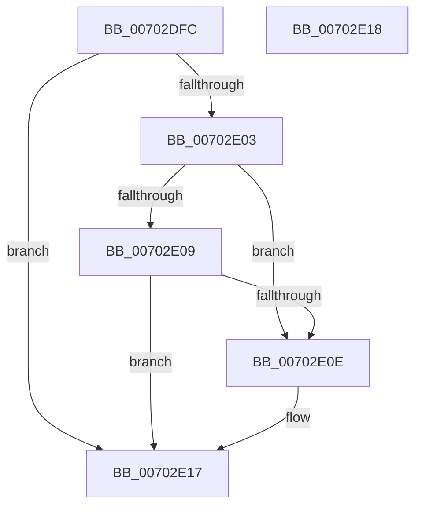

# CmCloseTmHandle

- RVA: `0x00702DFC`–`0x00702E19` (길이 `29` bytes)
- VA: `0x0000000140702DFC`
- 실행 섹션: `PAGE`
- PDB 이름 있음: `예`; PDB Function 태그: `아니요`
- unwind 정보 RVA: `0x000DB714`
- 디코드: `11`개 명령, `29/29` bytes 표시
- 미해석 바이트: `0` (있으면 어셈블리에 `.byte`로 보존)

> 이 문서는 커널 이미지의 기계어와 PDB 기호를 분석해 생성했습니다. 4번과 5번은 함수 원형과 자료형을 바이너리 사용 방식에서 추정한 C 해석이며 원본 소스 복구 결과는 아닙니다.

## 1. Dependencies

- 직접 호출 지점: **0**; 고유 호출 대상: **0**
- 직접 호출자로 확인된 함수: **2**
- RIP 상대 이미지 참조: **0**

### Outgoing calls
- 직접 디코드된 call 명령이 없습니다.

### Direct callers
- [CmpTryToRundownHive](../../text/2A/CmpTryToRundownHive_function_002A4A60.md) at `0x002A4B97`
- [CmShutdownSystem1](../../text/66/CmShutdownSystem1_function_0066A5B0.md) at `0x0066A61A`

### Static image references
- 디코드된 RIP-relative 메모리 참조가 없습니다.

## 2. Other-region calls and transfers

- 다른 실행 섹션으로 향하는 call: **0**
- 별도 외부 분기/꼬리 이동을 확인하지 못했습니다.

## 3. Assembly (complete function range)

```asm
00702DFC  33 C0                           xor eax, eax
00702DFE  48 85 C9                        test rcx, rcx
00702E01  74 14                           je 0x140702e17
00702E03  83 79 40 01                     cmp dword ptr [rcx + 0x40], 1
00702E07  74 05                           je 0x140702e0e
00702E09  80 FA 01                        cmp dl, 1
00702E0C  75 09                           jne 0x140702e17
00702E0E  48 8B 41 20                     mov rax, qword ptr [rcx + 0x20]
00702E12  48 83 61 20 00                  and qword ptr [rcx + 0x20], 0
00702E17  C3                              ret
00702E18  CC                              int3
```

## 4. C-style interpretation (structured pseudocode)

```c
__int64 __fastcall CmCloseTmHandle(__int64 a1, unsigned __int8 a2)
{
    __int64 result;

    result = 0;
    if (a1 == 0) goto loc_00702E17;
    if ((*(unsigned int *)(a1 + 64)) == 1) goto loc_00702E0E;
    if (a2 == 1) {
        result = *(unsigned __int64 *)(a1 + 32);
    }
    return result;
}
```

## 5. (Beta) C Style

```c
int64_t CmCloseTmHandle(int64_t Arg1, uint8_t Arg2)
{
    int64_t result;

    result = 0;
    if (Arg1 == 0) goto loc_00702E17;
    if ((*(uint32_t *)(Arg1 + 0x40)) == 1) goto loc_00702E0E;
    if (Arg2 == 1) {
        result = *(uint64_t *)(Arg1 + 0x20);
    }
    return result;
}
```

## 6. Execution-region graph

[열기: 2D/3D 그래프와 함수 탐색 컨트롤 패널](../../../control-panel.html?section=page&rva=0x00702DFC&view=graph)

- 2D 그래프는 위에서 아래로 흐르고, 3D 그래프는 빈 공간을 드래그해 회전합니다. Shift+드래그는 이동, 휠은 확대·축소, 함수 노드 선택은 대상 보고서 이동입니다.

### Static fallback


