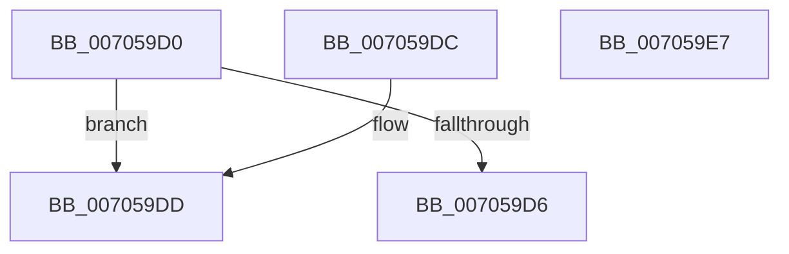

# CmFcpManagerComputeMinimumFeatureUsageFlushTimestampIncrement

- RVA: `0x007059D0`–`0x007059E8` (길이 `24` bytes)
- VA: `0x00000001407059D0`
- 실행 섹션: `PAGE`
- PDB 이름 있음: `예`; PDB Function 태그: `아니요`
- unwind 정보 RVA: `0x000DB714`
- 디코드: `13`개 명령, `24/24` bytes 표시
- 미해석 바이트: `0` (있으면 어셈블리에 `.byte`로 보존)

> 이 문서는 커널 이미지의 기계어와 PDB 기호를 분석해 생성했습니다. 4번과 5번은 함수 원형과 자료형을 바이너리 사용 방식에서 추정한 C 해석이며 원본 소스 복구 결과는 아닙니다.

## 1. Dependencies

- 직접 호출 지점: **0**; 고유 호출 대상: **0**
- 직접 호출자로 확인된 함수: **1**
- RIP 상대 이미지 참조: **0**

### Outgoing calls
- 직접 디코드된 call 명령이 없습니다.

### Direct callers
- [CmFcManagerFlushFeatureUsage](../AC/CmFcManagerFlushFeatureUsage_function_00AC1814.md) at `0x00AC185D`
- [CmFcManagerFlushFeatureUsage](../AC/CmFcManagerFlushFeatureUsage_function_00AC1814.md) at `0x00AC18E1`

### Static image references
- 디코드된 RIP-relative 메모리 참조가 없습니다.

## 2. Other-region calls and transfers

- 다른 실행 섹션으로 향하는 call: **0**
- 별도 외부 분기/꼬리 이동을 확인하지 못했습니다.

## 3. Assembly (complete function range)

```asm
007059D0  33 C0                           xor eax, eax
007059D2  84 C9                           test cl, cl
007059D4  75 07                           jne 0x1407059dd
007059D6  84 D2                           test dl, dl
007059D8  0F 95 C0                        setne al
007059DB  C3                              ret
007059DC  CC                              int3
007059DD  F6 DA                           neg dl
007059DF  1B C0                           sbb eax, eax
007059E1  F7 D8                           neg eax
007059E3  83 C0 02                        add eax, 2
007059E6  C3                              ret
007059E7  CC                              int3
```

## 4. C-style interpretation (structured pseudocode)

```c
__int64 __fastcall CmFcpManagerComputeMinimumFeatureUsageFlushTimestampIncrement(unsigned __int8 a1, unsigned __int8 a2)
{
    __int64 result;

    result = 0;
    if (a1 != 0) goto loc_007059DD;
    result = (a2 != 0) ? 1 : 0;
    return result;
loc_007059DD:
    a2 = (unsigned __int8)(-(a2));
    result = (unsigned int)(-(result));
    result = (unsigned int)((result) + (2));
    return result;
}
```

## 5. (Beta) C Style

```c
int64_t CmFcpManagerComputeMinimumFeatureUsageFlushTimestampIncrement(uint8_t Arg1, uint8_t Arg2)
{
    int64_t result;

    result = 0;
    if (Arg1 != 0) goto loc_007059DD;
    result = (Arg2 != 0) ? 1 : 0;
    return result;
loc_007059DD:
    Arg2 = (uint8_t)(-(Arg2));
    result = (uint32_t)(-(result));
    result = (uint32_t)((result) + (2));
    return result;
}
```

## 6. Execution-region graph

[열기: 2D/3D 그래프와 함수 탐색 컨트롤 패널](../../../control-panel.html?section=page&rva=0x007059D0&view=graph)

- 2D 그래프는 위에서 아래로 흐르고, 3D 그래프는 빈 공간을 드래그해 회전합니다. Shift+드래그는 이동, 휠은 확대·축소, 함수 노드 선택은 대상 보고서 이동입니다.

### Static fallback


