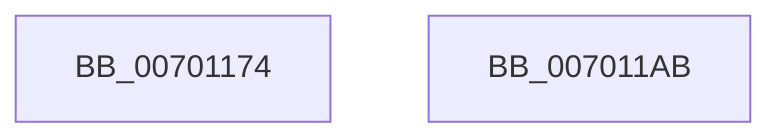

# CmpCheckKcbStackAccess

- RVA: `0x00701174`–`0x007011AC` (길이 `56` bytes)
- VA: `0x0000000140701174`
- 실행 섹션: `PAGE`
- PDB 이름 있음: `예`; PDB Function 태그: `아니요`
- unwind 정보 RVA: `0x0005CAAC`
- 디코드: `17`개 명령, `56/56` bytes 표시
- 미해석 바이트: `0` (있으면 어셈블리에 `.byte`로 보존)

> 이 문서는 커널 이미지의 기계어와 PDB 기호를 분석해 생성했습니다. 4번과 5번은 함수 원형과 자료형을 바이너리 사용 방식에서 추정한 C 해석이며 원본 소스 복구 결과는 아닙니다.

## 1. Dependencies

- 직접 호출 지점: **2**; 고유 호출 대상: **2**
- 직접 호출자로 확인된 함수: **3**
- RIP 상대 이미지 참조: **0**

### Outgoing calls
- `0x00701187` → [CmpGetSecurityCacheEntryForKcbStack](../8C/CmpGetSecurityCacheEntryForKcbStack_function_008C7580.md) (function, `0x008C7580`)
- `0x0070119B` → [CmpCheckKeySecurityDescriptorAccess](../94/CmpCheckKeySecurityDescriptorAccess_function_0094715C.md) (function, `0x0094715C`)

### Direct callers
- [CmRenameKey](../7E/CmRenameKey_function_007E8F48.md) at `0x007E919D`
- [CmpDoAccessCheckOnLayeredSubtree](../94/CmpDoAccessCheckOnLayeredSubtree_function_00945488.md) at `0x00945562`
- [CmpDoAccessCheckOnLayeredSubtree](../94/CmpDoAccessCheckOnLayeredSubtree_function_00945488.md) at `0x00945615`
- [CmpSetKeySecurity](../94/CmpSetKeySecurity_function_0094A124.md) at `0x0094A5F1`

### Static image references
- 디코드된 RIP-relative 메모리 참조가 없습니다.

## 2. Other-region calls and transfers

- 다른 실행 섹션으로 향하는 call: **0**
- 별도 외부 분기/꼬리 이동을 확인하지 못했습니다.

## 3. Assembly (complete function range)

```asm
00701174  48 89 5C 24 08                  mov qword ptr [rsp + 8], rbx
00701179  57                              push rdi
0070117A  48 83 EC 20                     sub rsp, 0x20
0070117E  41 8A F8                        mov dil, r8b
00701181  41 8B D9                        mov ebx, r9d
00701184  45 33 C0                        xor r8d, r8d
00701187  E8 F4 63 1C 00                  call 0x1408c7580
0070118C  44 8A 4C 24 50                  mov r9b, byte ptr [rsp + 0x50]
00701191  44 8B C3                        mov r8d, ebx
00701194  40 8A D7                        mov dl, dil
00701197  48 8D 48 20                     lea rcx, [rax + 0x20]
0070119B  E8 BC 5F 24 00                  call 0x14094715c
007011A0  48 8B 5C 24 30                  mov rbx, qword ptr [rsp + 0x30]
007011A5  48 83 C4 20                     add rsp, 0x20
007011A9  5F                              pop rdi
007011AA  C3                              ret
007011AB  CC                              int3
```

## 4. C-style interpretation (structured pseudocode)

```c
__int64 __fastcall CmpCheckKcbStackAccess(__int64 a1, __int64 a2, int a3, int a4, unsigned __int8 a5)
{
    __int64 result;
    __int64 v_rsp;
    unsigned __int64 v_stack_p8;

    v_stack_p8 = v_rbx;
    v_rsp = (v_rsp) - (32);
    a3 = 0;
    result = CmpGetSecurityCacheEntryForKcbStack(a1, a2, a3, a4);
    result = CmpCheckKeySecurityDescriptorAccess(result + 32, (unsigned __int8)((unsigned __int8)(a3)), (unsigned int)((unsigned int)((unsigned int)(a4))), a5);
    v_rsp = (v_rsp) + (32);
    return result;
}
```

## 5. (Beta) C Style

```c
int64_t CmpCheckKcbStackAccess(int64_t Arg1, int64_t Arg2, int32_t Arg3, int32_t Arg4, uint8_t Arg5)
{
    int64_t result;
    int64_t local_rsp;
    uint64_t v_stack_p8;

    v_stack_p8 = local_rbx;
    local_rsp = (local_rsp) - (32);
    Arg3 = 0;
    result = CmpGetSecurityCacheEntryForKcbStack(Arg1, Arg2, Arg3, Arg4);
    result = CmpCheckKeySecurityDescriptorAccess(result + 32, (uint8_t)((uint8_t)(Arg3)), (uint32_t)((uint32_t)((uint32_t)(Arg4))), Arg5);
    local_rsp = (local_rsp) + (32);
    return result;
}
```

## 6. Execution-region graph

[열기: 2D/3D 그래프와 함수 탐색 컨트롤 패널](../../../control-panel.html?section=page&rva=0x00701174&view=graph)

- 2D 그래프는 위에서 아래로 흐르고, 3D 그래프는 빈 공간을 드래그해 회전합니다. Shift+드래그는 이동, 휠은 확대·축소, 함수 노드 선택은 대상 보고서 이동입니다.

### Static fallback


