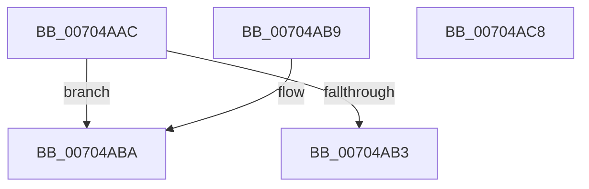

# CmpPerformSiloKeyLockTrackerEnabledCheck

- RVA: `0x00704AAC`–`0x00704AC9` (길이 `29` bytes)
- VA: `0x0000000140704AAC`
- 실행 섹션: `PAGE`
- PDB 이름 있음: `예`; PDB Function 태그: `아니요`
- unwind 정보 RVA: `0x000DB714`
- 디코드: `13`개 명령, `29/29` bytes 표시
- 미해석 바이트: `0` (있으면 어셈블리에 `.byte`로 보존)

> 이 문서는 커널 이미지의 기계어와 PDB 기호를 분석해 생성했습니다. 4번과 5번은 함수 원형과 자료형을 바이너리 사용 방식에서 추정한 C 해석이며 원본 소스 복구 결과는 아닙니다.

## 1. Dependencies

- 직접 호출 지점: **0**; 고유 호출 대상: **0**
- 직접 호출자로 확인된 함수: **2**
- RIP 상대 이미지 참조: **0**

### Outgoing calls
- 직접 디코드된 call 명령이 없습니다.

### Direct callers
- [CmLockKeyForWrite](../9E/CmLockKeyForWrite_function_009E7EE8.md) at `0x009E7F9C`
- [sub_00B3073E](../B3/Unknown_function_00B3073E.md) at `0x00B30769`

### Static image references
- 디코드된 RIP-relative 메모리 참조가 없습니다.

## 2. Other-region calls and transfers

- 다른 실행 섹션으로 향하는 call: **0**
- 별도 외부 분기/꼬리 이동을 확인하지 못했습니다.

## 3. Assembly (complete function range)

```asm
00704AAC  8B 41 08                        mov eax, dword ptr [rcx + 8]
00704AAF  A8 02                           test al, 2
00704AB1  74 07                           je 0x140704aba
00704AB3  B8 89 01 00 C0                  mov eax, 0xc0000189
00704AB8  C3                              ret
00704AB9  CC                              int3
00704ABA  24 01                           and al, 1
00704ABC  F6 D8                           neg al
00704ABE  1B C0                           sbb eax, eax
00704AC0  F7 D0                           not eax
00704AC2  25 BB 00 00 C0                  and eax, 0xc00000bb
00704AC7  C3                              ret
00704AC8  CC                              int3
```

## 4. C-style interpretation (structured pseudocode)

```c
__int64 __fastcall CmpPerformSiloKeyLockTrackerEnabledCheck(__int64 a1)
{
    __int64 result;

    if ((((unsigned __int8)((unsigned int)(*(unsigned int *)(a1 + 8)))) & (2)) == 0) goto loc_00704ABA;
    return (unsigned int)(0xC0000189ULL);
loc_00704ABA:
    result = (unsigned __int8)(((unsigned int)(0xC0000189ULL)) & (1));
    result = (unsigned __int8)(-(result));
    result = (unsigned int)(~(result));
    result = (unsigned int)((result) & (0xC00000BBULL));
    return result;
}
```

## 5. (Beta) C Style

```c
int64_t CmpPerformSiloKeyLockTrackerEnabledCheck(void *Arg1)
{
    uint8_t *arg1 = (uint8_t *)Arg1;

    int64_t result;

    if ((((uint8_t)((uint32_t)(*(uint32_t *)(arg1 + 0x8)))) & (2)) == 0) goto loc_00704ABA;
    return (uint32_t)(0xC0000189ULL);
loc_00704ABA:
    result = (uint8_t)(((uint32_t)(0xC0000189ULL)) & (1));
    result = (uint8_t)(-(result));
    result = (uint32_t)(~(result));
    result = (uint32_t)((result) & (0xC00000BBULL));
    return result;
}
```

### 관측된 메모리 오프셋

구조체 형식이 확인되지 않은 접근은 인자 기준의 오프셋으로만 기록했습니다.

| 기준 인자 | 오프셋 표현 | 폭 (bit) | 접근 |
|---|---:|---:|---|
| `Arg1` | `+ 0x8` | `32` | `R` |

## 6. Execution-region graph

[열기: 2D/3D 그래프와 함수 탐색 컨트롤 패널](../../../control-panel.html?section=page&rva=0x00704AAC&view=graph)

- 2D 그래프는 위에서 아래로 흐르고, 3D 그래프는 빈 공간을 드래그해 회전합니다. Shift+드래그는 이동, 휠은 확대·축소, 함수 노드 선택은 대상 보고서 이동입니다.

### Static fallback


