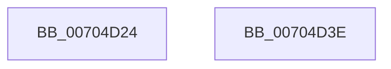

# CmpRegisterTraceLoggingProvider

- RVA: `0x00704D24`–`0x00704D3F` (길이 `27` bytes)
- VA: `0x0000000140704D24`
- 실행 섹션: `PAGE`
- PDB 이름 있음: `예`; PDB Function 태그: `아니요`
- unwind 정보 RVA: `0x0005C788`
- 디코드: `8`개 명령, `27/27` bytes 표시
- 미해석 바이트: `0` (있으면 어셈블리에 `.byte`로 보존)

> 이 문서는 커널 이미지의 기계어와 PDB 기호를 분석해 생성했습니다. 4번과 5번은 함수 원형과 자료형을 바이너리 사용 방식에서 추정한 C 해석이며 원본 소스 복구 결과는 아닙니다.

## 1. Dependencies

- 직접 호출 지점: **1**; 고유 호출 대상: **1**
- 직접 호출자로 확인된 함수: **1**
- RIP 상대 이미지 참조: **1**

### Outgoing calls
- `0x00704D34` → [TlgRegisterAggregateProviderEx](../AD/TlgRegisterAggregateProviderEx_function_00ADBA94.md) (function, `0x00ADBA94`)

### Direct callers
- [CmInitSystem2](../../init/C6/CmInitSystem2_function_00C6FDD8.md) at `0x00C6FDF8`

### Static image references
- `0x00704D2B` → RVA `0x00E09F58` (`.data`; read)

## 2. Other-region calls and transfers

- 다른 실행 섹션으로 향하는 call: **0**
- 별도 외부 분기/꼬리 이동을 확인하지 못했습니다.

## 3. Assembly (complete function range)

```asm
00704D24  48 83 EC 28                     sub rsp, 0x28
00704D28  45 33 C0                        xor r8d, r8d
00704D2B  48 8D 0D 26 52 70 00            lea rcx, [rip + 0x705226]
00704D32  33 D2                           xor edx, edx
00704D34  E8 5B 6D 3D 00                  call 0x140adba94
00704D39  48 83 C4 28                     add rsp, 0x28
00704D3D  C3                              ret
00704D3E  CC                              int3
```

## 4. C-style interpretation (structured pseudocode)

```c
__int64 __fastcall CmpRegisterTraceLoggingProvider(__int64 a1, int a2, int a3)
{
    __int64 result;
    __int64 v_rsp;

    v_rsp = (v_rsp) - (40);
    a3 = 0;
    a2 = 0;
    result = TlgRegisterAggregateProviderEx(v_rip + 7361062, a2, a3, a4);
    v_rsp = (v_rsp) + (40);
    return result;
}
```

## 5. (Beta) C Style

```c
int64_t CmpRegisterTraceLoggingProvider(int64_t Arg1, int32_t Arg2, int32_t Arg3)
{
    int64_t result;
    int64_t local_rsp;

    local_rsp = (local_rsp) - (40);
    Arg3 = 0;
    Arg2 = 0;
    result = TlgRegisterAggregateProviderEx(v_rip + 7361062, Arg2, Arg3, a4);
    local_rsp = (local_rsp) + (40);
    return result;
}
```

## 6. Execution-region graph

[열기: 2D/3D 그래프와 함수 탐색 컨트롤 패널](../../../control-panel.html?section=page&rva=0x00704D24&view=graph)

- 2D 그래프는 위에서 아래로 흐르고, 3D 그래프는 빈 공간을 드래그해 회전합니다. Shift+드래그는 이동, 휠은 확대·축소, 함수 노드 선택은 대상 보고서 이동입니다.

### Static fallback


