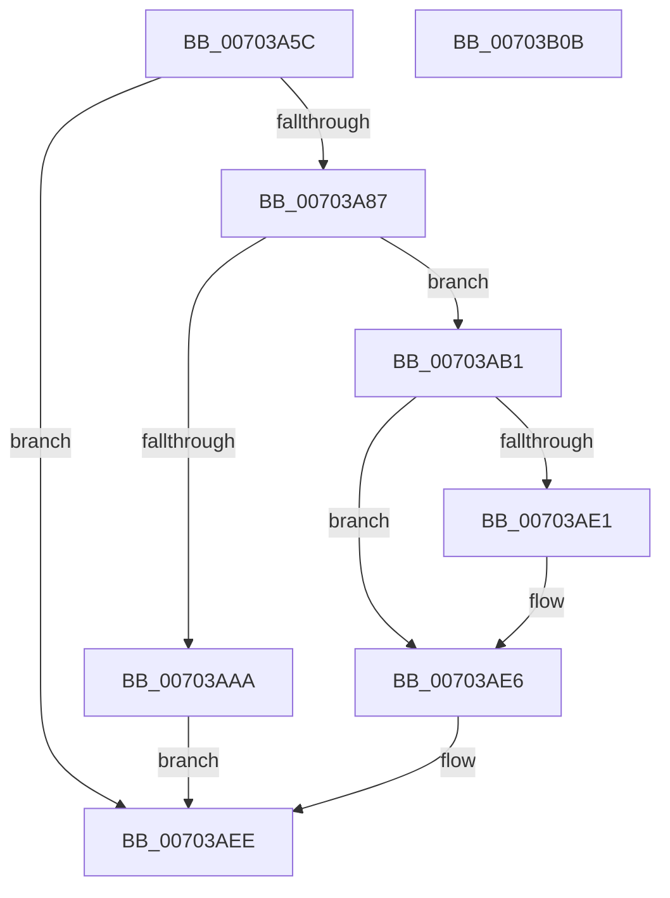

# CmpReserveRollbackPacketSpace

- RVA: `0x00703A5C`–`0x00703B0C` (길이 `176` bytes)
- VA: `0x0000000140703A5C`
- 실행 섹션: `PAGE`
- PDB 이름 있음: `예`; PDB Function 태그: `아니요`
- unwind 정보 RVA: `0x0005E6B4`
- 디코드: `52`개 명령, `176/176` bytes 표시
- 미해석 바이트: `0` (있으면 어셈블리에 `.byte`로 보존)

> 이 문서는 커널 이미지의 기계어와 PDB 기호를 분석해 생성했습니다. 4번과 5번은 함수 원형과 자료형을 바이너리 사용 방식에서 추정한 C 해석이며 원본 소스 복구 결과는 아닙니다.

## 1. Dependencies

- 직접 호출 지점: **4**; 고유 호출 대상: **4**
- 직접 호출자로 확인된 함수: **2**
- RIP 상대 이미지 참조: **0**

### Outgoing calls
- `0x00703A9D` → [CmpAllocatePool](../../text/3C/CmpAllocatePool_function_003CD504.md) (function, `0x003CD504`)
- `0x00703ABF` → [memcpy](../../text/6C/memcpy_function_006C6840.md) (function, `0x006C6840`)
- `0x00703AD3` → [memset](../../text/6C/memset_function_006C6C40.md) (function, `0x006C6C40`)
- `0x00703AE1` → [CmSiFreeMemory](../../text/47/CmSiFreeMemory_function_00475D80.md) (function, `0x00475D80`)

### Direct callers
- [CmpSnapshotTxOwnerArrayToRollbackPacket](../7F/CmpSnapshotTxOwnerArrayToRollbackPacket_function_007F0118.md) at `0x007F0146`
- [CmSnapshotRMTxArray](../9A/CmSnapshotRMTxArray_function_009AEC9C.md) at `0x009AED0A`

### Static image references
- 디코드된 RIP-relative 메모리 참조가 없습니다.

## 2. Other-region calls and transfers

- 다른 실행 섹션으로 향하는 call: **4**
  - `0x00703A9D` → [CmpAllocatePool](../../text/3C/CmpAllocatePool_function_003CD504.md) (`PAGE` → `.text`)
  - `0x00703ABF` → [memcpy](../../text/6C/memcpy_function_006C6840.md) (`PAGE` → `.text`)
  - `0x00703AD3` → [memset](../../text/6C/memset_function_006C6C40.md) (`PAGE` → `.text`)
  - `0x00703AE1` → [CmSiFreeMemory](../../text/47/CmSiFreeMemory_function_00475D80.md) (`PAGE` → `.text`)
- 별도 외부 분기/꼬리 이동을 확인하지 못했습니다.

## 3. Assembly (complete function range)

```asm
00703A5C  48 8B C4                        mov rax, rsp
00703A5F  48 89 58 08                     mov qword ptr [rax + 8], rbx
00703A63  48 89 68 10                     mov qword ptr [rax + 0x10], rbp
00703A67  48 89 70 18                     mov qword ptr [rax + 0x18], rsi
00703A6B  48 89 78 20                     mov qword ptr [rax + 0x20], rdi
00703A6F  41 56                           push r14
00703A71  48 83 EC 20                     sub rsp, 0x20
00703A75  48 8B D9                        mov rbx, rcx
00703A78  8B EA                           mov ebp, edx
00703A7A  8B 09                           mov ecx, dword ptr [rcx]
00703A7C  33 FF                           xor edi, edi
00703A7E  8B 43 04                        mov eax, dword ptr [rbx + 4]
00703A81  2B C1                           sub eax, ecx
00703A83  3B C2                           cmp eax, edx
00703A85  73 67                           jae 0x140703aee
00703A87  44 8D 34 29                     lea r14d, [rcx + rbp]
00703A8B  41 B8 43 4D 34 36               mov r8d, 0x36344d43
00703A91  41 8B D6                        mov edx, r14d
00703A94  B9 00 01 00 00                  mov ecx, 0x100
00703A99  48 C1 E2 03                     shl rdx, 3
00703A9D  E8 62 9A CC FF                  call 0x1403cd504
00703AA2  48 8B F0                        mov rsi, rax
00703AA5  48 85 C0                        test rax, rax
00703AA8  75 07                           jne 0x140703ab1
00703AAA  BF 9A 00 00 C0                  mov edi, 0xc000009a
00703AAF  EB 3D                           jmp 0x140703aee
00703AB1  44 8B 03                        mov r8d, dword ptr [rbx]
00703AB4  48 8B CE                        mov rcx, rsi
00703AB7  48 8B 53 08                     mov rdx, qword ptr [rbx + 8]
00703ABB  49 C1 E0 03                     shl r8, 3
00703ABF  E8 7C 2D FC FF                  call 0x1406c6840
00703AC4  8B 03                           mov eax, dword ptr [rbx]
00703AC6  4C 8B C5                        mov r8, rbp
00703AC9  49 C1 E0 03                     shl r8, 3
00703ACD  33 D2                           xor edx, edx
00703ACF  48 8D 0C C6                     lea rcx, [rsi + rax*8]
00703AD3  E8 68 31 FC FF                  call 0x1406c6c40
00703AD8  48 8B 4B 08                     mov rcx, qword ptr [rbx + 8]
00703ADC  48 85 C9                        test rcx, rcx
00703ADF  74 05                           je 0x140703ae6
00703AE1  E8 9A 22 D7 FF                  call 0x140475d80
00703AE6  48 89 73 08                     mov qword ptr [rbx + 8], rsi
00703AEA  44 89 73 04                     mov dword ptr [rbx + 4], r14d
00703AEE  48 8B 5C 24 30                  mov rbx, qword ptr [rsp + 0x30]
00703AF3  8B C7                           mov eax, edi
00703AF5  48 8B 7C 24 48                  mov rdi, qword ptr [rsp + 0x48]
00703AFA  48 8B 6C 24 38                  mov rbp, qword ptr [rsp + 0x38]
00703AFF  48 8B 74 24 40                  mov rsi, qword ptr [rsp + 0x40]
00703B04  48 83 C4 20                     add rsp, 0x20
00703B08  41 5E                           pop r14
00703B0A  C3                              ret
00703B0B  CC                              int3
```

## 4. C-style interpretation (structured pseudocode)

```c
__int64 __fastcall CmpReserveRollbackPacketSpace(__int64 a1, int a2)
{
    __int64 result;
    __int64 v_rdi;
    __int64 v_rsp;
    unsigned __int64 v_stack_p10;
    unsigned __int64 v_stack_p18;
    unsigned __int64 v_stack_p20;
    unsigned __int64 v_stack_p8;

    *(unsigned __int64 *)(v_rsp + 8) = v_rbx;
    *(unsigned __int64 *)(v_rsp + 16) = v_rbp;
    *(unsigned __int64 *)(v_rsp + 24) = v_rsi;
    *(unsigned __int64 *)(v_rsp + 32) = v_rdi;
    v_rsp = (v_rsp) - (32);
    v_rdi = 0;
    result = (unsigned int)(((unsigned int)(*(unsigned int *)(a1 + 4))) - ((unsigned int)((unsigned int)(*(unsigned int *)(a1)))));
    if (((unsigned int)(result)) >= a2) goto loc_00703AEE;
    a2 = ((unsigned int)((unsigned int)((unsigned int)(*(unsigned int *)(a1)) + (unsigned int)(a2) * 1))) << (3);
    result = CmpAllocatePool(256, a2, (unsigned int)(0x36344D43ULL), a4);
    if (result != 0) goto loc_00703AB1;
    goto loc_00703AEE;
loc_00703AB1:
    a3 = ((unsigned int)(*(unsigned int *)(a1))) << (3);
    result = memcpy(result, *(unsigned __int64 *)(a1 + 8), a3, a4);
    a3 = ((unsigned int)(a2)) << (3);
    a2 = 0;
    result = memset(result + (unsigned int)(*(unsigned int *)(a1)) * 8, a2, a3, a4);
    if (*(unsigned __int64 *)(a1 + 8) != 0) {
        result = CmSiFreeMemory(*(unsigned __int64 *)(a1 + 8), a2, a3, a4);
    }
    *(unsigned __int64 *)(a1 + 8) = result;
    *(unsigned int *)(a1 + 4) = (unsigned int)((unsigned int)(*(unsigned int *)(a1)) + (unsigned int)(a2) * 1);
loc_00703AEE:
    v_rsp = (v_rsp) + (32);
    return (unsigned int)((unsigned int)((unsigned int)(0xC000009AULL)));
}
```

## 5. (Beta) C Style

```c
int64_t CmpReserveRollbackPacketSpace(void *Arg1, int32_t Arg2)
{
    uint8_t *arg1 = (uint8_t *)Arg1;

    int64_t result;
    int64_t local_rdi;
    int64_t local_rsp;
    uint64_t v_stack_p10;
    uint64_t v_stack_p18;
    uint64_t v_stack_p20;
    uint64_t v_stack_p8;

    *(uint64_t *)(local_rsp + 0x8) = local_rbx;
    *(uint64_t *)(local_rsp + 0x10) = local_rbp;
    *(uint64_t *)(local_rsp + 0x18) = local_rsi;
    *(uint64_t *)(local_rsp + 0x20) = local_rdi;
    local_rsp = (local_rsp) - (32);
    local_rdi = 0;
    result = (uint32_t)(((uint32_t)(*(uint32_t *)(arg1 + 0x4))) - ((uint32_t)((uint32_t)(*(uint32_t *)(arg1)))));
    if (((uint32_t)(result)) >= Arg2) goto loc_00703AEE;
    Arg2 = ((uint32_t)((uint32_t)((uint32_t)(*(uint32_t *)(arg1)) + (uint32_t)(Arg2) * 1))) << (3);
    result = CmpAllocatePool(256, Arg2, (uint32_t)(0x36344D43ULL), a4);
    if (result != 0) goto loc_00703AB1;
    goto loc_00703AEE;
loc_00703AB1:
    a3 = ((uint32_t)(*(uint32_t *)(arg1))) << (3);
    result = memcpy(result, *(uint64_t *)(arg1 + 0x8), a3, a4);
    a3 = ((uint32_t)(Arg2)) << (3);
    Arg2 = 0;
    result = memset(result + (uint32_t)(*(uint32_t *)(arg1)) * 8, Arg2, a3, a4);
    if (*(uint64_t *)(arg1 + 0x8) != 0) {
        result = CmSiFreeMemory(*(uint64_t *)(arg1 + 0x8), Arg2, a3, a4);
    }
    *(uint64_t *)(arg1 + 0x8) = result;
    *(uint32_t *)(arg1 + 0x4) = (uint32_t)((uint32_t)(*(uint32_t *)(arg1)) + (uint32_t)(Arg2) * 1);
loc_00703AEE:
    local_rsp = (local_rsp) + (32);
    return (uint32_t)((uint32_t)((uint32_t)(0xC000009AULL)));
}
```

### 관측된 메모리 오프셋

구조체 형식이 확인되지 않은 접근은 인자 기준의 오프셋으로만 기록했습니다.

| 기준 인자 | 오프셋 표현 | 폭 (bit) | 접근 |
|---|---:|---:|---|
| `Arg1` | `+ 0x0` | `32` | `R` |
| `Arg1` | `+ 0x4` | `32` | `R` |
| `Arg1` | `+ 0x4` | `32` | `W` |
| `Arg1` | `+ 0x8` | `64` | `R` |
| `Arg1` | `+ 0x8` | `64` | `W` |

## 6. Execution-region graph

[열기: 2D/3D 그래프와 함수 탐색 컨트롤 패널](../../../control-panel.html?section=page&rva=0x00703A5C&view=graph)

- 2D 그래프는 위에서 아래로 흐르고, 3D 그래프는 빈 공간을 드래그해 회전합니다. Shift+드래그는 이동, 휠은 확대·축소, 함수 노드 선택은 대상 보고서 이동입니다.

### Static fallback


