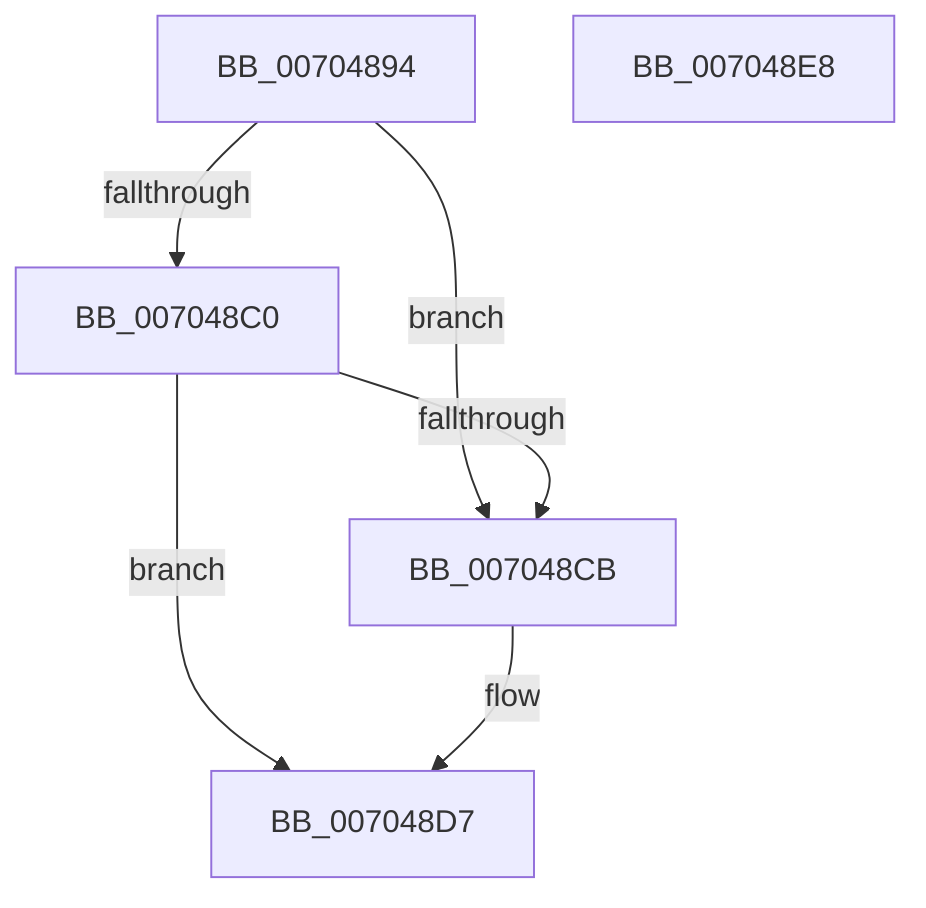

# CmpUnLockFreezeQueue

- RVA: `0x00704894`–`0x007048E9` (길이 `85` bytes)
- VA: `0x0000000140704894`
- 실행 섹션: `PAGE`
- PDB 이름 있음: `예`; PDB Function 태그: `아니요`
- unwind 정보 RVA: `0x0005C788`
- 디코드: `20`개 명령, `85/85` bytes 표시
- 미해석 바이트: `0` (있으면 어셈블리에 `.byte`로 보존)

> 이 문서는 커널 이미지의 기계어와 PDB 기호를 분석해 생성했습니다. 4번과 5번은 함수 원형과 자료형을 바이너리 사용 방식에서 추정한 C 해석이며 원본 소스 복구 결과는 아닙니다.

## 1. Dependencies

- 직접 호출 지점: **2**; 고유 호출 대상: **2**
- 직접 호출자로 확인된 함수: **2**
- RIP 상대 이미지 참조: **1**

### Outgoing calls
- `0x007048D2` → [ExfReleasePushLock](../../text/26/ExfReleasePushLock_function_002638D0.md) (function, `0x002638D0`)
- `0x007048DE` → [KeAbPostRelease](../../text/2E/KeAbPostRelease_function_002E1600.md) (function, `0x002E1600`)

### Direct callers
- [CmThawRegistry](../7E/CmThawRegistry_function_007E8510.md) at `0x007E8621`
- [CmpLockRegistryFreezeAware](../9B/CmpLockRegistryFreezeAware_function_009B4AE4.md) at `0x009B4B82`

### Static image references
- `0x00704898` → RVA `0x00EF71C0` (`.data`; read)

## 2. Other-region calls and transfers

- 다른 실행 섹션으로 향하는 call: **2**
  - `0x007048D2` → [ExfReleasePushLock](../../text/26/ExfReleasePushLock_function_002638D0.md) (`PAGE` → `.text`)
  - `0x007048DE` → [KeAbPostRelease](../../text/2E/KeAbPostRelease_function_002E1600.md) (`PAGE` → `.text`)
- 별도 외부 분기/꼬리 이동을 확인하지 못했습니다.

## 3. Assembly (complete function range)

```asm
00704894  48 83 EC 28                     sub rsp, 0x28
00704898  0F 0D 0D 21 29 7F 00            prefetchw byte ptr [rip + 0x7f2921]
0070489F  48 8B 05 1A 29 7F 00            mov rax, qword ptr [rip + 0x7f291a]
007048A6  45 33 C0                        xor r8d, r8d
007048A9  48 8B C8                        mov rcx, rax
007048AC  48 83 E1 F0                     and rcx, 0xfffffffffffffff0
007048B0  48 83 F9 10                     cmp rcx, 0x10
007048B4  48 8D 50 F0                     lea rdx, [rax - 0x10]
007048B8  49 0F 46 D0                     cmovbe rdx, r8
007048BC  A8 02                           test al, 2
007048BE  75 0B                           jne 0x1407048cb
007048C0  F0 48 0F B1 15 F7 28 7F 00      lock cmpxchg qword ptr [rip + 0x7f28f7], rdx
007048C9  74 0C                           je 0x1407048d7
007048CB  48 8D 0D EE 28 7F 00            lea rcx, [rip + 0x7f28ee]
007048D2  E8 F9 EF B5 FF                  call 0x1402638d0
007048D7  48 8D 0D E2 28 7F 00            lea rcx, [rip + 0x7f28e2]
007048DE  E8 1D CD BD FF                  call 0x1402e1600
007048E3  48 83 C4 28                     add rsp, 0x28
007048E7  C3                              ret
007048E8  CC                              int3
```

## 4. C-style interpretation (structured pseudocode)

```c
__int64 __fastcall CmpUnLockFreezeQueue(__int64 a1, __int64 a2, int a3)
{
    __int64 result;
    __int64 v_rsp;

    v_rsp = (v_rsp) - (40);
    a3 = 0;
    a1 = (*(unsigned __int64 *)(v_rip + 8333594)) & (-16);
    a2 = *(unsigned __int64 *)(v_rip + 8333594) - 16;
    if (a1 <= 16) { a2 = 0; }
    if ((((unsigned __int8)(*(unsigned __int64 *)(v_rip + 8333594))) & (2)) != 0) goto loc_007048CB;
    result = *(unsigned __int64 *)(v_rip + 8333594);
    if ((((unsigned __int8)(*(unsigned __int64 *)(v_rip + 8333594))) & (2)) != 0) {
        a1 = v_rip + 8333550;
        result = ExfReleasePushLock(a1, a2, a3, a4);
    }
    result = KeAbPostRelease(v_rip + 8333538, a2, a3, a4);
    v_rsp = (v_rsp) + (40);
    return result;
}
```

## 5. (Beta) C Style

```c
int64_t CmpUnLockFreezeQueue(int64_t Arg1, int64_t Arg2, int32_t Arg3)
{
    int64_t result;
    int64_t local_rsp;

    local_rsp = (local_rsp) - (40);
    Arg3 = 0;
    Arg1 = (*(uint64_t *)(v_rip + 0x7F291A)) & (-16);
    Arg2 = *(uint64_t *)(v_rip + 0x7F291A) - 16;
    if (Arg1 <= 16) { Arg2 = 0; }
    if ((((uint8_t)(*(uint64_t *)(v_rip + 0x7F291A))) & (2)) != 0) goto loc_007048CB;
    result = *(uint64_t *)(v_rip + 0x7F291A);
    if ((((uint8_t)(*(uint64_t *)(v_rip + 0x7F291A))) & (2)) != 0) {
        Arg1 = v_rip + 8333550;
        result = ExfReleasePushLock(Arg1, Arg2, Arg3, a4);
    }
    result = KeAbPostRelease(v_rip + 8333538, Arg2, Arg3, a4);
    local_rsp = (local_rsp) + (40);
    return result;
}
```

## 6. Execution-region graph

[열기: 2D/3D 그래프와 함수 탐색 컨트롤 패널](../../../control-panel.html?section=page&rva=0x00704894&view=graph)

- 2D 그래프는 위에서 아래로 흐르고, 3D 그래프는 빈 공간을 드래그해 회전합니다. Shift+드래그는 이동, 휠은 확대·축소, 함수 노드 선택은 대상 보고서 이동입니다.

### Static fallback


