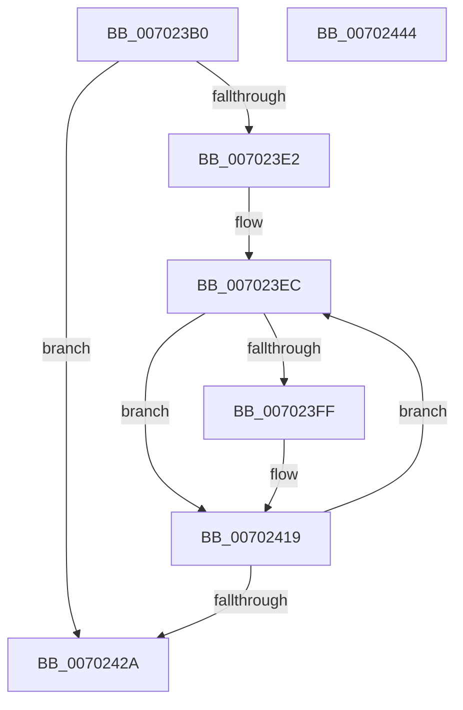

# CmpVolumeManagerCreateContextsForWellKnownVolumes

- RVA: `0x007023B0`–`0x00702445` (길이 `149` bytes)
- VA: `0x00000001407023B0`
- 실행 섹션: `PAGE`
- PDB 이름 있음: `예`; PDB Function 태그: `아니요`
- unwind 정보 RVA: `0x000718AC`
- 디코드: `42`개 명령, `149/149` bytes 표시
- 미해석 바이트: `0` (있으면 어셈블리에 `.byte`로 보존)

> 이 문서는 커널 이미지의 기계어와 PDB 기호를 분석해 생성했습니다. 4번과 5번은 함수 원형과 자료형을 바이너리 사용 방식에서 추정한 C 해석이며 원본 소스 복구 결과는 아닙니다.

## 1. Dependencies

- 직접 호출 지점: **5**; 고유 호출 대상: **5**
- 직접 호출자로 확인된 함수: **1**
- RIP 상대 이미지 참조: **1**

### Outgoing calls
- `0x007023D2` → [CmpInitializeThreadInfo](../../text/3F/CmpInitializeThreadInfo_function_003FBE70.md) (function, `0x003FBE70`)
- `0x007023F6` → [CmpVolumeManagerGetContextForFilePath](../7E/CmpVolumeManagerGetContextForFilePath_function_007E8A6C.md) (function, `0x007E8A6C`)
- `0x00702402` → [CmpVolumeContextLockExclusive](../7E/CmpVolumeContextLockExclusive_function_007E878C.md) (function, `0x007E878C`)
- `0x00702414` → [CmpVolumeContextUnlockExclusive](../7E/CmpVolumeContextUnlockExclusive_function_007E8A34.md) (function, `0x007E8A34`)
- `0x0070242F` → [CmCleanupThreadInfo](../../text/41/CmCleanupThreadInfo_function_0041FD50.md) (function, `0x0041FD50`)

### Direct callers
- [CmInitSystem2](../../init/C6/CmInitSystem2_function_00C6FDD8.md) at `0x00C6FE3C`

### Static image references
- `0x007023D9` → RVA `0x00FD8678` (`PAGEDATA`; read)

## 2. Other-region calls and transfers

- 다른 실행 섹션으로 향하는 call: **2**
  - `0x007023D2` → [CmpInitializeThreadInfo](../../text/3F/CmpInitializeThreadInfo_function_003FBE70.md) (`PAGE` → `.text`)
  - `0x0070242F` → [CmCleanupThreadInfo](../../text/41/CmCleanupThreadInfo_function_0041FD50.md) (`PAGE` → `.text`)
- 별도 외부 분기/꼬리 이동을 확인하지 못했습니다.

## 3. Assembly (complete function range)

```asm
007023B0  4C 8B DC                        mov r11, rsp
007023B3  49 89 5B 08                     mov qword ptr [r11 + 8], rbx
007023B7  49 89 73 10                     mov qword ptr [r11 + 0x10], rsi
007023BB  57                              push rdi
007023BC  48 83 EC 40                     sub rsp, 0x40
007023C0  0F 57 C0                        xorps xmm0, xmm0
007023C3  49 8D 4B D8                     lea rcx, [r11 - 0x28]
007023C7  33 C0                           xor eax, eax
007023C9  0F 11 44 24 20                  movups xmmword ptr [rsp + 0x20], xmm0
007023CE  49 89 43 E8                     mov qword ptr [r11 - 0x18], rax
007023D2  E8 99 9A CF FF                  call 0x1403fbe70
007023D7  33 DB                           xor ebx, ebx
007023D9  48 39 1D 98 62 8D 00            cmp qword ptr [rip + 0x8d6298], rbx
007023E0  74 48                           je 0x14070242a
007023E2  48 8D 35 8F 62 8D 00            lea rsi, [rip + 0x8d628f]
007023E9  48 8B C6                        mov rax, rsi
007023EC  48 8B 10                        mov rdx, qword ptr [rax]
007023EF  48 8D 78 08                     lea rdi, [rax + 8]
007023F3  4C 8B CF                        mov r9, rdi
007023F6  E8 71 66 0E 00                  call 0x1407e8a6c
007023FB  85 C0                           test eax, eax
007023FD  78 1A                           js 0x140702419
007023FF  48 8B 0F                        mov rcx, qword ptr [rdi]
00702402  E8 85 63 0E 00                  call 0x1407e878c
00702407  48 8B 07                        mov rax, qword ptr [rdi]
0070240A  C7 40 40 02 00 00 00            mov dword ptr [rax + 0x40], 2
00702411  48 8B 0F                        mov rcx, qword ptr [rdi]
00702414  E8 1B 66 0E 00                  call 0x1407e8a34
00702419  FF C3                           inc ebx
0070241B  8B C3                           mov eax, ebx
0070241D  48 C1 E0 04                     shl rax, 4
00702421  48 03 C6                        add rax, rsi
00702424  48 83 38 00                     cmp qword ptr [rax], 0
00702428  75 C2                           jne 0x1407023ec
0070242A  48 8D 4C 24 20                  lea rcx, [rsp + 0x20]
0070242F  E8 1C D9 D1 FF                  call 0x14041fd50
00702434  48 8B 5C 24 50                  mov rbx, qword ptr [rsp + 0x50]
00702439  48 8B 74 24 58                  mov rsi, qword ptr [rsp + 0x58]
0070243E  48 83 C4 40                     add rsp, 0x40
00702442  5F                              pop rdi
00702443  C3                              ret
00702444  CC                              int3
```

## 4. C-style interpretation (structured pseudocode)

```c
__int64 __fastcall CmpVolumeManagerCreateContextsForWellKnownVolumes(void)
{
    __int64 result;
    __int64 v_rbx;
    __int64 v_rsp;
    unsigned __int64 v_stack_m28;
    unsigned __int64 v_stack_p10;
    unsigned __int64 v_stack_p8;

    *(unsigned __int64 *)(v_rsp + 8) = v_rbx;
    *(unsigned __int64 *)(v_rsp + 16) = v_rsi;
    v_rsp = (v_rsp) - (64);
    result = 0;
    v_stack_m28 = v_xmm0;
    *(unsigned __int64 *)(v_rsp - 24) = 0;
    result = CmpInitializeThreadInfo(v_rsp - 40, a2, a3, a4);
    v_rbx = 0;
    if ((*(unsigned __int64 *)(v_rip + 9265816)) == 0) goto loc_0070242A;
loc_007023EC:
    result = CmpVolumeManagerGetContextForFilePath(v_rsp - 40, *(unsigned __int64 *)(v_rip + 9265807), a3, v_rip + 9265807 + 8);
    if (!(sign_flag)) {
        a1 = *(unsigned __int64 *)(v_rip + 9265807 + 8);
        result = CmpVolumeContextLockExclusive(a1, *(unsigned __int64 *)(v_rip + 9265807), a3, v_rip + 9265807 + 8);
        result = *(unsigned __int64 *)(v_rip + 9265807 + 8);
        *(unsigned int *)(result + 64) = 2;
        a1 = *(unsigned __int64 *)(v_rip + 9265807 + 8);
        result = CmpVolumeContextUnlockExclusive(a1, *(unsigned __int64 *)(v_rip + 9265807), a3, v_rip + 9265807 + 8);
    }
    v_rbx = (unsigned int)((v_rbx) + 1);
    result = ((unsigned int)((unsigned int)(v_rbx))) << (4);
    result = (result) + (v_rip + 9265807);
    if ((*(unsigned __int64 *)(result)) != 0) goto loc_007023EC;
loc_0070242A:
    result = CmCleanupThreadInfo(v_stack_m28, *(unsigned __int64 *)(v_rip + 9265807), a3, v_rip + 9265807 + 8);
    v_rsp = (v_rsp) + (64);
    return result;
}
```

## 5. (Beta) C Style

```c
void CmpVolumeManagerCreateContextsForWellKnownVolumes(void)
{
    int64_t result;
    int64_t local_rbx;
    int64_t local_rsp;
    uint64_t v_stack_m28;
    uint64_t v_stack_p10;
    uint64_t v_stack_p8;

    *(uint64_t *)(local_rsp + 0x8) = local_rbx;
    *(uint64_t *)(local_rsp + 0x10) = local_rsi;
    local_rsp = (local_rsp) - (64);
    result = 0;
    v_stack_m28 = v_xmm0;
    *(uint64_t *)(local_rsp - 0x18) = 0;
    result = CmpInitializeThreadInfo(local_rsp - 40, a2, a3, a4);
    local_rbx = 0;
    if ((*(uint64_t *)(v_rip + 0x8D6298)) == 0) goto loc_0070242A;
loc_007023EC:
    result = CmpVolumeManagerGetContextForFilePath(local_rsp - 40, *(uint64_t *)(v_rip + 0x8D628F), a3, v_rip + 9265807 + 8);
    if (!(sign_flag)) {
        a1 = *(uint64_t *)(v_rip + 0x8D628F + 0x8);
        result = CmpVolumeContextLockExclusive(a1, *(uint64_t *)(v_rip + 0x8D628F), a3, v_rip + 9265807 + 8);
        result = *(uint64_t *)(v_rip + 0x8D628F + 0x8);
        *(uint32_t *)(result + 0x40) = 2;
        a1 = *(uint64_t *)(v_rip + 0x8D628F + 0x8);
        result = CmpVolumeContextUnlockExclusive(a1, *(uint64_t *)(v_rip + 0x8D628F), a3, v_rip + 9265807 + 8);
    }
    local_rbx = (uint32_t)((local_rbx) + 1);
    result = ((uint32_t)((uint32_t)(local_rbx))) << (4);
    result = (result) + (v_rip + 9265807);
    if ((*(uint64_t *)(result)) != 0) goto loc_007023EC;
loc_0070242A:
    result = CmCleanupThreadInfo(v_stack_m28, *(uint64_t *)(v_rip + 0x8D628F), a3, v_rip + 9265807 + 8);
    local_rsp = (local_rsp) + (64);
    return result;
}
```

## 6. Execution-region graph

[열기: 2D/3D 그래프와 함수 탐색 컨트롤 패널](../../../control-panel.html?section=page&rva=0x007023B0&view=graph)

- 2D 그래프는 위에서 아래로 흐르고, 3D 그래프는 빈 공간을 드래그해 회전합니다. Shift+드래그는 이동, 휠은 확대·축소, 함수 노드 선택은 대상 보고서 이동입니다.

### Static fallback


