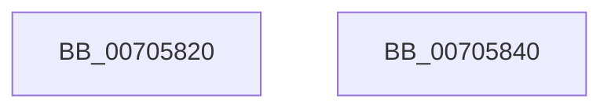

# CmpWorkItemRundown

- RVA: `0x00705820`–`0x00705841` (길이 `33` bytes)
- VA: `0x0000000140705820`
- 실행 섹션: `PAGE`
- PDB 이름 있음: `예`; PDB Function 태그: `아니요`
- unwind 정보 RVA: `0x0005CF00`
- 디코드: `11`개 명령, `33/33` bytes 표시
- 미해석 바이트: `0` (있으면 어셈블리에 `.byte`로 보존)

> 이 문서는 커널 이미지의 기계어와 PDB 기호를 분석해 생성했습니다. 4번과 5번은 함수 원형과 자료형을 바이너리 사용 방식에서 추정한 C 해석이며 원본 소스 복구 결과는 아닙니다.

## 1. Dependencies

- 직접 호출 지점: **1**; 고유 호출 대상: **1**
- 직접 호출자로 확인된 함수: **3**
- RIP 상대 이미지 참조: **0**

### Outgoing calls
- `0x0070582D` → [ExWaitForRundownProtectionRelease](../../text/2A/ExWaitForRundownProtectionRelease_function_002A4CB0.md) (function, `0x002A4CB0`)

### Direct callers
- [CmUnregisterMachineHiveLoadedNotification](../7E/CmUnregisterMachineHiveLoadedNotification_function_007E1CE0.md) at `0x007E1DC3`
- [CmFcManagerUnregisterFeatureConfigurationChangeNotification](../7F/CmFcManagerUnregisterFeatureConfigurationChangeNotification_function_007F49CC.md) at `0x007F4A72`
- [CmFcManagerUnregisterFeatureUsageProvider](../7F/CmFcManagerUnregisterFeatureUsageProvider_function_007F4ABC.md) at `0x007F4CCE`

### Static image references
- 디코드된 RIP-relative 메모리 참조가 없습니다.

## 2. Other-region calls and transfers

- 다른 실행 섹션으로 향하는 call: **1**
  - `0x0070582D` → [ExWaitForRundownProtectionRelease](../../text/2A/ExWaitForRundownProtectionRelease_function_002A4CB0.md) (`PAGE` → `.text`)
- 별도 외부 분기/꼬리 이동을 확인하지 못했습니다.

## 3. Assembly (complete function range)

```asm
00705820  40 53                           push rbx
00705822  48 83 EC 20                     sub rsp, 0x20
00705826  48 8D 59 20                     lea rbx, [rcx + 0x20]
0070582A  48 8B CB                        mov rcx, rbx
0070582D  E8 7E F4 B9 FF                  call 0x1402a4cb0
00705832  B8 01 00 00 00                  mov eax, 1
00705837  48 87 03                        xchg qword ptr [rbx], rax
0070583A  48 83 C4 20                     add rsp, 0x20
0070583E  5B                              pop rbx
0070583F  C3                              ret
00705840  CC                              int3
```

## 4. C-style interpretation (structured pseudocode)

```c
__int64 __fastcall CmpWorkItemRundown(__int64 a1)
{
    __int64 result;
    __int64 v_rsp;

    v_rsp = (v_rsp) - (32);
    result = ExWaitForRundownProtectionRelease(a1 + 32, a2, a3, a4);
    v_rsp = (v_rsp) + (32);
    return 1;
}
```

## 5. (Beta) C Style

```c
int64_t CmpWorkItemRundown(void *Arg1)
{
    uint8_t *arg1 = (uint8_t *)Arg1;

    int64_t result;
    int64_t local_rsp;

    local_rsp = (local_rsp) - (32);
    result = ExWaitForRundownProtectionRelease(Arg1 + 32, a2, a3, a4);
    local_rsp = (local_rsp) + (32);
    return 1;
}
```

### 관측된 메모리 오프셋

구조체 형식이 확인되지 않은 접근은 인자 기준의 오프셋으로만 기록했습니다.

| 기준 인자 | 오프셋 표현 | 폭 (bit) | 접근 |
|---|---:|---:|---|
| `Arg1` | `+ 0x0` | `64` | `R/W` |
| `Arg1` | `+ 0x20` | `64` | `R` |

## 6. Execution-region graph

[열기: 2D/3D 그래프와 함수 탐색 컨트롤 패널](../../../control-panel.html?section=page&rva=0x00705820&view=graph)

- 2D 그래프는 위에서 아래로 흐르고, 3D 그래프는 빈 공간을 드래그해 회전합니다. Shift+드래그는 이동, 휠은 확대·축소, 함수 노드 선택은 대상 보고서 이동입니다.

### Static fallback


